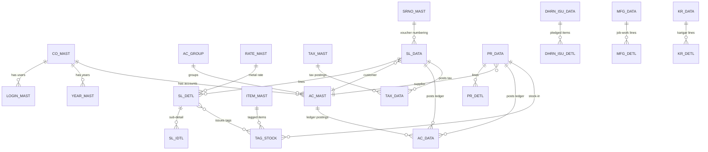

# Core ERD — DataCareNext data model

Derived from `data-model.json` (Task 3). 162 tables cataloged (100 DDL + 62 code-recovered),
4666 columns. Every transactional table is partitioned by the composite key
**(CO_CODE, LC_CODE, CO_YEAR, CO_BOOK, VCH_NO, SR_NO)**; masters by **(CO_CODE, ...)**.
In the web DB these become `tenant_id` (outermost) + the original composite key (preserved).

## Resolved core tables (web-build ready)
- **Ledger:** `AC_DATA` (CO_CODE,LC_CODE,CO_YEAR,CO_BOOK,VCH_TYPE,VCH_NO,VCH_DATE,LEDR_KEY,AC_CODE,LD_CODE,CR_AMT,DR_AMT,FINE_WT,FINE_RATE,SIGN,...), `AC_MAST`, `AC_GROUP`.
- **Sales:** `SL_DATA` (header: NET_AMT,DISC_AMT,TAX_AMT,ROF_AMT,TOT_AMT,CASH/CARD/CHQ_AMT,...), `SL_DETL`, `SL_IDTL`.
- **Purchase:** `PR_DATA`, `PR_DETL`, `PR_IDTL`.
- **Stock:** `TAG_STOCK` (DDL), masters `ITEM_MAST`, `RATE_MAST` (DDL).
- **Tax/auth/numbering:** `TAX_MAST`/`TAX_DATA`, `LOGIN_MAST` (note: `LOGIN_PWD` plaintext → Argon2 on migrate), `SRNO_MAST`.

## Unresolved (7) — recover via optional Docker mssql authoritative pass (non-blocking)
`AREA_MAST, IMAGE_DATA, LBR_ISU_IDTL, LOAN_ISU_DATA, LOAN_REC_DATA, OP_DETL, TAG_MAST`
— populated via `INSERT…SELECT` / read-mostly, so no column-list `INSERT` in code.
Docker is available (v29.4.0); a follow-up can restore `database/backups/NextMain.BAK` etc. and
dump `INFORMATION_SCHEMA.COLUMNS` to confirm these + authoritative types for code-recovered tables.

## Type-confidence note
Code-recovered columns get types via a global column→type map learned from the 100 DDL tables
(`source: "code+inferred-type"`); columns with no DDL precedent are `"unknown"`. The denormalized
schema reuses column names consistently, so inference confidence is high. Confirm via the Docker
pass before finalizing the Prisma `NUMERIC` precision map in Task 7.
