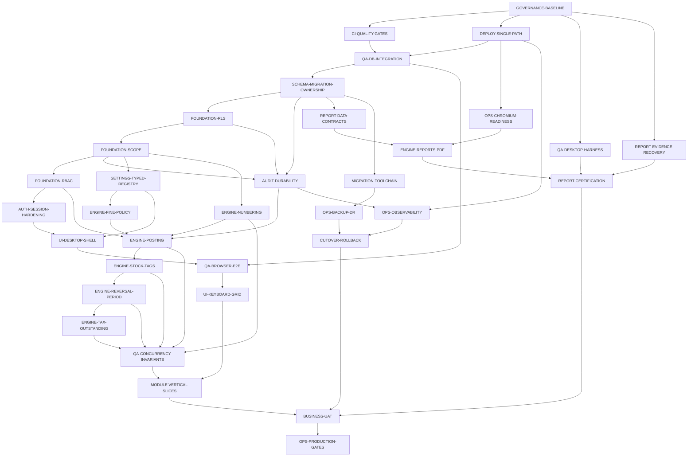

# DataCareNext Exact-Replica Production Delivery Plan

**Baseline:** 2026-07-26  
**Machine roadmap:** `project-memory/parity/PRODUCTION-WORK-PACKAGES.json`  
**Parity source of truth:** `project-memory/parity/DESKTOP-WEB-PARITY-MATRIX.json`  
**Current release decision:** **synthetic-data demonstration only; no real-business pilot or migration.**

## 1. Result first

The shortest safe route to production is not “finish more screens.” It is:

1. make CI, the deployment stack, a disposable migrated/RLS database, and desktop comparison harness reproducible;
2. make schema, tenant/company/location/year/book scope, per-form API rights, sessions and audit fail closed;
3. repair numbering, workflow-specific fine, balanced posting, loose/tagged stock, server-derived reversal, lock date, tax and outstanding as shared engines;
4. run real PostgreSQL isolation/failure/concurrency tests against those engines;
5. complete each desktop module as a vertical UI/API/data/report slice and compare it with the desktop;
6. replace generic/default/fake report behavior with report-specific contracts and certify all print output;
7. certify devices, external providers, migration, observability, restore, security, performance, cutover and business UAT.

The current 87 pages, 252 API routes, 168 Prisma models, 240 default workspace assertions and 5 additional PostgreSQL-backed HTTP assertions are useful engineering breadth, but the authoritative parity count is **0 desktop-compared units and 0 production-certified units**. The plan therefore advances matrix gates, not route or LOC percentages.

## 2. Non-negotiable constraints

- Reproduce desktop outcomes—UI composition, focus/keys, calculations, writes, reversals, reports, devices and integrations. Technology may change; business behavior may not change without an explicit product decision.
- Server context is authoritative for tenant, company, location, year, book, user rights, numbering, stock/tag state and reversal. Request bodies are never authoritative for those facts.
- Missing source evidence is a blocker, not permission to invent behavior.
- No critical invariant can be averaged away by completing low-risk pages.
- A generic master/report renderer is scaffolding until its specific desktop contract passes.
- New dependencies must use exact pinned versions and pass security/license review.
- No production/customer mutation is used for development or parity tests.
- No unsynchronized dual-write between desktop and web: exactly one system of record exists for each bounded company/location/book during any pilot.

## 3. Dependency graph and critical path



The bold critical spine is: executable CI/database → owned schema/RLS → authoritative scope/RBAC → numbering/fine/posting → stock/reversal/tax → concurrency proof → module G5 comparisons → migration/restore/cutover/UAT → G6. Report recovery, desktop harness, renderer, observability and migration tooling start in parallel because they are long-lead gates.

## 4. Waves

| Wave | Purpose | Primary packages | Exit condition |
|---|---|---|---|
| W0 | Reproducible evidence and execution | `GOVERNANCE-BASELINE`, `CI-QUALITY-GATES`, `DEPLOY-SINGLE-PATH`, `QA-DB-INTEGRATION`, `QA-DESKTOP-HARNESS`, `REPORT-EVIDENCE-RECOVERY` | One source of truth; real disposable DB and comparison path exist; CI gates are real |
| W1 | Data/security boundary | `SCHEMA-MIGRATION-OWNERSHIP`, `FOUNDATION-RLS`, `FOUNDATION-SCOPE`, `FOUNDATION-RBAC`, `AUTH-SESSION-HARDENING`, `AUDIT-DURABILITY`, `SETTINGS-TYPED-REGISTRY` | Requests cannot cross tenant/business scope or bypass form rights; schema/audit/policies deploy normally |
| W2 | Shared transaction integrity | `ENGINE-NUMBERING`, `ENGINE-FINE-POLICY`, `ENGINE-POSTING`, `ENGINE-STOCK-TAGS`, `ENGINE-REVERSAL-PERIOD`, `ENGINE-TAX-OUTSTANDING`, `QA-CONCURRENCY-INVARIANTS`, shell/browser/keyboard foundations | C1–C5 and H1/H2/H3 are closed with real-DB evidence; core invariants are G4 |
| W3 | Module vertical slices | All masters, finance, sales, purchase, inventory, manufacturing, Dhiran, membership, bullion/tour/VP, utilities/support and uncovered forms | Every contracted form has approved G2; completed modules reach G5 |
| W4 | Reports/print | `REPORT-DATA-CONTRACTS`, `OPS-CHROMIUM-READINESS`, `ENGINE-REPORTS-PDF`, `REPORT-CERTIFICATION` | Required reports have exact data/page/visual evidence; no fake/default dataset path |
| W5 | Devices/providers | `DEVICE-BRIDGE`, `INTEGRATION-CERTIFICATION` | Certified shop hardware and e-invoice/messaging/rate behavior including failure/retry |
| W6 | Migration and production | `MIGRATION-TOOLCHAIN`, observability, backup/DR, security, performance, cutover, UAT, final gate | All contracted units G5; all critical invariants G5; G6 evidence current and independently approved |

No calendar estimate is defensible without team capacity, customer-data availability, hardware/provider scope and business decisions. The JSON roadmap uses relative XS/S/M/L/XL size so scheduling can be generated once those inputs exist.

## 5. First work sequence: data and security before feature breadth

### 5.1 Establish a testable production substrate

**Packages:** `GOVERNANCE-BASELINE` → `CI-QUALITY-GATES` + `DEPLOY-SINGLE-PATH` → `QA-DB-INTEGRATION`.

Deliver first:

- fix the 704-file formatting gate and configure lint to execute real tasks;
- replace existing open dependency ranges with reviewed exact versions and block new unpinned ranges;
- retain one authoritative container/deployment path and quarantine the stale Redis/port-3000/`/ready` stack;
- add `/ready` that checks database access, the non-superuser/RLS role, required policies and—when PDF is mandatory—the renderer;
- launch an isolated PostgreSQL database in CI, apply all migrations, roles and RLS, seed at least two tenants, two companies, two locations, two years and two books;
- run tests through the same application role and transaction path used in production;
- retain uncached test and generated-matrix artifacts.

**Gate:** no business-engine change can be certified without this harness. Manual `.live.mjs` scripts remain diagnostic until promoted into normal isolated CI.

### 5.2 Own schema, RLS and audit in migrations

**Packages:** `SCHEMA-MIGRATION-OWNERSHIP` → `FOUNDATION-RLS` + `AUDIT-DURABILITY`.

Required corrections:

- represent `COUNTRY_MAST`, `IMAGE_DATA`, `LBR_ISU_IDTL`, `OP_DETL` in Prisma or an explicit supported schema layer;
- represent the 22 currently migration-only `TAG_DATA`/`DM_DATA` columns;
- create `audit_log`, its indexes and FORCE RLS in normal versioned migration;
- eliminate undocumented manual bootstrap order;
- split migration owner from a `NOSUPERUSER NOBYPASSRLS` application role;
- verify all mapped and approved web-only tenant tables have ENABLE + FORCE + correct policy;
- fail readiness if a required policy/role property is absent.

**Gate:** empty install, prior-release upgrade, rollback/fail-forward and cross-tenant tests pass. `logAudit()` may not silently discard required events.

### 5.3 Make business scope and form rights authoritative

**Packages:** `FOUNDATION-SCOPE` → `FOUNDATION-RBAC` → `AUTH-SESSION-HARDENING`.

Scope contract:

- context selection proves the user’s allowed tenant/company/location/year/book combination;
- the signed/session context carries explicit location—never `lcCode ?? coCode`;
- body/query `coCode`, `lcCode`, `coYear` and book overrides are rejected except by an authorized context-switch API;
- generic masters and reports use the same scoped repository contract as transaction services;
- every one of the 252 routes is mapped to an explicit public/system/form action.

RBAC contract:

- `USER_SET` View/Edit/Delete/Print is enforced on the API;
- hidden navigation is only UX, not authorization;
- missing rights fail closed under an approved bootstrap/admin rule;
- denials and rights changes are audited.

Session contract:

- remove prefilled demo credentials;
- atomically rehash a permitted legacy plaintext password or force reset before ERP access;
- implement reset, refresh/revocation and production cookie policy;
- reject default/weak production JWT and database secrets;
- rate-limit authentication, render, import/backup and expensive mutation endpoints.

**Gate:** adversarial calls cannot read or mutate another tenant/company/location/year/book or bypass a form action. Denied calls leave zero changes.

## 6. Correct the shared transaction engines

### 6.1 Voucher numbering

**Package:** `ENGINE-NUMBERING`.

Replace the current lock/key mismatch with a database-enforced identity keyed by tenant + company + location + year + book (or a source-proved equivalent). Preserve/import desktop sequence state and define reset, rollback, manual renumber and gap policy.

Tests must allocate at least 1,000 vouchers concurrently in the same and different scopes, repeatedly, with:

- zero duplicate identities;
- no cross-book/year/company leakage;
- deterministic year rollover/import behavior;
- safe retry and deadlock handling.

### 6.2 Workflow-specific fine and rounding

**Package:** `ENGINE-FINE-POLICY`.

The universal `(net+ght)×(touch+west)/100` helper must be replaced by named policies selected at compile/runtime by workflow. At minimum:

| Policy family | Source-observed formula |
|---|---|
| Sales/manufacturing branches | `(NetWt + GhtWt) × (Touch + West%) / 100` |
| Purchase/karigar-receipt branches | `NetWt × (Touch + West%) / 100` |
| Opening/melting-input/karigar-issue branches | often `NetWt × Touch / 100` |
| Unresolved less-touch/ghat/wastage branches | blocked pending source/runtime/business vector; never guessed |

Every caller gets an explicit policy. UI preview, API validation and persistence use the same decimal implementation. Money, weight, fine, tax, labour and rate rounding are book/company settings, not global convenience rounding.

**Gate:** all decision-table rows have desktop vectors; values are equal at persisted schema scale and displayed precision.

### 6.3 Posting and atomicity

**Package:** `ENGINE-POSTING`.

A posting contract owns the complete write set, not only header/detail/ledger:

- monetary debit/credit;
- independent gold/silver/fine legs;
- tax register;
- bill outstanding/allocation;
- stock/tag/lot/diamond;
- tender, loyalty, commission, rojmel/day register and audit where the desktop workflow owns them.

Inject a failure before/after each write and prove no partial row remains. Require idempotency for retried network requests. Lock-date enforcement applies to create, edit, delete, renumber and reversal and fails closed on missing/unparseable configuration.

### 6.4 Stock and tag lifecycle

**Package:** `ENGINE-STOCK-TAGS`.

Repair the proven stock defect first: every inventory line, tagged or loose, emits the correct signed `MAIN_STOCK` movement. Unify desktop `BAR_DETL` and web `TAG_STOCK` availability under one atomic state/locking contract. Cover opening, sale, purchase, returns, issue/receive, transfer, split, cancel, weight difference, physical adjustment and reversal.

**Gate:** on-hand from signed movements equals exact item/location stock and tag availability after every workflow. Two concurrent consumers cannot both consume one tag.

### 6.5 Server-derived reversal and lock period

**Package:** `ENGINE-REVERSAL-PERIOD`.

The server loads persisted voucher details and derives all inverse writes. Clients send voucher identity and authorized reason—not tag restores/removals, totals or ledger legs. A second reversal is rejected/idempotent. Rights, lock date and audit apply before any change.

This closes the current mismatch where `VoucherList` sends no body but `deleteSale()`/`deletePurchase()` expect optional client tag lists.

### 6.6 Tax, outstanding and tenders

**Package:** `ENGINE-TAX-OUTSTANDING`.

Certify place-of-supply GST, inclusive/exclusive amount policy, `TAX_DATA`, credit notes, `BILL_OS_DATA`, receipt allocation/unallocation and cash/card/UPI constraints. Reversal must unwind every allocation and statutory row.

### 6.7 Real concurrency and failure gate

**Package:** `QA-CONCURRENCY-INVARIANTS`.

Normal CI—not an optional script—must execute:

- real sale/purchase/return/opening/issue/receipt/create/edit/delete/reversal;
- same/different-scope numbering races;
- double-tag consumption and simultaneous reversal;
- cross-tenant/company/year/book read/write attempts;
- deadlock/retry and injected write failures;
- schema upgrade and RLS startup assertions;
- money/metal/stock/tag/tax/outstanding/audit reconciliations.

**W2 exit:** C1–C5 plus H1/H2/H3 are closed with qualifying artifacts, not comments or builder tests.

## 7. Complete modules as vertical desktop slices

Each form follows the autonomous loop and includes UI, keyboard, API, data writes, reversal, rights, reports and failure behavior. Shared engines are allowed, but each desktop variant still needs its own contract and G5 evidence.

### 7.1 Masters — `DOMAIN-MASTERS`

Cover all 33 forms. Replace generic metadata CRUD as parity evidence with per-form behavior for account/party, item, group, tax, rate, employee, book, product, location, design/diamond/model/style, company/year, print, membership, user and settings-related masters. Resolve `MS_HELP` and `MS_TASTING` explicitly.

Acceptance includes fields/tabs/grids/images, auto-code, lookup, focus, validation, uniqueness, delete restrictions, dependent updates, scope and rights.

### 7.2 Finance — `DOMAIN-FINANCE`

Cover receipt/payment/cash/card/UPI, contra, journal/fine JV, account opening, bill-to-bill, rate cut, ledger adjustment, employee JV, bank reconciliation and reminders. Require desktop equality for monetary/metal ledgers, bill allocation, tenders, edit/delete and print.

### 7.3 Sales — `DOMAIN-SALES`

Cover:

- `TR_SALE`, `TR_SALE_HM`, `TR_WH_SALE`;
- `TR_SALE_RTN`, `TR_WH_SALE_RTN`, `TR_SALE_RTN_UAE`;
- `TR_SALE_LBR`, `TR_SALE_ORD`, `TR_SL_ORD_ADJ`, `TR_SL_EBILL`.

Complete ghat/wastage, charges, old metal, order advance, hallmark/TCS/kasar, tenders, loyalty/commission, tag/lot/diamond, invoices and e-invoice. The UAE/wholesale-return forms currently have no bespoke evidence and remain explicit work, not aliases by assumption.

### 7.4 Purchase — `DOMAIN-PURCHASE`

Cover `TR_PURC`, `TR_PURC_HM`, `TR_OTH_PURC`, `TR_PR_SL_UAE`, `TR_FINE_SL_PR` and the web purchase-return behavior. Implement purchase-specific net/ghat/less-touch/fine, labour, inline tagging, tax, outstanding and complete deletion of generated tags.

### 7.5 Inventory — `DOMAIN-INVENTORY`

Cover tag/item opening, tag cancel/split/weight difference, lot, physical stock, `TR_INOUT` branch/stock in-out, `TR_FN_INOUT` fine in-out, stock adjustment, location/counter transfer and printing. Physical stock must be a certified posting/reconciliation workflow, not only a comparison screen.

### 7.6 Manufacturing — `DOMAIN-MANUFACTURING`

Cover karigar issue/receive, manufacturing issue/receive/item/order/ghat/lot, job-work, repair receipt and melting. Preserve separate material, stone/diamond and tag grids, labour/GST/outstanding, order/lot links, images and print copies. `TR_REP_REC` currently has no handler and is mandatory work.

### 7.7 Dhiran — `DOMAIN-DHRN`

Cover pledge issue, receipt, interest, packet state, Khata and outstanding. Resolve repository-insufficient opening/interest variants with business/runtime evidence before G2 pass. Test monthly/day/term/compound, partial/full settlement and reversal.

### 7.8 Membership — `DOMAIN-MEMBERSHIP`

Cover members, points, adjustments, schemes, installments, maturity/bonus/passbook/reminders and sale/reversal hooks. Exactly-once earn/redeem/adjust is an invariant.

### 7.9 Bullion, tour, approval, hedging, VP and gold book — `DOMAIN-BULLION-TOUR-VP`

Cover booking/sale, tour issue/order/billing/return, approval, item/hedge rate fixing, `TR_VP`, `TR_VP_ADJ`, `TR_GOLD_BOOK`, `TR_OTH_COMM` and `TR_LOCT_AMT`. These include several no-current-evidence/model-only surfaces and unresolved business modes; do not infer equivalence from adjacent routes.

### 7.10 Utilities/support and uncovered rows

`DOMAIN-UTILITIES-SUPPORT` gives all 22 utilities and 43 support classes an explicit disposition: user-visible workflow, approved conceptual engine, or externally blocked evidence. `DOMAIN-UNCOVERED-SURFACES` is the closure gate for the current 21 no-current-evidence forms: 9 transactions, 2 masters, 4 utilities and 6 helper/support classes.

**W3 exit:** zero no-current-evidence rows in contracted scope; every form has G2; released modules have G5.

## 8. Desktop shell, keyboard and browser evidence

### 8.1 Shell — `UI-DESKTOP-SHELL`

Reproduce company/location/year/book selection, role-filtered menu, status/rates, task switching, unsaved-change and exit behavior. Navigation labels derive from matrix state; the current all-`ready: true` approach is removed.

### 8.2 Browser harness — `QA-BROWSER-E2E`

Run pinned-browser E2E against the real API/database stack. Include login/reset/context, allow/deny rights, grids, save/edit/delete/reversal/print, validation/error rollback, screenshots, traces and accessibility. Empty test suites cannot pass.

### 8.3 Keys/grids — `UI-KEYBOARD-GRID`

Specify and test F1/F2/F3/F4/F5/F7/F8/F9/F11/F12, Enter, Escape-to-tender, row commit/cancel and exact focus order per form/state. Current F1/Enter/Escape/Ctrl+Enter support is a partial foundation, not the contract.

G5 requires desktop and browser key/focus traces to match. A source key occurrence alone does not pass.

## 9. Reports and printing

### 9.1 Recover blocked evidence now

`REPORT-EVIDENCE-RECOVERY` is a parallel long-lead track and owns **H8 stale report assets**:

- use a compatible Windows Crystal runtime/reader for `TagStkIdtlRpt` and a better `SalesQuotation` extraction;
- obtain the 20 code-referenced RPTs absent from all supplied roots;
- propagate the recovered partial `SalesQuotation` into the web only as explicitly partial until exact recovery;
- hash/provenance every recovered copy.

For the exact full-replica scope, these are GA blockers. They cannot receive a G1–G5 waiver; a product-scope change must explicitly remove an obligation before baseline freeze.

### 9.2 Define one data contract per report

`REPORT-DATA-CONTRACTS` replaces the current three-family/default-to-sales binder with explicit typed parameters and queries for all 275 known obligations. The 193 supplied reports that current detection would silently default to `SL_DATA` must instead fail until mapped.

A contract includes:

- company/location/year/book/user scope and rights;
- filter defaults, lookup behavior and validation;
- tables/joins/order/group hierarchy;
- running totals, print-state, suppression and formula semantics;
- expected page setup, fonts, images, barcode/QR and subreports;
- representative dataset and aggregate golden values.

### 9.3 Make PDF real in production

`OPS-CHROMIUM-READINESS` installs a pinned compatible browser and fonts in the runtime image. Readiness performs a content assertion. `FakePdfRenderer` cannot return HTTP success outside a visibly watermarked synthetic demo; normal failure is explicit and monitored.

### 9.4 Implement/certify output

`ENGINE-REPORTS-PDF` supports required Crystal semantics or uses a report-specific equivalent. `REPORT-CERTIFICATION` proceeds by risk:

1. **Tier 0:** invoices/returns/quotations, receipts/payments/contra, karigar/manufacturing/Dhiran vouchers, e-invoice, GST, tag/label/barcode output;
2. **Tier 1:** ledgers, trial/balance/day book, stock/tag/valuation, outstanding, karigar/Dhiran/scheme operational reports;
3. **Tier 2:** all remaining supplied/referenced outputs and all 45 RP filter dialogs.

Current direct exact-name engine test evidence exists only for `SalesBillA4Gst`; every other report needs individual evidence.

G5 report acceptance:

- query rows and aggregates have zero unexplained difference;
- paper size/orientation/margins/page count and all text/data/barcode values are exact;
- normalized object geometry differs by at most one pixel at the agreed raster DPI;
- pixel mismatch is limited to an approved anti-aliasing mask (provisional maximum 0.5%) with zero critical-region difference;
- physical media/printer output passes where operationally required.

## 10. Devices and integrations

### 10.1 Secure local bridge — `DEVICE-BRIDGE`

Prefer a signed, least-privilege local agent where browser APIs cannot reliably cover Windows scale/printer/camera behavior. Use authenticated loopback communication, allowlisted commands, signed updates and diagnostics. Certify:

- serial scale readings, stability/tare/unit conversion and disconnect;
- webcam capture/storage/privacy;
- scanner keyboard/HID round trip;
- label/receipt/A4 printer DPI, media, offsets, copies and spool failures;
- reconnect/retry without duplicate transaction or print.

### 10.2 Provider certification — `INTEGRATION-CERTIFICATION`

Use provider sandboxes and then controlled production certification for e-invoice IRN/cancel, SMS/WhatsApp and live rates. Implement outbox/idempotency/reconciliation, timeout/backoff, credential rotation, legal retention, alerting and explicit outage behavior. Fake transports remain test-only.

## 11. Migration and cutover

The supplied desktop backups are seeded templates, not real customer history. Production migration design therefore waits for representative sanitized customer databases and a business decision: full history vs approved opening-state migration.

### 11.1 Migration toolchain — `MIGRATION-TOOLCHAIN`

Preserve at minimum:

- tenant/company/location/year/book and desktop business keys;
- voucher numbers and sequence state;
- accounts/openings, money/metal ledger, tax and bill outstanding;
- item/stock/lot/tag identity and state;
- karigar/manufacturing/Dhiran/scheme state;
- settings/rights/report mappings/images where in scope;
- audit/provenance for transformation and rejected rows.

Each run emits:

- source/target table counts and business-key uniqueness;
- debit-credit and per-metal aggregate balances;
- signed stock by item/location and exact available/consumed tag sets;
- outstanding/tax/statutory control totals;
- numbering maxima/state;
- quarantined rows with owner and decision.

Runs are read-only against the desktop source, idempotent on target staging and deterministic.

### 11.2 Shadow and cutover model

1. rehearse extraction/load/reconciliation at least twice on representative volume;
2. run web read-only shadow comparisons while desktop remains the sole system of record;
3. define a bounded company/location/book freeze window;
4. back up and verify desktop/web restore points;
5. freeze desktop writes for the bounded scope, extract final delta, load and reconcile;
6. obtain automated and human go/no-go approval;
7. enable web writes only after exact controls pass;
8. keep desktop as hot fallback but read-only for the migrated scope—never dual-write;
9. reconcile continuously and invoke scripted failback on a veto.

`CUTOVER-ROLLBACK` must prove the rollback path in rehearsal; a theoretical rollback does not pass.

## 12. Production operations

### 12.1 Observability — `OPS-OBSERVABILITY`

Turn on structured logging with request, tenant, company/location/year/book, user, form, voucher and idempotency correlation while redacting secrets/PII. Add metrics/traces and alerts for:

- posting/reversal latency/failure and rollback;
- non-zero money/metal balance attempts;
- missing/duplicate numbering and lock contention;
- negative/unexpected stock and tag double-consumption attempts;
- cross-scope/RBAC denials and policy-readiness failures;
- PDF/render failures and any forbidden fake fallback;
- provider failures/reconciliation backlog;
- backup age/failure and restore-check status.

Readiness is dependency-aware; liveness does not claim business readiness.

### 12.2 Backup/DR — `OPS-BACKUP-DR`

Add encrypted offsite backups, PITR where the approved RPO requires it, automated clean-environment restore and post-restore business reconciliation. RPO/RTO are business inputs, not invented targets. G6 requires measured evidence that signed targets were met and an exercised failback runbook.

### 12.3 Security — `SECURITY-CERTIFICATION`

Require an independent threat model and review of tenant/business scope, route/form authorization, database roles/RLS, sessions/secrets, imports/backups/reports, device bridge and providers. Run SAST/SCA/secret/container scans, generate an SBOM and keep dependency versions exact. Production has zero open critical/high exploitable finding.

### 12.4 Performance — `PERFORMANCE-CERTIFICATION`

Build a workload from expected users, largest database, posting bursts, lookup/report/PDF volume, year-end/import and device/provider behavior. Measure p95/p99 latency, errors, locks/deadlocks, pool saturation and resource use under peak plus approved margin. No invariant may fail under load. Final SLOs require business volume/latency inputs.

## 13. Six objective parity gates

These gates are monotonic. A unit cannot pass a later gate while an earlier gate is failed, blocked or stale.

### G1 — Extracted

Pass only when canonical source/schema/RPT/layout/video/runtime evidence is present, indexed and hashed. An `evidence_gap` is honest documentation but does not satisfy full-scope GA.

### G2 — Understood

Pass only when the unit has an approved contract covering:

- fields, grids, defaults, focus and keys;
- validation/error/cancel behavior;
- calculations, formula family, decimal/rounding policy;
- reads/writes/business keys and atomic transaction boundary;
- edit/delete/reversal/period-lock behavior;
- scope/RBAC/audit;
- report, integration and device effects.

No unresolved critical semantic question remains. Generic CRUD prose or extracted geometry alone is insufficient.

### G3 — Implemented

Pass only when the complete contract is reachable through the authoritative production stack and uses the shared scope/RBAC/RLS/numbering/posting policies. No critical/high implementation blocker is open. Routes/models/HTTP status do not pass this gate.

### G4 — Tested

Pass only when retained CI evidence includes all applicable:

- pure/unit and decision-table tests;
- real migrated PostgreSQL integration and rollback/failure tests;
- tenant/company/year/book and form-action denial tests;
- concurrency/idempotency/deadlock/retry tests;
- migration/RLS/readiness tests;
- browser/keyboard/visual/accessibility tests;
- provider/device contract tests where applicable.

Builder/mock tests are supplemental. For formula/state decision tables, every defined branch needs a vector. CI format is green and lint executes non-zero work.

### G5 — Desktop-compared

Pass only when the same deterministic scenario runs on desktop and web and retained artifacts show:

- exact business-key row sets and persisted decimals at schema scale;
- exact money/metal/stock/tag/tax/outstanding/numbering aggregates;
- exact validation outcome and approved error text/meaning;
- exact keyboard action and focus sequence;
- deterministic screenshot/PDF geometry/text/data within the approved anti-alias-only visual threshold;
- no unexplained difference.

Arithmetic-only unit tests, toy row diffs or visual inspection do not pass.

### G6 — Production-certified

Pass only when current evidence covers:

- representative load/SLO and soak;
- independent security review/scans;
- structured observability/readiness and exercised alerts;
- measured offsite restore/DR within approved RPO/RTO;
- supported device/site/browser/OS and provider certification;
- migration/cutover/rollback rehearsal;
- signed business/statutory UAT and operational ownership.

## 14. Release stages and vetoes

### A. Synthetic demo — current maximum

Use isolated synthetic data only, display a non-certified warning, and never let a fake/content-free PDF resemble a successful business document. Exit only after baseline/CI/deploy are authoritative and every blocker has an owner and failing test.

### B. Read-only shadow

Desktop remains the sole system of record; pilot web accounts are technically read-only. Entry requires migrated/RLS CI, authoritative scope and per-form rights, session hardening, migration/comparison tooling and observability. Stop immediately on any data divergence, scope leak or wrong report dataset.

### C. Bounded transactional pilot

Limit to named company/location/book/users and retain rehearsed desktop failback. Entry requires all W1/W2 packages, C1–C5 and H1–H6/H9 closed, Tier-0 report comparisons, daily automated reconciliation, security/observability and a successful restore/rollback drill. Stop and fail back on:

- unreconciled money, metal, stock, tag, tax or outstanding;
- duplicate voucher identity or tag consumption;
- period-lock/RBAC/scope bypass;
- wrong/fake statutory or transactional PDF;
- audit loss, readiness failure or RPO/RTO miss.

### D. Production/GA

All contracted units and all 25 critical invariants are G5; all G6 evidence is current; no critical/high defect or in-scope evidence gap remains; independent audit and business owners sign. Maintain kill switches and heightened reconciliation for at least the agreed stabilization period.

Global vetoes are machine-readable in `PRODUCTION-WORK-PACKAGES.json`.

## 15. Autonomous extraction-to-parity loop

One loop handles one matrix unit or one tightly coupled invariant.

1. **Select/freeze:** choose the highest-severity dependency-ready row; record baseline hashes, blockers and acceptance checks.
2. **Extract/recover:** refresh source, behavior, SQL, layout, tutorial and runtime evidence. Promote G1 only with artifacts.
3. **Specify:** write the complete G2 contract and decision tables. Ask a business question only when repository/runtime evidence cannot resolve a material branch.
4. **Write failing tests:** desktop vectors plus unit, real-DB, authorization, failure, concurrency and browser tests fail for the missing behavior.
5. **Implement:** make the smallest complete vertical change; derive authority server-side; pin dependencies.
6. **Independent review:** a fresh reviewer challenges source interpretation, scope/RBAC/RLS, calculations, atomicity, reversal, concurrency, reports and unsupported completion claims.
7. **Validate:** run uncached targeted tests, real DB/migration/RLS, browser and relevant build/type/lint gates. Promote G4 only with retained CI evidence.
8. **Desktop compare:** execute identical fixtures; produce row/aggregate, calculation, focus, screenshot and PDF diffs. Promote G5 only on objective pass.
9. **Certify/promote:** attach load/security/restore/device/site/UAT evidence for G6, regenerate the matrix and take the next dependency-ready unit.

Failure returns to the earliest wrong assumption. Source changes mark downstream evidence `regressed`. If one unit is externally blocked, the agent records the exact blocker and continues another dependency-ready unit; it does not invent behavior or stop the whole program.

### Required per-unit evidence bundle

A future implementation should standardize:

```text
parity-evidence/<unit-type>/<unit-id>/
  baseline.json              # source hashes, desktop build/data fixture
  contract.md                # G2 behavior contract
  vectors.json               # formula/state/validation cases
  tests.json                 # test IDs and CI artifact links
  db-diff.json               # canonical row/aggregate comparison
  keyboard-trace.json        # key/focus sequence
  desktop.png / web.png / visual-diff.png
  desktop.pdf / web.pdf / pdf-diff.json
  review.md                  # independent findings/disposition
  certification.json         # G6 evidence/sign-offs when applicable
```

No artifact means no credit. The generator remains the only summary writer.

## 16. External evidence and decisions

Repository work can begin through W0/W1 without further questions. These external inputs are genuinely required before their named gates can close:

1. compatible Windows DataCareNext and Crystal runtime for automated desktop/report capture;
2. another installation containing the 20 absent RPTs;
3. representative sanitized customer databases and the full-history vs opening-state migration decision;
4. business/runtime decisions for unresolved Dhiran, VP/`GOLD_BOOK`, book/rounding and fine branches;
5. supported printer, scale, scanner, camera, Windows/browser and label-media matrix;
6. e-invoice/messaging/rate-provider sandboxes, credentials and retention constraints;
7. expected concurrency/data volumes/latency and signed RPO/RTO.

Until supplied, affected units stay `blocked`/`evidence_gap`; unrelated dependency-ready work continues.

## 17. Definition of program completion

The replica is complete only when:

- the extraction universe and all required external artifacts are reconciled;
- every contracted form, table, report, setting and shortcut is G5;
- all 25 critical invariants are G5 with no regression;
- schema/RLS/scope/RBAC/session/audit are fail closed;
- every posting/reversal is balanced, atomic and concurrency-safe;
- all reports and device/provider workflows are certified;
- migration, cutover and failback are rehearsed;
- security, load, observability and restore evidence meet signed targets;
- business/statutory owners approve UAT;
- `OPS-PRODUCTION-GATES` independently reproduces and signs G6.

Anything less may be useful engineering progress, but it is not an exact production-grade DataCareNext replica.
