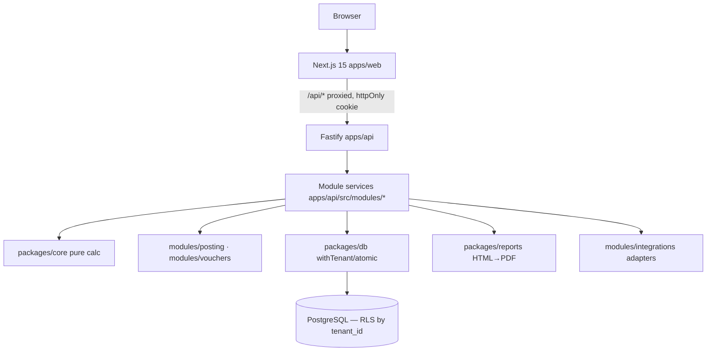
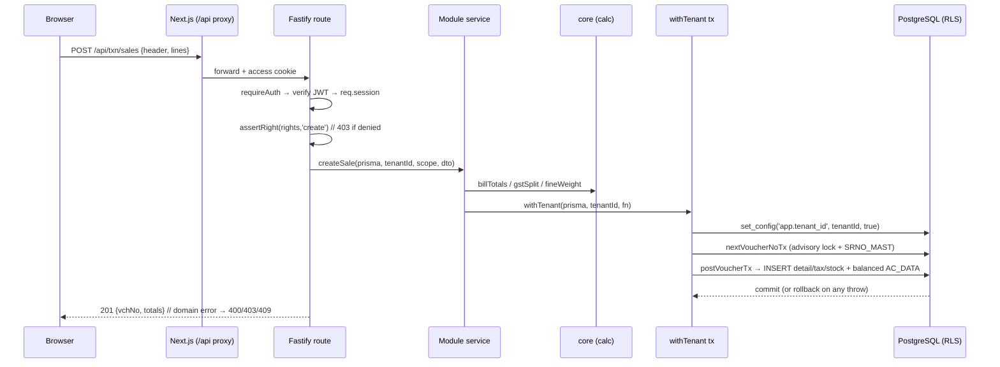

# System Architecture

How the web app is layered, how a request flows, and how transactional integrity + tenancy are
enforced. All code shown is from the existing `web/` implementation (cited), so it is the spec, not
a sketch.

## 1. Layers



- **apps/web** — Next.js App Router. `app/login`, `app/select` (company/year), `app/(app)/*` (auth-guarded screens). `next.config.mjs` proxies `/api/*` to the Fastify origin so the httpOnly cookie stays same-origin (no CORS).
- **apps/api** — Fastify. Cross-cutting: cookie auth, rate-limit, security headers, audit hook, RBAC. Routes: `/auth/*`, `/me`, `/context/*`, `/masters/:name*`, and all txn/report/gst routes via `registerTxnRoutes`.
- **packages/core** — pure functions (no DB): `labourCharge`, `metalAmount`, `lineNet`, `gstSplit`, `billTotals`, `fineWeight`, `round`. Unit-tested with golden vectors.
- **modules/posting + modules/vouchers** — the shared transaction primitives (balanced ledger posting; sequential numbering).
- **packages/db** — `withTenant` (RLS binding), `atomic` (multi-write tx), `buildScopeWhere` (CO/LC/YEAR/BOOK filter), Prisma client + `rls.sql`.

## 2. Request lifecycle (authenticated mutation)



## 3. Authentication & session

From `apps/api/src/app.ts`:
- `POST /auth/login` → `authenticate()` against `LOGIN_MAST`, then `issueAccess`/`issueRefresh` JWTs set as **httpOnly, sameSite=strict** cookies.
- `requireAuth` preHandler verifies the `access` cookie and populates `req.session = { sub, tenantId, coCode, coYear?, rights }`.
- `POST /context/select` re-issues the access token carrying the chosen `coCode`+`coYear` (the scope), mirroring the desktop `MS_OPNCOMP` company/year open step.
- An `onResponse` hook **audits every authenticated mutation** (method, path, status) best-effort.

> **Security note for new endpoints:** every data endpoint MUST be behind `requireAuth`, and every
> create/update/delete/print MUST call `assertRight`. Network-exposed routes without auth are a
> defect — the desktop enforced rights on every action and the web must too.

## 4. Transactional integrity (the core guarantee)

Every multi-table write happens inside `withTenant` (one interactive transaction). If anything
throws, the whole voucher rolls back — nothing partial is ever persisted (Req 5.4/5.5).

```ts
// packages/db/src/tenant.ts — the tenancy + transaction primitive
export async function withTenant<T>(prisma, tenantId, fn) {
  return prisma.$transaction(async (tx) => {
    await tx.$executeRawUnsafe("SELECT set_config('app.tenant_id', $1, true)", tenantId);
    return fn(tx); // throw ⇒ rollback (Req 5.5)
  });
}
```

```ts
// modules/posting/posting.ts — balanced double-entry, all writes in ONE tx
export async function postVoucherTx(tx, tenantId, input) {
  assertBalanced(input.ledger.lines);          // ΣCR must equal ΣDR (Req 13.1)
  await assertPeriodOpen(tx, tenantId, input);  // CO_SET.LOCK_DATE guard
  for (const w of input.writes ?? [])           // header, detail, tax, stock, …
    for (const r of w.rows) await insertRowTx(tx, w.table, tenantId, r);
  let srno = 0;
  for (const line of input.ledger.lines) {       // AC_DATA ledger legs
    srno++;
    await insertRowTx(tx, input.ledger.table, tenantId, enrichLedgerLine(line, srno, input.bookName));
  }
}
```

Composition pattern: a module service opens `withTenant`, calls `nextVoucherNoTx`, builds the
ledger + writes, calls `postVoucherTx`; delete calls `reverseVoucherTx` (delete by voucher key +
`DELETE_DATA` log) — all atomic.

## 5. Reporting subsystem

- A report = **dataset builder** (SQL read-model, scoped) + **HTML template** + **PDF renderer**.
- `packages/reports` provides the renderer; `FakePdfRenderer` for tests, `PlaywrightPdfRenderer` (Chromium) for real PDFs.
- Field parity vs the Crystal `.rpt` is tracked per report in `05_Reports/`.

## 6. Integrations subsystem

- Adapters behind interfaces: WhatsApp Cloud API, SMS gateway, e-invoice GSP (IRN), barcode/QR, live rates.
- Pattern: a `Fake*` implementation until env creds are set; `MessageSender.notify()` **never throws**
  into the transaction (a failed WhatsApp send must not roll back a saved sale — Req 20.3).

## 7. Deployment

- `docker-compose.yml` (web + api + postgres), prod `Dockerfile.web` / `Dockerfile.api`, health/readiness endpoints, daily `pg_dump` backup, perf indexes. See `web/DEPLOY.md`.
