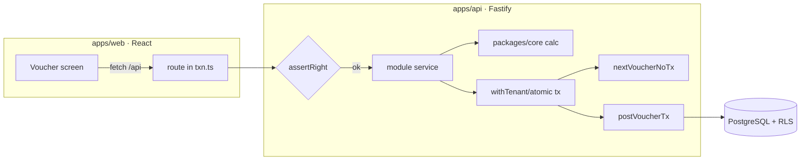

# Tech-Stack Mapping — Desktop → Web

Component-by-component translation of the DataCareNext desktop stack to the web stack. For each
desktop technology, the table gives the **web replacement**, the **why**, and **parity notes** an
implementer must respect.

## 1. Top-level mapping

| Desktop (.NET WinForms) | Web | Why / parity note |
|---|---|---|
| VB.NET / .NET Framework 4.7.2 | **TypeScript** (Node 20+/25) on server, TS+React on client | One language end-to-end; decimal math via `decimal.js`. |
| WinForms MDI shell (`MDI_FORM`, `DC_Main`) | **Next.js 15 App Router** + `components/Shell.tsx` (topbar + sidebar nav) | MDI child windows → routed pages under `app/(app)/…`. |
| DevExpress / DotNetBar controls | **React components** (HTML grid, form inputs) | Grids → a virtualized table; lookups → `LookupPicker.tsx`. |
| MSFlexGrid (COM) line grids | **Editable React data grid** | Keyboard-cell navigation + F-key lookups reproduced in JS. |
| SAP Crystal Reports (`.rpt` ×255) | **HTML templates → PDF via Playwright/Chromium** (`packages/reports`) | Each `.rpt` becomes a dataset builder + an HTML template; field parity tracked in `05_Reports/`. |
| SQL Server, **one DB per year** (Next23/24/25) | **One PostgreSQL DB**, year becomes the `CO_YEAR` column | Cross-year reads become `WHERE CO_YEAR=…`; no DB switching. |
| ADO.NET inline SQL (~14k queries) | **Prisma** (schema/migrations) + **raw SQL** for hot paths | Posting/numbering use `$executeRawUnsafe` for exact column control. |
| `LOGIN_MAST` plaintext password | **Argon2 hash** + JWT (jose) in **httpOnly cookie** | On migrate, plaintext → forced reset; see `auth`. |
| Per-user right flags (`USER_UPDATE/DELETE/PRINT`) | **RBAC policy** (`assertRight`, `filterNav`) | Same three rights + per-menu nav filtering. |
| COM integrations (WhatsApp, SMS, web-cam, OLocker) | **Server adapters behind interfaces** (`modules/integrations`) | Env-driven; `Fake*` until creds set, never blocks the txn. |
| Windows file backup | **`/backup` JSON export** + `pg_dump` | Company snapshot endpoint + DB-level backups. |
| Local install / single machine | **Docker** (web + api + postgres) | `docker-compose.yml`, prod Dockerfiles present. |

## 2. Monorepo layout (the proven decomposition)

```
web/
├── apps/
│   ├── web/   → Next.js 15 / React 19 frontend (the WinForms shell + screens)
│   └── api/   → Fastify server (auth, RBAC, masters CRUD, txn routes)
│       └── src/modules/   → one folder per functional module (sales, purchase, …)
└── packages/
    ├── core/    → pure calc engine (labour, fine, GST split, bill totals) + money/rounding
    ├── types/   → shared TS types (UserRights, Scope, …)
    ├── db/      → Prisma client + withTenant/atomic + buildScopeWhere + RLS sql
    ├── reports/ → report dataset/render helpers
    └── parity/  → golden-master diff engine
```

**Module pattern (every transaction module follows this):**
- *Pure core* (no I/O) → unit-testable calculations (Tier-1).
- *Tx-aware composition* → `withTenant`/`atomic` wraps number-allocation + posting + stock + ancillary writes in **one DB transaction**.
- *Posting* via `modules/posting` (`postVoucherTx`); *numbering* via `modules/vouchers` (`nextVoucherNoTx`); *RBAC* via `assertRight`.
- *REST* exposed in `routes/txn.ts` (RBAC-guarded, domain errors → HTTP).

## 3. The WinForms "form lifecycle" → web request lifecycle

A desktop transaction form (e.g. `TR_SALE`) does: load masters → user fills grid → `Save` runs a
big method that opens a SQL transaction, deletes prior rows (on edit), inserts header/detail/ledger/
stock/tax, commits, then prints. The web equivalent splits this cleanly:



Desktop "edit = delete-then-repost" becomes an explicit **reverse + repost inside one transaction**
(`reverseVoucherTx` then `postVoucherTx`) — same net effect, atomic and auditable.

## 4. What deliberately changes (and why it's still parity)

| Desktop behavior | Web behavior | Still parity because… |
|---|---|---|
| Edit deletes old rows then re-inserts | Explicit reverse+repost in one tx | Final persisted rows are identical; now atomic. |
| Year = separate database | Year = `CO_YEAR` column + scope filter | Same logical isolation; queries always scope by year. |
| Plaintext passwords | Argon2 + forced reset on first login | Same users authenticate; security improved without behavior change. |
| Crystal binary layout | HTML/PDF with the same dataset + fields | Output **data** matches field-for-field (`05_Reports/`); pixel layout is re-created. |
| Blocking modal print dialog | Async PDF endpoint returning a file | Same document content; delivery mechanism differs. |

## 5. Things that must NOT change (hard parity)

- **Calculations**: fine weight, labour by type, GST split, bill totals, round-off — to the same
  rounding precision (see `04_Cross_Cutting_Engines/calc-engine.md`).
- **Posting**: every voucher posts a **balanced** `AC_DATA` set (ΣCR=ΣDR); metal (fine) posted alongside money.
- **Voucher numbering**: sequential, unique per scope, gap-free under concurrency.
- **The persisted row-set** of each transaction (which tables get which rows) — this is the parity contract.
- **Validation gates**: same conditions reject saves (missing account, no lines, tag not available, cash-limit→PAN).
