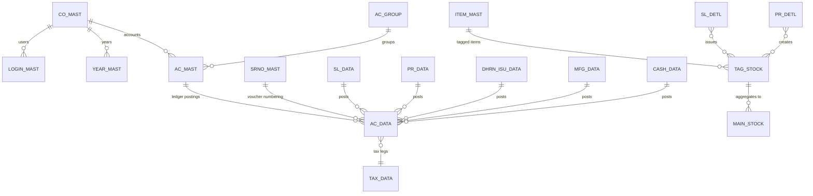
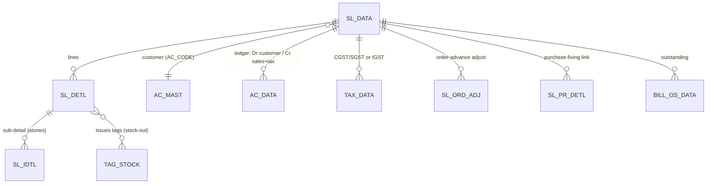
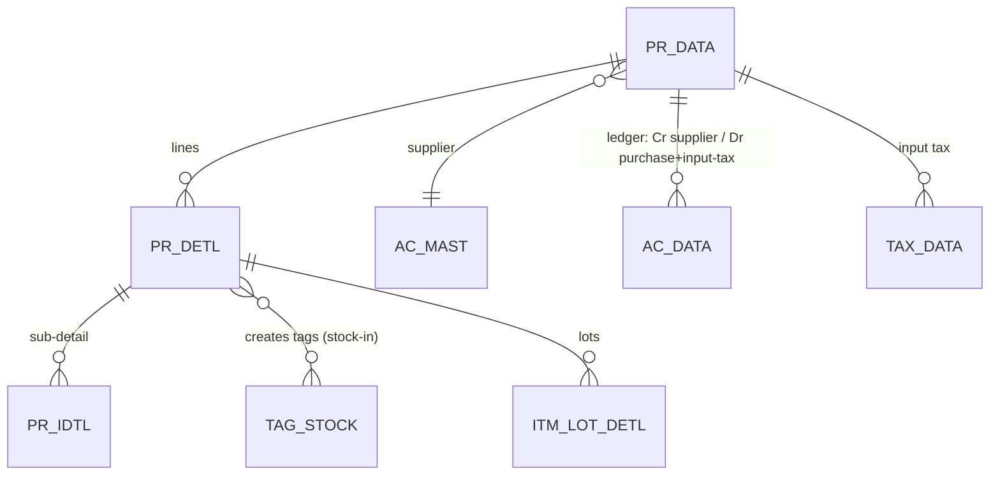
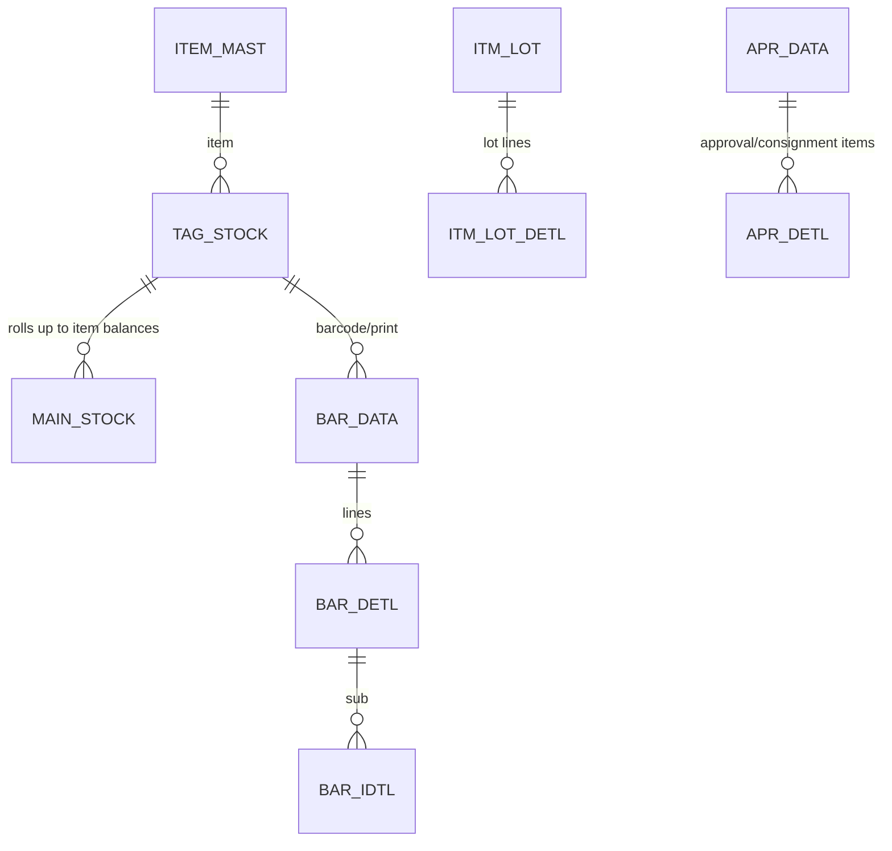
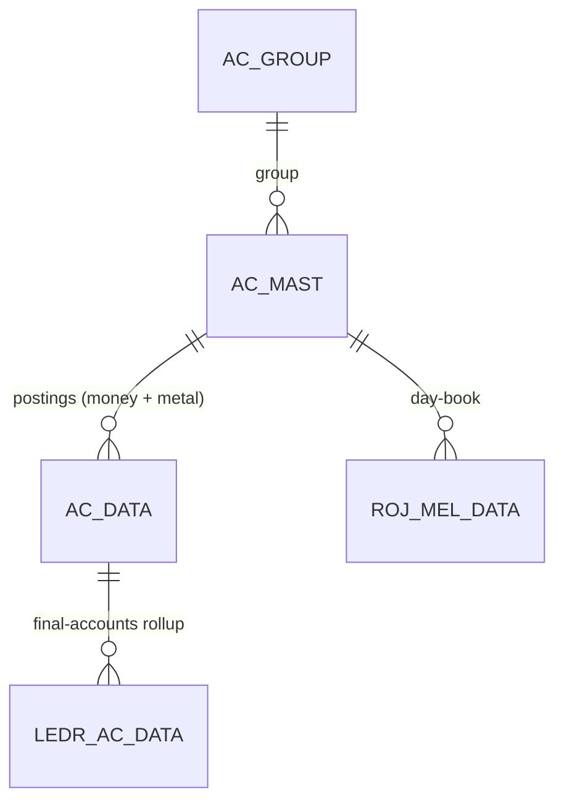
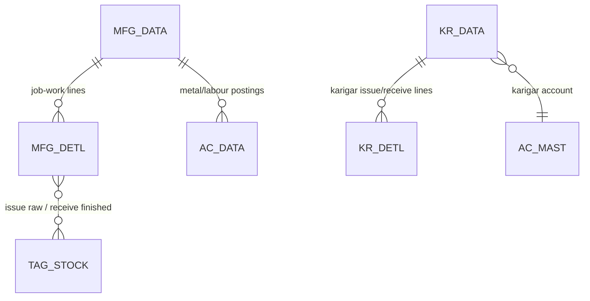
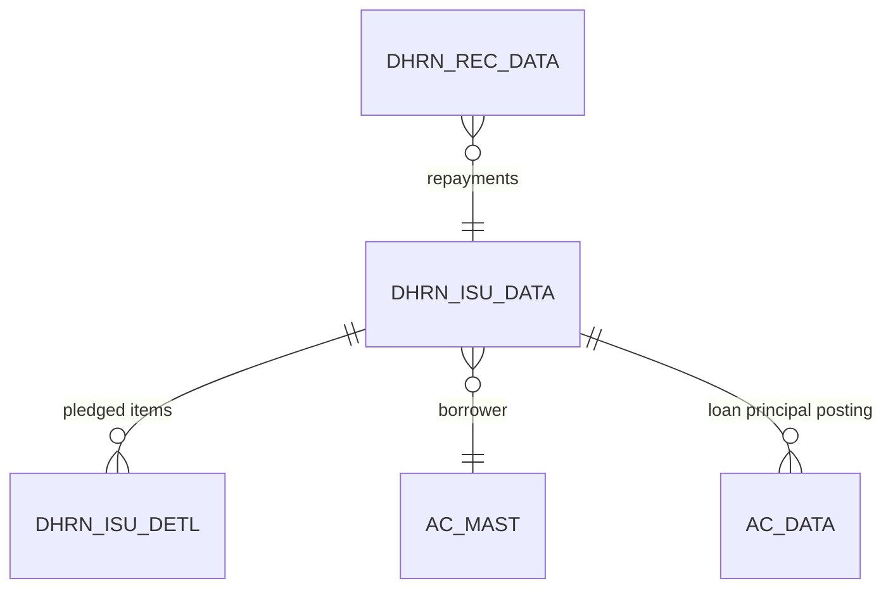
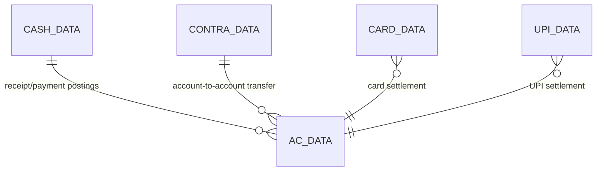

# Data Model — Overview

The complete relational model behind DataCareNext: **162 tables / 4,666 columns** (100 from DDL,
62 recovered from code, 7 unresolved). This page gives the naming patterns, the overall ERD, and
per-cluster ER diagrams. The exhaustive per-table column reference is generated under
[`tables/`](tables/INDEX.md) (one file per table, regenerate via `_generators/gen_table_reference.py`).

## 1. How to read the schema

### Scoping key on (almost) every row
Transactional tables are partitioned by **(CO_CODE, LC_CODE, CO_YEAR, CO_BOOK, VCH_NO, SR_NO)**;
masters by **(CO_CODE, …)**. In the web DB an outer `tenant_id` wraps these (RLS). See
`01_Architecture/multitenancy-scoping.md`.

### Header / detail / sub-detail naming pattern
The schema is highly regular. Learn these suffixes and most tables explain themselves:

| Suffix | Role | Example |
|---|---|---|
| `*_DATA` | Voucher **header** (one row per document) | `SL_DATA`, `PR_DATA`, `DHRN_ISU_DATA` |
| `*_DETL` | Voucher **detail / line items** | `SL_DETL`, `PR_DETL`, `MFG_DETL` |
| `*_IDTL` | **Sub-detail** of a line (stones, sub-items, breakdown) | `SL_IDTL`, `PR_IDTL` |
| `*_MAST` | **Master / reference** data | `AC_MAST`, `ITEM_MAST`, `RATE_MAST` |
| `*_OPBL` | **Opening balance** entries (year start) | `TR_AC_OPBL`, `TR_TAG_OPBL` |
| `AC_DATA` | The **double-entry ledger** (all postings land here) | — |
| `TAX_DATA` | **Tax** postings (CGST/SGST/IGST) | — |
| `*_OS*` | **Outstanding** (unpaid balances) | `BILL_OS_DATA` |
| `DELETE_DATA` | **Audit log** of deleted vouchers | — |

So `SL_DATA → SL_DETL → SL_IDTL` is "sale header → its lines → each line's stone/sub breakdown",
and every save also writes `AC_DATA` (ledger), `TAX_DATA` (tax), and stock tables.

## 2. Overall ERD (cluster level)



Every transaction cluster (sales, purchase, dhrn, manufacturing, finance) ultimately **posts into
`AC_DATA`** (money + metal) and most touch **stock** (`TAG_STOCK`/`MAIN_STOCK`). `AC_DATA` is the hub.

## 3. Per-cluster ER diagrams

### 3.1 Sales (`sales` cluster — 9 tables)

Header `SL_DATA` (totals, customer, payment split) → `SL_DETL` (per item weights/labour/tax) →
`SL_IDTL`. Ancillary: `BILL_OS_DATA`, `POINT_DATA` (loyalty), `UPI_DATA`/`CARD_DATA` (split tender),
`ROJ_MEL_DATA` (day-book), `SL_ORD_ADJ`, `SL_PR_DETL`.

### 3.2 Purchase (`purchase` cluster)

`ITM_FINE = ITM_NWT × ITM_TOUCH / 100`. Stock-in creates tags/lots (`TAG_SET`, `BAR_*`, `ITM_LOT_DETL`)
and may add `TOUCH_MAST` rows.

### 3.3 Inventory / Tags (`inventory` cluster — 23 tables)

`TAG_STOCK` = the per-physical-item ledger (presence = available). `MAIN_STOCK` = aggregate item
balances (qty/gwt/nwt/fine) updated on every stock-in/out.

### 3.4 Accounting / Ledger (`accounting` cluster — 7 tables)

`AC_DATA` carries both **money** (`CR_AMT`/`DR_AMT`) and **metal** (`FINE_WT`/`FINE_RATE`) on each
line; `IT_TYPE` distinguishes money (`A`) from gold/silver legs. Trial balance = Σ per account.

### 3.5 Manufacturing / Karigar (`manufacturing` cluster — 13 tables)

Karigar metal balance = Σ issued fine − Σ received fine; wastage folded into received fine
(`NWT × (TOUCH+WEST)/100`).

### 3.6 Loans / Dhrn (`dhrn` cluster — 5 tables)

Outstanding = issue − Σ receipts; interest accrues by **day-count** from issue date.

### 3.7 Finance / Cash-Bank (`finance` cluster — 10 tables)

Every voucher posts a balanced 2-leg (or n-leg) entry. Cash over the configured limit requires PAN.

## 4. Cross-cutting tables (touched by many clusters)

| Table | Role |
|---|---|
| `AC_DATA` | The ledger hub — every posting voucher writes here (money + metal). |
| `TAX_DATA` | Tax legs (CGST/SGST/IGST) for sales/purchase. |
| `SRNO_MAST` | Voucher-number counters per scope. |
| `ROJ_MEL_DATA` | Day-book / cash register entries. |
| `BILL_OS_DATA` | Outstanding balances per bill. |
| `DELETE_DATA` | Audit log of every deleted voucher. |
| `TAG_STOCK` / `MAIN_STOCK` | Physical-item + aggregate stock. |
| `PRINT_MAST`, `USER_DATA`, `TEMP_BOOK_DATA`, `CRNT_DATA` | Print counts, user activity, scratch/temp. |

## 5. Type-confidence & unresolved tables

- Columns from DDL have authoritative types; **code-recovered** columns get types via a learned
  column→type map (`source: "code+inferred-type"`), and a few are `unknown`.
- **7 unresolved tables** (no column-list `INSERT` in code, populated via `INSERT…SELECT`):
  `AREA_MAST, IMAGE_DATA, LBR_ISU_IDTL, LOAN_ISU_DATA, LOAN_REC_DATA, OP_DETL, TAG_MAST`.
  Recover authoritative columns via the optional Docker SQL-Server golden-master pass before
  finalizing Prisma `NUMERIC` precision (tracked in `06_Parity/` open items).
- **Float vs Numeric:** the desktop stored money/weight as `FLOAT`. The web uses `NUMERIC` with the
  precision policy in `conventions.md` — this is an intentional, parity-safe upgrade (rounding is
  pinned to match desktop output).

## 6. Regenerating the table reference

```bash
cd web-implementation-spec/_generators && python3 gen_table_reference.py
```
Writes `02_Data_Model/tables/<TABLE>.md` for all 162 tables + `INDEX.md` (by-cluster + alphabetical).
