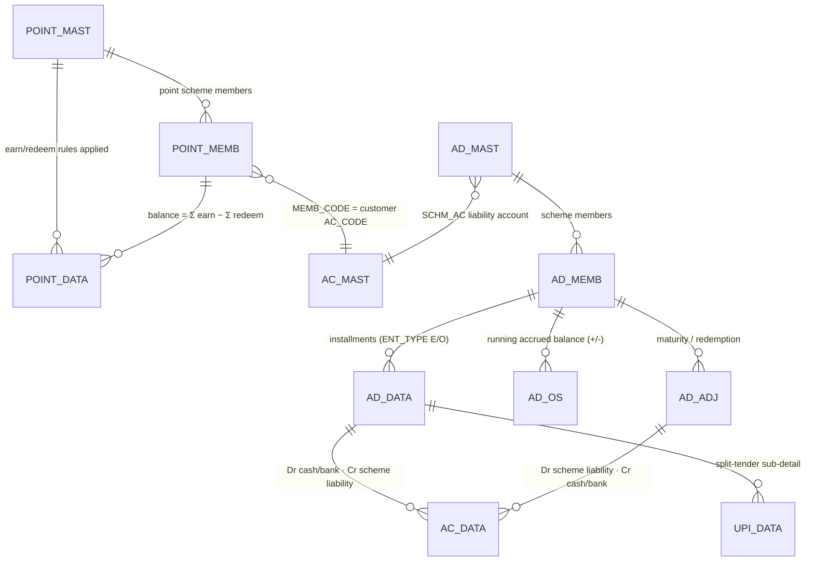

# Module 10 — Membership / Loyalty

> The customer-engagement subsystem. It has **two independent member-facing mechanisms** that the
> desktop groups together under "Membership" but which use entirely separate tables and posting rules:
>
> 1. **Loyalty points** — reward points a customer *earns* on a sale and later *redeems* against a
>    future bill. Points are **not money**, so they never touch `AC_DATA`; they live in their own
>    ledger `POINT_DATA` and are governed by point-scheme rules in `POINT_MAST` (master form
>    `MS_POINT`). Web engine: `membership.ts`.
> 2. **Member saving schemes** — a monthly gold/amount saving plan (Indian "scheme"/"committee"): a
>    customer joins a scheme (`AD_MAST`→`AD_MEMB`), pays installments over N months (`AD_DATA`+`AD_OS`),
>    and redeems the accrued balance (± bonus/penalty) at maturity (`AD_ADJ`). Each installment **is**
>    money the shop owes back, so it posts a balanced `AC_DATA` pair. Forms: **`TR_MEMB_ENT`** (entry /
>    opening) and **`TR_MEMB_ADJ`** (maturity / adjust). Web engine: `scheme.ts`.
>
> ⚠️ **Naming reconciliation (read first).** The desktop form literally named **`TR_MEMB_ENT`
> ("Memb Entry")** is the **saving-scheme installment/opening** form (it reads `AD_MEMB`/`AD_MAST`
> and writes `AD_DATA`/`AD_OS`/`AC_DATA` — it does **not** touch `POINT_DATA`).
> `// src: TR_MEMB_ENT.cs#L4567 (ENT_TYPE 'O' for 'MEMB OPENING' else 'E')`.
> Loyalty **points** are written from the **sales** screen (`TR_SALE` → `POINT_DATA` SR_NO 1 earn /
> SR_NO 2 redeem) and configured in `MS_POINT`. `// src: TR_SALE.cs#L14786, L15789-L15836`.
> [`TR_MEMB_ENT.md`](TR_MEMB_ENT.md) documents the scheme-entry form **and** the loyalty-points engine
> (both belong to this module); [`TR_MEMB_ADJ.md`](TR_MEMB_ADJ.md) stubs the scheme adjust/maturity form.

## 1. Purpose

In business terms this module **drives repeat custom**:

- **Loyalty.** A jeweller runs one or more *point schemes* (`POINT_MAST`, set up via `MS_POINT`). A
  scheme converts spend into points — by **sales-amount slab** (every `SL_AMT` rupees billed →
  `SL_POINT` points), by **gram** (`GRM_POINT` per net gram), or as a **fixed** award (`FIX_POINT`) —
  and declares a redemption value (`POINT_AMT` = rupees per point) and a redemption floor
  (`MIN_POINT`). At the sale counter the customer's points balance grows (earn) and can be spent
  (redeem) as a discount. The balance is the running sum of the `POINT_DATA` ledger; there is **no
  accounting entry** because points carry no monetary liability on the books.
- **Saving schemes.** A customer enrolls in a monthly plan (e.g. "11 months pay, 12th free" gold
  schemes). Each month they pay an installment that the shop records as a **receipt now / liability
  later** (Dr cash-or-bank, Cr the scheme-liability account). The member's accrued balance is tracked
  in `AD_OS`; at maturity the shop pays it back (± bonus/less) and clears the liability.

## 2. Form inventory

| Form | Type | Posting | Purpose | Web status |
|---|---|---|---|---|
| `MS_POINT` | master | — | Define point schemes: slabs (`POINT_TYPE` S/C/M), `POINT_AMT` (₹/point), `MIN_POINT`, `CUR_IN_USE`; enroll point members into `POINT_MEMB`. | 🟦 PARTIAL (`membership.ts → enrollMember`; POINT_MAST CRUD via masters) |
| `MS_MEMB` | master | — | Member master (scheme members / customer membership cards). | 🟦 PARTIAL (overlaps `AD_MEMB`/`POINT_MEMB`) |
| *(loyalty earn/redeem)* | — | — | Points are written by **`TR_SALE`** into `POINT_DATA` (SR_NO 1 earn, SR_NO 2 redeem); a standalone points entry/adjust mirrors it. | 🟩 BUILT (`membership.ts → postPoints`) |
| `TR_MEMB_ENT` | transaction | ✅ | **Member scheme entry** — monthly installment (`MEMB ENTRY`, `ENT_TYPE='E'`) or carried-forward opening (`MEMB OPENING`, `ENT_TYPE='O'`). Posts `AD_DATA`+`AD_OS`+balanced `AC_DATA`(+`UPI_DATA` split, `ROJ_MEL_DATA`). | 🟩 BUILT (`scheme.ts → schemeInstallment`/`schemeOpening`) |
| `TR_MEMB_ADJ` | transaction | ✅ | **Member scheme adjust / maturity** — redeem the accrued balance (± `MEMB_BONUS`/`MEMB_LESS`) → `AD_ADJ`+`AD_OS`(−)+balanced `AC_DATA`. | 🟩 BUILT (`scheme.ts → schemeMaturity`) — see [stub](TR_MEMB_ADJ.md) |

> The loyalty member-enrollment screen and the scheme member-enrollment screen are distinct in the
> desktop; the web folds enrollment into `enrollMember` (`POINT_MEMB`) and `enrollScheme` (`AD_MEMB`).

## 3. Module ER diagram



Composite key on transactional tables: `(CO_CODE, LC_CODE, CO_YEAR, CO_BOOK, VCH_NO, SR_NO)` + the web
`tenant_id`. Masters: `POINT_MAST`/`POINT_MEMB` key on `(CO_CODE, POINT_CODE[, MEMB_CODE])`;
`AD_MAST` keys on `(CO_CODE, SCHM_CODE)` (**no `LC_CODE`** — a real schema quirk), `AD_MEMB` on
`(CO_CODE, LC_CODE, SCHM_CODE, MEMB_CODE)`. Column names kept **verbatim**.

Table refs: [POINT_DATA](../../02_Data_Model/tables/POINT_DATA.md) ·
[POINT_MAST](../../02_Data_Model/tables/POINT_MAST.md) ·
[POINT_MEMB](../../02_Data_Model/tables/POINT_MEMB.md) ·
[AD_MAST](../../02_Data_Model/tables/AD_MAST.md) ·
[AD_MEMB](../../02_Data_Model/tables/AD_MEMB.md) ·
[AD_DATA](../../02_Data_Model/tables/AD_DATA.md) ·
[AD_OS](../../02_Data_Model/tables/AD_OS.md) ·
[AD_ADJ](../../02_Data_Model/tables/AD_ADJ.md) ·
[AC_DATA](../../02_Data_Model/tables/AC_DATA.md) ·
[UPI_DATA](../../02_Data_Model/tables/UPI_DATA.md).

## 4. Shared logic

### 4.1 Loyalty points (`membership.ts`)

Points balance is **derived from the ledger**, never stored (the `POINT_MEMB.MEMB_POINT` column is a
`varchar(1)` flag, not a number):

```ts
// web: membership.ts — balance = Σ TOT_POINT(earn 'I') − Σ TOT_POINT(redeem 'O') per member
SELECT coalesce(sum(CASE WHEN "INOUT_TYPE"='I' THEN "TOT_POINT" ELSE -"TOT_POINT" END),0) AS bal
  FROM "POINT_DATA" WHERE "CO_CODE"=$1 AND "POINT_CODE"=$2 AND "MEMB_CODE"=$3
```
- `enrollMember` → one `POINT_MEMB` row (`MEMB_CODE`, `MEMB_NAME`, `MOBILE_NO`, `CARD_NO`).
- `postPoints({type:'earn'|'redeem'})` → one `POINT_DATA` row (`INOUT_TYPE 'I'|'O'`, `TOT_POINT`),
  book `PNT`; redeem is blocked if it exceeds the current balance. **No `AC_DATA`** (points ≠ money).
- The **earn rule** comes from `POINT_MAST` slabs (see `TR_MEMB_ENT.md §4`); the desktop computes the
  point award on the **sales** screen and stamps it onto the bill (`POINT_DATA` SR_NO 1), redemption
  on SR_NO 2. `// src: TR_SALE.cs#L14786, L15789-L15836`

### 4.2 Member schemes (`scheme.ts`)

- `enrollScheme` → one `AD_MEMB` row (auto 5-digit `MEMB_CODE` if omitted); `AD_MAST` must exist.
- `schemeInstallment` / `schemeOpening` (`postMemberEntry`) → in one tx: `nextVoucherNoTx` →
  `postVoucherTx({ ledger: Dr cash/bank Cr SCHM_AC, writes:[AD_DATA(ENT_TYPE 'E'|'O'), AD_OS(OS_TYPE
  'A', SIGN '+')] })`. Books `074/MBENT/'MEMB ENTRY'` and `075/MBOP/'MEMB OPENING'`.
- `schemeMaturity` → mirror image: `AD_ADJ`(SIGN `-`, `MEMB_BONUS`/`MEMB_LESS`) + `AD_OS`(OS_TYPE
  `D`, SIGN `-`) + balanced `AC_DATA`(Dr SCHM_AC, Cr cash/bank) on **payout = amount + bonus − less**.
  Book `076/MBADJ/'MEMB ADJUST'`.
- All four use `buildTransferLedger` + `assertBalanced` from the posting engine; delete =
  `reverseVoucherTx` of `[AD_DATA|AD_ADJ, AD_OS, AC_DATA]` + `DELETE_DATA`.

The desktop delegates posting to helpers: `Ac_Ledr.Schm_Ledr` (ledger), `Ac_Tax.SchemeEnt_Os` /
`SchemeOp_Os` (outstanding), `Ac_Rojmel.Schm_RojMel` (day book). `// src: TR_MEMB_ENT.cs#L4649-L4683`

## 5. Dependencies

- Engines: **posting/ledger** (`AC_DATA`, balanced — schemes only), **numbering** (`SRNO_MAST` per
  book/year), **calc** (`decimal.js` HALF-UP; amounts 2 dp, points 0 dp, gold-scheme weight 3 dp),
  **RBAC** (`USER_UPDATE/DELETE/PRINT`). **No GST engine** (neither points nor scheme installments
  are taxable). **Finance** (`settlementAc`, `buildTransferLedger`) for the cash/bank leg + pay mode.
- Masters: `AC_MAST` (customer/loyalty member, cash/bank, scheme-liability `SCHM_AC`), `POINT_MAST`
  (point scheme), `AD_MAST` (saving scheme), `EMP_MAST` (salesperson), `RATE_MAST` (gold-scheme rate).
- Consumed by: **Sales** (`TR_SALE` earns/redeems points + adjusts order advances), reports
  `MembVch.rpt`, `MembRpt.rpt`, `MembCommRpt.rpt`, `SchmRecVch.rpt`, `SchmPassBook.rpt` (Module 12).

## 6. API surface (see form docs §7 for full contracts)

| Method | Path | Right | Purpose |
|---|---|---|---|
| POST | `/members` | create | Enroll a loyalty member (`POINT_MEMB`) |
| POST | `/members/points` | create | Earn/redeem points (`POINT_DATA`) |
| GET | `/members` | — | List members + derived points balance |
| POST | `/scheme/enroll` | create | Enroll a customer into a saving scheme (`AD_MEMB`) |
| POST | `/scheme/installment` | create | Monthly installment (book 074 / `MBENT`) |
| POST | `/scheme/opening` | create | Member opening balance (book 075 / `MBOP`) |
| POST | `/scheme/maturity` | create | Maturity/redemption (book 076 / `MBADJ` → `AD_ADJ`) |
| DELETE | `/scheme/opening/:vchNo` · `/scheme/maturity/:vchNo` | delete | Reverse a scheme voucher |

> **SECURITY.** These routes store customer PII (name, mobile, card number) and mutate financial
> ledgers (scheme side). They MUST sit behind authentication + per-tenant authorization. The
> reference services are auth-agnostic; routing enforces `requireAuth` + `assertRight`.

## 7. Build checklist

- [ ] Engines green: posting (balanced scheme legs), numbering (per-book PNT/074/075/076), calc.
- [ ] **Loyalty:** `POINT_MAST` slab evaluation (S/C/M) reproduces the desktop point award; `postPoints`
      earn/redeem; redeem floor (`MIN_POINT`) + balance guard; balance = ledger sum (no stored total).
- [ ] Earn/redeem on a **sale** writes `POINT_DATA` SR_NO 1/2 with the same totals as desktop; delete restores.
- [ ] **Schemes:** `enrollScheme` (auto member code), installment + opening post `AD_DATA`/`AD_OS`/`AC_DATA`
      matching desktop rows (`ENT_TYPE` E/O, `OS_TYPE` A `+`); maturity posts `AD_ADJ`/`AD_OS`(−)/`AC_DATA`
      with payout = amount + bonus − less; ΣCR=ΣDR.
- [ ] UPI/split-tender installments persist `UPI_DATA` sub-rows (desktop parity).
- [ ] Delete = reverse + `DELETE_DATA`; idempotent re-save (delete-then-insert) — no double posting.
- [ ] Trial balance still nets to zero after a batch of scheme installments + maturities + deletes.
- [ ] Parity fixtures under `06_Parity/membership.md`.
