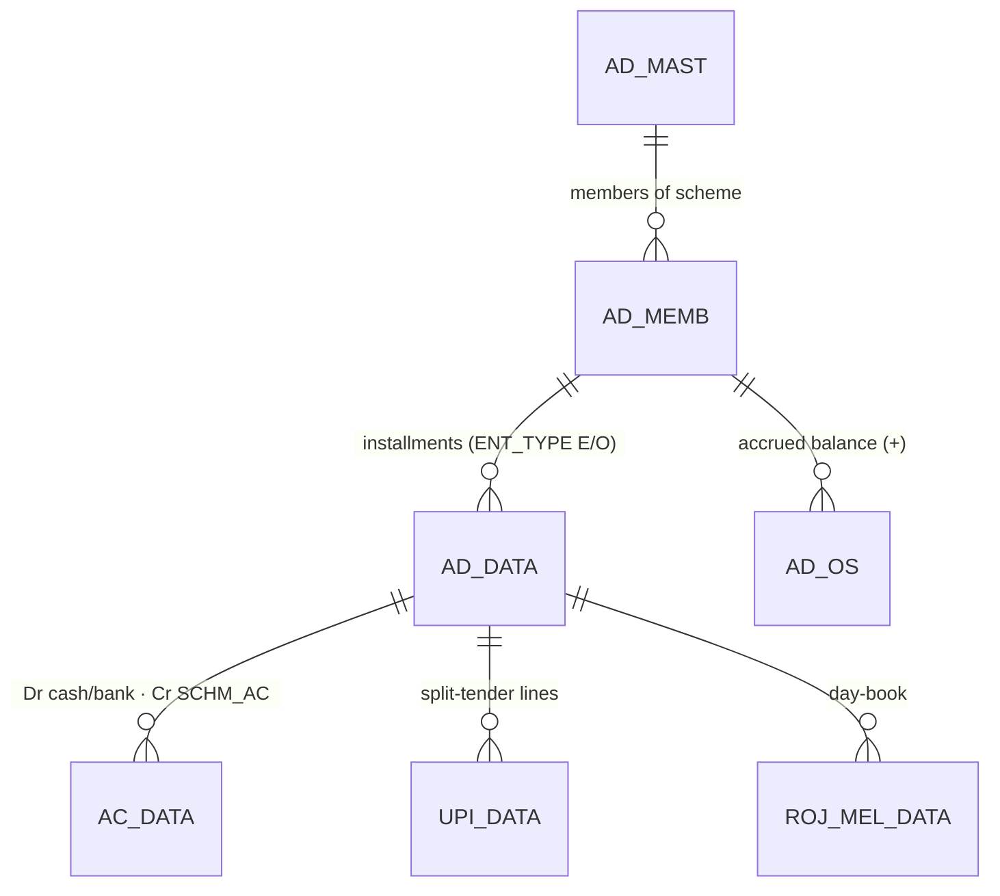
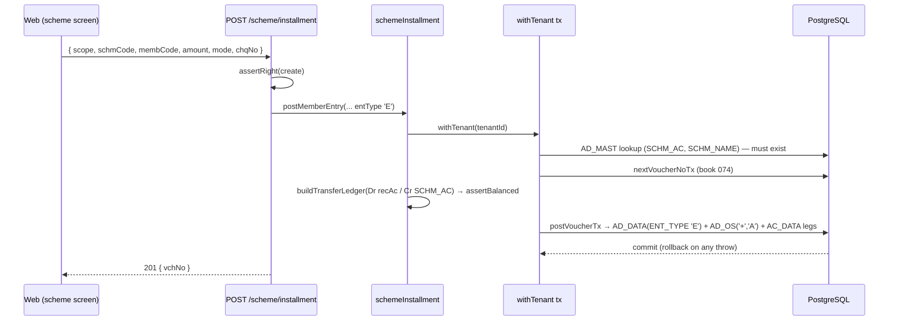

# TR_MEMB_ENT — Member Scheme Entry (+ Loyalty Points engine)

```
Form: TR_MEMB_ENT ("Memb Entry")  ·  Module: 10_Membership  ·  Type: transaction (posting)
Desktop source: unified/src/csharp/DataCareNext/TR_MEMB_ENT.cs (204 KB) + Ac_Ledr.Schm_Ledr, Ac_Tax.SchemeEnt_Os/SchemeOp_Os, Ac_Rojmel.Schm_RojMel
Loyalty source: unified/src/csharp/DataCareNext/MS_POINT.cs (point rules) + TR_SALE.cs#L14786,L15789-L15836 (POINT_DATA earn/redeem)
Web target: apps/api/src/modules/membership/scheme.ts (scheme) + membership.ts (loyalty) · routes/txn.ts (/scheme/*, /members/*)
Requirements: Req 9 (numbering), 13 (balanced ledger), 12 (calc) · Parity: 06_Parity/membership.md
Status: 📋 SPEC · 🟩 BUILT
Evidence: form catalog project-memory/catalogs/forms/TR_MEMB_ENT.md
```

## 1. Purpose & business context

This screen runs the jeweller's **monthly saving schemes** (Indian gold/amount "scheme"/committee).
A member who has joined a scheme (`AD_MEMB`) pays a periodic **installment**; the shop books it as
**cash/bank in now, a liability owed back later**, and grows the member's accrued balance (`AD_OS`).
The *same* form, switched by its book, also records a member's **opening balance** when migrating an
existing member mid-scheme. Book/voucher: `074 / MBENT / "MEMB ENTRY"` for an installment
(`AD_DATA.ENT_TYPE='E'`), `075 / MBOP / "MEMB OPENING"` for the opening (`ENT_TYPE='O'`).
`// src: TR_MEMB_ENT.cs#L4560-L4574`

> ⚠️ **Identity note.** Despite the "Memb Entry" caption, this is the **scheme installment** form,
> *not* the loyalty-points screen — it reads `AD_MEMB`/`AD_MAST` and writes `AD_DATA`/`AD_OS`/`AC_DATA`
> and never touches `POINT_DATA`. `// src: TR_MEMB_ENT.cs#L3636 (AD_MEMB⋈AD_MAST)`. Because the
> **Membership/Loyalty module owns both** mechanisms, this doc also fully specifies the **loyalty
> points earn/redeem engine** (`POINT_DATA`/`POINT_MEMB`/`MS_POINT`) — see **§4.4** and **§10.A**.
> Maturity/redemption of a scheme is the sibling form **`TR_MEMB_ADJ`** ([stub](TR_MEMB_ADJ.md)).

## 2. UI / UX specification

### Layout (scheme entry)
```
┌─ TR_MEMB_ENT ─ Member Entry ───────────────── [New][Save F2][Delete][Print][Close] ┐
│ Vch No:[____] Date:[__/__/____]  Scheme:[SCHM_CODE ▾][SCHM_NAME ........] Emp:[___] │
│ ┌ Members ─────────────────────────────────────────────────────────────────────────┐│
│ │ # │ Memb Code │ Memb Name │ Schm Date │ With UPI │ Rec A/C │ Gold Rate │ Gold Wt │ Amount ││
│ │ 1 │ 00012 ▾   │ (auto)    │ __/__/__  │ N/Y      │ CASH ▾  │  (gold)   │ (gold)  │ 2000.00││
│ └──────────────────────────────────────────────────────────────────────────────────┘│
│ Split tender (UPI grid): A/C · UPI Type · UPI Id · Amount      Cheque No:[____] Bank:[__]│
│ Desc:[__________]                                          Total Amount: [........]     │
└──────────────────────────────────────────────────────────────────────────────────────┘
```
A row per member paying this voucher (a collector can post many members' installments at once).

### Header / grid field table (`AD_DATA`)
| Label | Column | Type | Req | Default | Notes |
|---|---|---|---|---|---|
| Vch No | `VCH_NO` | string | auto | next per book | `SRNO_MAST` |
| Date | `VCH_DATE` | date | ✓ | today | blocked if ≤ `CO_SET.LOCK_DATE` |
| Scheme | `SCHM_CODE` | lookup→`AD_MAST` | ✓ | — | drives `SCHM_AC` liability + `SCHM_TYPE` |
| Member | `MEMB_CODE` | lookup→`AD_MEMB` | ✓ | — | filtered by scheme; `EXP_DATE ≥ VCH_DATE` |
| Schm Date | `SCHM_DATE` | date | — | vch date | the period being paid |
| Gold Rate | `ITM_RATE` | money | — | 0 | gold-scheme rate (amount→grams) |
| Gold Wt | `ITM_GWT` | weight | — | 0 | grams credited (gold scheme) |
| Amount | `MEMB_AMT` | money | ✓ | scheme amt | the installment paid |
| With UPI | `WITH_UPI` | Y/N | — | N | opens the split-tender grid |
| Rec A/C | `REC_AC` | lookup→`AC_MAST` | ✓ | CASH | cash/bank receiving the money |
| Cheque/Bank | `CHQ_NO`/`BANK_NAME` | string | — | — | for cheque tender |
| `TOT_AMT` | `TOT_AMT` | money | auto | **0** | desktop stores 0 here (amount lives in `MEMB_AMT`) |

`// src: TR_MEMB_ENT.cs#L4575-L4607 (AD_DATA row build: SCHM_CODE, MEMB_CODE, ITM_RATE, ITM_GWT, MEMB_AMT, REC_AC, WITH_UPI, CHQ_NO, BANK_NAME)`

### UPI split-tender sub-grid (`UPI_DATA`)
`UPI_AC_CODE`, `UPI_AC_NAME`, `UPI_TYPE`, `UPI_ID`, `UPI_AMT` per split line.
`// src: TR_MEMB_ENT.cs#L4615-L4642`

### Keyboard / modes
- **F2 = Save**, Enter = next cell, scheme/member F-lookups. _(Confirm exact F-key map from the form.)_
- New / Edit (load + re-post) / View / Delete (`USER_DELETE`) / Print (`USER_PRINT`).

## 3. Data model touched

**Writes (create):** `AD_DATA` (installment detail, one row per member, `ENT_TYPE` E/O),
`AD_OS` (accrued-balance row, `OS_TYPE='A'`, `SIGN='+'`), `AC_DATA` (balanced Dr cash/bank · Cr
scheme-liability — **only for installments, not openings**), `UPI_DATA` (split tender),
`ROJ_MEL_DATA` (day book), `REMARK_DATA` (narration).
**Deletes/reverses:** `AD_DATA, AD_OS, AC_DATA, UPI_DATA, ROJ_MEL_DATA, REMARK_DATA, TEMP_BOOK_DATA`
+ `DELETE_DATA` audit row. `// src: TR_MEMB_ENT.cs#L4800-L4808 (delete set)`


Refs: [AD_DATA](../../02_Data_Model/tables/AD_DATA.md) · [AD_OS](../../02_Data_Model/tables/AD_OS.md) ·
[AD_MEMB](../../02_Data_Model/tables/AD_MEMB.md) · [AD_MAST](../../02_Data_Model/tables/AD_MAST.md) ·
[AC_DATA](../../02_Data_Model/tables/AC_DATA.md) · [UPI_DATA](../../02_Data_Model/tables/UPI_DATA.md).

## 4. Business logic & calculations (with code)

### 4.1 Installment posting shape
Each installment is a **receipt against a liability**: money comes in now; the shop owes it back as
gold/cash at maturity. So the ledger is a balanced transfer:

```
Dr  REC_AC (CASH/BANK)        MEMB_AMT      ← money received
Cr  AD_MAST.SCHM_AC           MEMB_AMT      ← scheme liability (owed back later)
```

### 4.2 Web implementation (`scheme.ts → postMemberEntry`)
```ts
// web: membership/scheme.ts (trimmed) — one tx: number → balanced ledger → AD_DATA + AD_OS
const ledger = buildTransferLedger(key, tags.vchType, recAc, liabAc, amount); // Dr recAc / Cr liab
assertBalanced(ledger);                                                       // ΣDR === ΣCR (Req 13.1)
await postVoucherTx(tx, tenantId, {
  bookName: tags.bookName,                              // 'MEMB ENTRY' | 'MEMB OPENING'
  ledger: { table: 'AC_DATA', lines: ledger },
  writes: [
    { table: 'AD_DATA', rows: [{ ...key, SR_NO:1, SCHM_CODE, MEMB_CODE, MEMB_AMT:amount,
        TOT_AMT:amount, ENT_TYPE: tags.entType /* 'E' | 'O' */, REC_AC: recAc, INOUT_TYPE:'I' }] },
    { table: 'AD_OS',   rows: [{ ...key, SR_NO:1, SCHM_CODE, MEMB_CODE, MEMB_AMT:amount,
        ADJ_AMT:amount, SIGN:'+', OS_TYPE:'A' /* accrued (+) ; redemption books 'D' (-) */ }] },
  ],
});
```
`// web: scheme.ts (MEMB_ENTRY = {book:'074',vchType:'MBENT',bookName:'MEMB ENTRY'}; entType 'E')`

### 4.3 Desktop evidence
```csharp
// src: TR_MEMB_ENT.cs#L4565-L4571
if (Operators.CompareString(FormMainBook, "MEMB OPENING", false) == 0)
    dataRow2["ENT_TYPE"] = "O";          // opening balance
else
    dataRow2["ENT_TYPE"] = "E";          // monthly entry
...
dataRow2["MEMB_AMT"] = Conversion.Val(mSG[i, 8]);   // installment amount
dataRow2["TOT_AMT"]  = 0;                            // header total stays 0
// then: AD_OS via Ac_Tax.SchemeEnt_Os/SchemeOp_Os, AC_DATA via Ac_Ledr.Schm_Ledr (skipped for opening),
//       ROJ_MEL_DATA via Ac_Rojmel.Schm_RojMel.   // src: #L4649-L4683
```
Opening entries (`ENT_TYPE='O'`) **only** build `AD_OS` (no money ledger) — they carry an existing
balance forward; installments build both. **Money scale = 2 dp HALF-UP**; gold-scheme grams 3 dp.

### 4.4 Loyalty points — earn/redeem rules (`MS_POINT` + `POINT_DATA`)
A **point scheme** (`POINT_MAST`, set up in `MS_POINT`) carries a header (`POINT_CODE`, `POINT_NAME`,
`POINT_AMT` = ₹ value of one point on redemption, `MIN_POINT` = redemption floor, `CUR_IN_USE`='Y'
marks the active scheme) plus **slab rows** keyed by `POINT_TYPE`:

| `POINT_TYPE` | Rule | Columns |
|---|---|---|
| `S` (sales-amount slab) | every `SL_AMT` of bill value → `SL_POINT` points | `SL_AMT`, `SL_POINT` |
| `M` (per-gram) | `GRM_POINT` points × net grams sold | `GRM_POINT` |
| `C` (fixed) | flat `FIX_POINT` per qualifying bill | `FIX_POINT` |

`// src: MS_POINT.cs#L2003-L2042 (POINT_MAST: POINT_TYPE 'S'/'C'/'M', GRM_POINT, FIX_POINT, SL_AMT, SL_POINT, POINT_AMT, MIN_POINT)`

The award is computed on the **sale** and written to `POINT_DATA` keyed by the sale voucher —
SR_NO 1 = points **earned**, SR_NO 2 = points **redeemed**:
```csharp
// src: TR_SALE.cs#L15802-L15808  (earn row)
dataRow10["MEMB_CODE"] = tAcCode.Text;               // customer = loyalty member
dataRow10["TOT_POINT"] = Conversion.Val(nBillPoint.Text);   // points earned on this bill (SR_NO=1)
// src: TR_SALE.cs#L15830-L15836  (redeem row, SR_NO=2): TOT_POINT = nUsePoint
```
The redeemed points become a **discount** worth `points × POINT_AMT`, gated by `MIN_POINT`.
`// src: TR_SALE.cs#L14786-L14807 (join POINT_MAST for MIN_POINT/POINT_AMT)`. Points are **not money**
→ **no `AC_DATA`** leg (only the rupee discount they buy appears on the bill totals).

Web (`membership.ts`) models the same ledger but tags rows by `INOUT_TYPE 'I'/'O'` on standalone `PNT`
vouchers; balance = `Σ TOT_POINT('I') − Σ TOT_POINT('O')`:
```ts
// web: membership.ts → postPoints
const inout = p.type === 'redeem' ? 'O' : 'I';
if (inout === 'O' && pts > cur + 1e-9) throw new MembershipError(`redeem ${pts} exceeds balance ${cur}`);
await tx.$executeRawUnsafe(`INSERT INTO "POINT_DATA"(... "INOUT_TYPE","POINT_CODE","MEMB_CODE","TOT_AMT","TOT_POINT") ...`);
```

## 5. Save sequence (create / edit)

Edit = delete prior voucher then repost, all in one transaction.


Numbered: (1) validate scheme + member + amount>0; (2) resolve `SCHM_AC` liability (fallback
`SCHEME`); (3) voucher no from `SRNO_MAST` (book 074/075); (4) build + assert balanced ledger;
(5) `postVoucherTx` writes `AD_DATA` + `AD_OS` (+ `AC_DATA` for installments); (6) commit.
`// web: scheme.ts → postMemberEntry`

## 6. Delete / reverse sequence

```ts
// web: scheme.ts → deleteSchemeInstallment
await reverseVoucherTx(tx, tenantId, {
  tables: ['AD_DATA','AD_OS','AC_DATA'],
  key,                                   // (CO_CODE,LC_CODE,CO_YEAR,CO_BOOK='074'|'075',VCH_NO)
  deleteLog: { table:'DELETE_DATA', row:{ ...key, VCH_TYPE:'MBENT'|'MBOP', DELETE_USER } },
});
```
One transaction; requires `USER_DELETE`. The desktop additionally clears `UPI_DATA`, `ROJ_MEL_DATA`,
`REMARK_DATA`, `TEMP_BOOK_DATA` for the key — add those tables when the web persists them.
`// src: TR_MEMB_ENT.cs#L4800-L4808`

## 7. API contract

```ts
// POST /scheme/installment   (right: create)        → 201 { vchNo }
interface SchemeInstallmentBody {
  coCode?; lcCode?; coYear?; coBook?;     // scope (else from session)
  schmCode: string; membCode: string; amount: number;
  mode?: 'cash'|'card'|'upi'|'cheque'|'bank'; bankAc?: string; chqNo?: string; vchDate?: string;
}
// POST /scheme/opening   (right: create) — same body; books 075/MBOP, ENT_TYPE 'O'
// POST /scheme/enroll    (right: create) → { membNo }   { schmCode, membCode?, membName?, monthlyAmt }
// DELETE /scheme/opening/:vchNo   (right: delete) → { reversed:true }
// ---- loyalty ----
// POST /members          (right: create) → { enrolled:true }   { pointCode?, membCode, membName, mobile?, cardNo? }
// POST /members/points   (right: create) → { vchNo, balance }  { pointCode?, membCode, points, type:'earn'|'redeem', amount? }
// GET  /members          → [{ membCode, membName, mobile, pointCode, points }]
```
Errors: `SchemeValidationError`/`MembershipError`→400, `ForbiddenError`→403, `UnbalancedError`→500
(invariant), `PeriodLock…`→400. `// web: routes/txn.ts (run() maps *ValidationError|MembershipError→400)`

## 8. Validation rules

| Rule | Condition | Desktop message (confirm) | HTTP | source |
|---|---|---|---|---|
| Scheme required/exists | no/unknown `schmCode` | "Enter scheme" | 400 | `scheme.ts`; `AD_MAST` lookup |
| Member required | no `membCode` | "Select member" | 400 | `scheme.ts` |
| Member enrolled | not in `AD_MEMB` (maturity) | — | 400 | `scheme.ts → schemeMaturity` |
| Amount positive | `amount ≤ 0` | "Enter amount" | 400 | `scheme.ts` |
| Member not expired | `AD_MEMB.EXP_DATE < VCH_DATE` | filtered out of lookup | — | `// src: TR_MEMB_ENT.cs#L3642` |
| Period open | `VCH_DATE ≤ CO_SET.LOCK_DATE` | "Period locked" | 400 | posting engine |
| Balanced ledger | ΣCR≠ΣDR (installment) | — (invariant) | 500 | `assertBalanced` |
| **Points:** positive | `points ≤ 0` | — | 400 | `membership.ts` |
| **Points:** redeem ≤ balance | redeem > derived balance | — | 400 | `membership.ts` |
| **Points:** member exists | not in `POINT_MEMB` | "member not found" | 400 | `membership.ts` |

## 9. Parity criteria (Definition of Done)

1. An installment persists the **same** `AD_DATA` (`ENT_TYPE='E'`, `MEMB_AMT`, `SCHM_CODE`, `MEMB_CODE`,
   `REC_AC`, `TOT_AMT=0`) + `AD_OS` (`OS_TYPE='A'`, `SIGN='+'`, `ADJ_AMT`) rows as the desktop.
2. `AC_DATA` legs match (Dr `REC_AC` / Cr `SCHM_AC`, `BOOK_NAME='MEMB ENTRY'`) and **ΣCR=ΣDR**; an
   **opening** (`ENT_TYPE='O'`) writes `AD_OS` only (no `AC_DATA`), matching desktop.
3. After delete: no `AD_DATA`/`AD_OS`/`AC_DATA` rows for the key + a `DELETE_DATA` row exists.
4. **Loyalty:** the point award computed from the active `POINT_MAST` slab equals the desktop
   `nBillPoint`; `POINT_DATA` earn (SR_NO 1) / redeem (SR_NO 2) totals match; derived balance is
   correct; redeem beyond balance / below `MIN_POINT` rejected.
5. Trial balance still nets to zero after a batch of installments + maturities + deletes.
Fixtures: `web/apps/api/integration/*` (scheme + members); tracked in `06_Parity/membership.md`.

## 10. Variants & edge cases

### 10.A Loyalty points entry (companion subsystem — `membership.ts`)
A standalone earn/redeem entry (and the points written by `TR_SALE`): one `POINT_DATA` row per
event, `INOUT_TYPE 'I'`(earn)/`'O'`(redeem), **no `AC_DATA`**. Member master = `POINT_MEMB`
(`MEMB_CODE` = customer `AC_CODE`, `CARD_NO`, `MOBILE_NO`). Balance derived from the ledger.
See §4.4. `// src: MS_POINT.cs; TR_SALE.cs#L15789-L15836`

### 10.B Other variants
| Variant | Delta vs installment |
|---|---|
| `MEMB OPENING` (075/MBOP) | `ENT_TYPE='O'`; **no `AC_DATA`** — `AD_OS` carry-forward only. `// src: #L4567` |
| `TR_MEMB_ADJ` (076/MBADJ) | maturity/redemption → `AD_ADJ`+`AD_OS`(−). [stub](TR_MEMB_ADJ.md) |
| Gold scheme | `ITM_RATE`+`ITM_GWT` credit grams alongside `MEMB_AMT` (amount→gold at day rate). |
| Split tender (`WITH_UPI='Y'`) | multiple `UPI_DATA` rows; sum must equal `MEMB_AMT`. |
| Multi-member voucher | one `AD_DATA` row per grid member under one `VCH_NO` (collector batch). |

## 11. Open questions / risks

- **Form-name trap (resolved, keep flagged):** desktop `TR_MEMB_ENT` = scheme entry, **not** loyalty
  points. Loyalty points are written by `TR_SALE` (`POINT_DATA` SR_NO 1/2) and configured in `MS_POINT`.
  The web splits these cleanly into `scheme.ts` vs `membership.ts`. Do not merge them.
- **Earn-vs-redeem modeling difference:** desktop distinguishes earn/redeem by **SR_NO (1 vs 2)** on
  the sale voucher; web uses **`INOUT_TYPE 'I'/'O'`** on standalone `PNT` vouchers. `POINT_DATA` carries
  *both* `SR_NO` and `INOUT_TYPE` (+ unused-by-web `POINT_VAL`, `ITM_SIGN`, `REF_CUST`/`REF_NAME` for
  referral points) — reconcile when wiring points into the web sale, and confirm `POINT_VAL` semantics.
- **`AD_MAST` has no `LC_CODE`** in its key (scheme master is company-wide) — preserve this; do not
  add `LC_CODE` to scheme-master lookups.
- Desktop satellite rows on save (`UPI_DATA`, `ROJ_MEL_DATA`, `REMARK_DATA`, `TEMP_BOOK_DATA`) are not
  all persisted by the web yet — add for full parity. The exact `Ac_Ledr.Schm_Ledr` / `Ac_Tax.Scheme*_Os`
  account resolution (which `SCHM_AC` / charge / kasar codes) needs a Docker golden-master pass.
- The point-award slab arithmetic for `POINT_TYPE='C'` (`C`urrent? `C`ard?) is inferred — confirm
  against `MS_POINT.cs` slab evaluation before final implementation.
