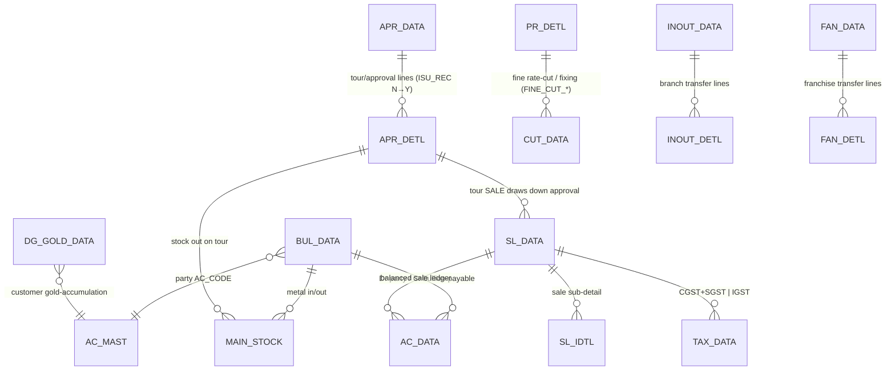

# Module 11 — Bullion / Tour / VP (wholesale-metal & field-sales)

> A cluster of **specialised trade forms** that sit beside ordinary retail sales. They share the
> balanced-`AC_DATA` posting engine and the fine-weight calc, but each models a distinct
> jeweller workflow:
>
> - **Bullion** — wholesale raw-metal trading: *book* a quantity of fine metal at a locked rate
>   (`TR_BUL_BOOKING` → `BUL_DATA`), then *draw it down* by selling against the booking (`TR_BUL_SALE`).
> - **Fine sale/purchase** — trade **pure metal priced on fine weight** (`TR_FINE_SL_PR`), settling
>   open fine positions (rate-cut / fixing) against purchase lines.
> - **Tour** — a salesman takes stock **on tour** (approval), books orders/sales remotely
>   (`TR_TOUR` issue, `TR_TOUR_ORD` order, `TR_TOUR_SALE` sale) and the unsold stock returns.
> - **VP (Value-Payable Parcel)** — dispatch goods by **value-payable post (VPP / COD)** (`TR_VP`)
>   and settle on delivery/return (`TR_VP_ADJ`).
> - **Gold Booking** — a **customer gold-accumulation** ledger (`TR_GOLD_BOOK` → `DG_GOLD_DATA`).
> - **Branch / Franchise In-Out** — inter-location (`TR_INOUT`, "Branch Inout") and inter-company
>   franchise (`TR_FN_INOUT`, "Franchise In Out") stock transfers.
> - **Other Commission** — commission income/expense vouchers (`TR_OTH_COMM`).
>
> ⚠️ **Two semantics are derived from the decompiled source and must be confirmed before build**
> (flagged in each form doc §11): **VP** (exact `AC_DATA`/charge flow) and **GOLD_BOOK** (the
> per-account gold-balance accounting). Do **not** invent posting rules for these.
>
> Full deep-dives: [`TR_FINE_SL_PR.md`](TR_FINE_SL_PR.md) (fine sale/purchase) and
> [`TR_TOUR_SALE.md`](TR_TOUR_SALE.md) (tour sale). All other forms are variant stubs in this folder.

## 1. Purpose

These forms serve the **wholesale / B2B / field** side of the trade where the plain retail
`TR_SALE` doesn't fit: trading loose metal by fineness (bullion, fine sale/purchase), selling away
from the counter (tour, VPP), accumulating gold for a customer over time (gold book), and moving
stock between the firm's own branches or its franchisees. Each still ends in the **same double-entry
ledger** so the trial balance ties, and each touches **`MAIN_STOCK`** so on-hand metal stays correct.

## 2. Form inventory

| Form | Caption | Type | Posting | Purpose | Web status |
|---|---|---|---|---|---|
| `TR_BUL_BOOKING` | Bullion Booking | transaction | ✅ | Book fine metal at a locked rate → `BUL_DATA` (Dr party / Cr bullion-payable; advance optional). | 🟩 BUILT (`bullion.ts → bullionBooking`) |
| `TR_BUL_SALE` | Bullion Sales | transaction | ✅ | Sell against a booking: draw down `BUL_DATA.ADJ_WT`, price `ITM_RATE`+`PRM_AMT`, post ledger+tax. | ⬛ UNBUILT (booking only) |
| `TR_FINE_SL_PR` | Fine Sales / Fine Purc | transaction | ✅ | Trade **pure metal on fine weight**; rate-cut/fixing of open fine (`PR_DETL.FINE_CUT_*`). | ⬛ UNBUILT (reuse calc + rateCut) |
| `TR_TOUR` | Tour Issue / IsuRec | transaction | ✅ (stock) | Issue stock to a salesman on tour (approval out) / receive back. → `APR_DATA`/`APR_DETL`+`MAIN_STOCK`. | 🟩 BUILT (`tour.ts → tourIssue`) |
| `TR_TOUR_ORD` | Sales Order (tour) | transaction | ✅ | Book an **order** while on tour (advance). → `SL_ORD_*`. | ⬛ UNBUILT |
| `TR_TOUR_SALE` | Tour Sales | transaction | ✅ | **Sell** stock taken on tour: draw down approval → real sale (`SL_IDTL`+`AC_DATA`+`TAX_DATA`+`MAIN_STOCK`). | ⬛ UNBUILT |
| `TR_VP` | Vp Parcel | transaction | ✅ | Dispatch goods by **value-payable post (VPP/COD)**; VP charge/insurance. Sale-like stock-out. | ⬛ UNBUILT |
| `TR_VP_ADJ` | Vp Adjust Book | transaction | ✅ | Settle a VP parcel on delivery (money received) or return. | ⬛ UNBUILT |
| `TR_GOLD_BOOK` | Gold Booking | transaction | ✅ | Customer **gold-accumulation** booking → `DG_GOLD_DATA` (fine grams @ rate, per-account balance). | ⬛ UNBUILT |
| `TR_INOUT` | Branch Inout | transaction | ✅ | Inter-**branch/location** stock transfer (`INOUT_*`, `TO_LC_CODE`). | 🟦 PARTIAL (`fineInout.ts`, metal-only) |
| `TR_FN_INOUT` | Franchise In Out | transaction | ✅ | Inter-**company/franchise** stock transfer w/ billing (`FAN_*`+tax). | ⬛ UNBUILT |
| `TR_OTH_COMM` | Other Commission | transaction | ✅ | Commission income/expense voucher → `AC_DATA`. | ⬛ UNBUILT |

> **Build reality.** Module-11's web footprint is partial: a bullion **booking** (`bullion.ts`), a
> tour **issue** (`tour.ts`), and a pure-metal in/out (`inout/fineInout.ts`). The priced **sale**
> sides (bullion sale, fine sale/purchase, tour sale, VP, gold book, franchise in/out, commission)
> are **not yet built** — this spec defines them from the decompiled source.

## 3. Module ER diagram

Composite key everywhere: `(CO_CODE, LC_CODE, CO_YEAR, CO_BOOK, VCH_NO[, SR_NO])` + `tenant_id`
(`INOUT_DATA` is header-only — no `SR_NO` in its PK). Names kept **verbatim**.
Refs: [BUL_DATA](../../02_Data_Model/tables/BUL_DATA.md) · [APR_DATA](../../02_Data_Model/tables/APR_DATA.md) ·
[APR_DETL](../../02_Data_Model/tables/APR_DETL.md) · [PR_DETL](../../02_Data_Model/tables/PR_DETL.md) ·
[CUT_DATA](../../02_Data_Model/tables/CUT_DATA.md) · [CUT_DETL](../../02_Data_Model/tables/CUT_DETL.md) ·
[DG_GOLD_DATA](../../02_Data_Model/tables/DG_GOLD_DATA.md) · [INOUT_DATA](../../02_Data_Model/tables/INOUT_DATA.md) ·
[FAN_DATA](../../02_Data_Model/tables/FAN_DATA.md) · [AC_DATA](../../02_Data_Model/tables/AC_DATA.md).

## 4. Shared logic

- **Fine weight** (`@datacare/core → fineWeight`): `fine = netWt × touch / 100`, 3 dp HALF-UP — the
  unit every metal trade prices on. Bullion/fine-sale value = `fine × FINE_RATE` (+ premium/labour).
- **Balanced posting** (`postVoucherTx`/`assertBalanced`): every priced form posts a balanced
  `AC_DATA` pair (party ↔ sales/payable/cash) — see [posting-and-ledger.md](../../04_Cross_Cutting_Engines/posting-and-ledger.md).
- **GST split** (`gstSplit`): the bullion/fine/tour *sale* forms carry tax (CGST+SGST intra / IGST inter)
  into `TAX_DATA`; bookings, tour-issue, branch-transfer and gold-book mostly do not.
- **Stock movement** (`MAIN_STOCK`): `TR_TYPE`/`ITM_SIGN` per form — tour issue `'O'/'-'`, fine
  purchase `'+'`, sale `'-'`. Bookings reserve via `BUL_DATA.ADJ_WT` rather than moving stock.
- **Rate-cut / fixing** (`bullion.ts` booking, `rateCut.ts`): an open metal position is settled at a
  later rate; `TR_FINE_SL_PR` and `TR_BUL_SALE` draw down `FINE_CUT_*` / `ADJ_WT` against it.
- Existing web building blocks: `bullion.ts` (booking ledger), `tour.ts` (`tourLineFine`, approval
  out-movement), `inout/fineInout.ts` (`lineFine`, signed `MAIN_STOCK`), `sales/rateCut.ts` (fixing).

## 5. Dependencies

- Engines: **posting/ledger**, **numbering** (`SRNO_MAST` per book: `BUL`, `TUR`, fine/VP/gold/inout
  books), **calc** (fine + GST), **GST** (sale variants), **stock** (`MAIN_STOCK`, tag/approval),
  **RBAC**. Some forms also hit **ROJ_MEL_DATA** (day book) and **REMARK_DATA**.
- Masters: `AC_MAST` (party, bullion-payable, cash/bank), `ITEM_MAST`/`TOUCH_MAST` (metal item +
  purity), `RATE_MAST` (metal rate), `EMP_MAST` (salesman/tour), `TAX_MAST`, `FAN_AC_MAST` (franchise
  master), `AD`-side n/a here.
- Reports: `BullBookBill.rpt`, `BulCustBooking.rpt`, `BulCustAdjust.rpt`, `TourOrdVch.rpt`,
  `VpIsuRpt.rpt`, `VpAdjustBill.rpt`, `FineSalesGstBill.rpt`, `LedrInOut.rpt`/`LedrInOutWh.rpt`,
  `OthCommVch.rpt`, `MembGoldRpt.rpt` (Module 12).

## 6. API surface (built subset; see form docs for the full target)

| Method | Path | Right | Purpose | State |
|---|---|---|---|---|
| POST | `/bullion/booking` | create | Bullion booking → `BUL_DATA` | 🟩 BUILT |
| DELETE | `/bullion/:vchNo` | delete | Reverse a booking | 🟩 BUILT |
| POST | `/tour/issue` | create | Tour/approval issue → `APR_*`+`MAIN_STOCK` | 🟩 BUILT |
| DELETE | `/tour/:vchNo` | delete | Reverse a tour issue | 🟩 BUILT |
| POST | `/inout/fine` | create | Fine/branch in-out → `INOUT_*`+`MAIN_STOCK` | 🟦 PARTIAL |
| DELETE | `/inout/fine/:vchNo` | delete | Reverse an in-out | 🟦 PARTIAL |
| *(planned)* | `/bullion/sale`, `/fine-sale`, `/tour/sale`, `/vp`, `/gold-book`, `/inout/franchise`, `/commission` | create | priced sale variants | ⬛ TODO |

> **SECURITY.** All routes mutate financial ledgers and stock; they MUST be behind authentication +
> per-tenant authorization + RBAC. The reference services are auth-agnostic — routing enforces it.

## 7. Build checklist

- [ ] Engines green: posting (balanced + metal legs), numbering (per book), calc (fine + GST), stock.
- [ ] **Bullion booking** (built): `BUL_DATA` header + Dr party/Cr payable (+advance) match desktop; delete reverses.
- [ ] **Bullion sale** (new): draw down `BUL_DATA.ADJ_WT`; price `ITM_RATE`+`PRM_AMT`; `AC_DATA`+`TAX_DATA`; over-draw guarded.
- [ ] **Fine sale/purchase** (new): trade fine at `FINE_RATE`; rate-cut updates `PR_DETL.FINE_CUT_*`+`MAIN_STOCK`; `CUT_*` rows; tax. — `TR_FINE_SL_PR.md`.
- [ ] **Tour**: issue (built) → order → sale (new) lifecycle; tour sale draws down `APR_DETL` (`ISU_REC`) into a real sale. — `TR_TOUR_SALE.md`.
- [ ] **VP** (new): dispatch + `TR_VP_ADJ` settlement — **confirm accounting first** (flagged).
- [ ] **Gold book** (new): `DG_GOLD_DATA` accumulation + per-account fine balance — **confirm accounting first** (flagged).
- [ ] **Branch/Franchise in-out**: `TR_INOUT` (`INOUT_*`, `TO_LC_CODE`) vs `TR_FN_INOUT` (`FAN_*`+tax) kept distinct; reconcile the web `fineInout.ts` naming (see `TR_FN_INOUT.md §`).
- [ ] **Other commission**: balanced `AC_DATA` income/expense.
- [ ] Trial balance nets to zero + `MAIN_STOCK` correct after a batch across all forms. Parity: `06_Parity/bullion-tour-vp.md`.
