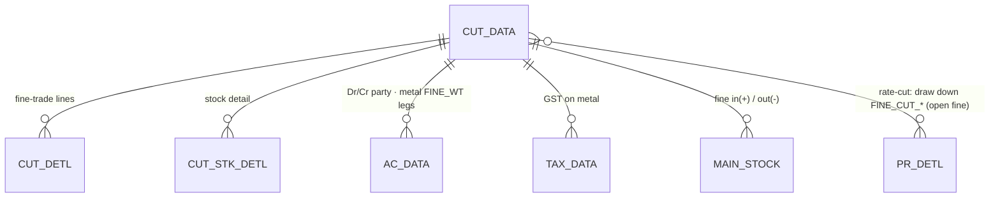
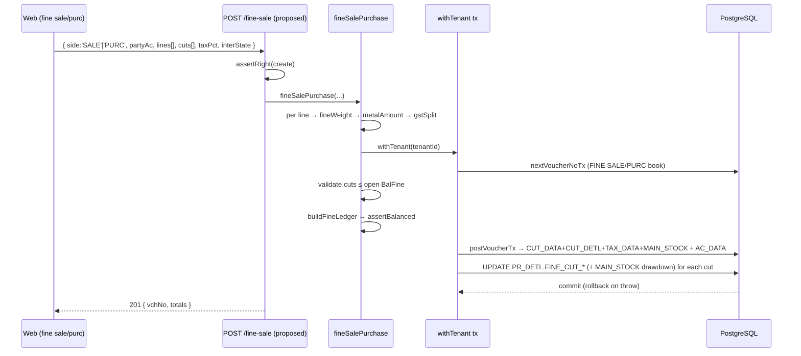

# TR_FINE_SL_PR — Fine Sale / Fine Purchase (pure-metal trade on fine weight)

```
Form: TR_FINE_SL_PR ("Fine Sales" / "Fine Purc")  ·  Module: 11_Bullion_Tour_VP  ·  Type: transaction (posting)
Desktop source: unified/src/csharp/DataCareNext/TR_FINE_SL_PR.cs (233 KB) + Ac_Ledr/Ac_Tax/Ac_Rojmel helpers
Web target: NEW apps/api/src/modules/bullion/fineSalePurchase.ts (proposed) — reuses @datacare/core (fineWeight, gstSplit) + sales/rateCut.ts patterns
Requirements: Req 9 (numbering), 10/18 (sale+GST), 12.1 (fine), 13 (ledger) · Parity: 06_Parity/bullion-tour-vp.md
Status: 📋 SPEC · ⬛ UNBUILT (calc + rate-cut primitives exist; the form itself is not yet built)
Evidence: form catalog project-memory/catalogs/forms/TR_FINE_SL_PR.md
```

## 1. Purpose & business context

The **bullion-style pure-metal trade**. Instead of selling a finished, tagged ornament, the jeweller
buys or sells **loose fine metal** (gold/silver) **priced on its fine (pure) weight** at a fine rate
(`FINE_RATE` per gram of pure metal). The single form runs two books, chosen by `FormMainBook`:
**`FINE SALE`** (sell fine metal out) and **`FINE PURC`** (buy fine metal in).
`// src: TR_FINE_SL_PR.cs#L1660 (lblBook "Fine Sales"); #L4474, #L4701 (FormMainBook == "FINE PURC")`

Critically, a fine sale/purchase is also the jeweller's **rate-fixing / rate-cut** instrument: an
earlier metal transaction can be left **unpriced** (an open fine position on a purchase line), and a
later fine sale/purchase **"cuts"** (fixes) part of that open fine at today's rate. The form therefore
draws down the open balance on the linked purchase line (`PR_DETL.FINE_CUT_FINE`/`_NWT`/`_GWT`/`_PCS`)
and records the cut in the `CUT_*` tables. `// src: TR_FINE_SL_PR.cs#L2350 (PR_DETL.ITM_FINE − FINE_CUT_FINE = BalFine)`

> Value is **always on fine weight**: `amount = fineWeight × FINE_RATE` (no labour, no MRP — this is
> raw metal). GST applies on the metal value (HSN 7108 gold etc.). Contrast `TR_SALE` (tagged retail).

## 2. UI / UX specification

### Layout
```
┌─ TR_FINE_SL_PR ─ Fine Sales / Fine Purchase ───────── [New][Save F2][Delete][Print][Close] ┐
│ Vch No:[____] Date:[__/__/__]  Party:[AC_CODE ▾][AC_NAME ........]  Emp:[__]  It.Type: G/S  │
│ ┌ Items (fine) ───────────────────────────────────────────────────────────────────────────┐│
│ │ # │ Item │ Pcs │ G.Wt │ N.Wt │ Touch │ Fine │ Fine Rate │ Metal Amt │ Tax% │ Net │         ││
│ │ 1 │ GOLD │     │      │      │ 99.50 │ calc │  6450.00  │   calc    │  3   │calc │         ││
│ └────────────────────────────────────────────────────────────────────────────────────────────┘│
│ ┌ Rate-cut / fixing (link open fine) ──────────────────────────────────────────────────────┐│
│ │ Pick open purchase line → Bal Fine = ITM_FINE − FINE_CUT_FINE → cut N fine at this rate    ││
│ └────────────────────────────────────────────────────────────────────────────────────────────┘│
│ Cash/Bank:[__]  Party A/C bal → outstanding         Totals → Fine:[..] Metal:[..] Tax:[..] TOT:[..]│
└────────────────────────────────────────────────────────────────────────────────────────────────┘
```

### Header / line field table
| Label | Column | Type | Req | Notes |
|---|---|---|---|---|
| Vch No / Date | `VCH_NO` / `VCH_DATE` | string/date | auto/✓ | per book; period-lock guard |
| Party | `AC_CODE`/`AC_NAME` | lookup→`AC_MAST` | ✓ | supplier (purc) or customer (sale); drives GST state |
| It.Type | `IT_TYPE` | G/S | ✓ | gold or silver fine |
| N.Wt / Touch | `ITM_NWT` / `ITM_TOUCH` | weight/% | ✓ | drives fine |
| Fine | `ITM_FINE` | weight | auto | `NWT × TOUCH / 100` (3 dp) `// src: #L4665` |
| Fine Rate | `FINE_RATE` | money | ✓ | ₹ per gram of **fine** `// src: #L4620` |
| Metal Amt | `ITM_AMT` | money | auto | `fine × FINE_RATE` |
| Tax% | `TAX_PRC`/`TAX_CODE` | %/lookup→`TAX_MAST` | — | GST on metal |
| Net | `NET_AMT` | money | auto | metal + tax (− cut adjustments) |

### Modes / keys
F2 save; party + item + tax F-lookups; a fixing picker lists **open** purchase lines (`BalFine > 0`).
New / Edit (delete+repost) / View / Delete (`USER_DELETE`) / Print (`USER_PRINT`).

## 3. Data model touched

**Writes / updates (create):**
- `CUT_DATA` (cut/voucher header), `CUT_DETL` (cut detail), `CUT_STK_DETL` (cut stock detail) — the
  fine-trade voucher tables. `// src: catalog: DELETE CUT_DATA/CUT_DETL/CUT_STK_DETL on re-save`
- `PR_DETL` **UPDATE** — increments `FINE_CUT_FINE`/`FINE_CUT_NWT`/`FINE_CUT_GWT`/`FINE_CUT_PCS` on the
  linked open purchase line (draws down its unpriced balance). `// src: #L4703 (UPDATE PR_DETL)`
- `RATE_CUT_ISU` **UPDATE** — marks the cut against the open issue. `// src: #L4717`
- `MAIN_STOCK` — fine in (purc, `+`) / out (sale, `−`); for `FINE PURC` the cut reduces stock by the
  fixed quantity (`SET ITM_* = ITM_* − FINE_CUT_*`). `// src: #L4710-L4724`
- `AC_DATA` (balanced party ↔ metal/cash + metal `FINE_WT` legs), `TAX_DATA` (GST), `ROJ_MEL_DATA`
  (day book), `REMARK_DATA` (narration).

**Deletes/reverses:** `CUT_DATA, CUT_DETL, CUT_STK_DETL, AC_DATA, TAX_DATA, ROJ_MEL_DATA, MAIN_STOCK,
REMARK_DATA, TEMP_BOOK_DATA` + restore `PR_DETL.FINE_CUT_*` + `DELETE_DATA`.
`// src: TR_FINE_SL_PR.cs#L4850-L4858`


Refs: [CUT_DATA](../../02_Data_Model/tables/CUT_DATA.md) · [CUT_DETL](../../02_Data_Model/tables/CUT_DETL.md) ·
[PR_DETL](../../02_Data_Model/tables/PR_DETL.md) · [RATE_CUT_DATA](../../02_Data_Model/tables/RATE_CUT_DATA.md) ·
[AC_DATA](../../02_Data_Model/tables/AC_DATA.md).

## 4. Business logic & calculations (with code)

### 4.1 Fine pricing (the core rule)
```ts
// web (proposed): bullion/fineSalePurchase.ts — reuse @datacare/core
import { fineWeight, metalAmount, gstSplit, round } from '@datacare/core';
const fine  = line.fineWt ?? fineWeight(line.netWt, line.touch);   // NWT × TOUCH / 100  (3 dp HALF-UP)
const metal = metalAmount(fine, line.fineRate);                    // fine × FINE_RATE   (2 dp HALF-UP)
const tax   = round(metal * (line.taxPct ?? 0) / 100, 2);
const split = gstSplit(tax, interState);                           // CGST+SGST | IGST
const net   = round(metal + tax, 2);
```
`// src: TR_FINE_SL_PR.cs#L4620 (FINE_RATE), #L4665 (ITM_FINE) — value is fine × FINE_RATE, no labour`

### 4.2 Rate-cut / fixing drawdown (`FINE PURC` against an open line)
An open (unpriced) purchase line carries `ITM_FINE`; the amount already fixed is `FINE_CUT_FINE`; the
remaining **balance fine** is `ITM_FINE − FINE_CUT_FINE`. A fine trade cuts `q` fine of it:
```sql
-- src: TR_FINE_SL_PR.cs#L4703-L4724 (trimmed)
UPDATE PR_DETL SET FINE_CUT_FINE = FINE_CUT_FINE + @q, FINE_CUT_NWT = FINE_CUT_NWT + @qNwt, ...
  WHERE <linked open purchase line key>;
UPDATE MAIN_STOCK SET ITM_FINE = ITM_FINE - @q, ITM_NWT = ITM_NWT - @qNwt, ITM_GWT = ..., ITM_PCS = ...
  FROM MAIN_STOCK JOIN PR_DETL AS B ON ... ;   -- reduce on-hand by the fixed quantity
```
Guard: a cut may not exceed the open balance (`q ≤ ITM_FINE − FINE_CUT_FINE`).

### 4.3 Balanced ledger (web target)
```ts
// FINE SALE: Dr customer (or cash) / Cr fine-sales + Cr GST ; metal OUT leg (IT_TYPE 'G'/'S', FINE_WT−)
// FINE PURC: Dr fine-purchase + Dr input-GST / Cr supplier ; metal IN leg (FINE_WT+)
const ledger = buildFineLedger({ key, partyAc, metalAc, taxAc, party: net, metal, tax, interState, side });
assertBalanced(ledger);                          // ΣDR === ΣCR (Req 13.1) + metal legs balance (Req 13.5)
await postVoucherTx(tx, tenantId, { ledger:{table:'AC_DATA',lines:ledger}, bookName: FormMainBook,
  writes:[{table:'CUT_DATA',rows:[header]},{table:'CUT_DETL',rows:detl},{table:'TAX_DATA',rows:tax},
          {table:'MAIN_STOCK',rows:stock}] });
```
Money **2 dp**, fine **3 dp**, **HALF-UP** (calc-engine). GST split keeps the penny (`SGST = tax − CGST`).

## 5. Save sequence (create / edit)


Numbered: (1) compute fine/metal/tax per line; (2) voucher no; (3) validate cuts vs open balance;
(4) build+assert balanced ledger (money + metal legs); (5) `postVoucherTx` writes cut header/detail/
tax/stock + `AC_DATA`; (6) update linked `PR_DETL.FINE_CUT_*`; (7) commit.

## 6. Delete / reverse sequence

Reverse the whole derived set **and restore** the open fine balance:
```ts
await reverseVoucherTx(tx, tenantId, {
  tables:['CUT_DATA','CUT_DETL','CUT_STK_DETL','AC_DATA','TAX_DATA','ROJ_MEL_DATA','MAIN_STOCK','REMARK_DATA'],
  key, deleteLog:{ table:'DELETE_DATA', row:{ ...key, VCH_TYPE:FormBookSname, DELETE_USER } },
});
// then UNDO the cut: PR_DETL.FINE_CUT_* -= q (re-open the fixed balance)
```
One transaction; requires `USER_DELETE`. `// src: TR_FINE_SL_PR.cs#L4850-L4858`

## 7. API contract (proposed)

```ts
// POST /fine-sale   (right: create)            → 201 { vchNo, totals }
interface FineSalePurchaseBody {
  scope?; side: 'SALE' | 'PURC'; partyAc: string; itType?: 'G'|'S';
  taxPct?: number; interState?: boolean; vchDate?: string;
  lines: { itCode; pcs?; grossWt?; netWt?; touch?; fineWt?; fineRate: number; taxPct?: number }[];
  cuts?: { purcKey: VoucherKey; srNo: number; fine: number }[];  // fix open fine on a purchase line
  cashAmt?: number; bankAc?: string;
}
// DELETE /fine-sale/:vchNo   (right: delete) → { reversed:true }
```
Errors: `FineSaleValidationError`→400 (no party / no line / cut > open balance / period lock),
`ForbiddenError`→403, `UnbalancedError`→500 (invariant).

## 8. Validation rules

| Rule | Condition | HTTP | req |
|---|---|---|---|
| Party required | no `partyAc` | 400 | 10.7 |
| ≥1 line | empty `lines` | 400 | 10.6 |
| Fine rate > 0 | `fineRate ≤ 0` | 400 | 12 |
| Fine derivable | no `fineWt` and (no `netWt`/`touch`) | 400 | 12.1 |
| Cut ≤ open balance | `cut.fine > (ITM_FINE − FINE_CUT_FINE)` | 400 | — |
| Period open | `VCH_DATE ≤ CO_SET.LOCK_DATE` | 400 | — |
| Balanced ledger | ΣCR≠ΣDR / metal legs unbalanced | 500 | 13.1/13.5 |

## 9. Parity criteria (Definition of Done)

1. `CUT_DATA`/`CUT_DETL` rows reproduce desktop (`ITM_FINE`, `FINE_RATE`, `ITM_AMT`, `IT_TYPE`).
2. `AC_DATA` legs match (party ↔ fine-sales/purchase + GST + metal `FINE_WT` legs) and **ΣCR=ΣDR**;
   `TAX_DATA` matches GST shape (CGST+SGST intra / IGST inter).
3. A **rate-cut** increments the linked `PR_DETL.FINE_CUT_*` by exactly the fixed quantity and reduces
   `MAIN_STOCK` accordingly; the open balance `ITM_FINE − FINE_CUT_FINE` matches desktop after the cut.
4. Delete reverses every table, **restores** `PR_DETL.FINE_CUT_*`, and writes `DELETE_DATA`.
5. `fine × FINE_RATE` and GST totals reproduce desktop to the paisa; trial balance nets to zero.
Crystal parity report: `FineSalesGstBill.rpt`, `JmUdFineSl.rpt`. Fixtures: `06_Parity/bullion-tour-vp.md`.

## 10. Variants & edge cases

| Variant | Delta |
|---|---|
| `FINE SALE` | sell fine out; Dr customer/cash, Cr fine-sales+GST; `MAIN_STOCK '−'`. |
| `FINE PURC` | buy fine in; Dr fine-purchase+input-GST, Cr supplier; `MAIN_STOCK '+'`; may **cut** open lines. |
| Silver (`IT_TYPE='S'`) | metal leg uses silver code; rounding still 3 dp fine. |
| Pure rate-cut (no new metal) | only fixes an open position — links `RATE_CUT_ISU`/`PR_DETL`, no fresh stock. Overlaps `sales/rateCut.ts`. |
| Hedged fixing | links a hedge (`TR_PR_SL_HEDG`) — out of scope here. |

## 11. Open questions / risks

- **Not yet built in web.** The calc primitives (`fineWeight`, `metalAmount`, `gstSplit`) and the
  rate-cut pattern (`sales/rateCut.ts`) exist, but no `fineSalePurchase.ts` — the §4/§7 web target is
  the spec, not extant code. Build + parity-test against `FineSalesGstBill.rpt`.
- **Exact `CUT_*` column set + the `RATE_CUT_ISU`/`RATE_CUT_REC` link rows** need a Docker golden-master
  pass (the form catalog confirms the tables but not every column/flow). Do not guess column names beyond
  those in the table refs.
- **Account resolution** (which ledger codes for fine-sales / fine-purchase / metal control) is resolved
  from `BOOK_DETL` sub-rows in the desktop — confirm before wiring `buildFineLedger`.
- Confirm whether silver fine uses `SILVER_FINE` (a distinct `PR_DETL` column) vs `ITM_FINE`.
