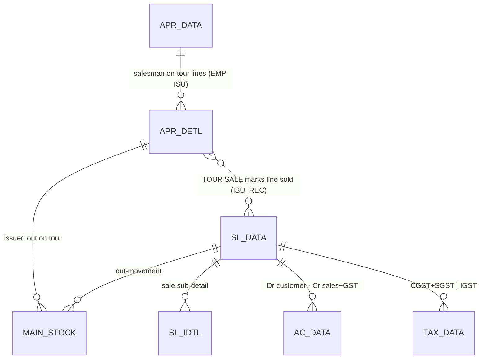
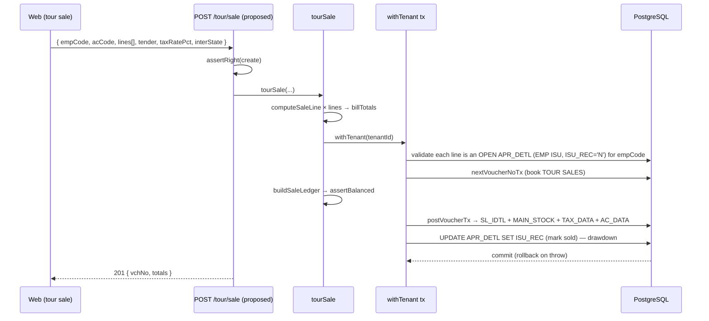

# TR_TOUR_SALE — Tour Sales (field sale against on-tour approval stock)

```
Form: TR_TOUR_SALE ("Tour Sales")  ·  Module: 11_Bullion_Tour_VP  ·  Type: transaction (posting)
Desktop source: unified/src/csharp/DataCareNext/TR_TOUR_SALE.cs (550 KB) + Ac_Ledr/Ac_Tax/Ac_Stock helpers
Web target: NEW apps/api/src/modules/tour/tourSale.ts (proposed) — reuses sales engine (sales.ts) + tour.ts approval drawdown
Requirements: Req 9, 10 (sale), 12 (calc), 13 (ledger), 14 (stock), 18 (GST) · Parity: 06_Parity/bullion-tour-vp.md
Status: 📋 SPEC · ⬛ UNBUILT (tour ISSUE is built in tour.ts; the SALE is not)
Evidence: form catalog project-memory/catalogs/forms/TR_TOUR_SALE.md
```

## 1. Purpose & business context

A salesman takes a tray of stock **on tour** (an exhibition, a customer's home, a B2B circuit) via a
**Tour Issue** (`TR_TOUR`, book `EMP ISU` → approval out). Away from the shop he then **sells** items
to end customers; this form books those sales remotely. On save it does two things at once:
1. **draws down the approval** — the sold approval lines are marked issued/sold (`APR_DETL.ISU_REC`),
   so the salesman's on-tour balance reduces; and
2. **posts a normal sale** — sub-detail, a **balanced** customer↔sales↔GST ledger, a `MAIN_STOCK`
   out-movement, and tax, exactly like `TR_SALE`.

Book/voucher: **`TOUR SALES`**. The salesman's net on-hand for an item is
`Σ(EMP ISU) − Σ(EMP REC) − Σ(TOUR SALES)`. `// src: TR_TOUR_SALE.cs#L9175 (net = SUM CASE BOOK_NAME 'EMP ISU' …)`,
`#L8521 (UPDATE APR_DETL SET ISU_REC)`, `#L4014 (lblBook "Tour Sales")`.

> This is the **gold-standard `TR_SALE` plus an approval drawdown**. Read [`2_Sales/TR_SALE.md`](../2_Sales/TR_SALE.md)
> first — the line calc, bill totals, GST split, ledger and stock-out are identical; this doc covers
> only the **tour deltas** (salesman/employee, approval source, `APR_DETL` drawdown).

## 2. UI / UX specification

### Layout
```
┌─ TR_TOUR_SALE ─ Tour Sales ─────────────────────── [New][Save F2][Delete][Print][Close] ┐
│ Bill No:[___] Date:[__/__/__]  Salesman/Emp:[EMP_CODE ▾][name]  Customer:[AC_CODE ▾][name]│
│ ┌ Items (from this salesman's on-tour stock) ─────────────────────────────────────────────┐│
│ │ # │ Tag/Item │ Pcs │ G.Wt │ N.Wt │Touch│ Fine │ Rate │ Metal │ Labour │ Tax% │ Net │      ││
│ │ 1 │ scan ▾   │     │      │      │     │ calc │      │ calc  │ calc   │      │calc │      ││
│ │   └ picks an APR_DETL line where BOOK_NAME='EMP ISU', EMP_CODE=salesman, ISU_REC='N'      ││
│ └────────────────────────────────────────────────────────────────────────────────────────────┘│
│ Discount:[__] Tax%:[__]  Tender → Cash/Card/UPI/Cheque   Totals → Net/CGST/SGST/IGST/RoundOff/TOTAL│
└────────────────────────────────────────────────────────────────────────────────────────────────┘
```

### Fields (deltas vs `TR_SALE`)
| Label | Column | Notes |
|---|---|---|
| Salesman / Emp | `EMP_CODE` | the tour salesman — scopes the available approval stock (`EMP_MAST`) |
| Tag/Item picker | `TAG_NO`/`IT_CODE` | resolves to an **open** `APR_DETL` line (`EMP ISU`, `ISU_REC='N'`) for that emp `// src: #L8822, #L10716` |
| Customer | `AC_CODE`/`AC_NAME` | the end customer (drives GST state) |
| (rest) | `SL_DETL`/`SL_IDTL`/`SL_DATA` | identical to `TR_SALE` (fine, metal, labour, GST, totals) |

### Keys / modes
F2 save; tag scan resolves the salesman's on-tour line; customer/item F-lookups. New / Edit / View /
Delete (`USER_DELETE`) / Print (`USER_PRINT`).

## 3. Data model touched

**Reads:** `APR_DETL` (the salesman's on-tour approval lines, `BOOK_NAME IN ('EMP ISU','EMP REC',
'TOUR SALES')`), `ITEM_MAST`, `AC_MAST`, `EMP_MAST`, `TAX_MAST`, `RATE_MAST`, `TOUCH_MAST`.

**Writes / updates (create):**
- `APR_DETL` **UPDATE** — mark the sold approval line (`ISU_REC`, clear `ISU_*` link). `// src: #L8521-L8523`
- `SL_IDTL` (sale tag/stone sub-detail), `MAIN_STOCK` (out-movement), `AC_DATA` (balanced sale ledger),
  `TAX_DATA` (CGST+SGST | IGST), `RATE_CUT_*` (if metal fixed), `DM_DATA` (diamond/stone detail),
  `ROJ_MEL_DATA` (day book), `TOUCH_MAST` (auto-add a new touch value if entered). `// src: #L11250-L11402`

**Deletes/reverses:** `AC_DATA, TAX_DATA, ROJ_MEL_DATA, MAIN_STOCK, DM_DATA, RATE_CUT_DATA,
RATE_CUT_ISU, RATE_CUT_REC, SL_IDTL, APR_DETL`(restored) + `DELETE_DATA`. `// src: #L11379-L11402`


Refs: [APR_DETL](../../02_Data_Model/tables/APR_DETL.md) · [APR_DATA](../../02_Data_Model/tables/APR_DATA.md) ·
[AC_DATA](../../02_Data_Model/tables/AC_DATA.md) · [DM_DATA](../../02_Data_Model/tables/DM_DATA.md) ·
[RATE_CUT_DATA](../../02_Data_Model/tables/RATE_CUT_DATA.md). (Sale tables: see [TR_SALE.md](../2_Sales/TR_SALE.md).)

## 4. Business logic & calculations (with code)

### 4.1 Sale calc — identical to TR_SALE
Line: `fine = NWT × TOUCH / 100` → `metal = fine × rate` → `+ labour (by LBR_TYPE) + other = net`.
Bill: `Σ net − discount → taxable → × tax% → split CGST/SGST/IGST → round to rupee → total`.
See [`calc-engine.md`](../../04_Cross_Cutting_Engines/calc-engine.md) and `TR_SALE.md §4`. Money 2 dp,
fine 3 dp, **HALF-UP**; `SGST = tax − CGST`.

### 4.2 Tour delta — approval drawdown & salesman balance
```ts
// web (proposed): tour/tourSale.ts — sale engine + approval drawdown in ONE tx
const calc = lines.map(computeSaleLine);                         // reuse sales.ts
const totals = billTotals({ lineNetTotal: Σ calc.net, discountAmount, taxRatePct, interState });
// 1) validate each line resolves to an OPEN approval line for this salesman
//    onTour = Σ(EMP ISU) − Σ(EMP REC) − Σ(TOUR SALES)  must cover the sold qty
// 2) post the sale (same shape as createSale) AND mark the approval line sold:
await postVoucherTx(tx, tenantId, { ledger: saleLedger, bookName: 'TOUR SALES',
  writes:[ {table:'SL_IDTL',rows:idtl}, {table:'MAIN_STOCK',rows:stockOut}, {table:'TAX_DATA',rows:tax} ] });
await tx.$executeRawUnsafe(`UPDATE "APR_DETL" SET "ISU_REC"='Y' WHERE <line key>`);  // drawdown
```
```csharp
// src: TR_TOUR_SALE.cs#L9175 — the salesman's net on-hand per item
SELECT IT_CODE, SUM(CASE WHEN BOOK_NAME='EMP ISU' THEN ITM_GWT ELSE -ITM_GWT END) As GrWt
  FROM APR_DETL WHERE EMP_CODE=@emp AND BOOK_NAME IN ('EMP ISU','EMP REC','TOUR SALES') ... HAVING SUM(...)>0
// src: TR_TOUR_SALE.cs#L8521 — mark the approval line sold on save
UPDATE APR_DETL SET APR_DETL.ISU_REC='N' WHERE <CO/LC/YEAR/BOOK/VCH/SR of the picked line>
```

## 5. Save sequence (create / edit)



## 6. Delete / reverse sequence

```ts
await reverseVoucherTx(tx, tenantId, {
  tables:['AC_DATA','TAX_DATA','ROJ_MEL_DATA','MAIN_STOCK','DM_DATA','RATE_CUT_DATA','RATE_CUT_ISU','RATE_CUT_REC','SL_IDTL'],
  key, deleteLog:{ table:'DELETE_DATA', row:{ ...key, VCH_TYPE:'TOUR', DELETE_USER } },
});
// restore the approval: APR_DETL.ISU_REC='N' (goods go back onto the salesman's tour balance)
```
One transaction; requires `USER_DELETE`. The reversed sale **re-opens** the approval lines so the
salesman's on-tour balance is restored. `// src: TR_TOUR_SALE.cs#L11381-L11402`

## 7. API contract (proposed)

```ts
// POST /tour/sale   (right: create)            → 201 { vchNo, totals }
interface TourSaleBody {
  scope?; empCode: string; acCode: string; acName?: string;
  taxRatePct: number; interState: boolean; discountAmount?: number;
  cashAmt?; cardAmt?; upiAmt?; chequeAmt?;
  lines: { tagNo?; itCode; pcs?; grossWt?; netWt?; touch?; fineWt?; rate?; labourType?; labourRate? }[];
}
// DELETE /tour/sale/:vchNo   (right: delete) → { reversed:true }
```
Errors: `TourValidationError`→400 (no emp / no customer / line not on this salesman's tour / period
lock), `ForbiddenError`→403, tag/stock guards→400, `UnbalancedError`→500.

## 8. Validation rules

| Rule | Condition | HTTP | req |
|---|---|---|---|
| Salesman required | no `empCode` | 400 | — |
| Customer required | no `acCode` | 400 | 10.7 |
| ≥1 line | empty `lines` | 400 | 10.6 |
| Line on salesman's tour | item/tag not an open `APR_DETL` (`EMP ISU`,`ISU_REC='N'`) for emp | 400 | 14.5 |
| Not over-selling tour stock | sold qty > `Σ(EMP ISU)−Σ(EMP REC)−Σ(TOUR SALES)` | 400 | — |
| Period open | `VCH_DATE ≤ CO_SET.LOCK_DATE` | 400 | — |
| Balanced ledger | ΣCR≠ΣDR | 500 | 13.1 |

## 9. Parity criteria (Definition of Done)

1. The sale persists the same `SL_*`/`SL_IDTL` + `AC_DATA` + `TAX_DATA` + `MAIN_STOCK` rows as a
   `TR_SALE` for the same inputs (field-for-field, GST split, totals to the paisa).
2. The sold `APR_DETL` line is marked (`ISU_REC`) so the salesman's net on-tour balance drops by
   exactly the sold quantity (matches desktop `SUM(CASE BOOK_NAME …)`).
3. Delete reverses the sale **and** re-opens the approval line; `DELETE_DATA` written.
4. `BOOK_NAME='TOUR SALES'`, `VCH_TYPE` correct; trial balance nets to zero.
Crystal parity: `TourOrdVch.rpt` / `EmpSaleReport.rpt`. Fixtures: `06_Parity/bullion-tour-vp.md`.

## 10. Variants & edge cases

| Form / variant | Relationship |
|---|---|
| `TR_TOUR` (Tour Issue / IsuRec) | **issues** stock to the salesman (`APR_DATA`/`APR_DETL`, `MAIN_STOCK` out) and receives unsold back — the source this sale draws down. Built: `tour.ts → tourIssue`. |
| `TR_TOUR_ORD` (Sales Order) | books an **order** while on tour (advance, no stock-out yet); later fulfilled. |
| Emp sale (`EMP ISU`→sale) | same engine; the salesman/employee dimension distinguishes it from a counter sale. |
| Old-gold / exchange on tour | as `TR_SALE` (old metal in → `SL_PR_DETL`). |
| Rate-cut on tour | links `RATE_CUT_*` when metal is fixed at the point of sale. |

## 11. Open questions / risks

- **Web has tour ISSUE only.** `tour.ts → tourIssue` writes `APR_DATA`/`APR_DETL`/`MAIN_STOCK` but
  uses `BOOK_NAME='TOUR'`, whereas the desktop tour issue/sale chain keys on `BOOK_NAME='EMP ISU'`
  / `'EMP REC'` / `'TOUR SALES'`. **Align the book names** (or the drawdown query won't find the
  issued lines) before building the sale — flagged for the build.
- The tour **sale** form is **not built**; §4/§7 are the spec. It should reuse `sales.ts`
  (`computeLine`/`buildSaleLedger`) plus the approval-drawdown update, in one transaction.
- `DM_DATA` (diamond/stone sub-detail) and the exact `APR_DETL.ISU_*` link columns (`ISU_NO`,
  `ISU_YRCD`, `ISU_DBCD`, `ISU_SRNO`, `ISU_AC_CODE`) need a Docker golden-master pass to confirm the
  precise update set on sale vs delete. `// src: TR_TOUR_SALE.cs#L8523`
- Confirm whether a tour sale to an **unregistered walk-in** customer is allowed (cash account) vs
  requiring an `AC_MAST` party.
