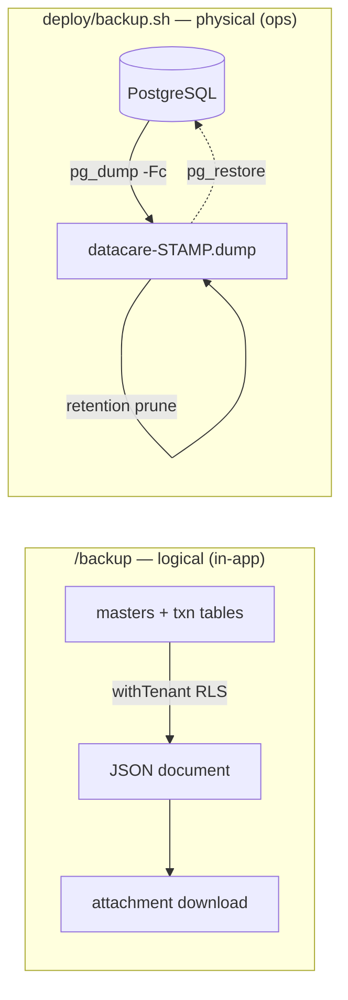

# BACKUP / RESTORE deep-dive

```
Form: UT_BKP  ·  Module: 13_Utilities_Settings_Integrations  ·  Type: utility (operational, non-posting)
Desktop source: unified/src/csharp/DataCareNext/UT_BKP.cs (1,298 ln)
Web target: apps/api/src/modules/ops/backup.ts (logical JSON) · web/deploy/backup.sh (physical pg_dump) · GET /backup
Requirements: Req 7 (data safety / company scope), 1.x (data layer integrity)
Parity: 06_Parity/utilities.md   ·   Status: 📋 SPEC · 🟩 BUILT
Evidence: forms/UT_BKP.md (reads USER_SET; no write ops) · app.ts#140 (/backup route) · deploy/backup.sh
```

## 1. Purpose & business context

A jeweler must be able to take a copy of their data — for safety, for moving to a new machine, or for
the accountant. On the desktop this was `UT_BKP`: a button that produced a **SQL Server `.bak`** (or
a file copy of the per-year database), an OS/file-system operation that read almost nothing from the
app DB (`UT_BKP.cs` reads only `USER_SET` and performs **no INSERT/UPDATE/DELETE** — the work is the
native backup). The web has **two layers**, matching the two real needs:

1. **Logical, per-company JSON export** (`/backup`) — a portable, human-readable snapshot of one
   tenant's master + transaction tables, downloadable from the app. The closest in-app analogue to
   the desktop "export my company" button.
2. **Physical, full-database backup** (`deploy/backup.sh`) — a scheduled `pg_dump` of the entire
   Postgres database for disaster recovery, the true replacement for the SQL Server `.bak`.

## 2. UI / UX specification

### Layout
```
┌─ Backup ──────────────────────────────────────────────────────────┐
│  [ Download company backup (.json) ]   ← GET /backup                │
│  Last physical backup: <ops-managed; see runbook>                   │
│  Restore: operator-only (pg_restore) — see §6                       │
└─────────────────────────────────────────────────────────────────────┘
```
- **In-app:** a single "Download backup" action streaming a JSON attachment.
- **Physical backup/restore** is an **operator** task (cron + shell), intentionally *not* a
  self-service web button — restore is destructive and runs with DDL privileges.

### Modes
Export (download) only from the web. No edit/delete. Any authenticated user may download their own
tenant's logical backup (RLS guarantees they can only read their tenant); physical backup/restore is
out-of-band (host/ops).

## 3. Data model touched

**Reads (logical export):** a curated table set, every read RLS-scoped to the tenant —
```
CO_MAST, AC_MAST, ITEM_MAST, GROUP_MAST, PRODUCT_MAST, RATE_MAST, TAX_MAST, BOOK_DATA, EMP_MAST, LOCT_MAST,
SL_DATA, SL_DETL, SL_IDTL, SL_DETL_RTN, PR_DATA, PR_DETL, AC_DATA, TAX_DATA,
POINT_MEMB, POINT_DATA, KR_DATA, KR_DETL, SL_ORD_DATA, BILL_OS_DATA, TAG_STOCK
```
(`// src: web/apps/api/src/modules/ops/backup.ts#TABLES`). **Writes:** none. **Physical backup**
reads the whole database via `pg_dump`.



## 4. Business logic & calculations (with code)

### 4.1 Logical JSON export (per-company)
```ts
// src: web/apps/api/src/modules/ops/backup.ts#backupCompany
export async function backupCompany(prisma, tenantId) {
  return withTenant(prisma, tenantId, async (tx) => {           // RLS scopes every read to the tenant
    const tables = {}; let rowCount = 0;
    for (const t of TABLES) {
      try {
        const rows = await tx.$queryRawUnsafe(`SELECT * FROM ${qid(t)} LIMIT 100000`);  // safety cap
        tables[t] = safe(rows); rowCount += rows.length;
      } catch { tables[t] = []; }                               // missing table ⇒ empty, never fail
    }
    return { generatedAt: new Date().toISOString(), tenant: tenantId, rowCount, tables };
  });
}
const qid  = (c) => '"' + c.replace(/[^A-Za-z0-9_]/g, '') + '"';                 // identifier hardening
const safe = (rows) => rows.map((r) => Object.fromEntries(Object.entries(r).map(
  ([k, v]) => [k, typeof v === 'bigint' ? v.toString()
                 : Buffer.isBuffer(v) ? '[binary]' : v])));      // JSON-safe: bigint→string, blob→'[binary]'
```
Key properties: a **100,000-row cap per table** (a backup, not a bulk-export firehose); `bigint`
serialized to string and binary columns elided to `'[binary]'` so the document is valid JSON; a
missing table degrades to `[]` rather than failing the whole backup.

### 4.2 Physical backup (pg_dump, scheduled)
```bash
# src: web/deploy/backup.sh
pg_dump -h "$PGHOST" -U "$PGUSER" -d "$PGDATABASE" -Fc -f "$OUT"   # -Fc = compressed, selective-restore
find "$BACKUP_DIR" -name 'datacare-*.dump' -mtime "+${RETENTION_DAYS}" -delete   # prune (default 14d)
# cron: 0 1 * * *  /app/deploy/backup.sh >> /var/log/datacare-backup.log 2>&1
```
Off-host copy to object storage (S3/B2) is a documented but deferred lever (ADR-0002).

## 5. Save sequence (export)

```mermaid
sequenceDiagram
  participant U as Web
  participant A as GET /backup
  participant B as backupCompany
  participant DB as PostgreSQL
  U->>A: GET /backup  (cookie auth)
  A->>B: backupCompany(tenantId)
  loop each table in TABLES
    B->>DB: withTenant → SELECT * FROM <t> LIMIT 100000
    DB-->>B: rows (RLS-scoped) → safe()
  end
  B-->>A: { generatedAt, tenant, rowCount, tables }
  A-->>U: 200 application/json  (Content-Disposition: attachment; backup-<co>-<date>.json)
```
Route: `// src: web/apps/api/src/app.ts#140` — sets `content-type: application/json` and a
`content-disposition` attachment filename `backup-<coCode>-<YYYY-MM-DD>.json`.

## 6. Delete / reverse sequence (= restore)

The "reverse" of a backup is a **restore**, and it is deliberately an **operator** action, never a
web endpoint (it overwrites live data and needs DDL rights):
```bash
# Physical restore (manual, documented in deploy/backup.sh):
pg_restore -h "$PGHOST" -U "$PGUSER" -d datacare --clean --if-exists "<dump-file>"
```
- **High-risk / destructive** (`--clean --if-exists` drops & recreates objects) — run only by ops,
  off-hours, against a confirmed target. No self-service restore button.
- The **logical JSON** is for inspection / external load (e.g. via the ETL
  `unified/tools/etl_mssql_to_pg.py`), not an automatic in-app re-import.
- Restore is **not** audited by the app hook (it happens below the app); record it in the ops runbook.

## 7. API contract

```ts
// GET /backup   (right: auth — RLS restricts to the caller's tenant)
// → 200 application/json, attachment "backup-<coCode>-<date>.json"
interface CompanyBackup {
  generatedAt: string;                 // ISO timestamp
  tenant: string;                      // tenant_id
  rowCount: number;                    // total rows across all tables
  tables: Record<string, unknown[]>;   // table → JSON-safe rows (≤100k each)
}
// No POST/restore endpoint by design (see §6).
```

## 8. Validation rules

| Rule | Condition | Behavior | HTTP |
|---|---|---|---|
| Authenticated | no/invalid session cookie | reject | 401 |
| Tenant isolation | reads only the caller's tenant | enforced by RLS (`withTenant`) | — |
| Row cap | table > 100,000 rows | truncated to 100k (it's a snapshot) | 200 |
| Missing table | table absent in this deployment | `[]` (never fails the backup) | 200 |
| Restore | any web caller | **no endpoint** — operator-only `pg_restore` | 404 |

## 9. Parity criteria (Definition of Done)

1. `/backup` returns a JSON document containing the tenant's rows for every table in `TABLES`, with
   `rowCount` equal to the sum of rows and **no rows from another tenant** (RLS proof).
2. `bigint`/binary columns serialize without breaking JSON (`'[binary]'`, string ints).
3. `deploy/backup.sh` produces a restorable `-Fc` dump; `pg_restore --clean --if-exists` round-trips
   a database to an identical state (trial balance still nets to zero post-restore).
4. Retention prune keeps the last `RETENTION_DAYS` dumps and deletes older ones.
Fixtures: `06_Parity/utilities.md` (backup round-trip + RLS isolation check).

## 10. Variants & edge cases

| Variant | Delta |
|---|---|
| Desktop `UT_BKP` | Native SQL Server `.bak`/file copy (device/file-system bound); reads only `USER_SET`, no app-table writes. Web replaces with logical JSON + `pg_dump`. |
| Per-year DBs | Desktop kept Next23/Next24/… separate DBs; web collapses to one DB scoped by `CO_YEAR`, so a backup is one tenant across years (or the whole DB physically). |
| `UT_EXPORT`/`UT_IMPORT` | A *different* feature — table-level company/year transfer (delete-then-insert), documented in `VARIANTS.md`; not the same as a backup. |
| Off-host copy | S3/B2 sync of `BACKUP_DIR` — recommended, deferred (ADR-0002). |

## 11. Open questions / risks

- **No automated logical re-import** — the JSON export is one-way (inspect / external load). If
  customers expect "restore my company from this file" in-app, that needs a guarded, transactional
  importer (see `UT_IMPORT` in `VARIANTS.md`).
- **Image/binary data** is elided to `'[binary]'` in the logical backup — the desktop `NextImage`
  store / `AllImage` files are backed up separately at the file-system layer (flag for ops runbook).
- **Restore privileges** — `pg_restore --clean` needs the owner/superuser connection
  (`MIGRATE_DATABASE_URL`), never the runtime `app_user`; keep it out of the API service env.
- Confirm whether the desktop `UT_BKP` also triggered an **image-folder** archive (the form is mostly
  UI; the actual backup likely shelled out) — flag for a golden-master pass.
