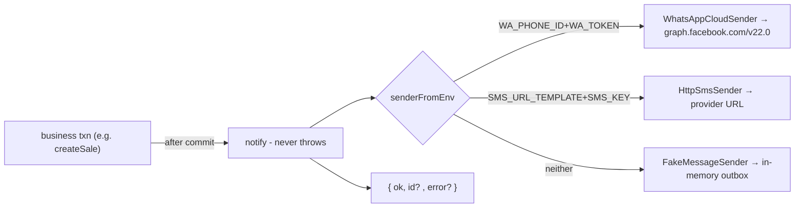
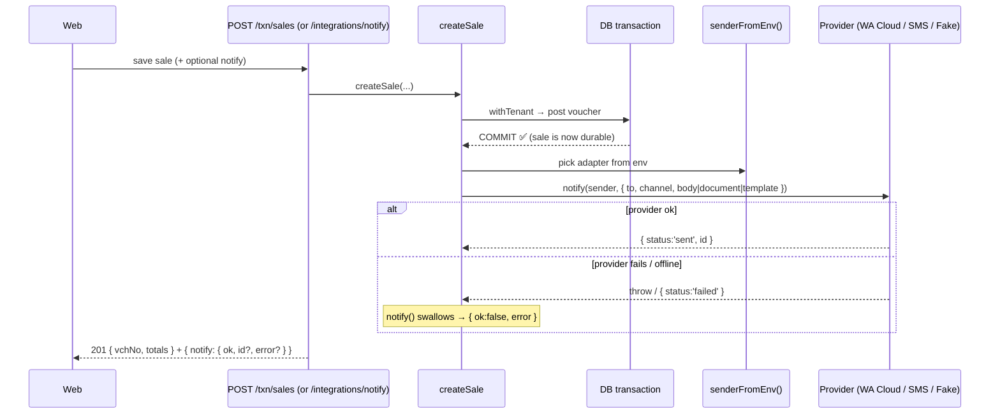

# INTEGRATIONS deep-dive — Messaging, Barcode/QR, Live Rates

```
Form: UT_WHATSAPP / UT_WAPP_WITH_API / UT_SMS  (+ UT_TAG_PRINT barcode, MDI live-rate feed)
Module: 13_Utilities_Settings_Integrations  ·  Type: integration framework (non-posting, post-commit, best-effort)
Desktop source: UT_WAPP_WITH_API.cs (5,422 ln, Graph Cloud API), UT_WHATSAPP.cs (6,773 ln, browser automation), UT_SMS.cs (4,782 ln)
Web target: apps/api/src/modules/integrations/{messaging,barcode,rates}.ts · routes/txn.ts (/integrations/*)
Requirements: Req 20 (integrations), 20.3 (a failed send NEVER rolls back the txn) · Parity: 06_Parity/integrations.md
Status: 📋 SPEC · 🟩 BUILT (Fake by default; real adapters env-activated)
Evidence: forms/UT_WAPP_WITH_API.md, forms/UT_SMS.md, forms/UT_WHATSAPP.md · engine 04_Cross_Cutting_Engines/reporting-and-integrations.md
```

## 1. Purpose & business context

Jewelers live on WhatsApp: they send the bill PDF to the customer, a payment reminder, a festival
greeting; they fire OTP/marketing SMS; they print tag barcodes; they watch the live gold rate. The
desktop did all of this with bespoke code — a Selenium **browser-automation** WhatsApp launcher
(`UT_WHATSAPP` + `DevNet.WhatsApp.V2.dll` + `Auto WhatsApp Launcher.exe`), a newer **Meta Graph Cloud
API** path (`UT_WAPP_WITH_API`), three hard-coded **HTTP SMS gateways** (`UT_SMS`), a barcode **font**
(`FRE3OF9X.TTF`) + `QRCoder`, and a live-rate fetch from public APIs.

The web replaces all of it with one **adapter framework** (`integrations/`): each channel is an
interface with a `Fake` default and a real adapter switched on by environment variables — **no code
change to go live, just credentials** — and every send is **post-commit and best-effort**: a failure
is logged and reported, never thrown back into the business transaction (Req 20.3). This is the
single most important rule of the module: *messaging must never void a sale.*

## 2. UI / UX specification

Integrations surface as **actions on other screens** (Send on WhatsApp from a sale; the live-rate
ticker on the dashboard; barcode on the tag-print) plus a small **status panel**:

```
┌─ Integrations status ──────────────────────────────────────────────┐
│ Live rates   gold-api.com + frankfurter.app     live (no key)       │
│ Messaging    fake | whatsapp-cloud | http-sms   <env-driven>        │
│ E-invoice    Chartered Info GSP                 fake | sandbox|prod │
│ Barcode/QR   Code39 / QR (server SVG)           live                │
│ PDF          Chromium / Playwright              wired                │
└──────────────────────────────────────────────────────────────────────┘
   Send: [ to ____ ] [ channel: whatsapp|sms ] [ body … ] → POST /integrations/notify
```
(`// src: routes/txn.ts#404 /integrations/status`). The "Send" action requires the `USER_PRINT`
right (messaging is treated like an output/print action).

### Modes
Send (one-off), Live-rates (read), Status (read). No persistence on the web path (the desktop logged
sends to `MSG_MAST` / `app_ChatMessages`; the web returns the provider result — persistence is a
future per-tenant feature).

## 3. Data model touched

**Web:** none on the hot path — `notify` is fire-and-forget after the caller's own transaction has
committed. (Desktop wrote a sent-message log `MSG_MAST`, a chat store `app_ChatMessages`, and touched
`LEDR_AC_DATA`/`POINT_MAST` for loyalty-linked sends — `// src: forms/UT_WAPP_WITH_API.md`,
`forms/UT_SMS.md`.) **Reads (desktop, to build the message):** `AC_MAST` (name/mobile), `CO_SET_NEW`
(toggles), `RATE_MAST` (rate in the message), `AD_MEMB`/`POINT_MAST` (loyalty).



## 4. Business logic & calculations (with code)

### 4.1 The contract: one interface, swappable adapters
```ts
// src: web/apps/api/src/modules/integrations/messaging.ts
export type Channel = 'whatsapp' | 'sms';
export interface OutboundMessage {
  to: string; channel: Channel; body: string;
  document?: { pdf: Buffer; filename: string; caption?: string };   // WhatsApp doc (invoice PDF)
  template?: { name: string; lang?: string; params?: string[] };    // approved WA template (out-of-session)
}
export interface SendResult { id: string; status: 'sent' | 'failed'; }
export interface MessageSender { send(msg: OutboundMessage): Promise<SendResult>; }
```

### 4.2 Templates are pure (desktop `CUST_SMS`/`ADMIN_SMS` parity)
```ts
// src: messaging.ts#renderTemplate
export function renderTemplate(template: string, vars: Record<string, string|number>): string {
  return template.replace(/\{(\w+)\}/g, (_m, key) => (vars[key] ?? '') as string);
}
// e.g. CO_SET.CUST_SMS = "Dear {name}, bill {billNo} of Rs {amount} is ready. - {shop}"
```

### 4.3 SMS adapter — config-driven URL (covers all desktop gateways)
The desktop hard-coded three providers; the web generalizes them into one **URL template** with
`{key}{sender}{mobile}{text}` placeholders, so any of them — or a new one — works by configuration:
```ts
// src: messaging.ts#HttpSmsSender
const url = this.cfg.urlTemplate
  .replace('{key}', enc(this.cfg.key)).replace('{sender}', enc(this.cfg.sender))
  .replace('{mobile}', enc(msg.to)).replace('{text}', enc(msg.body));
const res = await fetch(url, { signal: AbortSignal.timeout(12000) });
return { id: `sms-${Date.now()}`, status: res.ok ? 'sent' : 'failed' };
```
Desktop evidence (the three providers the template subsumes):
```csharp
// src: unified/src/csharp/DataCareNext/UT_SMS.cs#L2783-L2914
"http://beta.tripadasmsbox.com/api/sendapi.php?auth_key=" + SmsId + "&mobiles=" + mo + "&message=" + txt + "&sender=JEWELL&route=1"
"http://site.ping4sms.com/api/smsapi?key=" + SmsUser + "&route=2&sender=" + SmsId + "&number=" + mo + "&sms=" + txt + "&templateid=…"
"https://sms.mobileadz.in/api/push?apikey=" + SmsUser + "&sender=" + SmsId + "&mobileno=" + mo + "&text=" + txt   // +"&unicode=1" for unicode
```
→ `SMS_URL_TEMPLATE` is set to whichever provider the shop uses; `SMS_KEY`=`SmsUser`/`auth_key`,
`SMS_SENDER`=`SmsId` (defaults to `JEWELL`).

### 4.4 WhatsApp adapter — Meta Graph Cloud API (text / template / document)
```ts
// src: messaging.ts#WhatsAppCloudSender   base = https://graph.facebook.com/{v22.0}
//  text:     POST /{phoneNumberId}/messages { type:'text', text:{ body } }
//  template: POST /{phoneNumberId}/messages { type:'template', template:{ name, language, components } }
//  document: upload PDF → POST /{phoneNumberId}/media (multipart) → returns media id →
//            POST /{phoneNumberId}/messages { type:'document', document:{ id, filename, caption } }
//  header:   authorization: Bearer {token}
```
Desktop evidence (identical host/version/shape — the web is a faithful port):
```csharp
// src: unified/src/csharp/DataCareNext/UT_WAPP_WITH_API.cs
#L3230  await client.PostAsync($"https://graph.facebook.com/v22.0/{PHONE_NUMBER_ID}/messages", content)
#L3228  headers.Add("Authorization", $"Bearer {ACCESS_TOKEN}")
#L3688  $"https://graph.facebook.com/v22.0/{PHONE_NUMBER_ID}/media"            // media upload before document send
#L3223  "{ messaging_product:'whatsapp', to:…, type:'template', template:{ name, language:{code}, components:[…] } }"
```
→ web env: `WA_PHONE_ID` = `PHONE_NUMBER_ID`, `WA_TOKEN` = `ACCESS_TOKEN`, optional `WA_API_VERSION`.

### 4.5 Adapter selection from env (Fake until creds)
```ts
// src: messaging.ts#senderFromEnv
if (env.WA_PHONE_ID && env.WA_TOKEN)        return { sender: new WhatsAppCloudSender({...}), mode: 'whatsapp-cloud' };
if (env.SMS_URL_TEMPLATE && env.SMS_KEY)    return { sender: new HttpSmsSender({...}),        mode: 'http-sms' };
return { sender: new FakeMessageSender(), mode: 'fake' };     // wired; awaiting credentials
```

### 4.6 The non-blocking rule — `notify` never throws (Req 20.3)
```ts
// src: messaging.ts#notify
export async function notify(sender, msg): Promise<{ ok; id?; error? }> {
  try {
    if (!msg.to) return { ok: false, error: 'no recipient' };
    const r = await sender.send(msg);
    return r.status === 'sent' ? { ok: true, id: r.id } : { ok: false, error: 'send failed', id: r.id };
  } catch (e) { return { ok: false, error: e?.message ?? 'send error' }; }   // swallow — never bubble into the txn
}
```
Callers invoke `notify` **after** their DB transaction commits; the worst case is a logged
`{ ok:false }`, never a rolled-back sale (desktop parity: a failed WhatsApp/SMS never voided the bill).

### 4.7 Barcode / QR (pure SVG — replaces the `.TTF` font + QRCoder)
```ts
// src: web/apps/api/src/modules/integrations/barcode.ts
export function code39Svg(data: string, opts?): string { /* 9-element bar/space patterns, '*' framed */ }
export function code39CheckChar(data: string): string  { /* mod-43 check digit */ }
export async function qrSvg(data: string, width=200): Promise<string> { /* qrcode pkg, guarded dynamic import */ }
```
Code39 encodes `0-9 A-Z - . space $ / + %`, framed by the `*` start/stop, optional mod-43 check char —
a pure SVG generator (no font file, no native dep), replacing the desktop `FRE3OF9X.TTF`. QR uses the
`qrcode` package via a guarded import so the codebase compiles without it.

### 4.8 UPI pay URI (NPCI deep-link / QR payload)
```ts
// src: messaging.ts#buildUpiUri  → "upi://pay?pa=…&pn=…&cu=INR&am=…&tr=…&tn=…"
```
Pure builder for the UPI collect QR (amount `toFixed(2)`, `pa` required); the SVG is produced by `qrSvg`.

### 4.9 Live metal + forex rates (best-effort, never throws)
```ts
// src: web/apps/api/src/modules/integrations/rates.ts
export const OZ_TO_GRAM = 31.1034768;                          // troy ounce → grams
export function metalInrPerGram(usdPerOz, usdInr, purity=1) {  // pure, Tier-1 testable
  return r2((usdPerOz * usdInr / OZ_TO_GRAM) * purity);
}
// fetchLiveRates(): Promise.all[ gold-api.com/price/XAU, /XAG, frankfurter.app USD→INR ]
//   → { ok, usdInr, goldUsdOz, gold24kInrGram, gold22kInrGram(=22/24), silverInrGram }  | { ok:false, error }
```
Same free public sources the desktop used (no API key); 24k = purity 1, 22k = 22/24. On any network
error returns `{ ok:false, error }` — never throws.

## 5. Send sequence (post-commit, best-effort)


The notify result is **advisory** — the 201 stands whether or not the message went out.

## 6. Delete / reverse sequence

N/A — sending a message is not reversible and writes nothing on the web hot path; there is nothing to
delete. (A future `MSG_MAST` send-log would be append-only; re-sends create new rows.)

## 7. API contract

```ts
// GET  /integrations/live-rates   (auth) → LiveRates { ok, usdInr, gold24kInrGram, gold22kInrGram, silverInrGram, ... }
// POST /integrations/notify        (right: print)
interface NotifyBody { to: string; channel?: 'whatsapp'|'sms'; body?: string; }
// → { ok: boolean; id?: string; error?: string; mode: 'whatsapp-cloud'|'http-sms'|'fake' }
// GET  /integrations/status        (auth) → per-adapter { provider, status } (live vs awaiting-creds)
```
Source: `// src: web/apps/api/src/routes/txn.ts#395-415`. Barcode/QR + UPI are consumed internally by
tag-print and invoice renderers (not standalone public endpoints in the current surface).

## 8. Validation rules

| Rule | Condition | Behavior | HTTP | req |
|---|---|---|---|---|
| Recipient required | empty `to` | `notify` → `{ ok:false, error:'no recipient' }` | 200 (advisory) | 20.3 |
| Send right | caller lacks `USER_PRINT` | reject before send | 403 `forbidden` | 6.4 |
| Provider failure | network/HTTP error / timeout | swallowed → `{ ok:false, error }`; **txn intact** | 200 | 20.3 |
| Adapter not configured | no WA_/SMS_ creds | `FakeMessageSender` records to outbox; `mode:'fake'` | 200 | 20.2 |
| UPI payee | missing `pa` | `buildUpiUri` throws (pre-send build, not a network call) | 400 | — |
| Barcode charset | char not in Code39 set | `BarcodeError` | 400 | — |
| Rate fetch | upstream down / bad payload | `{ ok:false, error }` (never throws) | 200 | 20.3 |

## 9. Parity criteria (Definition of Done)

1. **Non-blocking proof (Req 20.3):** force the adapter to fail on a sale that requests a WhatsApp
   send — the sale still commits (rows persisted) and the response carries `{ notify:{ ok:false } }`.
2. **WhatsApp shape:** the Cloud adapter posts to `graph.facebook.com/{v}/{phoneNumberId}/messages`
   with `Bearer` auth and the desktop's text/template/document payload shape; a document send uploads
   to `/media` first (matches `UT_WAPP_WITH_API.cs#L3230/#L3688`).
3. **SMS shape:** `SMS_URL_TEMPLATE` reproduces any of tripadasmsbox/ping4sms/mobileadz by config.
4. **Templates:** `renderTemplate(CO_SET.CUST_SMS, vars)` yields the same body the desktop built.
5. **Rates:** `metalInrPerGram` golden vectors (24k/22k) match; `fetchLiveRates` returns `ok:false`
   on a forced network error without throwing.
6. **Barcode/QR:** `code39Svg` + `code39CheckChar` produce a scannable Code39 (mod-43 verified);
   `qrSvg` renders the tag/UPI/IRN payload.
Fixtures: `06_Parity/integrations.md` (fake-fail injection, payload-shape assertions, rate vectors).

## 10. Variants & edge cases

| Variant | Delta |
|---|---|
| `UT_WHATSAPP` (legacy) | Browser-automation (Selenium + `DevNet.WhatsApp.V2.dll` + `Auto WhatsApp Launcher.exe`) driving WhatsApp Web — device/session-bound; web supersedes with the Cloud API adapter. Validation strings: "WhatsApp not ready. Current state:", "Internet Connection Failed", "Message sent successfully!". |
| `UT_WAPP_WITH_API` | The Cloud-API path the web ports 1:1; also fetches approved templates (`/message_templates?status=APPROVED`) and logs to `app_ChatMessages`. Errors: "API Error:", "Media upload failed.", "All variables fill First…". |
| `UT_SMS` | Bulk SMS over the three HTTP gateways; route `1/2`, `templateid`, `unicode=1` for non-Latin — all expressible via `SMS_URL_TEMPLATE`. |
| WhatsApp **document** (invoice PDF) | upload-then-send (`/media` → `type:document`); the web supports this in `WhatsAppCloudSender.send`. |
| WhatsApp **template** (out-of-session) | required outside the 24h window; web supports `template:{ name, lang, params }`. |
| E-invoice IRN | A *separate* integration (Chartered Info GSP) — env `GSP_*`, documented in **Module 9** + `SETTINGS.md §4.5`; same Fake-until-creds, never-block pattern. |
| OLocker / Planet Pay (UAE) | TBD adapters — flagged device/region-bound. |

## 11. Open questions / risks

- **No send-log persisted on the web** yet — desktop kept `MSG_MAST`/`app_ChatMessages`. If audit of
  outbound messages is required, add an append-only log (and consider per-tenant credentials instead
  of process-wide env).
- **Per-tenant credentials:** today WA/SMS creds are process-env (one set per deployment). Multi-shop
  hosting needs per-`CO_CODE` credentials — `sendReminder` already threads `prisma`/`tenantId` for this.
- **WhatsApp template approval** is a Meta-side process; the wired adapter assumes an approved
  template name is supplied. Real send is an **external blocker** until `WA_PHONE_ID`/`WA_TOKEN` set.
- **Rate-source stability:** gold-api.com / frankfurter.app are free, unauthenticated, best-effort —
  acceptable for a ticker, but a paid feed may be needed for rate-locking on invoices.
- Confirm the desktop's exact **message templates** and any per-event triggers (sale/dhrn/scheme →
  `DHRN_WAPP`/`SCHM_WAPP` toggles in `CO_SET`) for full send-trigger parity.
