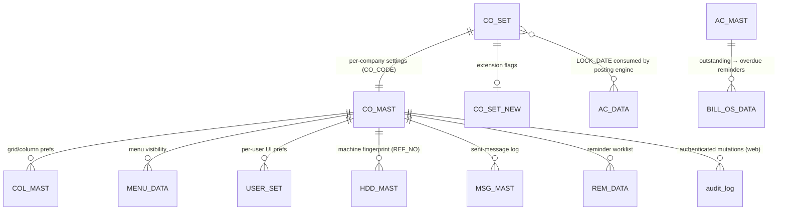

# Module 13 — Utilities / Settings / Integrations

> The cross-cutting "everything else" module: the **company settings** that the whole app reads
> (`CO_SET` — period-lock, cash-limit, GST/interest defaults, SMS templates), the **operational
> utilities** (backup, import/export, voucher-renumber, reminders, data-repair), and the
> **third-party integrations** (WhatsApp Cloud API, SMS gateway, live metal/forex rates, barcode/QR,
> e-invoice). These are not posting transactions; they configure, move, message, or maintain — but
> several of them (settings, renumber, import/export) are powerful enough to change every other
> module's behavior, so they are documented with the same rigor.

Three heavy deep-dives carry the depth:

| Deep-dive | Covers | Desktop forms |
|---|---|---|
| [SETTINGS.md](SETTINGS.md) | `CO_SET` per-company settings: `LOCK_DATE` period-lock, `CASH_LIMIT`→PAN, GST / e-invoice config, interest & SMS defaults | `UT_SETTING`, `UT_SETTING_MAIN` |
| [BACKUP_RESTORE.md](BACKUP_RESTORE.md) | Logical JSON company backup (`/backup`) + physical `pg_dump`/`pg_restore`; restore & retention | `UT_BKP` |
| [INTEGRATIONS.md](INTEGRATIONS.md) | Env-driven adapter framework: WhatsApp Cloud API, SMS gateway, never-throws `notify`, Code39/QR barcode, live rates, UPI URI | `UT_WHATSAPP`, `UT_WAPP_WITH_API`, `UT_SMS` |

Lighter variant stubs (covered in [VARIANTS.md](VARIANTS.md)): `UT_IMPORT`, `UT_EXPORT`, `UT_REMINDER`,
`UT_VCH_RE_NUMBR`, `UT_WEB_CAM`, `UT_HDD`, `MS_UPDATE`.

---

## 1. Purpose

A jeweler's back-office needs a place to (a) set how the system behaves for their shop — the tax
code, the cash-receipt PAN threshold, pledge/loan interest method, the date before which books are
frozen, the SMS message templates; (b) run periodic operations — take a backup, roll a year over by
exporting/importing, renumber a book that has gaps, push outstanding/birthday reminders, repair
denormalized balances; and (c) reach the outside world — send a bill on WhatsApp, fire an SMS, pull
the live gold rate, print a tag barcode, push an e-invoice to the GSP. Module 13 is that back office.

The unifying web principle (from `04_Cross_Cutting_Engines/reporting-and-integrations.md`): **every
external integration is an env-activated adapter that defaults to a `Fake` no-op and goes live the
moment its credentials are set — with no code change — and a failed external call NEVER rolls back
the business transaction that triggered it** (Req 20.3).

## 2. Form inventory

| Form | Type | Purpose | Tables (desktop) | Posting? | Web status |
|---|---|---|---|---|---|
| `UT_SETTING` | config | Per-company behavior flags (single-row editor) | `CO_SET`, `CO_SET_NEW`, `COL_MAST` (UPDATE) · reads `USER_SET` | ❌ | 🟩 BUILT (`settings.ts`, whitelist subset) |
| `UT_SETTING_MAIN` | config | Tabbed master-settings screen (theme/menu/behavior) | `CO_SET`, `CO_SET_NEW`, `MENU_DATA` (UPDATE) | ❌ | 🟦 PARTIAL (subset of flags exposed) |
| `UT_BKP` | utility | Take a company/database backup | reads `USER_SET`; OS-level `.bak`/file copy | ❌ | 🟩 BUILT (`/backup` JSON + `deploy/backup.sh` pg_dump) |
| `UT_IMPORT` | utility | Import a company/year dataset (delete-then-insert all tables) | INSERT/DELETE ~45 masters+txn tables; UPDATE `CO_SET`,`YEAR_MAST`,`HDD_MAST` | ❌ (bulk data move) | 🟦 PARTIAL (`ops/yearEnd.ts` carry-forward) |
| `UT_EXPORT` | utility | Export a company/year dataset to a transfer file | reads ~40 txn tables; mirror of import | ❌ | 🟦 PARTIAL |
| `UT_VCH_RE_NUMBR` | utility | Resequence a book's vouchers to gapless 1..N across all its tables | UPDATE `SL_*`,`PR_*`,`BAR_*`,`CASH_DATA`,`BILL_OS_DATA`,`RATE_CUT_*`,`AD_ADJ`,`UPI_DATA` | ❌ (key rewrite) | 🟩 BUILT (`voucherRenumber.ts`) |
| `UT_REMINDER` | utility | Outstanding / birthday / anniversary reminder lists + send | reads `AC_MAST`,`BILL_OS_DATA`,`REM_DATA`,`TEMP_BOOK_DATA` | ❌ | 🟩 BUILT (`ops/reminders.ts`) |
| `UT_WHATSAPP` | integration | Send WhatsApp via the desktop's browser-automation launcher | `MSG_MAST`,`LEDR_AC_DATA`,`POINT_MAST`; reads `AC_MAST`,`CO_SET_NEW` | ❌ | 🟩 BUILT (`integrations/messaging.ts`) |
| `UT_WAPP_WITH_API` | integration | Send WhatsApp via Meta Graph **Cloud API** (text/template/document) | `LEDR_AC_DATA`,`POINT_MAST`,`MSG_MAST` | ❌ | 🟩 BUILT (`WhatsAppCloudSender`) |
| `UT_SMS` | integration | Send SMS via an HTTP gateway (tripadasmsbox / ping4sms / mobileadz) | `MSG_MAST`,`LEDR_AC_DATA` | ❌ | 🟩 BUILT (`HttpSmsSender`) |
| `UT_E_INVOICE` | integration | Generate / push IRN e-invoice (→ **Module 9**) | `SL_DATA`,`E_DATA` | ❌ | 🟩 BUILT (`einvoice.ts`) |
| `UT_TAG_PRINT` | utility | Tag/barcode label printing (→ Code39/QR) | reads stock/tag | ❌ | 🟩 BUILT (`integrations/barcode.ts`) |
| `UT_WEB_CAM` | device | Capture a customer/item photo from the webcam | none (writes image file) | ❌ | ⬛ device-bound (browser `getUserMedia`) |
| `UT_HDD` | device | "Pc Registrar No" — machine fingerprint for licensing | `HDD_MAST` (single-row REF_NO) | ❌ | ⬛ device-bound (N/A on web) |
| `MS_UPDATE` | admin | Data-maintenance toolbox: recompute/refresh/repair denormalized balances | recompute across stock/ledger/mfg/scheme | ❌ (recompute) | 🟦 PARTIAL (`ops/yearEnd.ts`, `parity/golden.ts`) |
| `UT_PWD_UPDATE` | admin | Change login password (→ **Module 0** auth) | `LOGIN_MAST` | ❌ | 🟩 BUILT (auth) |
| `UT_SET_ADMIN`, `UT_BANK`, `UT_AI_TRFR`, `UT_REPORT`, `UT_USER_REQUEST`, `UT_CUST_ENTRY`, `UT_WINDOW` | misc | Admin/setup helpers (see `project-memory/catalogs/forms/UT_*.md`) | varies | ❌ | ⬜ TODO / partial |

> "22 UT_* forms" in the master index = the `UT_*.cs` set above. The three deep-dives + variant
> stubs cover the behaviorally-significant ones; the remaining admin helpers are thin wrappers over
> features already documented in their home modules (auth, GST, reports).

## 3. Module ER diagram

The tables this module **owns** (configuration / operational state) and the ones it **touches**
(reads for reminders/renumber/import-export). Tenant key is `tenant_id` (web) + `CO_CODE` (desktop scope).

`CO_SET` is the hub: it is read by the **posting engine** (`LOCK_DATE`), the **finance/cash module**
(`CASH_LIMIT`), the **GST engine** (`TAX_CODE`/`TAX_ROF`), the **dhrn/loan modules**
(`DHRN_INT_TYPE`/`DHRN_PRC`/`LOAN_INT_TYPE`/`INT_YEAR_DAYS`), and the **integrations** (`CUST_SMS`/
`ADMIN_SMS` templates, `SMS_LINK`). See `02_Data_Model/tables/CO_SET.md` (59 columns).

## 4. Shared logic (the env-driven adapter model)

Every integration is an **interface** with a `Fake*` default and a real adapter chosen at runtime
from environment variables — the feature is fully wired and goes live by configuration alone
(`// src: web/apps/api/src/modules/integrations/messaging.ts#senderFromEnv`).

| Integration | Real adapter | Activates when (env) | Default | Desktop origin |
|---|---|---|---|---|
| Live gold/silver/forex rates | `fetchLiveRates` (gold-api.com + frankfurter.app) | always (no key) | live | rate feed (`MDI_FORM`) |
| Barcode / QR | `code39Svg` / `qrSvg` (pure SVG) | always | live | `FRE3OF9X.TTF`, `UT_TAG_PRINT` |
| WhatsApp | `WhatsAppCloudSender` (Graph v22.0) | `WA_PHONE_ID` + `WA_TOKEN` | `FakeMessageSender` | `UT_WAPP_WITH_API` |
| SMS | `HttpSmsSender` (URL template) | `SMS_URL_TEMPLATE` + `SMS_KEY` (`SMS_SENDER` opt) | `FakeMessageSender` | `UT_SMS` |
| E-invoice IRN | `CharteredInfoIrnTransport` | `GSP_ASPID`+`GSP_PASSWORD`+`GSP_GSTIN`+`GSP_USER`+`GSP_EINV_PWD` | `FakeIrnTransport` | `UT_E_INVOICE` (→ Mod 9) |
| PDF render | `PlaywrightPdfRenderer` (Chromium) | always (wired) | live | Crystal export |

Two rules every adapter obeys:
1. **Never-throws `notify`** — delivery is best-effort, called **after commit**, and a failure is
   returned as `{ ok:false, error }`, never raised into the transaction (Req 20.3).
2. **Templates are pure** — `renderTemplate('{name} bill {billNo}…', vars)` substitutes `{token}`s,
   reproducing the desktop `CO_SET.CUST_SMS`/`ADMIN_SMS` message build.

## 5. Dependencies

- **Posting engine** (`modules/posting`) — consumes `CO_SET.LOCK_DATE` (`assertPeriodOpen`).
- **Finance / cash module** (`modules/finance`) — consumes `CO_SET.CASH_LIMIT` (`assertCashLimit`).
- **GST engine** (`modules/gst`) + **E-invoice** (`modules/einvoice`, Module 9) — `TAX_CODE`/GSP.
- **Reports engine** (`modules/reports`) — reminder datasets reuse the `ListReport` shape & `withTenant`.
- **Auth/RBAC** (`modules/auth`,`rbac`) — `update`/`delete`/`print` rights gate every utility; the
  `onResponse` audit hook logs mutations.
- **DB layer** (`@datacare/db` `withTenant`) — RLS scopes every read/write to the tenant.
- **Masters** — `AC_MAST` (reminder names/mobiles), `CO_MAST` (company GSTIN), `BILL_OS_DATA`.

## 6. API surface

| Method | Path | Right | Purpose | Source |
|---|---|---|---|---|
| GET | `/settings` | auth | `{ fields, values }` of the whitelisted `CO_SET` subset | `routes/txn.ts#387` |
| POST | `/settings` | update | Upsert the whitelisted `CO_SET` columns | `routes/txn.ts#388` |
| GET | `/backup` | auth | Logical JSON backup (attachment download) | `app.ts#140` |
| GET | `/audit` | auth | Recent authenticated mutations (audit_log) | `app.ts#138` |
| GET | `/integrations/live-rates` | auth | Live 24k/22k/silver INR-per-gram + USD-INR | `routes/txn.ts#395` |
| POST | `/integrations/notify` | print | Send WhatsApp/SMS via configured provider | `routes/txn.ts#397` |
| GET | `/integrations/status` | auth | Which adapters are live vs awaiting creds | `routes/txn.ts#404` |
| GET | `/utilities/vch-renumber/preview` | auth | Dry-run old→new map + gap count | `routes/txn.ts#324` |
| POST | `/utilities/vch-renumber/apply` | delete | Apply renumber (requires `confirm:true`) | `routes/txn.ts#329` |
| GET | `/reminders/overdue` | auth | Parties with net unpaid balance | `routes/txn.ts#483` |
| GET | `/reminders/birthdays` | auth | Birthday/anniversary matches for a day | `routes/txn.ts#484` |
| POST | `/reminders/send` | auth | Send one reminder via the provider | `routes/txn.ts#485` |

## 7. Build checklist

- [x] `CO_SET` read path: `getSettings` whitelist + `saveSettings` upsert (insert-if-absent + UPDATE).
- [x] `LOCK_DATE` consumed by `postVoucherTx` (`assertPeriodOpen`) — opt-in, blocks ≤ lock date.
- [x] `CASH_LIMIT` consumed by `assertCashLimit` — cash over limit ⇒ PAN required (Req 17.2).
- [x] Logical `/backup` JSON export (RLS-scoped) + physical `pg_dump` cron + documented restore.
- [x] Audit hook logs every authenticated mutation (best-effort, never blocks).
- [x] Integrations: `senderFromEnv` adapter selection; `notify` never throws; `fetchLiveRates`;
      `code39Svg`/`qrSvg`; `buildUpiUri`.
- [x] Voucher renumber: dry-run preview + collision-safe two-phase apply (confirm-gated, one tx).
- [ ] **Parity gate**: editing a setting matches the desktop `CO_SET` row 1:1; a locked period
      rejects an in-range voucher; a forced adapter failure leaves the saved txn intact; renumber
      produces a gapless permutation with header/detail/ledger still joined. Track in `06_Parity/`.
- [ ] `UT_IMPORT`/`UT_EXPORT` full year-rollover parity (currently partial via `ops/yearEnd.ts`).
- [ ] `MS_UPDATE` recompute operations enumerated & gated (dangerous; admin-only).

## 8. Open questions / risks

- **`CO_SET` column types** are mostly `code`-recovered (`unknown` in the table ref). The web
  whitelist treats them as `varchar(255)` strings; confirm true types via a Docker golden-master pass
  before widening the editable set (esp. `LOCK_DATE` date vs string, `CASH_LIMIT` numeric).
- **`CO_SET_NEW`** is a sibling extension table the desktop updates alongside `CO_SET`; the web
  currently writes only `CO_SET`. Map the `CO_SET_NEW` flags before exposing them.
- **`UT_WEB_CAM` / `UT_HDD` / OLocker are device-bound** (camera, motherboard/disk serial, hardware
  locker) — they have no faithful server-side equivalent; documented as device features, flagged.
- **`UT_IMPORT`/`UT_EXPORT`** perform unbounded delete-then-insert across ~45 tables; the safe web
  port is the scoped, transactional `ops/yearEnd.ts` carry-forward — full file-transfer import is a
  deferred lever (ADR-0002) and needs the ETL (`unified/tools/etl_mssql_to_pg.py`).
