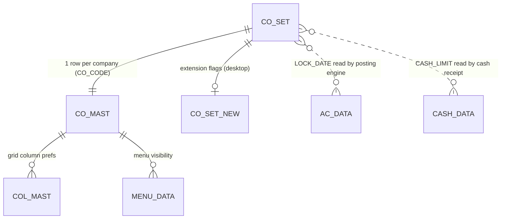
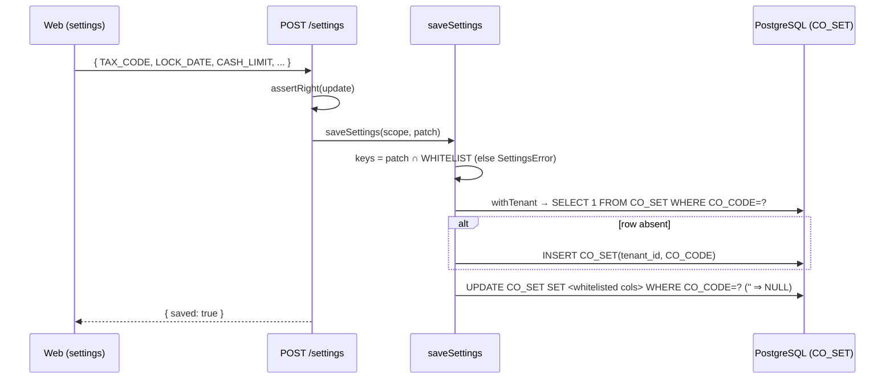

# SETTINGS — Company Settings (`CO_SET`) deep-dive

```
Form: UT_SETTING / UT_SETTING_MAIN  ·  Module: 13_Utilities_Settings_Integrations  ·  Type: configuration (non-posting)
Desktop source: unified/src/csharp/DataCareNext/UT_SETTING.cs (5,148 ln) + UT_SETTING_MAIN.cs (9,495 ln)
Web target: apps/api/src/modules/settings/settings.ts · consumed by modules/posting, finance, gst, dhrn · apps/web/app/(app)/settings
Requirements: Req 7 (load company settings into session), 17.2 (cash-limit→PAN), 18 (GST/e-invoice config)
Parity: 06_Parity/utilities.md   ·   Status: 📋 SPEC · 🟩 BUILT (whitelisted subset)
Evidence: forms/UT_SETTING.md, forms/UT_SETTING_MAIN.md · table 02_Data_Model/tables/CO_SET.md (59 cols)
```

## 1. Purpose & business context

`CO_SET` is the **per-company control panel**: one row per `CO_CODE` holding ~59 behavior flags that
decide how the whole application computes, posts, prints, and messages for that shop. It is not a
transaction — nobody "posts" a setting — but it is the most far-reaching screen in the product
because other modules **read** it on every operation: the posting engine refuses vouchers dated
on/before `LOCK_DATE`; the cash receipt screen demands a PAN once cash exceeds `CASH_LIMIT`; the GST
engine seeds the default `TAX_CODE`; the pledge/loan modules pick their interest method from
`DHRN_INT_TYPE`/`LOAN_INT_TYPE`/`INT_YEAR_DAYS`; the messaging adapters render `CUST_SMS`/`ADMIN_SMS`
templates. The desktop edits it on two screens — `UT_SETTING` (single-row flags) and
`UT_SETTING_MAIN` (the tabbed master-settings window) — both of which `UPDATE CO_SET` (and its
extension `CO_SET_NEW`). The web exposes a **curated, whitelisted subset** for safe editing and
upserts the row.

## 2. UI / UX specification

### Layout
```
┌─ Settings ─ Company Configuration ─────────────────────────────── [Save] ┐
│ Taxation        Default Tax Code [__]   Round-off tax [Y/N]               │
│ Period control  Period lock date [____-__-__]  (blank = no lock)          │
│ Cash / KYC      Cash limit (PAN above) [________]                         │
│ Interest        Pledge int type [M/D]  Pledge int % [__]                  │
│                 Loan int type [_]  Interest year days [0/360/365]         │
│ Messaging       Customer SMS template [……{name} bill {billNo} ₹{amount}…] │
│                 Admin SMS template     [……]                               │
│ Printing        Duplicate print [Y/N]                                     │
└───────────────────────────────────────────────────────────────────────────┘
```

### Field table (web whitelist — the only columns ever written)
| Label | Column (`CO_SET`) | Type | Req | Default | Editable when | Notes / validation |
|---|---|---|---|---|---|---|
| Default Tax Code | `TAX_CODE` | varchar(2)→`TAX_MAST` | — | — | always | seeds GST on new vouchers |
| Round-off tax | `TAX_ROF` | Y/N | — | — | always | round tax to whole unit |
| Period lock date | `LOCK_DATE` | date (stored text) | — | blank | always | **blocks vouchers ≤ this date**; blank = open |
| Cash limit (PAN above) | `CASH_LIMIT` | numeric | — | 200000 | always | cash receipt > limit ⇒ PAN required |
| Pledge interest type | `DHRN_INT_TYPE` | char(1) | — | — | always | `M`=monthly, `D`=day-count |
| Pledge interest % | `DHRN_PRC` | numeric | — | — | always | per-period rate |
| Loan interest type | `LOAN_INT_TYPE` | char(1) | — | — | always | loan accrual method |
| Interest year days | `INT_YEAR_DAYS` | int | — | — | always | `0/360/365` day-basis |
| Customer SMS template | `CUST_SMS` | varchar | — | — | always | `{token}` placeholders |
| Admin SMS template | `ADMIN_SMS` | varchar | — | — | always | `{token}` placeholders |
| Duplicate print | `DUP_PRINT` | Y/N | — | — | always | auto-print a duplicate copy |

> Source of the whitelist: `// src: web/apps/api/src/modules/settings/settings.ts#SETTING_FIELDS`.
> **Keys outside the whitelist are never written** — this is the safety boundary around a 59-column
> table whose remaining flags (theme, grid prefs, country/FX, weight-port, etc.) are not yet mapped.

### Other notable `CO_SET` columns (read elsewhere, not in the editable subset)
`PAN_CARD_VAL` (PAN-required toggle), `LAST_DAY_LOCK` (alt. day-lock flag), `SMS_LINK`/`DHRN_WAPP`/
`SCHM_WAPP` (messaging toggles), `COUNTRY_CODE`/`COUNTRY_ID`/`FX_CODE`/`FX_RATE`/`OZ_CON_VAL`/
`RATE_PAR` (UAE & rate-unit config), `LBR_TYPE`/`LBR_ROF`/`LBR_RATE_GEN` (labour defaults),
`DHIRN_COMPOUND` (compounding), `AC_LC_CODE_LEN` (code widths). Full list: `02_Data_Model/tables/CO_SET.md`.

### Modes
View / Edit only. No New (the row is created lazily on first save), no Delete, no Print. Requires the
`USER_UPDATE` right to save (`// src: routes/txn.ts#388 guard(req,reply,'update')`).

### Wireframe note
The desktop `UT_SETTING_MAIN` is a multi-tab window (theme, behavior, menu visibility) that writes
many `CO_SET`/`CO_SET_NEW` pairs and `MENU_DATA`; the web renders a single grouped form over the
whitelisted subset and grows tab-by-tab as flags are mapped.

## 3. Data model touched

**Writes (UPDATE, upsert):** `CO_SET` (the whitelisted columns). The row is **inserted if absent**
(`tenant_id`,`CO_CODE`) then updated.
**Desktop also writes:** `CO_SET_NEW` (extension flags), `COL_MAST` (grid column prefs, `UT_SETTING`
L4887), `MENU_DATA` (menu visibility, `UT_SETTING_MAIN` L9423). **Reads:** `USER_SET`, `CO_SET`,
`CO_SET_NEW`, `COL_MAST`.



Table ref: [CO_SET](../../02_Data_Model/tables/CO_SET.md) · related: [CO_MAST](../../02_Data_Model/tables/CO_MAST.md)

## 4. Business logic & calculations (with code)

### 4.1 Read (whitelist projection)
```ts
// src: web/apps/api/src/modules/settings/settings.ts#getSettings
export async function getSettings(prisma, scope: { tenantId; coCode }) {
  return withTenant(prisma, scope.tenantId, async (tx) => {
    const cols = SETTING_FIELDS.map((f) => qcol(f.key)).join(',');           // quoted, sanitized idents
    const rows = await tx.$queryRawUnsafe(
      `SELECT ${cols} FROM "CO_SET" WHERE "CO_CODE"=$1 LIMIT 1`, scope.coCode);
    const row = rows[0] ?? {};
    return Object.fromEntries(SETTING_FIELDS.map((f) => [f.key, row[f.key] ?? '']));
  });
}
const qcol = (c) => '"' + c.replace(/[^A-Za-z0-9_]/g, '') + '"';            // identifier hardening
```

### 4.2 Save (upsert, whitelist-enforced)
```ts
// src: web/apps/api/src/modules/settings/settings.ts#saveSettings
const keys = Object.keys(patch).filter((k) => WHITELIST.has(k));            // drop anything not whitelisted
if (!keys.length) throw new SettingsError('no valid settings to save');
return withTenant(prisma, scope.tenantId, async (tx) => {
  const exists = await tx.$queryRawUnsafe(`SELECT 1 FROM "CO_SET" WHERE "CO_CODE"=$1 LIMIT 1`, scope.coCode);
  if (!exists.length)                                                       // insert-if-absent
    await tx.$executeRawUnsafe(`INSERT INTO "CO_SET"(tenant_id,"CO_CODE") VALUES ($1,$2)`, scope.tenantId, scope.coCode);
  const sets = keys.map((k, i) => `${qcol(k)}=$${i + 2}`).join(', ');
  await tx.$executeRawUnsafe(`UPDATE "CO_SET" SET ${sets} WHERE "CO_CODE"=$1`,
    scope.coCode, ...keys.map((k) => blankToNull(patch[k])));               // '' ⇒ NULL (e.g. clearing LOCK_DATE)
  return { saved: true };
});
```
Blank values are written as `NULL` so clearing `LOCK_DATE` truly re-opens the period.

### 4.3 `LOCK_DATE` — the period-lock (consumed by the posting engine)
This is the highest-impact setting. `CO_SET.LOCK_DATE` freezes the books: **any voucher dated on or
before it is rejected** at post time. The posting engine reads it per-company (falling back to a
tenant-wide row), and the check is **opt-in** — no lock configured ⇒ no-op.
```ts
// src: web/apps/api/src/modules/posting/posting.ts#assertPeriodOpen
export async function assertPeriodOpen(tx, tenantId, input: PostInput): Promise<void> {
  const { coCode, vchDate } = voucherCoAndDate(input);
  if (vchDate == null) return;                       // nothing to check
  const lock = await lockDateFor(tx, tenantId, coCode);
  if (!lock) return;                                 // period OPEN (no LOCK_DATE set)
  const vd = new Date(String(vchDate).trim());
  if (isNaN(vd.getTime())) return;                   // unparseable → don't block
  if (vd.getTime() <= lock.getTime())               // on/before lock ⇒ reject
    throw new PeriodLockValidationError(String(vchDate).slice(0,10), lock.toISOString().slice(0,10));
}
// lockDateFor: SELECT "LOCK_DATE"::text FROM "CO_SET" WHERE tenant_id=$1 AND "CO_CODE"=$2  (then tenant-wide fallback)
```
`PeriodLockValidationError` ends in `ValidationError`, so the route adapter maps it to **HTTP 400**
(desktop parity: the `MsLockDt` guard). `postVoucherTx` calls `assertPeriodOpen` before writing, so
the entire voucher (header/detail/ledger/stock/tax) rolls back if the period is locked.

### 4.4 `CASH_LIMIT` — cash-receipt PAN threshold (consumed by finance)
```ts
// src: web/apps/api/src/modules/finance/finance.ts#assertCashLimit
export const DEFAULT_CASH_LIMIT = 200000;                                   // ₹2,00,000 (CBDT cash ceiling)
export function assertCashLimit(mode, amount, pan, limit = DEFAULT_CASH_LIMIT): void {
  if (mode === 'cash' && amount > limit && !pan)
    throw new FinanceValidationError(`PAN required for cash transaction over ${limit}`);
}
```
The configurable ceiling is `CO_SET.CASH_LIMIT` (the `200000` constant is the fallback default);
non-cash modes are exempt (Req 17.2). Mirrors the desktop `PAN_CARD_VAL`/`CASH_LIMIT` guard on sale &
cash-receipt screens.

### 4.5 GST / e-invoice configuration (where each piece lives)
"GST/e-invoice config" is **deliberately split** across three stores — preserve this distinction:

| Config | Where | Read by |
|---|---|---|
| Default tax code / rate behavior | `CO_SET.TAX_CODE`, `CO_SET.TAX_ROF`, `TAX_MAST` rows | GST engine (`modules/gst`) |
| Company GSTIN / legal name / state | **`CO_MAST`** (company master, Module 1) — *not* `CO_SET` | e-invoice `SellerDtls`, invoices |
| GSP credentials (IRN submit) | **environment** `GSP_ASPID`/`GSP_PASSWORD`/`GSP_GSTIN`/`GSP_USER`/`GSP_EINV_PWD` | `einvoice.ts irnTransportFromEnv` |
| Country / FX (UAE variant) | `CO_SET.COUNTRY_CODE`/`COUNTRY_ID`/`FX_CODE`/`FX_RATE`/`OZ_CON_VAL` | UAE GST/rate logic |

So the **settings screen** owns the tax *defaults* and the *period/cash* controls; the **company
master** owns the GSTIN identity; the **env** owns the GSP secret. The actual IRN build/submit is
documented in **Module 9 (GST & E-Invoice)** and `INTEGRATIONS.md §B`.

## 5. Save sequence (edit)

There is no posting transaction; "save" is a single upsert.



## 6. Delete / reverse sequence

N/A — `CO_SET` is never deleted; it is a single permanent per-company row. To "undo" a setting,
re-save the prior value. Clearing `LOCK_DATE` (saving blank ⇒ NULL) is the reverse of locking. No
`DELETE_DATA` audit row; instead the change is captured by the **audit hook** (see `BACKUP_RESTORE.md §6`).

## 7. API contract

```ts
// GET /settings   (right: auth)
// → { fields: { key; label; hint? }[], values: Record<colName,string> }
//   (fields drives the form; values are the current CO_SET row, '' for unset)

// POST /settings  (right: update)
interface SaveSettingsBody { [CO_SET_COLUMN: string]: string | null; }     // only whitelisted keys persist
// → 200 { saved: true }
// Errors: SettingsError('no valid settings to save') → 400 ; ForbiddenError → 403
```
Source: `// src: web/apps/api/src/routes/txn.ts#387-391`.

## 8. Validation rules

| Rule | Condition | Desktop message (confirm) | HTTP error | req |
|---|---|---|---|---|
| At least one valid key | `patch ∩ WHITELIST = ∅` | — | 400 `SettingsError` | — |
| Identifier safe | column name not `[A-Za-z0-9_]` | — | stripped by `qcol` (defense-in-depth) | — |
| Edit right | caller lacks `USER_UPDATE` | "No rights" | 403 `forbidden` | 6.4 |
| Period lock (consumer) | voucher `VCH_DATE` ≤ `LOCK_DATE` | "Date is locked" (`MsLockDt`) | 400 `PeriodLockValidationError` | — |
| Cash limit (consumer) | cash > `CASH_LIMIT` and no PAN | "PAN required" | 400 `FinanceValidationError` | 17.2 |

## 9. Parity criteria (Definition of Done)

1. Reading `/settings` returns the same values stored in the desktop `CO_SET` row for the company.
2. Saving a whitelisted field updates exactly that `CO_SET` column (verbatim name) and nothing else.
3. Setting `LOCK_DATE=D` then posting a voucher dated `≤ D` is **rejected (400)**; dated `> D` posts;
   clearing `LOCK_DATE` re-opens both — matching the desktop `MsLockDt` behavior.
4. Setting `CASH_LIMIT=L` then a cash receipt `> L` without PAN is rejected; with PAN it posts (Req 17.2).
5. A new company with no `CO_SET` row gets one created on first save (insert-if-absent).
6. Non-whitelisted keys in the POST body are silently ignored (never written).
Fixtures: `06_Parity/utilities.md` (settings round-trip + period-lock + cash-limit vectors).

## 10. Variants & edge cases

| Variant | Delta vs the curated editor |
|---|---|
| `UT_SETTING_MAIN` | Full tabbed window; also writes `CO_SET_NEW` + `MENU_DATA` (menu visibility) — web exposes a subset, grows tab-by-tab. |
| `CO_SET_NEW` | Extension table updated in lockstep on desktop; web writes only `CO_SET` today (flagged risk). |
| `COL_MAST` / `USER_SET` | Grid-column & per-user UI prefs — UI-state, mapped to client-side prefs, not core `CO_SET`. |
| UAE variant | `COUNTRY_CODE`/`FX_*`/`OZ_CON_VAL` drive currency & ounce conversion; needs the UAE rate logic. |
| Per-company vs tenant-wide lock | `lockDateFor` reads the per-`CO_CODE` row first, then a tenant-wide row if `CO_CODE` isn't a `CO_SET` column in that deployment. |

## 11. Open questions / risks

- **Column types unverified.** `CO_SET` is largely `code`-recovered (`unknown` types). The web treats
  whitelisted values as `varchar(255)` strings; confirm `LOCK_DATE` (date vs text) and `CASH_LIMIT`
  (numeric vs text) against a Docker golden-master before relying on type-sensitive comparisons.
- **`CO_SET_NEW` mapping incomplete** — desktop updates it alongside `CO_SET`; un-mapped flags there
  could diverge. Enumerate before widening the editable set.
- **Whitelist is intentionally narrow** (11 of 59 columns). Theme/behavior/menu flags from
  `UT_SETTING_MAIN` are not yet editable on the web; prioritize by which flags other modules read.
- Confirm the exact desktop **save validation messages** (none were detected by the auto-extractor)
  from `UT_SETTING.cs`/`UT_SETTING_MAIN.cs` key handlers.
