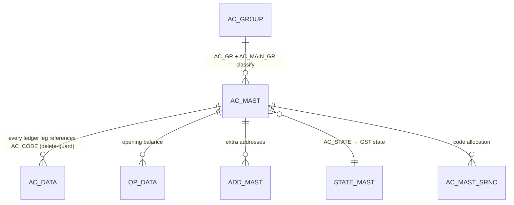
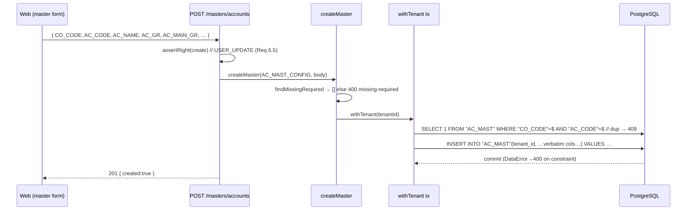

# MS_ACCT — Account Master (chart of accounts) · deep-dive

```
Form: MS_ACCT  ·  Module: 1_Masters  ·  Type: master (reference data, no posting)
Desktop source: unified/src/csharp/DataCareNext/MS_ACCT.cs (9,651 lines) + MS_AC_GROUP.cs (account groups)
Web target: apps/api/src/modules/masters/{master.service.ts (AC_MAST_CONFIG, AC_GROUP_CONFIG), configs.ts}
            · generic routes apps/api/src/app.ts · picker apps/web → LookupPicker (lookup.ts: accounts/customers)
Requirements: Req 8 (master CRUD), 8.2 (required), 8.3 (duplicate), 8.6 (referenced-delete), 6.5 (RBAC)
Parity: 06_Parity/masters.md   ·   Status: 📋 SPEC · 🟩 BUILT (create/delete/list/import; no update yet)
Evidence: form catalog project-memory/catalogs/forms/MS_ACCT.md; table 02_Data_Model/tables/AC_MAST.md
```

## 1. Purpose & business context

`MS_ACCT` maintains the **chart of accounts** (`AC_MAST`) — the single party/ledger master that every
customer, supplier, bank, cash, expense, income and tax head lives in. Each account belongs to an
**account group** (`AC_GROUP`, maintained by sibling `MS_AC_GROUP`) which classifies it under a main
group (assets/liabilities/income/expense) for the trial balance and final accounts. Nothing posts
money here — but **every** ledger leg in `AC_DATA` written by Sales, Purchase, Cash/Bank, Dhrn, JV,
etc. carries an `AC_CODE` that must resolve to a row in this table. It is therefore the most
referenced master in the system and the one with the strictest delete guard.

Two structural facts the rebuild must preserve:

- **System/default accounts occupy `AC_CODE < '00101'`** (codes 1–100). These are software-seeded
  ledgers — cash, sales, GST, round-off, purchase, etc. — that `MS_YEAR`/`MS_COMPANY` copy from the
  template company `'01'` (`AC_CODE < '00101'`, see [MS_YEAR.md](MS_YEAR.md) §4) and that the desktop
  refuses to delete or rename. They are exactly the accounts the web's `buildSaleLedger` posts to
  (`CASH`,`SALES`,`GST`,`ROUNDOFF` — see Sales [TR_SALE.md](../2_Sales/TR_SALE.md) §4.3).
- **`customers` and `accounts` are the same table.** The registry maps both slugs to `AC_MAST_CONFIG`;
  the customer screen is just `AC_MAST` UI-filtered by `AC_TYPE`.

## 2. UI / UX specification

### Layout
```
┌─ MS_ACCT ─ Account Master ──────────────────────── [New][Save F2][Delete][Print][Image][Close] ┐
│ Ac Code: [_____]   Party Name: [______________________________]  Short: [______]               │
│ Main Group: [AC_MAIN_GR ▾]   Account Group: [AC_GR ▾ → AC_GROUP]   GST Type: [AC_GST_TYPE ▾]    │
│ ┌ Contact ───────────────────────────────────────────────────────────────────────────────────┐ │
│ │ Add1/2/3 · Country[INDIA] · State[▾STATE_MAST] · District · City* · Area · Pin               │ │
│ │ Phone · Phone2 · Mobile* · Mobile2 · Email                                                   │ │
│ └──────────────────────────────────────────────────────────────────────────────────────────────┘ │
│ GSTIN: [AC_GSTNO]  PAN: [AC_PANNO]  Aadhaar: [AC_ADHAR_NO]  Ref Code: [AC_REF_CODE→AC_MAST]      │
│ Cr Days: [AC_CR_DAYS]  Int%: [AC_INT_PRC]  DPC%: [DPC_PRC]   Bank: name/area/ac-no/RTGS         │
│ Type: [AC_TYPE ▾]  (L=ledger party · system default if Ac Code<00101)                           │
└───────────────────────────────────────────────────────────────────────────────────────────────────┘
```

### Field table (`AC_MAST`, 50 columns — principal ones)
| Label | Column | Type | Req | Default | Editable when | Lookup / validation |
|---|---|---|---|---|---|---|
| Ac Code | `AC_CODE` | varchar(8) | ✓ (auto-seq) | next `+1` `00000` | New only | unique per `CO_CODE`; `<00101` = system default |
| Party Name | `AC_NAME` | varchar(50) | ✓ | — | always (not default) | required (L6803); unique name (L7638) |
| Short Name | `AC_SHORT` | varchar | — | '' | always | unique short (L6945/L7266) |
| Main Group | `AC_MAIN_GR` | code | ✓ | from `AC_GROUP` | always | derived from `AC_GR` via `AC_GROUP` |
| Account Group | `AC_GR` | code→`AC_GROUP` | ✓ | — | always | required (L7712); FK→`AC_GROUP.AC_GR` |
| GST Type | `AC_GST_TYPE` | varchar(1) | — | per group | always | drives GST treatment on sale/purchase |
| Country/State | `AC_COUNTRY`/`AC_STATE` | text/code | — | `INDIA` | always | `AC_STATE`→`STATE_MAST` (intra/inter-state GST) |
| City | `AC_CITY` | varchar(20) | ✓* | '' | always | required before save (L7670/L7682) |
| Mobile | `AC_MOBILE` | varchar(21) | ✓* | '' | always | required & **unique** for multi-branch (L7676/L6911) |
| GSTIN | `AC_GSTNO` | text | — | '' | always | format per state (UI) |
| PAN | `AC_PANNO` | text | — | '' | always | needed when cash-sale > limit (Sales §8) |
| Aadhaar | `AC_ADHAR_NO` | text | — | '' | always | |
| Ref Code | `AC_REF_CODE` | varchar(8)→`AC_MAST` | — | '' | always | referrer account |
| Cr Days / Int% / DPC% | `AC_CR_DAYS`/`AC_INT_PRC`/`DPC_PRC` | num | — | 0 | always | credit terms / interest |
| Bank | `BANK_NAME`/`BANK_AREA`/`BANK_AC_NO`/`BANK_RTGS_NO` | text | — | '' | always | for bank/RTGS payouts |
| Type | `AC_TYPE` | varchar(1) | — | `L` | always | ledger party classification |
| (audit) | `MAIN_USER`,`DATA_TRFR`,`APP_TRFR`,`LAST_DATE`,`LAST_VISIT` | — | auto | system | — | stamped on save |

`* City + Mobile` are conditionally mandatory (multi-branch accounts); see §8.

### Keyboard / F-keys (desktop → web)
- **F2 = Save**, Delete button, Print (needs `USER_PRINT`, L6694). `AC_GR` opens an `AC_GROUP` picker.
- Web: standard master form + `LookupPicker` for `AC_GR`/`AC_STATE`/`AC_REF_CODE`; this same account
  master is itself the source for the **`accounts`/`customers`** picker (`lookup.ts`) returning
  `{code,name,AC_GST_TYPE,AC_CITY,AC_MOBILE,AC_STATE}`. // src: lookup.ts#L4-L5

### Modes
New / Edit (desktop loads the row, edits in place — internally delete-then-reinsert) / Delete (needs
`USER_DELETE`, blocked if referenced) / Print / Image (party photo via NextImage; web → object store).
**Web today: New + Delete + List + Import only — no Edit (see §11).**

## 3. Data model touched

**Writes (save):** `AC_MAST` — `INSERT` on new, `UPDATE` on edit.
// src: MS_ACCT.cs#L8943 (INSERT), #L9009 (UPDATE); catalog MS_ACCT.md "Tables written"
**Reads:** `AC_GROUP` (group→main-group), `STATE_MAST` (state), `CO_MAST` (company defaults),
`ADD_MAST` (extra addresses), `AD_MEMB`, `OP_DATA` (opening balance), `AC_MAST_SRNO` (code sequence),
`USER_SET`.
**Delete/reverse:** removes `AC_MAST` **and** its satellites `AC_DATA`, `AC_MAST_SRNO`, `OP_DATA`.
// src: MS_ACCT.cs#L7760-L8009; catalog "Tables deleted"

The web generic engine writes/deletes **only `AC_MAST`** and guards delete against `AC_DATA`. Opening
balance (`OP_DATA`) and the code-sequence (`AC_MAST_SRNO`) are handled by Accounting/numbering modules
respectively (flag §11).


Refs: [AC_MAST](../../02_Data_Model/tables/AC_MAST.md) · [AC_GROUP](../../02_Data_Model/tables/AC_GROUP.md) · [AC_DATA](../../02_Data_Model/tables/AC_DATA.md)

## 4. Business logic & calculations (with code)

A master has no money math; the "logic" is **key allocation, classification, and the three guards**.

### 4.1 The desktop INSERT (the column contract to preserve)
```csharp
// src: MS_ACCT.cs#L8943
"INSERT INTO AC_MAST(CO_CODE,AC_CODE,LC_CODE,AC_NAME,AC_SHORT,AC_MAIN_GR,AC_GR, AC_PERSON,
   AC_ADD1,AC_ADD2,AC_ADD3,AC_COUNTRY,AC_STATE,AC_DISTRICT,AC_CITY,AC_AREA, AC_PIN,AC_PHONE,
   AC_PHONE2,AC_MOBILE,AC_MOBILE2,AC_EMAIL,AC_GSTNO,AC_GST_TYPE, AC_PANNO,AC_REF_CODE,AC_KHATA_NO,
   BR_DATE,L_BR_DATE,AN_DATE,AC_CR_DAYS,AC_INT_PRC, DPC_PRC,BANK_NAME,BANK_AREA,BANK_AC_NO,
   BANK_RTGS_NO,BANK_DETL,AC_TYPE,LAST_DATE, DATA_TRFR,MAIN_USER,LAST_VISIT,VISIT_TRAN,APP_TRFR,
   AC_REF_NAME,AC_ADHAR_NO) VALUES ('" + MCo_code + "','" + text2 + "', …)"
//  text2 = AC_CODE = Format(Val(prev)+1, "00000")   ← sequential code allocation (#L8…/IL_0567)
```

### 4.2 Account-code allocation
New codes are the previous max `+1`, zero-padded `"00000"` (`text2 = Format(Val(text2)+1.0,"00000")`).
// src: MS_ACCT.cs IL_0567. Codes `< '00101'` are reserved system accounts (never user-allocated).

### 4.3 Group → main-group derivation (classification that feeds the ledger)
An account's `AC_MAIN_GR` is set from its `AC_GROUP` row, so the trial balance can roll accounts up by
main group. The desktop normalizes this with a join-update (seen in the year/party import):
```csharp
// src: MS_ACCT.cs#L9039 (party-import normalization)
"UPDATE AC_MAST SET AC_MAIN_GR = B.AC_MAIN_GR FROM AC_MAST,AC_GROUP AS B
   WHERE AC_MAST.CO_CODE=B.CO_CODE AND AC_MAST.AC_GR=B.AC_GR AND AC_MAST.CO_CODE='" + MCo_code + "'"
```
`MS_AC_GROUP` maintains `AC_GROUP(CO_CODE,AC_GR,AC_GR_NAME,AC_MAIN_GR,AC_SUB_GR)` and is delete-guarded
against `AC_MAST` (you cannot drop a group still used by an account).
// src: MS_AC_GROUP.cs#L1809-L1813 (INSERT AC_GROUP); web AC_GROUP_CONFIG.references=['AC_MAST']

### 4.4 Web equivalent (the spec)
```ts
// src: web/apps/api/src/modules/masters/master.service.ts (config) + configs.ts
export const AC_MAST_CONFIG: MasterConfig = {
  table: 'AC_MAST',
  keyColumns: ['CO_CODE', 'AC_CODE'],
  requiredColumns: ['CO_CODE', 'AC_CODE', 'AC_NAME'],   // Req 8.2
  references: ['AC_DATA'],                              // Req 8.6 — block delete if used by ledger
};
export const AC_GROUP_CONFIG: MasterConfig = {
  table: 'AC_GROUP', keyColumns: ['CO_CODE', 'AC_GR'],
  requiredColumns: ['CO_CODE', 'AC_GR', 'AC_GR_NAME'], references: ['AC_MAST'],
};
// create: findMissingRequired → dup check on (CO_CODE,AC_CODE) → INSERT (column names verbatim)
```
The web requires only the structural minimum (`CO_CODE,AC_CODE,AC_NAME`); the desktop's
*conditional* requirements (city, mobile-for-multi-branch) and uniqueness on name/short/mobile are
**not yet** in the engine — flagged in §8/§11 as parity-affecting validations to port.

## 5. Save sequence (create / edit)


**Edit:** desktop = delete-then-reinsert `AC_MAST` (#L7760 DELETE … #L8943 INSERT). Web has no update
route yet (§11) — so editing must become delete+create, which fails for referenced accounts.

## 6. Delete / reverse sequence

```ts
// DELETE /masters/accounts  body: { CO_CODE, AC_CODE }   (right: delete → USER_DELETE)
await deleteMaster(prisma, tenantId, AC_MAST_CONFIG, key);
//   for ref in ['AC_DATA']: SELECT 1 FROM "AC_DATA" WHERE "CO_CODE"=$ AND "AC_CODE"=$ LIMIT 1
//     → if found: throw ReferencedError('AC_DATA')  → 409 { error:'referenced', ref:'AC_DATA' }
//   else: DELETE FROM "AC_MAST" WHERE <key>
```
Desktop additionally cleans `OP_DATA`, `AC_MAST_SRNO` and confirms *"Are You Sure To Delete This
Account now?"* (L8002), and hard-blocks default/system accounts (L7994/L8000). The web engine deletes
only `AC_MAST`; cascading `OP_DATA`/`AC_MAST_SRNO` cleanup and the default-account block are TODO (§11).

## 7. API contract

```ts
GET    /masters/accounts            // or /masters/customers  → AC_MAST rows (≤500), company-scoped
GET    /masters/accounts/meta       // { table:"AC_MAST", keyColumns:["CO_CODE","AC_CODE"], requiredColumns:["CO_CODE","AC_CODE","AC_NAME"] }
POST   /masters/accounts  (create)  // body = AC_MAST row → 201 {created} | 400 missing-required | 409 duplicate-key | 400 invalid-data
DELETE /masters/accounts  (delete)  // body = { CO_CODE, AC_CODE } → 200 {deleted} | 409 referenced{ref:"AC_DATA"}
POST   /masters/accounts/import (create) // { rows:[…] } → { created, failed, errors }
// Same five endpoints exist for ac-groups (AC_GROUP_CONFIG).
```
RBAC: create/import → `USER_UPDATE`; delete → `USER_DELETE` (`assertRight`, app.ts#L216-L251).

## 8. Validation rules

| Rule | Condition | Desktop message (verbatim) | HTTP (web) | req |
|---|---|---|---|---|
| Party name required | empty `AC_NAME` | "Please Insert Party Name ..." (L6803); "Enter Party Name and Account group Detail" (L7712) | 400 `missing-required` | 8.2 |
| Account group required | empty `AC_GR` | "Enter Party Name and Account group Detail" (L7712) | 400 (add `AC_GR` to required) | 8.2 |
| Duplicate code | `AC_CODE` exists | "This Ac Code already Exist in '<name>' Party Name…" (L6635) | 409 `duplicate-key` | 8.3 |
| Duplicate name | `AC_NAME` exists | "This Ac Name already Exist in '<code>' Ac Code…" (L7638) | _(not in engine — port)_ | 8.3 |
| Duplicate short | `AC_SHORT` exists | "This Short Name = <name> With this Account…" (L6945/L7266) | _(port)_ | 8.3 |
| City required | empty `AC_CITY` | "Please Insert City Then Try…." (L7670) | _(conditional — port)_ | 8.2 |
| Mobile required (multi-branch) | empty `AC_MOBILE`, multi-branch | "Please Insert Mobile No Because This Ac With Multi Branch…" (L7676) | _(conditional — port)_ | 8.2 |
| Duplicate mobile | mobile reused | "This Mobile No With = <name> … Branch …" (L6911/L6922) | _(port)_ | 8.3 |
| Cannot change branch code | `LC_CODE` of branch account | "This Ac Code Is Branch With : <lc> You Cant Change…" (L6373) | _(port)_ | — |
| Cannot change default ac | system default account | "You Can't Change Software Default Account…." (L7700) | _(port)_ | — |
| No rights (save/print) | missing `USER_UPDATE`/`USER_PRINT` | "You Have No Rights….." (L7665) / "You Have No Print Rights….." (L6694) | 403 `forbidden` | 6.5 |
| Select before delete | no row selected | "Please Select AcCode For Delete." (L7980) | 400 | — |
| **Referenced delete** | `AC_DATA` rows exist | "You Can't Delete Record This Party Code Use in Transection…." (L7987) | 409 `referenced{ref:"AC_DATA"}` | 8.6 |
| Cannot delete default | system account | "You Cant Delete Default Account …." (L7994); "You Can't Delete Software Default Account…." (L8000) | _(add guard — port)_ | — |

Engine covers required(min)/duplicate(code)/referenced(`AC_DATA`). Bold + "port" rows are desktop
guards not yet in the generic engine (§11).

## 9. Parity criteria (Definition of Done)

1. Creating an account via `POST /masters/accounts` persists an `AC_MAST` row whose columns equal the
   desktop INSERT (§4.1) field-for-field (verbatim names, `AC_MAIN_GR` derived from `AC_GR`).
2. Duplicate `AC_CODE` → 409; missing `AC_NAME` → 400 (matches desktop refusal).
3. Deleting an account **used in any `AC_DATA`** is blocked (409 referenced) exactly as the desktop
   blocks "…Use in Transection…"; an unused account deletes.
4. `AC_GROUP` create/delete mirrors, with delete blocked while referenced by `AC_MAST`.
5. System/default accounts (`AC_CODE < '00101'`) seeded by `MS_YEAR` exist and are the ones
   `buildSaleLedger` posts to — cross-checked against `06_Parity/sales.md`.
6. The `accounts`/`customers` lookup returns the same code/name set the desktop F-key picker shows.

Fixtures: `06_Parity/masters.md` (account create/delete + referenced-delete vectors).

## 10. Variants & edge cases

| Variant | Delta vs MS_ACCT |
|---|---|
| `MS_AC_GROUP` → `AC_GROUP` | The classification master feeding `AC_MAIN_GR`; delete-guarded by `AC_MAST`; also writes `BOOK_IDTL`. |
| `customers` slug | Same `AC_MAST`, UI filtered by `AC_TYPE`; same engine/route. |
| `MS_ADD_MAST` → `ADD_MAST` | Additional addresses for one account (`CO_CODE,AC_CODE` key). |
| Bank/RTGS accounts | Same table; `BANK_*` fields populated; used by Finance payouts. |
| Tax ledger account | Created by `MS_TAX` as an `AC_MAST` row (GST output/input head). |
| Opening balance | Entered via Accounting `TR_AC_OPBL` → `OP_DATA` (not on this form in web). |

## 11. Open questions / risks

- **No UPDATE path** — the single biggest gap: the generic engine has no `updateMaster`; editing an
  existing account is impossible without delete (which the `AC_DATA` guard blocks). Desktop edits in
  place. **Add `updateMaster` + `PUT /masters/:name` before claiming parity.**
- **Conditional/uniqueness validations not ported** — city/mobile-mandatory (multi-branch), unique
  name/short/mobile, branch-code-immutability, default-account protection (§8 "port" rows). Decide
  which are parity-critical vs UI-only.
- **Satellite cleanup on delete** — desktop also clears `OP_DATA` and `AC_MAST_SRNO`; web engine
  deletes only `AC_MAST`. Confirm whether opening-balance/code-seq rows must cascade.
- **Code allocation** — desktop computes next `AC_CODE` as max+1 padded `00000`; web currently expects
  the caller to supply `AC_CODE`. Decide if server-side allocation (via `AC_MAST_SRNO`) is needed.
- **`AC_GST_TYPE` value domain** — single-char code drives GST treatment; enumerate its values from
  `Ac_Tax.cs`/`TR_SALE.cs` for the dropdown (Docker golden-master pass).
