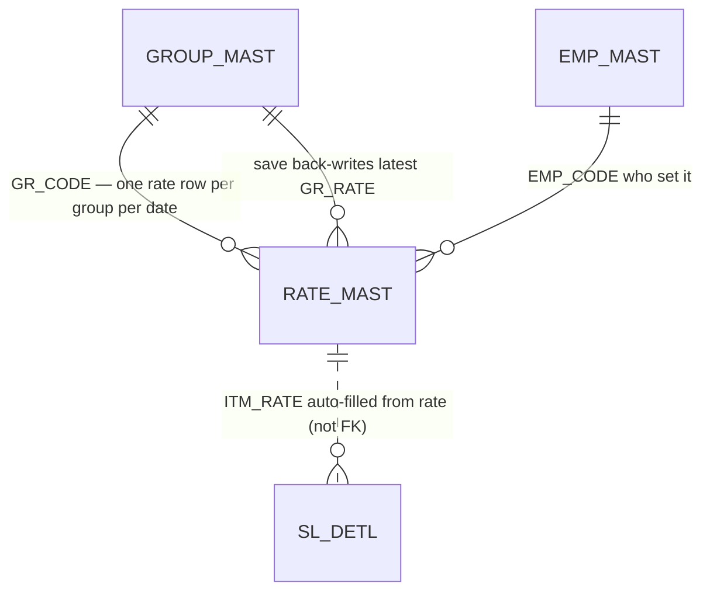
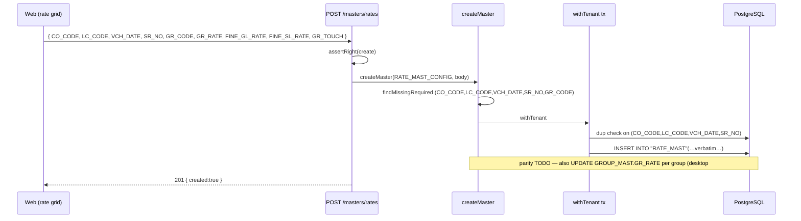

# MS_RATE — Metal Rate Master (day rate) · deep-dive

```
Form: MS_RATE  ·  Module: 1_Masters  ·  Type: master (reference data, no posting)
Desktop source: unified/src/csharp/DataCareNext/MS_RATE.cs (2,515 lines)
Web target: apps/api/src/modules/masters/rate.ts (fetchRate, rateGroups) + RATE_MAST_CONFIG (configs.ts)
            · generic CRUD apps/api/src/app.ts · consumed by sales.ts/purchase.ts line-rate auto-fill
Requirements: Req 8 (master CRUD), 8.2/8.3/8.6 (guards), 12 (calc — valuation uses the rate)
Parity: 06_Parity/masters.md   ·   Status: 📋 SPEC · 🟩 BUILT (CRUD + fetchRate; no update yet)
Evidence: form catalog project-memory/catalogs/forms/MS_RATE.md; table 02_Data_Model/tables/RATE_MAST.md
```

## 1. Purpose & business context

`MS_RATE` records the **metal rate for the day**. Gold and silver prices move daily, so before billing
the user enters today's rates here; every sale/purchase/job-work line then values metal as
`fine × rate`. The form captures the market fine rates — **gold per 10 g** (`FINE_GL_RATE`) and
**silver per 1 kg** (`FINE_SL_RATE`) — and a **per-group rate** (`GR_RATE`) for each item-group
(e.g. 22K gold, 18K gold, silver ornaments). On save it also **stamps the latest rate back onto
`GROUP_MAST.GR_RATE`** and refreshes the on-screen rate ticker (`Rate_1..Rate_7`) shown on the main
shell. Rates are keyed by **date** (`VCH_DATE`) so history is preserved and any back-dated voucher
picks the rate that was effective on its date.

This is the master most tightly coupled to money: if the rate is wrong, every bill that day is wrong.

## 2. UI / UX specification

### Layout
```
┌─ MS_RATE ─ Day Rate Entry ─────────────────────────────── [Save F2][Delete][Print][Close] ┐
│ Date: [__/__/____ ▾]      Gold Rate (10 g): [__________]   Silver Rate (1 Kg): [__________]  │
│ ┌ Group rates (grid; one row per RATE_DISPLAY='Y' group) ──────────────────────────────────┐│
│ │ Sr │ Group (GR_CODE→GR_NAME) │ Touch (GR_TOUCH) │ Rate (GR_RATE) │ Purc Touch │ Purc Rate ││
│ │ 1  │ 01 - GOLD 22K            │ 91.60            │ 6450.00        │ …          │ …         ││
│ │ 2  │ 02 - GOLD 18K            │ 75.00            │ 5280.00        │            │           ││
│ │ 3  │ 10 - SILVER              │ 99.90            │ 78.50          │            │           ││
│ └────────────────────────────────────────────────────────────────────────────────────────────┘│
│ Rate Type: [GR_TYPE]   Employee: [EMP_CODE→EMP_MAST]                                            │
│ (on save → MDI ticker Rate_1..Rate_7 = "GR_NAME - GR_RATE"; GROUP_MAST.GR_RATE updated)         │
└───────────────────────────────────────────────────────────────────────────────────────────────────┘
```

### Field table
| Label | Column (`RATE_MAST`) | Type | Req | Default | Notes |
|---|---|---|---|---|---|
| Date | `VCH_DATE` | date | ✓ (key) | today | one rate set per date; back-date allowed |
| Sr | `SR_NO` | float | ✓ (key) | grid ordinal | per-row sequence within the date |
| Group | `GR_CODE` | varchar(3)→`GROUP_MAST` | ✓ | from grid | only groups with `RATE_DISPLAY='Y'` listed (L1950/L2001) |
| Group name | `GR_NAME` | varchar(40) | — | from `GROUP_MAST` | denormalized for display |
| Gold rate (10 g) | `FINE_GL_RATE` | float | — | 0 | header fine gold rate; shown `nGoldRate` (L1761) |
| Silver rate (1 Kg) | `FINE_SL_RATE` | float | — | 0 | header fine silver rate; `nSilverRate` (L1763) |
| Rate | `GR_RATE` | float | — | 0 | **per-group valuation rate** (drives line metal value) |
| Touch | `GR_TOUCH` | float | — | from group | purity used with this rate |
| Purc touch/rate | `GR_PR_TOUCH`/`GR_PR_RATE` | float | — | 0 | separate purchase-side rate |
| Type | `GR_TYPE` | varchar | — | — | rate-type tag |
| Employee | `EMP_CODE` | code→`EMP_MAST` | — | session | who set the rate |
| (audit) | `MAIN_USER`,`ADD_USER`,`ADD_DATE`,`CO_YEAR`,`CASH_AMT` | — | auto | system | stamped on insert (L1945) |

### Keyboard / F-keys (desktop → web)
- **F2 = Save** (re-inserts all grid rows for the date). Delete removes the day's rates. Print needs
  `USER_PRINT` (L1839).
- Web: a date-scoped grid; `fetchRate`/`rateGroups` back this and the transaction-line auto-fill.

### Modes
New/Save (replace-for-date), Delete (per date, confirmed), Print, View history. **Web today: CRUD +
`fetchRate` read; no in-place update beyond delete+re-create per date.**

## 3. Data model touched

**Writes (save):** `INSERT INTO RATE_MAST` (one row per group with `GR_RATE>0`), preceded by a
`DELETE FROM RATE_MAST` for that date so save is idempotent (replace-for-date).
// src: MS_RATE.cs#L1894 (DELETE), #L1945 / #L2086 (INSERT); catalog MS_RATE.md
**Updates:** `UPDATE GROUP_MAST SET GR_RATE=…` per group — the group master always holds the latest
rate for quick lookup. // src: MS_RATE.cs#L1932
**Reads:** `RATE_MAST`, `GROUP_MAST` (which groups display, names), `EMP_MAST`, `LOCT_MAST`, `BOOK_IDTL`.
**Delete:** `DELETE FROM RATE_MAST` for the date (confirmed). // src: MS_RATE.cs#L2104-L2106


Refs: [RATE_MAST](../../02_Data_Model/tables/RATE_MAST.md) · [GROUP_MAST](../../02_Data_Model/tables/GROUP_MAST.md)

## 4. Business logic & calculations (with code)

### 4.1 Save = replace-for-date + back-write group rate (desktop)
```csharp
// src: MS_RATE.cs#L1910-L1945 (per grid row i, trimmed)
dataRow["FINE_GL_RATE"] = Conversion.Val(nGoldRate.Text);     // gold per 10 g
dataRow["FINE_SL_RATE"] = Conversion.Val(nSilverRate.Text);   // silver per 1 kg
dataRow["GR_RATE"]      = Conversion.Val(MSG[i, 5]);          // per-group rate from grid col 5
// keep GROUP_MAST in sync with the latest day rate:
ExeQuteDc("UPDATE GROUP_MAST SET GR_RATE = " + Val(MSG[i,5]) +
          " WHERE CO_CODE = '" + MCo_code + "' AND GR_CODE = '" + MSG[i,1] + "'");   // #L1932
// replace this date's rows, then insert the new one:
"DELETE FROM RATE_MAST WHERE … VCH_DATE = '<date>' …"                                 // #L1894/#L1944
"INSERT INTO RATE_MAST(CO_CODE,LC_CODE,CO_YEAR,VCH_DATE,SR_NO,GR_CODE,FINE_GL_RATE,
   FINE_SL_RATE, GR_RATE,GR_TOUCH,GR_TYPE,EMP_CODE,CASH_AMT,MAIN_USER,ADD_USER,ADD_DATE,
   GR_PR_TOUCH,GR_PR_RATE, …) VALUES (…)"                                              // #L1945
```
After save the shell ticker is refreshed: `MDI_FORM.Rate_1..Rate_7 = "<GR_NAME> - <GR_RATE>"` for the
display groups. // src: MS_RATE.cs#L1963-L1993

### 4.2 How the rate drives valuation (the reason this master matters)
A transaction line's metal value is `fine × rate`, where `rate` is the group's `GR_RATE` for the
voucher date. The web auto-fills the line rate from this master:
```ts
// src: web/apps/api/src/modules/masters/rate.ts#L8-L40 (trimmed)
export async function fetchRate(prisma, tenantId, coCode, group, date?) {
  const d = (date && /^\d{4}-\d{2}-\d{2}/.test(date)) ? date.slice(0,10) : '9999-12-31';
  // latest rate on/before the date; fall back to the most recent if none on/before:
  //   SELECT GR_CODE, VCH_DATE, GR_RATE rate, GR_TOUCH touch, FINE_GL_RATE finegl, FINE_SL_RATE finesl
  //   FROM "RATE_MAST" WHERE "CO_CODE"=$1 AND "GR_CODE"=$2 AND "VCH_DATE" <= $3
  //   ORDER BY "VCH_DATE" DESC, "SR_NO" DESC LIMIT 1
  return { group, rate, touch, fineGold, fineSilver, date };   // numerics coalesced to 0, never null
}
```
`computeLine` in `sales.ts`/`purchase.ts` then uses this `rate` in `metalAmount(fine, rate)` (HALF-UP,
amount 2 dp / weight 3 dp — see `04_Cross_Cutting_Engines/calc-engine.md`). The on/before-date
selection reproduces the desktop's "rate effective on the voucher date" behavior.

### 4.3 Web config
```ts
// src: web/apps/api/src/modules/masters/configs.ts#L3-L9
export const RATE_MAST_CONFIG: MasterConfig = {
  table: 'RATE_MAST',
  keyColumns: ['CO_CODE', 'LC_CODE', 'VCH_DATE', 'SR_NO'],
  requiredColumns: ['CO_CODE', 'LC_CODE', 'VCH_DATE', 'SR_NO', 'GR_CODE'],
  references: [],   // rates are time-series; old rows are kept, not delete-guarded
};
```

## 5. Save sequence (create / edit)


Desktop saves the **whole grid** as replace-for-date (delete then insert each group row). The web
generic engine inserts one row per call; a batch/replace-for-date wrapper + the `GROUP_MAST.GR_RATE`
back-write are parity items (§11).

## 6. Delete / reverse sequence

```ts
// DELETE /masters/rates  body: { CO_CODE, LC_CODE, VCH_DATE, SR_NO }  (right: delete)
await deleteMaster(prisma, tenantId, RATE_MAST_CONFIG, key);  // no references[] → always deletable
```
Desktop confirms *"Are You Sure To Delete This Day Rate?"* (L2104) and deletes the date's rows. There
is no referential guard (rates are historical time-series); deleting a past rate could change the
valuation of a back-dated voucher recompute — flag for the period-lock policy (§11).

## 7. API contract

```ts
GET    /masters/rates            // RATE_MAST rows (≤500)
GET    /masters/rates/meta       // { table:"RATE_MAST", keyColumns:["CO_CODE","LC_CODE","VCH_DATE","SR_NO"], requiredColumns:[…,"GR_CODE"] }
POST   /masters/rates  (create)  // body = RATE_MAST row → 201 | 400 missing-required | 409 duplicate-key
DELETE /masters/rates  (delete)  // body = { CO_CODE, LC_CODE, VCH_DATE, SR_NO } → 200
// Read helpers used by transaction screens (registered with txn routes, not the masters block):
//   fetchRate(coCode, group, date) → { group, rate, touch, fineGold, fineSilver, date }   // rate.ts
//   rateGroups(coCode)             → string[] of GR_CODE                                   // rate.ts
```

## 8. Validation rules

| Rule | Condition | Desktop message | HTTP | req |
|---|---|---|---|---|
| Group required | empty `GR_CODE` | (grid enforces group selection) | 400 `missing-required` | 8.2 |
| Key complete | missing date/sr | — | 400 `missing-required` | 8.2 |
| Duplicate row | same `(CO_CODE,LC_CODE,VCH_DATE,SR_NO)` | replace-for-date (delete first) | 409 if not replaced | 8.3 |
| No rights | missing `USER_UPDATE`/`USER_PRINT` | "You Have No Rights….." (L1888) / "You Have No Print Rights….." (L1839) | 403 `forbidden` | 6.5 |
| Confirm delete | delete day rate | "Are You Sure To Delete This Day Rate?" (L2104) | (client confirm) | — |
| Only display groups | `RATE_DISPLAY<>'Y'` | hidden from grid (L1950/L2001) | — (UI) | — |

## 9. Parity criteria (Definition of Done)

1. A saved day-rate persists `RATE_MAST` rows with verbatim columns (`GR_RATE`, `FINE_GL_RATE` per 10 g,
   `FINE_SL_RATE` per 1 kg, `GR_TOUCH`, `VCH_DATE`, `SR_NO`) equal to the desktop.
2. After save, `GROUP_MAST.GR_RATE` for each group equals the latest entered rate (back-write parity).
3. `fetchRate(group, date)` returns the same rate the desktop would apply to a voucher on that date
   (latest on/before; fallback to most recent).
4. A sale/purchase line's `ITM_RATE`/metal value computed from `fetchRate` matches the desktop bill to
   the paisa (cross-check `06_Parity/sales.md`, `purchase.md`).
5. Deleting a date's rate removes exactly those rows (no FK block).

## 10. Variants & edge cases

| Variant / case | Behavior |
|---|---|
| Purchase-side rate | `GR_PR_TOUCH`/`GR_PR_RATE` give a separate purchase valuation rate. |
| Back-dated voucher | `fetchRate` uses on/before-date selection so the historically effective rate applies. |
| No rate for date | falls back to the most recent prior rate (desktop & `fetchRate` agree). |
| `CONV_MAST` (bullion/UAE) | currency/ounce conversion master; separate from `RATE_MAST` day rate. |
| MDI rate ticker | `Rate_1..Rate_7` on the shell mirror the top display groups (web: a header rate widget). |

## 11. Open questions / risks

- **Batch/replace-for-date not in engine** — desktop saves the whole grid (delete date → insert each
  group). The web inserts one row per POST; add a replace-for-date batch endpoint for true parity.
- **`GROUP_MAST.GR_RATE` back-write missing** — `createMaster` does not yet update the group's latest
  rate (desktop #L1932). Add it (or have `fetchRate` always read `RATE_MAST`, never `GROUP_MAST`).
- **No update path** (module-wide gap) — editing a rate = delete+create.
- **`GR_RATE` vs `FINE_GL_RATE` derivation** — confirm whether `GR_RATE` is independently entered per
  group or derived from `FINE_GL_RATE × touch`; the calc engine consumes `GR_RATE` directly.
- **Deleting historical rates** — could alter recomputed back-dated vouchers; tie deletion to the
  period-lock (`CO_SET.LOCK_DATE`) policy.
- **Rate scale/precision** — gold per 10 g, silver per 1 kg vs per-gram `GR_RATE`: pin the unit in the
  calc engine so `fine × rate` is unambiguous (Docker golden-master pass).
