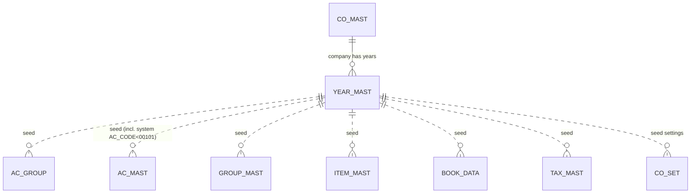
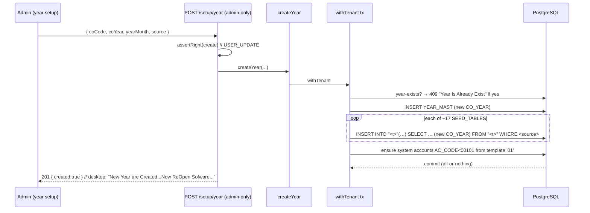

# MS_YEAR — Year Setup (creates & seeds the year) · deep-dive

```
Form: MS_YEAR  ·  Module: 1_Masters (Foundation/setup)  ·  Type: master / SETUP (no posting; seeds many tables)
Desktop source: unified/src/csharp/DataCareNext/MS_YEAR.cs (1,596 lines) · sibling MS_COMPANY.cs (company setup)
Web target: apps/api/src/modules/masters (YEAR_MAST_CONFIG) + a dedicated seed service (TODO) ·
            multitenancy via CO_YEAR column (01_Architecture/multitenancy-scoping.md)
Requirements: Req 1 (company/year setup), Req 8 (master CRUD), Req 6.5 (RBAC)
Parity: 06_Parity/masters.md   ·   Status: 📋 SPEC · 🟦 PARTIAL (YEAR_MAST CRUD via engine; seeding service not built)
Evidence: form catalog project-memory/catalogs/forms/MS_YEAR.md; table 02_Data_Model/tables/YEAR_MAST.md; MODULE_MAP write-set
```

## 1. Purpose & business context

`MS_YEAR` opens a **new financial year**. Unlike every other master it is a **setup/provisioning
form**, not single-row CRUD: on the desktop it literally `CREATE DATABASE`s a new per-year SQL Server
database (`Next23`/`Next24`/`Next25`…) and then **seeds it** by copying the masters and settings —
chart of accounts, account groups, item-groups, items, books, taxes, company settings, employees,
print formats, etc. — from either the **prior company/year** or the **software template company `'01'`**.
After it runs, the user re-opens the software into the new year and starts billing. This is the form
referenced in `MODULE_MAP.md` as "SEEDS many tables" — its INSERT write-set is ~17 tables and its
DELETE (wipe-year) set is ~115 tables.

**Web translation (locked architecture).** The web does **not** create databases. Per-year SQL Server
DBs collapse to a **`CO_YEAR` column** in one multi-tenant Postgres DB (`00_README.md §2`,
`01_Architecture/multitenancy-scoping.md`). So "create year" becomes: insert a `YEAR_MAST` row and
**seed the new `CO_YEAR`'s master rows** (same INSERT…SELECT set, with the new `CO_YEAR` stamped)
inside one transaction.

## 2. UI / UX specification

Setup wizard, not a grid form.

```
┌─ MS_YEAR ─ Create New Year ───────────────────────────────────── [Create][Delete][Close] ┐
│  Year Code: [____]   (e.g. 2024)        Month: [__]  (YEAR_MONTH, e.g. 04 = Apr start)      │
│  Copy masters from:  ( ) Template company '01'    ( ) Existing company [MsOldCoCode ▾]       │
│  [✓] Import all parties from old Ac Master         [✓] Import opening balances               │
│  ───────────────────────────────────────────────────────────────────────────────────────── │
│  Status: creating database Next<YY> … seeding AC_GROUP, AC_MAST, GROUP_MAST, ITEM_MAST,      │
│          BOOK_DATA/DETL, CO_SET/CO_SET_NEW, TAX_MAST, EMP_MAST, PRINT_MAST, … done.           │
│  → "New Year are Created...Now ReOpen Sofware..."                                            │
└───────────────────────────────────────────────────────────────────────────────────────────────┘
```

### Field table
| Label | Column / var | Type | Req | Notes |
|---|---|---|---|---|
| Year Code | `CO_YEAR` (`tYearCode`) | varchar | ✓ | financial-year code; part of the key |
| Month | `YEAR_MONTH` (`tMonth`) | varchar | ✓ | FY start month; part of the desktop duplicate key (L901) |
| Copy-from | `MsOldCoCode` / `'01'` | choice | ✓ | source of seeded masters (prior company or template) |
| Import parties | confirm flag | bool | — | "Import All Party from Ac Master Of <old> Company…?" (L1512) |

### F-keys / modes
- **Create** (provision + seed), **Delete** (drop/wipe the year — high-impact), **Close**.
- Web: an admin-only setup screen calling a `createYear` service (not the generic master POST).

### Modes
Create / Delete only. No per-record edit. RBAC: `USER_UPDATE` to create, `USER_DELETE` to wipe (L978).

## 3. Data model touched

**Primary write:** `YEAR_MAST` (the year registry row). Desktop key is `(CO_CODE, CO_YEAR, YEAR_MONTH)`
(L901); web `YEAR_MAST_CONFIG` key is `(CO_CODE, CO_YEAR)` — see §11.

**Seeds (INSERT…SELECT) — ~17 tables** (from prior company `MsOldCoCode`, or template `'01'`):
`AC_GROUP, AC_MAST, BAL_GR, BOOK_DATA, BOOK_DETL, CO_SET, CO_SET_NEW, COL_MAST, CONV_MAST, EMP_MAST,
GROUP_MAST, ITEM_MAST, LOCT_MAST, PRINT_MAST, PRODUCT_MAST, TABLE_MAST, TAX_MAST`.
// src: MS_YEAR.cs#L1511-L1553 (copy-from-old) and #L1558-L1578+ (copy-from-template '01'); catalog "Tables written"

**Provisioning:** `CREATE DATABASE Next<YY>` with data/log files. // src: MS_YEAR.cs#L1262, #L1333

**Delete (wipe year) — ~115 tables:** every transactional + master table for the year is emptied
(`AC_DATA, SL_DATA, PR_DATA, MAIN_STOCK, TAG_*`, … and the masters), plus `YEAR_MAST`.
// src: MS_YEAR.cs#L1173-L1483+; catalog "Tables deleted"


Refs: [YEAR_MAST](../../02_Data_Model/tables/YEAR_MAST.md) · [CO_MAST](../../02_Data_Model/tables/CO_MAST.md) · [AC_MAST](../../02_Data_Model/tables/AC_MAST.md) · [GROUP_MAST](../../02_Data_Model/tables/GROUP_MAST.md) · [TAX_MAST](../../02_Data_Model/tables/TAX_MAST.md)

## 4. Business logic & calculations (with code)

No money math — the logic is **provision + duplicate-check + seed**.

### 4.1 Duplicate-year guard
```csharp
// src: MS_YEAR.cs#L901
"SELECT * FROM YEAR_MAST WHERE CO_CODE = '" + MCo_code + "' AND CO_YEAR = '" + tYearCode.Text +
  "' AND YEAR_MONTH = '" + tMonth.Text + "'"
// if it already exists → "Year Is Already Exist...Now ReOpen Sofware..."  (#L1394)
```

### 4.2 Provision the year partition (desktop only)
```csharp
// src: MS_YEAR.cs#L1262 / #L1333
"CREATE DATABASE " + text4 + " ON PRIMARY(NAME = " + text4 + "_Data, FILENAME='…', SIZE=5MB, …)
   LOG ON (NAME = " + text4 + "_Log, FILENAME='…', SIZE=1MB, …)"
```
**Web:** no `CREATE DATABASE`. The new year is the `CO_YEAR` value stamped on seeded rows; the schema
already exists. This is the single largest desktop→web shape change in the masters module.

### 4.3 Seed the masters (the heart of MS_YEAR)
Two source branches; both copy the same ~17 tables, stamping the **new** `CO_CODE`/`CO_YEAR`:
```sql
-- src: MS_YEAR.cs#L1511 (account groups, from prior company)
INSERT INTO AC_GROUP (CO_CODE,AC_GR,AC_GR_NAME,AC_MAIN_GR,AC_SUB_GR,MAIN_USER)
  SELECT '<newCo>',AC_GR,AC_GR_NAME,AC_MAIN_GR,AC_SUB_GR,MAIN_USER FROM AC_GROUP WHERE CO_CODE='<oldCo>';

-- src: MS_YEAR.cs#L1515 (all parties — behind the "Import All Party…?" confirm #L1512)
INSERT INTO AC_MAST (CO_CODE,AC_CODE,LC_CODE,AC_NAME,AC_SHORT,AC_MAIN_GR,AC_GR,AC_GST_TYPE,DATA_TRFR, …)
  SELECT '<newCo>',AC_CODE,LC_CODE,AC_NAME,AC_SHORT,AC_MAIN_GR,AC_GR,AC_GST_TYPE,'N', … FROM AC_MAST WHERE CO_CODE='<oldCo>';

-- src: MS_YEAR.cs#L1520 / #L1560 (software DEFAULT/system accounts only: AC_CODE < '00101')
INSERT INTO AC_MAST (CO_CODE,AC_CODE,LC_CODE,AC_NAME,AC_SHORT,AC_MAIN_GR,AC_GR,AC_GST_TYPE,DATA_TRFR)
  SELECT '<newCo>',AC_CODE,LC_CODE,AC_NAME,AC_SHORT,AC_MAIN_GR,AC_GR,AC_GST_TYPE,'N'
  FROM AC_MAST WHERE CO_CODE='01' AND LC_CODE='00' AND AC_CODE < '00101';

-- then the same INSERT…SELECT for: BAL_GR (#L1523), BOOK_DATA (#L1525), BOOK_DETL (#L1527),
-- CO_SET (#L1529), CO_SET_NEW (#L1531), COL_MAST (#L1533), CONV_MAST (#L1535), EMP_MAST (#L1537),
-- GROUP_MAST (#L1539), ITEM_MAST (#L1541), LOCT_MAST (#L1543/#L1545), PRINT_MAST (#L1547),
-- PRODUCT_MAST (#L1549), TABLE_MAST (#L1551), TAX_MAST (#L1553).
```
Note the **system accounts** seed (`AC_CODE < '00101'`) is what guarantees `CASH`/`SALES`/`GST`/
`ROUNDOFF` exist for `buildSaleLedger` (see [MS_ACCT.md](MS_ACCT.md) §1 and Sales §4.3).

### 4.4 Web target (the spec)
```ts
// src: web/apps/api/src/modules/masters/configs.ts#L100 (registry entry today)
export const YEAR_MAST_CONFIG: MasterConfig = {
  table: 'YEAR_MAST', keyColumns: ['CO_CODE', 'CO_YEAR'], requiredColumns: ['CO_CODE', 'CO_YEAR'], references: [],
};

// TODO service (the real MS_YEAR): seed-from-source in ONE tx, stamping the new CO_YEAR.
const SEED_TABLES = ['AC_GROUP','AC_MAST','BAL_GR','BOOK_DATA','BOOK_DETL','CO_SET','CO_SET_NEW',
  'COL_MAST','CONV_MAST','EMP_MAST','GROUP_MAST','ITEM_MAST','LOCT_MAST','PRINT_MAST',
  'PRODUCT_MAST','TABLE_MAST','TAX_MAST'] as const;
export async function createYear(prisma, tenantId, { coCode, coYear, source /* {coCode,coYear} | 'TEMPLATE' */ }) {
  return withTenant(prisma, tenantId, async (tx) => {
    if (await yearExists(tx, coCode, coYear)) throw new DuplicateKeyError();        // §4.1 parity
    await tx.$executeRawUnsafe(`INSERT INTO "YEAR_MAST"(tenant_id,"CO_CODE","CO_YEAR") VALUES ($1,$2,$3)`, tenantId, coCode, coYear);
    for (const t of SEED_TABLES) await seedTable(tx, t, source, coYear);            // INSERT…SELECT, new CO_YEAR
    // ensure system accounts (AC_CODE < '00101') exist from template '01' if source lacks them
  });
}
```

## 5. Save sequence (create year)


Desktop runs each `INSERT…SELECT` sequentially after `CREATE DATABASE`; the web runs the seed set in
**one transaction** so a partial year can never exist.

## 6. Delete / reverse sequence (wipe year — HIGH IMPACT)

Desktop "delete year" empties ~115 tables for the year then removes `YEAR_MAST`
(L1173-L1483+), guarded by *"Are You Sure To Delete This … now?"* (L980) and `USER_DELETE` (L978).

```ts
// Web: a destructive admin op — delete all rows WHERE CO_YEAR=:year (tenant-scoped) then YEAR_MAST.
// Must be: explicit confirmation, USER_DELETE, single tx, and BLOCKED if the year has posted vouchers
// unless an explicit "force wipe" is given. Never expose via the generic /masters DELETE.
```
> ⚠️ This is the most destructive operation in the masters module. It is **not** the generic master
> delete; it must be an isolated, confirmed, admin-only endpoint (see §11 / safety).

## 7. API contract

```ts
// Generic engine today (registry slug "years"):
GET    /masters/years            // YEAR_MAST rows
GET    /masters/years/meta       // { table:"YEAR_MAST", keyColumns:["CO_CODE","CO_YEAR"], requiredColumns:["CO_CODE","CO_YEAR"] }
POST   /masters/years  (create)  // inserts a YEAR_MAST row ONLY — does NOT seed (gap)
DELETE /masters/years  (delete)  // removes a YEAR_MAST row ONLY — does NOT wipe (and must not, generically)

// Required dedicated setup service (TODO — the real MS_YEAR):
POST   /setup/year   { coCode, coYear, yearMonth, source }  (right: create) → seeds ~17 tables in one tx
DELETE /setup/year   { coCode, coYear }  (right: delete, force flag)        → wipe-year (confirmed, guarded)
```

## 8. Validation rules

| Rule | Condition | Desktop message | HTTP | req |
|---|---|---|---|---|
| Year required | empty `CO_YEAR` | (field required) | 400 `missing-required` | 8.2 |
| Duplicate year | `(CO_CODE,CO_YEAR,YEAR_MONTH)` exists | "Year Is Already Exist...Now ReOpen Sofware..." (L1394) | 409 `duplicate-key` | 8.3 |
| No rights (create) | missing `USER_UPDATE` | "You Have No Rights….." (L1149) | 403 `forbidden` | 6.5 |
| No rights (delete) | missing `USER_DELETE` | "You Have No Rights….." (L978) | 403 `forbidden` | 6.5 |
| Confirm wipe | delete year | "Are You Sure To Delete This … now?" (L980) | client confirm + `force` | — |
| Seed source valid | source company/year has masters | — | 400 `invalid-data` | — |
| System accounts present | after seed, `AC_CODE<00101` exist | (seeded from '01') | invariant | — |

## 9. Parity criteria (Definition of Done)

1. Creating year `Y` seeds **the same rows** into all ~17 tables (verbatim columns) as the desktop's
   `INSERT…SELECT` set, with `CO_YEAR=Y` stamped — row counts and key sets match.
2. The system/default accounts (`AC_CODE < '00101'`) exist after seeding (cash/sales/GST/round-off),
   so a first sale in the new year posts a balanced ledger (cross-check `06_Parity/sales.md`).
3. Duplicate-year is refused (409) exactly as the desktop refuses.
4. Seeding is atomic — a failure leaves **no** `YEAR_MAST` row and **no** partial masters.
5. Trial balance for the freshly seeded year nets to zero (no stray opening rows).
6. Wipe-year removes exactly the year's rows and is impossible without confirmation + `USER_DELETE`.

## 10. Variants & edge cases

| Variant | Delta vs MS_YEAR |
|---|---|
| **`MS_COMPANY`** → `CO_MAST` | Company-level sibling: creates the company and seeds an even larger set (`CO_MAST`+`COL_MAST`,`CONV_MAST`,`FAN_AC_MAST`,`GROUP_MAST`,`ITEM_MAST`,`PRODUCT_MAST`), wipe-company touches ~140 tables. // src: MS_COMPANY.cs#L6240-L6348 |
| `MS_OPNCOMP` | Selects the active company/year scope (session), does not create. |
| Seed from template `'01'` | Fresh year with only software defaults (system accounts, default books/settings). |
| Seed from prior company | Carries the full chart of accounts/items forward (continuity). |
| Import opening balances | Opening `OP_DATA`/`BAL_GR` carried from the prior year (closing → opening). |

## 11. Open questions / risks

- **Seeding service not built** — the web `years` registry entry only inserts/deletes a `YEAR_MAST`
  row; the ~17-table seed (the actual purpose of MS_YEAR) is **TODO**. Build `createYear` per §4.4.
- **Key mismatch** — desktop keys `YEAR_MAST` by `(CO_CODE,CO_YEAR,YEAR_MONTH)` (L901); the web config
  uses `(CO_CODE,CO_YEAR)` and the table reference only recovered `OP_DATE`. Reconcile the real
  `YEAR_MAST` schema (`CO_YEAR`,`YEAR_MONTH`,`OP_DATE`,…) before building — table doc is incomplete.
- **`CREATE DATABASE` → `CO_YEAR` column** — confirm the multitenancy doc's collapse rule covers every
  seeded table (each must carry `CO_YEAR` or be year-agnostic). Some masters are year-agnostic
  (`STATE_MAST`) and must **not** be re-seeded per year.
- **Opening balances** — closing balances of the prior year must roll into the new year's opening
  (`OP_DATA`/`OP_LDR`/`BAL_GR`); confirm which the desktop carries vs recomputes (Accounting module).
- **Wipe-year safety** — must be an isolated, confirmed, RBAC-gated, force-flagged admin endpoint;
  never reachable through the generic `/masters/:name` DELETE. High blast radius.
- **Exact seed column lists** — captured for AC_GROUP/AC_MAST/BAL_GR/BOOK_*/GROUP_MAST/ITEM_MAST/etc.
  (§4.3); verify the full column list of `CO_SET`/`CO_SET_NEW` (very wide settings rows) against a
  Docker golden-master so no setting is dropped.
