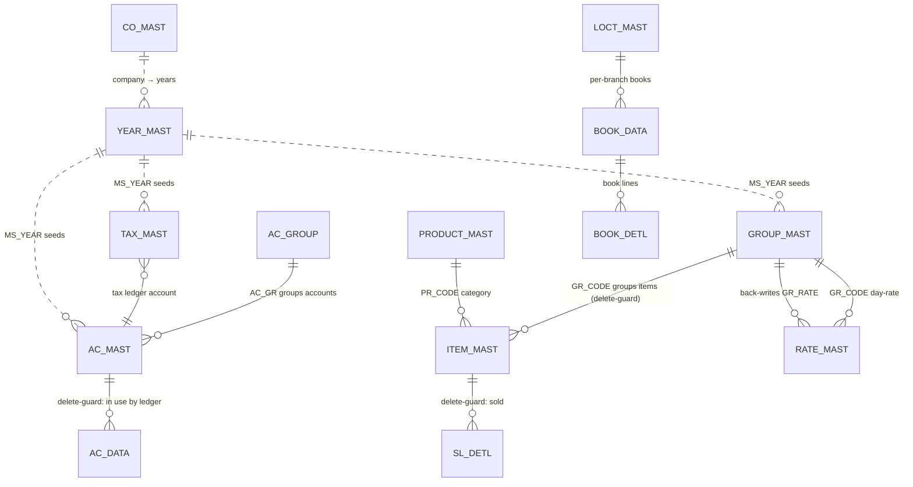

# Module 1 — Masters

> **The reference-data backbone.** Every transaction module (Sales, Purchase, Stock, Manufacturing,
> Dhrn, Finance, Accounting) reads its lookups from here: accounts, items, item-groups, metal rates,
> taxes, books, employees, products, locations, … ~33 desktop `MS_*` forms. The web rebuilds almost
> all of them as **one config-driven generic-CRUD engine** — a new master is a single config entry,
> not a new screen. The two exceptions are the *setup* forms (`MS_COMPANY`, `MS_YEAR`) which **create
> and seed** dozens of tables and are documented as deep-dives.
>
> Status: **📋 SPEC** · Web build: **🟩 BUILT** (`apps/api/src/modules/masters`) — parity to re-verify per `06_Parity/`.

---

## 1. Purpose

Masters hold the **company-scoped reference data** that transactions point at. In a jeweler's daily
flow you first set up the company & year, then the chart of accounts (customers/suppliers/ledgers),
item catalog, item-groups with their metal touch, the day's metal **rate**, tax slabs, voucher books
and employees — and from then on every sale/purchase/job-work voucher simply *looks up* those rows.

Three properties define the module:

1. **Company-scoped.** Every master row carries the tenant/scope key (`CO_CODE`, often `+ LC_CODE`,
   and for year-partitioned data `+ CO_YEAR`). The web folds the desktop's per-year SQL Server
   databases into a single multi-tenant Postgres DB keyed by `tenant_id` + these columns
   (see `01_Architecture/multitenancy-scoping.md`). Column names are preserved verbatim.
2. **Mostly pure CRUD.** ~26 of the 33 forms are create/list/delete of a single table with three
   guards: required-field, duplicate-key, referenced-delete. These are served by **one generic
   engine** (`master.service.ts`) parameterized by a **config registry** (`configs.ts`).
3. **A few are *setup* forms.** `MS_COMPANY` and `MS_YEAR` are not CRUD — they provision a whole
   company/year by **seeding many tables** (chart of accounts, groups, books, settings, taxes…).
   `MS_YEAR` even issues `CREATE DATABASE` on the desktop. These get full deep-dives.

### Deep-dives in this module
| Form | Why it earns a deep-dive | Doc |
|---|---|---|
| `MS_ACCT` → `AC_MAST` (+`AC_GROUP`) | Chart of accounts; every ledger leg (`AC_DATA`) points here; referenced-delete guard; system accounts feed `buildSaleLedger` | [MS_ACCT.md](MS_ACCT.md) |
| `MS_RATE` → `RATE_MAST` | Per-day metal rate that drives **all** valuation (sale/purchase line rate auto-fill); back-updates `GROUP_MAST.GR_RATE` and the MDI rate ticker | [MS_RATE.md](MS_RATE.md) |
| `MS_YEAR` → `YEAR_MAST` (+ seeds ~17 tables) | Year setup: creates the per-year partition and **seeds** accounts/groups/books/settings/taxes from a template/prior company | [MS_YEAR.md](MS_YEAR.md) |

---

## 2. The config-driven generic-CRUD architecture (the heart of the module)

Instead of 30 hand-written master screens + 30 services, the web has **one** service whose behavior
is data: each master is a `MasterConfig` (table name, business key, required columns, referencing
tables). A registry maps a URL slug → config; the routes are generic.

```ts
// src: web/apps/api/src/modules/masters/master.service.ts#L1-L40
export interface MasterConfig {
  table: string;            // desktop table, verbatim (e.g. "AC_MAST")
  keyColumns: string[];     // business key, excludes tenant_id (e.g. ["CO_CODE","AC_CODE"])
  requiredColumns: string[];// must be non-empty on create (Req 8.2)
  references?: string[];    // tables that reference this master by the SAME key cols → delete guard (Req 8.6)
}

export class ValidationError  extends Error { constructor(public missing: string[]) { super('missing-required: ' + missing.join(',')); this.name='ValidationError'; } }
export class DuplicateKeyError extends Error { constructor() { super('duplicate-key'); this.name='DuplicateKeyError'; } }
export class ReferencedError   extends Error { constructor(public ref: string) { super('referenced-by:' + ref); this.name='ReferencedError'; } }
export class DataError         extends Error { constructor(public detail: string) { super(detail); this.name='DataError'; } }
```

The three desktop guards become three pure, Tier-1-testable builders + four live ops:

```ts
// src: web/apps/api/src/modules/masters/master.service.ts#L55-L160 (trimmed)
const q = (id: string): string => '"' + id.replace(/[^A-Za-z0-9_]/g, '') + '"'; // legacy upper-case idents are quoted

export function findMissingRequired(config: MasterConfig, data: Record<string, unknown>): string[] {
  return config.requiredColumns.filter((c) => { const v = data[c]; return v === undefined || v === null || v === ''; });
}

export async function createMaster(prisma, tenantId, config, data) {            // Req 8.2 + 8.3
  const missing = findMissingRequired(config, data);
  if (missing.length) throw new ValidationError(missing);                        // → 400 missing-required
  return withTenant(prisma, tenantId, async (tx) => {
    const dup = buildDuplicateCheck(config, data);                               // SELECT 1 … WHERE <key> LIMIT 1
    if ((await tx.$queryRawUnsafe(dup.sql, ...dup.params)).length) throw new DuplicateKeyError(); // → 409 duplicate-key
    const ins = buildInsert(config, tenantId, data);                             // INSERT INTO "<table>"(tenant_id, …) VALUES …
    try { await tx.$executeRawUnsafe(ins.sql, ...ins.params); }
    catch (e) { throw new DataError(dbErrorDetail(e)); }                         // → 400 invalid-data
    return { created: true };
  });
}

export async function deleteMaster(prisma, tenantId, config, key) {             // Req 8.6
  return withTenant(prisma, tenantId, async (tx) => {
    for (const g of buildDeleteGuards(config, key)) {                            // one SELECT 1 per referencing table
      if ((await tx.$queryRawUnsafe(g.sql, ...g.params)).length) throw new ReferencedError(g.ref); // → 409 referenced
    }
    const { where, params } = buildKeyWhere(config, key);
    await tx.$executeRawUnsafe(`DELETE FROM ${q(config.table)} WHERE ${where}`, ...params);
    return { deleted: true };
  });
}

export async function listMaster(prisma, tenantId, config, limit = 100) { /* SELECT * … LIMIT n (≤500) */ }
export async function importMaster(prisma, tenantId, config, rows) {            // desktop UT_IMPORT — CSV bulk
  // each row is its own createMaster tx, so failures are isolated; returns {created, failed, errors[≤20]}
}
```

The registry (`configs.ts`) wires URL slug → config. Adding a master = adding **one line** here
(plus a nav entry); no new screen, route, or service:

```ts
// src: web/apps/api/src/modules/masters/configs.ts#L150-L185 (the live registry, trimmed)
export const MASTERS: Record<string, MasterConfig> = {
  accounts: AC_MAST_CONFIG, customers: AC_MAST_CONFIG,   // AC_MAST (customers = accounts, UI-filtered by AC_TYPE)
  items: ITEM_MAST_CONFIG, rates: RATE_MAST_CONFIG, taxes: TAX_MAST_CONFIG,
  groups: GROUP_MAST_CONFIG, employees: EMP_MAST_CONFIG, books: BOOK_DATA_CONFIG,
  products: PRODUCT_MAST_CONFIG, locations: LOCT_MAST_CONFIG, designs: DESIGN_MAST_CONFIG,
  diamonds: DM_MAST_CONFIG, models: MODEL_MAST_CONFIG, states: STATE_MAST_CONFIG,
  points: POINT_MAST_CONFIG, labour: LBR_MAST_CONFIG, touch: TOUCH_MAST_CONFIG,
  messages: MSG_MAST_CONFIG, conversions: CONV_MAST_CONFIG, mfg: MFG_MAST_CONFIG,
  companies: CO_MAST_CONFIG, years: YEAR_MAST_CONFIG, addresses: ADD_MAST_CONFIG,
  'gold-rate': DG_GOLD_MAST_CONFIG, schemes: AD_MAST_CONFIG, counters: TABLE_MAST_CONFIG,
  'item-weights': ITM_WT_MAST_CONFIG, styles: COL_MAST_CONFIG, 'print-formats': PRINT_MAST_CONFIG,
  'einvoice-gsp': E_MAST_CONFIG, 'franchise-accounts': FAN_AC_MAST_CONFIG, 'ac-groups': AC_GROUP_CONFIG,
};
```

**Referential integrity is by convention, not FK.** Because column names are identical across the
denormalized schema, a referencing table shares the master's key columns, so the delete guard is a
literal `SELECT 1 FROM <ref> WHERE <same key>` (e.g. `AC_MAST` → `AC_DATA`, `ITEM_MAST` → `SL_DETL`,
`GROUP_MAST` → `ITEM_MAST`, `AC_GROUP` → `AC_MAST`).

> ⚠️ **Gap — no UPDATE path.** The generic engine implements **create / delete / list / import only**;
> there is no `updateMaster` and no `PUT/PATCH /masters/:name` route (verified in
> `master.service.ts` and `app.ts`). The desktop *edits* a master row in place (and several `MS_*`
> forms do delete-then-reinsert internally — e.g. `MS_ACCT` `DELETE AC_MAST` … `INSERT AC_MAST`).
> Until an update path is added, editing a master in the web means delete-then-create, which the
> referenced-delete guard will **block** for any account/item already used in a transaction. Flagged
> in each deep-dive §11 and the build checklist.

---

## 3. Form inventory — all 33 `MS_*` masters

Grouped by how the web serves them. **Web status** legend: 🟩 generic-CRUD route live · 🟦 route live
but form does **more** than single-table CRUD (detail tables / cascades / setup) · 🧩 served by
another module (auth/settings/membership) · ⬛ not yet wired.

> The "Masters" functional bucket in `MODULE_MAP.md` lists 20 forms; the remaining 13 `MS_*` forms
> live in Foundation (9), Membership (2), Bullion (1) and Manufacturing (1). All 33 are listed here
> because they are the same *kind* of object (reference data) and most share this engine.

### 3a. Pure / near-pure CRUD (the generic engine) — Masters bucket

| Form | Table | Key columns | Required | Route `/masters/…` | Web | Notes |
|---|---|---|---|---|---|---|
| **`MS_ACCT`** | `AC_MAST` | `CO_CODE,AC_CODE` | `+AC_NAME` | `accounts` / `customers` | 🟩 | Chart of accounts. refs→`AC_DATA`. **[deep-dive](MS_ACCT.md)** |
| **`MS_AC_GROUP`** | `AC_GROUP` | `CO_CODE,AC_GR` | `+AC_GR_NAME` | `ac-groups` | 🟩 | Account groups; refs→`AC_MAST`. Also writes `BOOK_IDTL`. |
| `MS_ADD_MAST` | `ADD_MAST` | `CO_CODE,AC_CODE` | `CO_CODE,AC_CODE` | `addresses` | 🟩 | Multi-address book per account. |
| `MS_ITEM` | `ITEM_MAST` | `CO_CODE,IT_CODE` | `+IT_NAME` | `items` | 🟦 | Item catalog; refs→`SL_DETL`. Form also touches `GROUP_MAST`,`PRODUCT_MAST`,`BAR_DETL`. |
| `MS_GROUP` | `GROUP_MAST` | `CO_CODE,GR_CODE` | `+GR_NAME` | `groups` | 🟦 | Item-group (holds touch/HSN/rate); refs→`ITEM_MAST`. Rename cascades `GR_NAME`→`ITEM_MAST`. |
| **`MS_RATE`** | `RATE_MAST` | `CO_CODE,LC_CODE,VCH_DATE,SR_NO` | `+GR_CODE` | `rates` | 🟦 | Per-day metal rate. Back-updates `GROUP_MAST.GR_RATE`. **[deep-dive](MS_RATE.md)** |
| `MS_TAX` | `TAX_MAST` | `CO_CODE,TAX_CODE` | `+TAX_NAME` | `taxes` | 🟦 | GST slabs; form also creates the tax ledger `AC_MAST` account. |
| `MS_BOOK` | `BOOK_DATA` | `CO_CODE,LC_CODE,CO_BOOK` | `+BOOK_NAME` | `books` | 🟦 | Voucher books; detail `BOOK_DETL` not in generic engine yet. |
| `MS_EMP` | `EMP_MAST` | `CO_CODE,EMP_CODE` | `+EMP_NAME` | `employees` | 🟩 | Salesperson/karigar staff; TDS/PF fields. |
| `MS_PRODUCT` | `PRODUCT_MAST` | `CO_CODE,PR_CODE` | `+PR_NAME` | `products` | 🟦 | Product category. Form is setup-ish (touches `ITEM_MAST`,`CO_MAST`,`TAG_STOCK`,`BOOK_IDTL`,`TABLE_MAST`). |
| `MS_LOCT` | `LOCT_MAST` | `CO_CODE,LC_CODE` | `+LC_NAME` | `locations` | 🟦 | Branch/location; form also seeds that branch's `BOOK_DATA`/`BOOK_DETL`/`MENU_DATA`/`TABLE_MAST`. |
| `MS_PRINT` | `PRINT_MAST` | `CO_CODE,PRINT_TYPE` | `CO_CODE,PRINT_TYPE` | `print-formats` | 🟩 | Per-book print template selection. |
| `MS_STYLE` | `DESIGN_MAST` / `MODEL_MAST` / `ITM_CITY` | `CO_CODE,DESIGN_NO` / `CO_CODE,MODEL_NAME` | (key only) | `designs` / `models` / `styles`(`COL_MAST`) | 🟦 | Style/design/model/colour masters; spread across 3 tables/routes. |
| `MS_LBR_TYPE` | `LBR_MAST` | `CO_CODE,LBR_CODE` | `CO_CODE,LBR_CODE` | `labour` | 🟩 | Labour/making-charge types; feeds `labourCharge` in calc engine. |
| `MS_DESIGN_BOOK` | `DESIGN_DETL` | (design key) | — | (via `designs`) | ⬛ | Design-book detail lines; detail table not in generic engine. |
| `MS_AUTO_ITEM` | `ITEM_MAST` (+`BAR_DETL`,`BAR_IDTL`) | `CO_CODE,IT_CODE` | — | (via `items`) | ⬛ | Bulk auto-generate items+tags; a generator utility, not single-row CRUD. |
| `MS_STK_LIMIT` | `ITEM_MAST.MIN_STK` (inferred) | `CO_CODE,IT_CODE` | — | (via `items`) | ⬛ | Min-stock limit setter; no own table (updates item rows). Flag §11. |
| `MS_BOOKLIST` | — (read-only listing) | — | — | — | 🧩 | Lists books; no writes. Subsumed by `books` list endpoint. |
| `MS_TRADE` | `BAL_GR` (trading groups, inferred) | `CO_CODE,TRAD_TYPE` | — | ⬛ | `BAL_GR` not yet registered; used by final-accounts. Flag §11. |
| `MS_TASTING` | — (not detected) | — | — | ⬛ | Purpose unresolved from decompile (touch-testing?). Flag §11. |

### 3b. Reference masters wired but owned by their domain module

| Form | Table | Key columns | Required | Route | Web | Notes |
|---|---|---|---|---|---|---|
| `MS_DM` | `DM_MAST` | `CO_CODE,DM_CODE` | `+DM_NAME` | `diamonds` | 🟦 | Diamond/stone master; writes not auto-detected in catalog (flag). |
| `MS_GOLD_MAST` | `DG_GOLD_MAST` | `CO_CODE,COUNTRY_CODE` | key only | `gold-rate` | 🟩 | Bullion/digital-gold country rate (Module 11). |
| `MS_POINT` | `POINT_MAST` | `CO_CODE,POINT_CODE,SR_NO` | `+POINT_NAME` | `points` | 🟩 | Loyalty point slabs (Module 10). |
| `MS_MEMB` | `AD_MAST` (scheme) | `CO_CODE,SCHM_CODE` | `+SCHM_NAME` | `schemes` | 🟦 | Membership/advance-scheme master (Module 10). |
| `MS_MFG_MAST` | `MFG_MAST` | `CO_CODE,SM_MAIN_CODE` | key only | `mfg` | 🟦 | Manufacturing process master; setup-ish (`BOOK_DATA`,`MENU_DATA`). |
| — | `CONV_MAST` | `CO_CODE,CON_CODE` | `+CON_NAME` | `conversions` | 🟩 | Currency/unit conversion (UAE/bullion); no single `MS_` form. |
| — | `TOUCH_MAST` | `CO_CODE,LC_CODE,AC_CODE,AC_IT_CODE` | (key only) | `touch` | 🟩 | Per-party/item touch overrides; written by txns, edited here. |
| — | `MSG_MAST` | `CO_CODE,MSG_TYPE,MSG_TYPING` | (key only) | `messages` | 🟩 | SMS/WhatsApp templates (Module 13). |
| — | `STATE_MAST` | `STATE_CODE` | `+STATE_NAME` | `states` | 🟩 | GST state codes — **global** (no `CO_CODE`); engine skips tenant filter. |
| — | `ITM_WT_MAST` | `CO_CODE,IT_CODE,SR_NO` | (key only) | `item-weights` | 🟩 | Standard item weights. |
| — | `E_MAST` | `CO_CODE` | `CO_CODE` | `einvoice-gsp` | 🟩 | E-invoice GSP credentials (Module 9). |
| — | `FAN_AC_MAST` | `CO_CODE,FAN_AC_CODE` | (key only) | `franchise-accounts` | 🟩 | Franchise account mapping. |

### 3c. Setup / session / utility forms (NOT generic CRUD)

| Form | Table(s) | Owner | Web | Notes |
|---|---|---|---|---|
| **`MS_COMPANY`** | `CO_MAST` (+seeds ~7 / wipes ~140) | Foundation (`companies` route + setup svc) | 🟦 | Provisions a company; mirrors `MS_YEAR` seeding. Setup, not CRUD. |
| **`MS_YEAR`** | `YEAR_MAST` (+seeds ~17, `CREATE DATABASE`) | Foundation | 🟦 | Year setup that **seeds many tables**. **[deep-dive](MS_YEAR.md)** |
| `MS_USER` | `LOGIN_MAST` (+`USER_SET`,`MENU_DATA`,`TILE_DATA`) | `auth`/`rbac` (Module 0) | 🧩 | User master + rights; web uses Argon2 hashing, not `LOGIN_MAST` plaintext. |
| `MS_LOGIN` | `AC_MAST_SRNO` | `auth` | 🧩 | Login/company picker (session bootstrap). |
| `MS_OPNCOMP` | `CO_SET`,`MENU_DATA`,`BOOK_IDTL` | `auth`/`settings` | 🧩 | Open-company (sets active CO/LC/YEAR scope). |
| `MS_WINDOW_SET` | `CO_SET_NEW`,`TILE_DATA` | `settings` (Module 13) | 🧩 | Window/tile/home-screen settings. |
| `MS_UPDATE` | ~all tables | `utilities` (Module 13) | 🧩 | DB schema migration/updater — not a master. |
| `MS_HELP` | — | `utilities` | 🧩 | Help-text content; no business table. |

---

## 4. Module ER diagram

The masters this module owns and the principal cross-references the delete-guards protect. Tenant
key `CO_CODE` (often `+LC_CODE`, `+CO_YEAR`) is implicit on every box.



Per-table column references: [AC_MAST](../../02_Data_Model/tables/AC_MAST.md) ·
[AC_GROUP](../../02_Data_Model/tables/AC_GROUP.md) · [ITEM_MAST](../../02_Data_Model/tables/ITEM_MAST.md) ·
[GROUP_MAST](../../02_Data_Model/tables/GROUP_MAST.md) · [RATE_MAST](../../02_Data_Model/tables/RATE_MAST.md) ·
[TAX_MAST](../../02_Data_Model/tables/TAX_MAST.md) · [EMP_MAST](../../02_Data_Model/tables/EMP_MAST.md) ·
[CO_MAST](../../02_Data_Model/tables/CO_MAST.md) · [YEAR_MAST](../../02_Data_Model/tables/YEAR_MAST.md) ·
[LOGIN_MAST](../../02_Data_Model/tables/LOGIN_MAST.md) · [BOOK_DATA](../../02_Data_Model/tables/BOOK_DATA.md)

---

## 5. Shared logic

- **The generic engine itself** (`master.service.ts`) is the shared logic: `findMissingRequired`,
  `buildInsert`, `buildKeyWhere`, `buildDuplicateCheck`, `buildDeleteGuards`, `createMaster`,
  `deleteMaster`, `listMaster`, `importMaster`. All multi-table-safe via `withTenant`.
- **Lookups** (`lookup.ts`): a type-ahead `LookupPicker` source map (`accounts`, `customers`, `items`,
  `groups`, `products`, `employees`, `designs`, `tags`) returning `{code,name,…extra}`, company-scoped
  if the table has `CO_CODE`. This is what every transaction screen's F-key picker calls.
  // src: web/apps/api/src/modules/masters/lookup.ts#L4-L12
- **Rate resolution** (`rate.ts`): `fetchRate(co, group, date)` returns the latest `RATE_MAST` row
  on/before a date (HALF-UP numerics), driving line-rate auto-fill in Sales/Purchase. See
  [MS_RATE.md](MS_RATE.md). // src: web/apps/api/src/modules/masters/rate.ts#L8-L40
- **Error→HTTP mapping** is shared with the whole app (`01_Architecture/conventions.md §5`):
  `ValidationError`→400, `DuplicateKeyError`→409, `ReferencedError`→409, `DataError`→400.

---

## 6. Dependencies

- **RBAC** (Module 0 / `modules/rbac`): create & import require `USER_UPDATE` (`assertRight(...,'create')`);
  delete requires `USER_DELETE`. // src: web/apps/api/src/app.ts#L216-L233, L236-L251 (Req 6.5)
- **DB/tenant** (`@datacare/db` `withTenant`): scopes every query to `tenant_id` + sets the RLS GUC.
- **Consumed by everything:** Sales/Purchase/Stock/Mfg/Dhrn/Finance/Accounting all read these masters
  (account, item, group, rate, tax, book, employee). Masters have **no** posting (`AC_DATA`) of their
  own — except the setup forms which *seed* opening data.
- **Setup ordering:** `MS_COMPANY` → `MS_YEAR` must run before any transaction module (they create the
  chart of accounts, books, settings the engines assume exist). See `07_Build_Plan/`.

---

## 7. API surface

All under `requireAuth`. The `:name` segment is the registry slug from §2.
// src: web/apps/api/src/app.ts#L193-L266

| Method | Path | Right | Body / params | Success | Errors |
|---|---|---|---|---|---|
| GET | `/masters/:name` | — | — | `200` rows (≤500) | `404 unknown-master` |
| GET | `/masters/:name/meta` | — | — | `200 {table,keyColumns,requiredColumns}` | `404` |
| POST | `/masters/:name` | `create` | full row object | `201 {created:true}` | `400 missing-required{missing}` · `409 duplicate-key` · `409 referenced{ref}` · `400 invalid-data{detail}` · `403 forbidden` |
| DELETE | `/masters/:name` | `delete` | **key object in body** | `200 {deleted:true}` | `409 referenced{ref}` · `403 forbidden` |
| POST | `/masters/:name/import` | `create` | `{rows:[…]}` | `200 {created,failed,errors[≤20]}` | `400 rows-array-required` · `403 forbidden` |

```ts
// shapes — generic over the master row (column names verbatim)
GET    /masters/accounts                         → [{ CO_CODE, AC_CODE, AC_NAME, AC_GR, AC_GST_TYPE, … }]
GET    /masters/accounts/meta                    → { table:"AC_MAST", keyColumns:["CO_CODE","AC_CODE"], requiredColumns:["CO_CODE","AC_CODE","AC_NAME"] }
POST   /masters/rates       { CO_CODE, LC_CODE, VCH_DATE, SR_NO, GR_CODE, FINE_GL_RATE, GR_RATE, … }   → 201
DELETE /masters/items       { CO_CODE, IT_CODE }                                                       → 200 | 409 referenced(SL_DETL)
POST   /masters/items/import { rows:[ { CO_CODE, IT_CODE, IT_NAME }, … ] }                             → { created, failed, errors }
```

> ⚠️ **No `PUT/PATCH`** — see the gap note in §2. There is also no per-master right beyond the global
> create/delete (a future enhancement may scope rights per master).
>
> 🔌 **Lookup endpoint** (`lookup.ts`) is registered by the transaction-routes layer
> (`registerTxnRoutes`), not the masters block; documented with Sales/Purchase pickers.

---

## 8. Build checklist

- [x] Generic engine (`master.service.ts`) with required/duplicate/referenced guards + tenant tx.
- [x] Registry (`configs.ts`) covering 32 slugs / 31 tables; routes in `app.ts` (`GET/POST/DELETE/meta/import`).
- [x] `rate.ts` (`fetchRate`, `rateGroups`) and `lookup.ts` (8 pick sources) for transaction screens.
- [ ] **Add UPDATE path** (`updateMaster` + `PUT /masters/:name`) — desktop edits rows in place; current web can only create/delete (referenced-delete blocks re-create). **Highest-priority gap.**
- [ ] Wire the **detail/cascade** forms that exceed single-table CRUD: `MS_BOOK`→`BOOK_DETL`, `MS_DESIGN_BOOK`→`DESIGN_DETL`, `MS_STYLE` (3 tables), `MS_TAX`→tax `AC_MAST` account, `MS_GROUP` `GR_NAME`→`ITEM_MAST` cascade.
- [ ] Implement **setup forms** as services (not generic CRUD): `MS_COMPANY` provision, `MS_YEAR` seed-from-template (replace `CREATE DATABASE` with `CO_YEAR` partition seeding) — see [MS_YEAR.md](MS_YEAR.md).
- [ ] Register remaining tables/forms: `BAL_GR` (`MS_TRADE`), min-stock (`MS_STK_LIMIT`), `MS_AUTO_ITEM` generator; resolve `MS_TASTING`.
- [ ] Port desktop **validation messages** verbatim where users depend on them (deep-dives §8).
- [ ] **Parity gate** (`06_Parity/masters.md`): for each master, web create/list/delete persists the same rows (verbatim columns); seeded company/year matches the desktop's seeded set row-for-row; trial balance after seeding still nets to zero.

---

## 9. Evidence index

- Web (central): `web/apps/api/src/modules/masters/{master.service.ts,configs.ts,rate.ts,lookup.ts}`, routes `web/apps/api/src/app.ts#L193-L266`.
- Desktop: `unified/src/csharp/DataCareNext/MS_*.cs` (33 forms); op-sequences in `project-memory/catalogs/forms/MS_*.md`.
- Module map: `03_Modules/MODULE_MAP.md` (Masters bucket + Foundation/Membership/Bullion/Manufacturing `MS_*`).
- Conventions/scoping: `01_Architecture/conventions.md`, `01_Architecture/multitenancy-scoping.md`. Requirements: Req 8 (master CRUD), 8.2/8.3/8.6 (guards), 6.5/6.7 (RBAC/nav).
