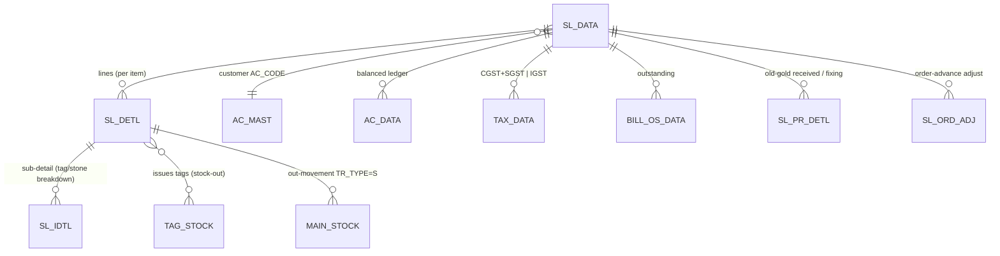

# Module 2 — Sales

> The most complex transaction module and the **gold-standard exemplar** for this spec. The
> [`TR_SALE.md`](TR_SALE.md) deep-dive shows the full depth contract; sibling variants reuse its
> engine and document only their deltas.

## 1. Purpose

Point-of-sale and credit selling of jewelry: pick tagged items (or enter loose items), compute
metal + labour + GST, take split tender (cash/card/UPI/cheque/old-gold), post the customer ledger,
issue the tags out of stock, and print a tax invoice. This is where most revenue is booked, so its
accounting + stock + tax effects must match the desktop exactly.

## 2. Form inventory

| Form | Type | Posting | Purpose | Web status |
|---|---|---|---|---|
| `TR_SALE` | transaction | ✅ | Standard retail sale (tagged + loose items) | 🟩 BUILT (`sales.ts`) |
| `TR_SALE_LBR` | transaction | ✅ | Labour-only / making-charge sale | 🟩 BUILT |
| `TR_SALE_HM` | transaction | ✅ | Hallmark sale capturing **HUID** per item | 🟩 BUILT (`SL_DETL.HM_ID`) |
| `TR_SALE_ORD` | transaction | ✅ | Order booking (advance) → later adjusted on the bill | 🟩 BUILT (`salesOrder.ts`) |
| `TR_SALE_RTN` | transaction | ✅ | Sales return (reverse stock + ledger) | 🟩 BUILT (`salesReturn.ts`) |
| `TR_SALE_RTN_UAE` | transaction | ✅ | UAE-variant return | 🟦 variant |
| `TR_WH_SALE` | transaction | ✅ | Wholesale sale (B2B pricing/posting) | 🟩 BUILT |
| `TR_WH_SALE_RTN` | transaction | ✅ | Wholesale return | 🟦 variant |
| `TR_SL_ORD_ADJ` | transaction | ✅ | Adjust order advance against a sale | 🟩 BUILT (`SL_ORD_ADJ`) |
| `TR_SL_PR_ITEM` | transaction | ✅ | Sale-against-purchase / fixing item link | 🟦 PARTIAL |
| `TR_BILL_TO` | transaction | ✅ | Bill-to / consolidated billing | 🟦 PARTIAL |
| `TR_SL_EBILL` | transaction | ✅ | E-invoice/e-bill on a sale → see Module 9 | 🟩 BUILT |

## 3. Module ER diagram

## 4. Shared logic (the sales engine, reused by every variant)

From `apps/api/src/modules/sales/sales.ts` (all pure except the tx wrapper):
- `lineFine(line)` → fine = explicit `fineWt` or `netWt × touch / 100`.
- `computeLine(line)` → `{ fine, metal, labour, net }` (uses `metalAmount`, `labourCharge`, `lineNet`).
- `billTotals(...)` → net → discount → taxable → tax → split → round-off → total.
- `buildSaleLedger(...)` → the **balanced** `AC_DATA` legs (Dr cash/bank/old-gold/customer; Cr sales+GST+round-off).
- `createSale` / `deleteSale` → compose numbering + tag-issue + posting in one tx (reverse + tag-restore on delete).

Variants change **inputs/books/extra columns**, not the engine: `TR_SALE_HM` adds `HM_ID`;
`TR_SALE_LBR` zeroes metal and bills labour; `TR_SALE_ORD`/`TR_SL_ORD_ADJ` add advance handling;
returns flip signs and restore stock.

## 5. Dependencies

- Engines: **calc**, **posting**, **numbering**, **GST**, **stock** (tag issue/restore), **RBAC**.
- Masters: `AC_MAST` (customer), `ITEM_MAST`, `RATE_MAST`, `TAX_MAST`, `TOUCH_MAST`.
- Reports: tax invoice (`invoice.ts` → PDF), sale register, GSTR-1 (Module 9, 12).

## 6. API surface (see `TR_SALE.md §7` for full contracts)

| Method | Path | Right | Purpose |
|---|---|---|---|
| POST | `/txn/sales` | create | Create a sale |
| DELETE | `/txn/sales/:vchNo` | delete | Reverse a sale |
| GET | `/txn/sales` | — | List/register |
| GET | `/txn/sales/:vchNo/invoice` | print | Invoice HTML/PDF |

## 7. Build checklist

- [ ] Engines built + parity-green (calc, posting, numbering, stock).
- [ ] `TR_SALE` create/delete passes parity vs desktop (rows + totals) — `06_Parity/sales.md`.
- [ ] GST split intra/inter correct on `SL_DETL` + `TAX_DATA`.
- [ ] Tag issue/restore + `MAIN_STOCK` movement correct; double-issue rejected.
- [ ] Invoice PDF fields match the Crystal `SaleReport.rpt`.
- [ ] Variants (LBR/HM/ORD/RTN/WH) each pass their delta parity.
- [ ] Trial balance still nets to zero after a batch of sales + deletes.
