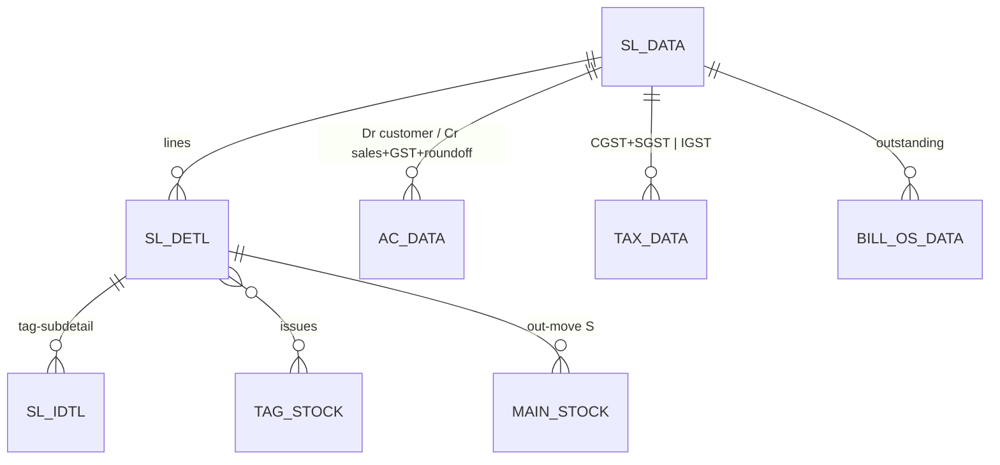
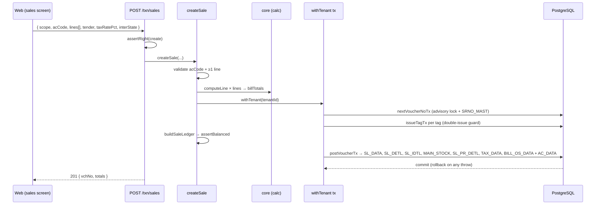

# TR_SALE — Sale (gold-standard deep-dive)

```
Form: TR_SALE  ·  Module: 2_Sales  ·  Type: transaction (posting)
Desktop source: unified/src/csharp/DataCareNext/TR_SALE.cs (889 KB) + Ac_Ledr.cs (ledger), Ac_Tax.cs (tax)
Web target: apps/api/src/modules/sales/{sales,invoice}.ts · apps/web/app/(app)/txn/sales
Requirements: Req 9 (numbering), 10 (sales), 12 (calc), 13 (ledger), 14 (tags), 18 (GST)
Parity: 06_Parity/sales.md   ·   Status: 📋 SPEC · 🟩 BUILT
Evidence: curated spec project-memory/catalogs/forms/curated/TR_SALE.md; op-sequence forms/TR_SALE.md
```

## 1. Purpose & business context

The retail sales counter. A salesperson selects the customer, scans/【picks tagged items (each tag
carries its weight, touch, labour), the screen computes metal value + labour + GST, accepts split
tender (cash/card/UPI/cheque/old-gold exchange), and saves. On save the app: numbers the voucher,
writes the bill header + lines, posts a **balanced** customer↔sales↔GST ledger, **issues the tags out
of stock**, records tax + outstanding, and prints a GST tax invoice. Uses book **`SALES`**, voucher
type **`SALE`**.

## 2. UI / UX specification

### Layout
```
┌─ TR_SALE ─ Sale Entry ───────────────────────────────── [New][Save F2][Delete][Print][Close] ┐
│ Bill No: [____]  Date: [__/__/____]   Customer: [AC_CODE ▾][AC_NAME .................] [F-lookup]│
│ ┌ Items ─────────────────────────────────────────────────────────────────────────────────────┐│
│ │ # │ Item │ Tag No │ Pcs │ G.Wt │ N.Wt │Touch│ Fine │ Rate │ Metal │ Labour │ HUID │ Net │     ││
│ │ 1 │ …    │ scan…  │     │      │      │     │ calc │      │ calc  │ calc   │      │calc │     ││
│ └──────────────────────────────────────────────────────────────────────────────────────────────┘│
│ Old gold in: [pcs][nwt][touch][rate][amt]      Discount: [____]  Tax%: [__]                       │
│ Tender → Cash:[__] Card:[__] UPI:[__] Cheque:[__] OldGold:[auto]      Outstanding (BILL_OS):[auto]│
│ Totals → Net:[..] Disc:[..] Taxable:[..] CGST:[..] SGST:[..] IGST:[..] RoundOff:[..] TOTAL:[....] │
└───────────────────────────────────────────────────────────────────────────────────────────────────┘
```

### Header field table
| Label | Column (`SL_DATA`) | Type | Req | Default | Notes |
|---|---|---|---|---|---|
| Bill No | `BILL_NO` | string | auto | = VCH_NO | editable per book policy |
| Date | `VCH_DATE` | date | ✓ | today | blocked if ≤ `CO_SET.LOCK_DATE` |
| Customer code | `AC_CODE` | lookup→`AC_MAST` | ✓ | — | F-key lookup; drives GST state |
| Customer name | `AC_NAME` | string | — | from master | |
| Discount | `DISC_AMT`/`DISC_PRC` | money/% | — | 0 | reduces taxable |
| Tax % | `TAX_PRC`/`TAX_CODE` | %/lookup→`TAX_MAST` | ✓ | item GST | |
| Cash/Card/UPI/Cheque | `CASH_AMT`/`CARD_AMT`/`UPI_AMT`/`CHQ_AMT` | money | — | 0 | split tender |
| Old-gold amount | `OLD_GL_AMT` | money | — | auto | from old-gold grid |
| Outstanding | `BILL_OS` | money | auto | total−paid | receivable balance |
| Totals | `NET_AMT`,`TAX_AMT`,`CGST_TAX`,`SGST_TAX`,`IGST_TAX`,`ROF_AMT`,`TOT_AMT` | money | auto | computed | read-only |

### Line grid columns (`SL_DETL`)
| Col | Column | Editable | Source/behavior |
|---|---|---|---|
| Item | `IT_CODE` | yes | lookup→`ITEM_MAST` |
| Tag No | `TAG_NO` | yes | scan/lookup→`TAG_STOCK`; auto-fills wt/touch/labour; must be in stock |
| Pcs | `ITM_PCS` | yes | |
| G.Wt / N.Wt | `ITM_GWT`/`ITM_NWT` | yes/auto | from tag if tagged |
| Touch | `ITM_TOUCH` | yes | purity % |
| Fine | `ITM_FINE` | auto | `NWT×TOUCH/100` |
| Rate | `ITM_RATE` | yes | metal rate (per fine) |
| Metal | `ITM_AMT` | auto | `fine×rate` |
| Labour | `LBR_AMT` | auto | by `LBR_TYPE` |
| HUID | `HM_ID` | yes (HM variant) | 6-char hallmark id |
| Net | `NET_AMT` | auto | metal+labour+other |
| GST | `ITM_CGST_AMT`/`ITM_SGST_AMT`/`ITM_IGST_AMT` | auto | line split |

### Keyboard / F-keys (desktop → web)
- **F2 = Save**, Enter = next cell, tag scanner types into `TAG_NO` then Enter adds the row.
- F-key lookups for customer/item/tag (web: `LookupPicker.tsx` modal on the same keys).
- _(Confirm exact F-key map from `TR_SALE.cs` key handlers before final UI.)_

### Modes
New / Edit (loads header+lines, re-posts on save) / View / Delete (needs `USER_DELETE`) / Print (needs `USER_PRINT`).

## 3. Data model touched

**Writes (create):** `SL_DATA` (header), `SL_DETL` (lines), `SL_IDTL` (tag sub-detail), `MAIN_STOCK`
(out-movement `TR_TYPE='S'`, and `'+'` in-movement for old gold), `AC_DATA` (balanced ledger),
`TAX_DATA` (CGST+SGST or IGST rows), `BILL_OS_DATA` (outstanding), `SL_PR_DETL` (old-gold/fixing).
Tag state: `TAG_STOCK` marked issued. _(Desktop also touches loyalty `POINT_DATA`, `UPI_DATA`/`CARD_DATA`,
`ROJ_MEL_DATA`, `SL_ORD_ADJ` — see §10/curated spec; web folds tender into ledger + `BILL_OS_DATA`.)_

**Deletes/reverses:** `SL_DATA, SL_DETL, SL_IDTL, SL_PR_DETL, MAIN_STOCK, AC_DATA, TAX_DATA, BILL_OS_DATA`
+ restore tags + write `DELETE_DATA`.

Table refs: [SL_DATA](../../02_Data_Model/tables/SL_DATA.md) · [SL_DETL](../../02_Data_Model/tables/SL_DETL.md) · [AC_DATA](../../02_Data_Model/tables/AC_DATA.md) · [TAX_DATA](../../02_Data_Model/tables/TAX_DATA.md) · [TAG_STOCK](../../02_Data_Model/tables/TAG_STOCK.md) · [MAIN_STOCK](../../02_Data_Model/tables/MAIN_STOCK.md) · [BILL_OS_DATA](../../02_Data_Model/tables/BILL_OS_DATA.md)



## 4. Business logic & calculations (with code)

### 4.1 Line computation (web — `sales.ts`, pure)
```ts
export function computeLine(line) {
  const fine = lineFine(line);                            // fineWt OR netWt×touch/100
  const metal = line.metalAmount ?? (fine>0 && line.rate!=null ? metalAmount(fine, line.rate) : 0);
  const labour = line.labourType ? labourCharge(line.labourType, {netWt,pcs,rate,pct,metalAmount:metal,fixed}) : 0;
  const net = calcLineNet({ metal, labour, other: line.otherAmount });
  return { fine, metal, labour, net };
}
```

### 4.2 Bill totals + GST split (web — `@datacare/core`)
```ts
const totals = billTotals({ lineNetTotal: Σ net, discountAmount, taxRatePct, interState });
// → net, discount, taxable, tax, cgst, sgst, igst, roundOff, total   (HALF-UP; total→nearest rupee)
```
Intra-state: CGST=SGST=tax/2 (SGST=tax−CGST); inter-state: IGST=tax. See `calc-engine.md`.

### 4.3 Balanced ledger (web — `buildSaleLedger`)
```ts
// Dr cash/bank/old-gold for amounts received now; Dr customer for the balance (BILL_OS);
// Cr sales (taxable) + Cr GST (tax) + Cr round-off.  ΣDr === ΣCr (assertBalanced).
if (cashAmt>0) lines.push({...base, AC_CODE:'CASH',    DR_AMT:cashAmt, SIGN:'D'});
if (bankAmt>0) lines.push({...base, AC_CODE:'BANK',    DR_AMT:bankAmt, SIGN:'D'});
if (balance!==0) lines.push({...base, AC_CODE:customer, DR_AMT:balance, SIGN:'D'});
lines.push({...base, AC_CODE:'SALES', CR_AMT: taxable, SIGN:'C'});
if (tax)      lines.push({...base, AC_CODE:'GST',      CR_AMT: tax,     SIGN:'C'});
if (roundOff) lines.push({...base, AC_CODE:'ROUNDOFF', CR_AMT: roundOff,SIGN:'C'});
```

### 4.4 Desktop evidence
Ledger insert is centralized in `Ac_Ledr.cs` (`INSERT INTO AC_DATA(...CR_AMT,DR_AMT,FINE_WT,FINE_RATE,LEDR_KEY...)`),
not inline in `TR_SALE`. Tax split is `Ac_Tax.Sales_GST` (separate CGST+SGST rows intra, single IGST inter) —
the web reproduces this exact `TAX_DATA` shape.

## 5. Save sequence (create / edit)

Edit = reverse prior voucher then repost, **all in one tx**. Order (from `createSale`):



Numbered: (1) voucher no from `SRNO_MAST`; (2) compute lines+totals; (3) issue tags; (4) build+assert
balanced ledger; (5) `postVoucherTx` writes detail/stock/tax/OS + the `AC_DATA` legs; (6) commit.

## 6. Delete / reverse (Req 10.10)

```ts
await reverseVoucherTx(tx, tenantId, {
  tables: ['SL_DATA','SL_DETL','SL_IDTL','SL_PR_DETL','MAIN_STOCK','AC_DATA','TAX_DATA','BILL_OS_DATA'],
  key, deleteLog: { table:'DELETE_DATA', row:{...key, VCH_TYPE:'SALE', DELETE_USER } },
});
for (const tag of tagRestores) await restoreTagTx(tx, tenantId, tag); // tags available again
```
One transaction; requires `USER_DELETE`. (Desktop reverses the same set + `POINT_DATA/UPI_DATA/CARD_DATA/
ROJ_MEL_DATA/SL_ORD_ADJ` — add those tables when those satellites are written; evidence L16332–L16386.)

## 7. API contract

```ts
// POST /txn/sales   (right: create)
interface CreateSaleBody {
  scope: { coCode; lcCode; coYear?; coBook? };   // tenantId from session
  acCode: string; acName?: string; billNo?: string; vchDate?: string;
  discountAmount?: number; taxRatePct: number; interState: boolean;
  cashAmt?: number; cardAmt?: number; upiAmt?: number; chequeAmt?: number;
  oldGold?: { itCode?; pcs?; netWt?; touch?; rate?; amount }[];
  lines: { itCode; tagNo?; pcs?; grossWt?; netWt?; touch?; fineWt?; rate?;
           labourType?; labourRate?; labourPct?; labourFixed?; otherAmount?; huid? }[];
}
// → 201 { vchNo:number, totals:BillTotals }
// DELETE /txn/sales/:vchNo  (right: delete) → { reversed:true }
// GET    /txn/sales         (list/register)
// GET    /txn/sales/:vchNo/invoice  (right: print) → HTML/PDF (invoice.ts)
```
Errors: `SaleValidationError`→400, `ForbiddenError`→403, tag-not-available→400, `PeriodLock…`→400.

## 8. Validation rules

| Rule | Condition | Desktop msg (confirm) | HTTP | req |
|---|---|---|---|---|
| Customer required | no `acCode` | "Select account" | 400 | 10.7 |
| ≥1 line | empty `lines` | "Enter at least one item" | 400 | 10.6 |
| Tag exists & in stock | `tagNo` not available for CO/LC | "Tag not found / not available" | 400 | 10.2, 14.5 |
| Double-issue guard | tag already issued | — | 400 | 14.5 |
| Period open | `VCH_DATE` ≤ `CO_SET.LOCK_DATE` | "Period locked" | 400 | — |
| Cash-limit → PAN | cash tender > limit, no PAN | "PAN required" | 400 | 17.2 |
| Balanced ledger | ΣCR≠ΣDR (invariant) | — | 500 | 13.1 |

## 9. Parity criteria (Definition of Done)

1. Given a desktop sale's inputs, the web persists the **same** `SL_DATA`+`SL_DETL`(+`SL_IDTL`) rows
   (weights, fine, metal, labour, net, GST splits) field-for-field.
2. `AC_DATA` legs match (accounts, Dr/Cr, `LEDR_KEY`, `BOOK_NAME='SALES'`, `IT_TYPE`) and ΣCR=ΣDR.
3. `TAX_DATA` rows match the desktop shape (CGST+SGST intra / IGST inter).
4. Sold tags become unavailable; `MAIN_STOCK` out-movement recorded; on delete, tags restored + `DELETE_DATA` written.
5. `billTotals` reproduces `TOT_AMT/ROF_AMT` to the paisa (HANDOFF: 190/190 invoices matched).
6. Invoice PDF carries the same fields as `SaleReport.rpt`.
Fixtures/scripts: `web/apps/api/integration/sales.live.mjs`, `compute_parity.live.mjs`; tracked in `06_Parity/sales.md`.

## 10. Variants & edge cases

| Variant | Delta vs TR_SALE |
|---|---|
| `TR_SALE_LBR` | metal=0; bill labour only; book LBR; `LbrWorkRpt.rpt`. |
| `TR_SALE_HM` | capture `HM_ID` (HUID) per line; hallmark fields; `RP_HUID`. |
| `TR_SALE_ORD` | books an order with advance (`ADV_AMT`); no stock-out yet; later adjusted. |
| `TR_SL_ORD_ADJ` | adjusts order advance against the sale (`SL_ORD_ADJ`, `AD_ADJ`). |
| `TR_SALE_RTN` | reverse signs; restore stock; book RTN; `SaleRtnReport.rpt`. |
| `TR_WH_SALE`(_RTN) | wholesale pricing/book; different posting account; `SalesWithOrder.rpt`. |
| Old-gold exchange | old metal in → `SL_PR_DETL` + `MAIN_STOCK '+'` + `OLDGOLD` Dr leg (already in `createSale`). |
| Split tender | cash/card/UPI/cheque → Dr cash/bank legs; balance → customer `BILL_OS`. |

## 11. Open questions / risks

- Confirm exact desktop F-key map + on-screen validation message strings from `TR_SALE.cs`.
- Loyalty (`POINT_DATA`/`POINT_MEMB`), `UPI_DATA`/`CARD_DATA` satellite rows, and `ROJ_MEL_DATA`
  day-book entries are in the desktop save set (stub op-sequence) but folded/omitted in the current
  web `createSale`; add them for full satellite parity (Modules 7, 10, 12).
- `SRNO_MAST` per-book/per-year numbering needs the Docker golden-master column recovery (see numbering engine).
