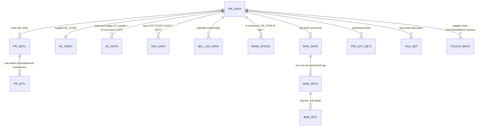

# Module 3 — Purchase

> The supplier-side mirror of Sales. Where Sales books revenue and pushes tagged stock **out**, Purchase
> books a payable and pulls metal/tagged stock **in**. The [`TR_PURC.md`](TR_PURC.md) deep-dive is the
> reference; the sibling variants (`TR_PURC_HM`, `TR_OTH_PURC`, `TR_PR_SL_UAE`) reuse its engine and
> document only their deltas. Ledger sense, calc engine, numbering, GST split, and stock movement are
> all the **same machinery** as Sales — read [`2_Sales/TR_SALE.md`](../2_Sales/TR_SALE.md) first.

## 1. Purpose

Inward buying of gold/silver jewellery, bullion and loose metal from suppliers (and karigars). The
operator picks the supplier, enters/scan-generates line items (each with gross/net weight, touch,
labour, rate), the screen computes fine weight + metal value + labour + tax, and saves. On save the
app: numbers the voucher, writes the bill header (`PR_DATA`) + lines (`PR_DETL`) + sub-detail
(`PR_IDTL`), posts a **balanced** supplier↔purchase↔input-GST ledger (`AC_DATA`), brings the metal/
tags **into stock** (creating `BAR_DATA`/`BAR_DETL`/`BAR_IDTL`, `ITM_LOT_DETL`, `TAG_SET` and a
`MAIN_STOCK` in-movement, and remembering the supplier's default touch/wastage in `TOUCH_MAST`),
records input tax (`TAX_DATA`) and the payable (`BILL_OS_DATA`). Uses book **`PURCHASE`**, voucher
type **`PURC`**. The same desktop form also hosts the **KARIGAR RECEIPT** and **OLD ITEM SALES** books
by switching the ledger/tax/stock routine (see §10 of the form doc).

`src: TR_PURC.cs#L13631-L13710` (Purc_Ledr / Purc_Rojmel / Purc_GST / Purc_Stk re-post on save); `req: 11`.

## 2. Form inventory

| Form | Type | Posting | Purpose | Tables (write set) | Web status |
|---|---|---|---|---|---|
| `TR_PURC` | transaction | ✅ | Standard tagged metal purchase (gold/silver) | `PR_DATA`,`PR_DETL`,`PR_IDTL`,`AC_DATA`,`TAX_DATA`,`MAIN_STOCK`,`BAR_DATA/DETL/IDTL`,`ITM_LOT_DETL`,`LOT_DETL`,`TAG_SET`,`TOUCH_MAST`,`ROJ_MEL_DATA`,`DM_DATA`,`SRNO_MAST`,`BILL_OS_DATA` | 🟩 BUILT (`purchase.ts`) — core subset |
| Purchase Return | transaction | ✅ | Goods returned to supplier (reverse of purchase) | `PR_DATA`,`PR_DETL`,`AC_DATA`,`TAX_DATA`,`MAIN_STOCK` (book `PRT`/`PRTN`) | 🟩 BUILT (`purchaseReturn.ts`) |
| `TR_PURC_HM` | transaction | ✅ | Hallmark purchase — stamps HUID/HM charges onto existing tags | updates `BAR_DETL`/`BAR_IDTL`; `AC_DATA`,`TAX_DATA`,`MAIN_STOCK`,`TAG_SET`,`DM_DATA`,`LOT_DETL`,`SRNO_MAST` | 🟦 variant (deltas in [`TR_PURC_HM.md`](TR_PURC_HM.md)) |
| `TR_OTH_PURC` | transaction | ✅ | Other / non-tagged metal purchase booked through a payment book | `PAY_DATA`,`PAY_DETL`,`AC_DATA`,`TAX_DATA`,`ROJ_MEL_DATA` (no stock/tag tables) | ⬛ variant (deltas in [`TR_OTH_PURC.md`](TR_OTH_PURC.md)) |
| `TR_PR_SL_UAE` | transaction | ✅ | UAE B2B combined **purchase + sale** under VAT | `PR_DATA/SL_DATA`,`AC_DATA`,`TAX_DATA`,`MAIN_STOCK`,`BAR_*`,`LOT_DETL`,`TAG_SET`,`DM_DATA` | ⬛ variant (deltas in [`TR_PR_SL_UAE.md`](TR_PR_SL_UAE.md)) |
| `TR_PR_SL_HEDG` | transaction | ✅ | Rate-cut / hedge purchase-sale (fixing unfixed metal) | `CUT_DATA/DETL`,`CUT_STK_DETL`,`RATE_CUT_ISU`,`AC_DATA`,`MAIN_STOCK` | 🟦 related — see `sales/rateCut.ts` |

> Source for write/delete sets: `project-memory/catalogs/module-map.json` (`forms.TR_PURC`, `TR_PURC_HM`,
> `TR_OTH_PURC`, `TR_PR_SL_UAE`) + the op-sequence in `project-memory/catalogs/forms/TR_PURC.md`.

## 3. Module ER diagram

Scope/tenant key on every table: `CO_CODE, LC_CODE, CO_YEAR, CO_BOOK` (+ `tenant_id` in the web).

## 4. Shared logic (the purchase engine, reused by every variant)

From `apps/api/src/modules/purchase/purchase.ts` (all pure except the tx wrapper) — note it is the
**deliberate mirror** of the sales engine and reuses the exact same `@datacare/core` primitives:

- `lineFine(line)` → fine = explicit `fineWt`, else `netWt × touch / 100` (Req 11.1). Matches desktop
  `ITM_FINE = ITM_NWT × ITM_TOUCH / 100` formatted to **3 dp**. `src: TR_PURC.cs#L7261,L7279`.
- `computeLine(line)` → `{ fine, metal, labour, net }` (uses `metalAmount`, `labourCharge`, `lineNet`).
- `billTotals(...)` → net → discount → taxable → tax → CGST/SGST/IGST split → round-off → total.
- `buildPurchaseLedger(...)` → the **balanced** `AC_DATA` legs: **Cr supplier (total)**, **Dr purchase
  (taxable)** + **Dr input-GST (tax)** + **Dr round-off** — the *mirror* of `buildSaleLedger`. A metal
  fine-weight sub-ledger leg (`IT_TYPE 'G'/'S'`, `SIGN '+'`, `FINE_WT=Σ fine`, `DR=CR=0`) records the
  metal received.
- `createPurchase` / `deletePurchase` → compose numbering + stock-IN (tag create) + posting in one tx;
  delete reverses the rows and removes the created tags.
- `createPurchaseReturn` / `deletePurchaseReturn` (`purchaseReturn.ts`) → flip the ledger sense
  (**Dr supplier / Cr purchase+GST**), send tagged goods back out of stock, book `PRT`/`PRTN`.

Variants change **inputs/books/extra columns/stock footprint**, not the calc: `TR_PURC_HM` adds the
HUID + hallmark-charge columns and updates existing tags; `TR_OTH_PURC` zeroes the tag/stock side and
posts through a payment book; `TR_PR_SL_UAE` swaps the GST split for a single VAT line and can post the
sale or the purchase leg.

## 5. Dependencies

- Engines: **calc** (`packages/core`), **posting** (`modules/posting`), **numbering**
  (`modules/vouchers`), **GST** (`gstSplit`), **stock** (`modules/stock` tag create/issue), **RBAC**.
- Masters: `AC_MAST` (supplier), `ITEM_MAST`, `RATE_MAST`, `TAX_MAST`, `TOUCH_MAST` (per-supplier touch/
  wastage/labour defaults), `LBR_MAST`, `TABLE_MAST`, `MODEL_MAST`.
- Reports: purchase register (`reports.ts` `purchaseRegister`), monthly purchase / purchase-by-party
  (`reports3.ts`), purchase-by-item (`reports7.ts`), purchase-return register (`reports6.ts`), inward
  GST / GSTR-2 (`reports10.ts gstr2Purchase`).

## 6. API surface (full contracts in [`TR_PURC.md §7`](TR_PURC.md))

| Method | Path | Right | Purpose |
|---|---|---|---|
| POST | `/txn/purchases` | create | Create a purchase |
| DELETE | `/txn/purchases/:vchNo` | delete | Reverse a purchase |
| POST | `/txn/purchase-returns` | create | Create a purchase return |
| DELETE | `/txn/purchase-returns/:vchNo` | delete | Reverse a purchase return |
| GET | `/txn/reports/purchase-register` | — | Purchase register (excludes `PRT`) |

`src: web/apps/api/src/routes/txn.ts#L175-L196`.

## 7. Build checklist

- [ ] Engines built + parity-green (calc, posting, numbering, GST, stock) — shared with Sales.
- [ ] `lineFine`/`computeLine` reproduce desktop `ITM_FINE` and line net to weight-3/amount-2 precision.
- [ ] `buildPurchaseLedger` is the balanced mirror of sales (Cr supplier / Dr purchase + input-GST + round-off); ΣDr = ΣCr.
- [ ] Input GST split on `TAX_DATA` correct (intra → CGST+SGST `TRAN_TYPE`/marker per live DB = `P`; inter → IGST).
- [ ] Stock-IN: `MAIN_STOCK` in-movement (`TR_TYPE='P'`, `ITM_SIGN='+'`) + tag creation; double-create rejected.
- [ ] Delete reverses `PR_DATA/PR_DETL/AC_DATA/TAX_DATA/BILL_OS_DATA/MAIN_STOCK` + removes created tags + writes `DELETE_DATA`; needs `USER_DELETE`; blocked if a created tag was already sold.
- [ ] Purchase return flips signs and books `PRT`/`PRTN`.
- [ ] Variants (HM / OTH / UAE) each pass their delta parity.
- [ ] Trial balance still nets to zero after a batch of purchases + deletes — `06_Parity/purchase.md`.

> **Parity gap (tracked):** the current web `createPurchase` writes the *accounting + payable + a
> simplified `MAIN_STOCK`/`TAG_STOCK`* subset. Desktop also writes `PR_IDTL`, the full `BAR_*` tag
> batch, `ITM_LOT_DETL`/`LOT_DETL`, `TAG_SET`, `TOUCH_MAST` and `ROJ_MEL_DATA`. Close these for full
> stock/tag parity (see [`TR_PURC.md §11`](TR_PURC.md)).
