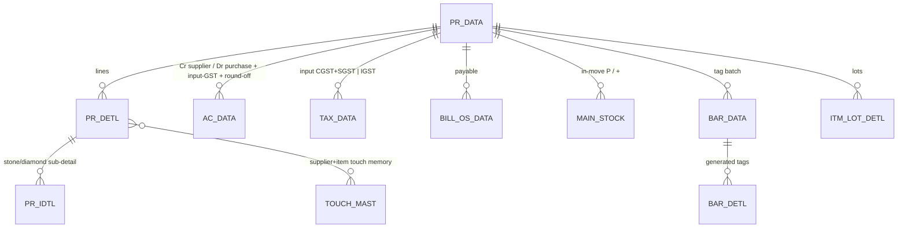

# TR_PURC — Purchase (deep-dive)

```
Form: TR_PURC  ·  Module: 3_Purchase  ·  Type: transaction (posting)
Desktop source: unified/src/csharp/DataCareNext/TR_PURC.cs (17,255 lines) + Ac_Ledr.cs (ledger), Ac_Tax.cs (tax), Ac_Stock.cs (stock), Ac_Rojmel.cs (day-book)
Web target: apps/api/src/modules/purchase/{purchase,purchaseReturn}.ts · apps/web/app/(app)/txn/purchase
Requirements: Req 9 (numbering), 11 (purchase), 12 (calc), 13 (ledger), 14 (tags/stock-in), 18 (GST)
Parity: 06_Parity/purchase.md   ·   Status: 📋 SPEC · 🟩 BUILT (core subset)
Evidence: curated spec project-memory/catalogs/forms/curated/TR_PURC.md; op-sequence forms/TR_PURC.md; module-map.json forms.TR_PURC
```

## 1. Purpose & business context

The supplier-side counter. A buyer selects the supplier account, enters or scan-generates the metal/
jewellery being bought (gross & net weight, touch/purity, labour, rate), the screen computes fine
weight + metal value + labour + tax, and saves. On save the app numbers the voucher, writes the bill
header + lines + sub-detail, posts a **balanced** supplier↔purchase↔input-GST ledger (the exact
*mirror* of a sale), brings the metal **into stock** (creating the tag batch, lots and a `MAIN_STOCK`
in-movement, and remembering the supplier's default touch/wastage), records input tax and the payable
outstanding. It uses book **`PURCHASE`**, voucher type **`PURC`**. The same desktop form is reused for
the **KARIGAR RECEIPT** and **OLD ITEM SALES** books by swapping the posting routine
(`Ac_Ledr.Kr_Rec_Ledr` / `Ac_Ledr.OldSale_Ledr` vs `Ac_Ledr.Purc_Ledr`). `src: TR_PURC.cs#L13660-L13710`.

## 2. UI / UX specification

### Layout
```
┌─ TR_PURC ─ Purchase Entry ────────────────────────────── [New][Save F2][Delete][Print][Close] ┐
│ Vch No: [____]  Date: [__/__/____]   Supplier: [AC_CODE ▾][AC_NAME .................] [F-lookup] │
│ Bill No: [______]  Bill Date:[__/__/__]                                  Party Fine: [____.___]  │
│ ┌ Items ───────────────────────────────────────────────────────────────────────────────────────┐│
│ │ # │ Item │ Tag/Lot │ Pcs │ G.Wt │ N.Wt │Touch│West%│ Fine │ Rate │ Metal │ Labour │ Oth │ Net │ ││
│ │ 1 │ …    │ gen…    │     │      │      │     │     │ calc │      │ calc  │ calc   │     │calc │ ││
│ └─────────────────────────────────────────────────────────────────────────────────────────────────┘│
│ Discount: [____]  Tax%: [__]   Kasar: [____]                                                        │
│ Pay → Cash:[__] Card:[__] Cheque:[__]      Outstanding (BILL_OS):[auto]                             │
│ Totals → Net:[..] Disc:[..] Taxable:[..] CGST:[..] SGST:[..] IGST:[..] RoundOff:[..] TOTAL:[....]   │
└──────────────────────────────────────────────────────────────────────────────────────────────────────┘
```

### Header field table
| Label | Column (`PR_DATA`) | Type | Req | Default | Notes |
|---|---|---|---|---|---|
| Vch No | `VCH_NO` | string | auto | from `SRNO_MAST` | per scope |
| Date | `VCH_DATE` | date | ✓ | today | blocked if ≤ `CO_SET.LOCK_DATE` (period lock) |
| Supplier code | `AC_CODE` | lookup→`AC_MAST` | ✓ | — | F-key lookup; drives input-GST state & default touch |
| Supplier name | `AC_NAME` | string | — | from master | |
| Bill No | `BILL_NO` | string | — | = `VCH_NO` | supplier's invoice number |
| Party fine | `PARTY_FINE` | weight(3) | — | 0 | metal owed to supplier (fine ledger) |
| Discount | `DISC_AMT`/`DISC_PRC` | money/% | — | 0 | reduces taxable |
| Tax % | `TAX_PRC`/`TAX_CODE` | %/lookup→`TAX_MAST` | ✓ | item GST | input GST |
| Kasar | `KASAR_AMT` | money | — | 0 | rounding/settlement give-up |
| Cash/Card/Cheque | `CASH_AMT`/`CARD_AMT`/`CHQ_AMT` | money | — | 0 | amount paid now |
| Outstanding | `BILL_OS` | money | auto | total−paid | payable balance |
| Totals | `NET_AMT`,`TAX_AMT`,`CGST_TAX`,`SGST_TAX`,`IGST_TAX`,`ROF_AMT`,`TOT_AMT` | money | auto | computed | read-only |
| Hallmark | `HM_AMT`,`HM_TAX_PRC`,`HM_TAX_AMT` | money | — | 0 | populated by the `TR_PURC_HM` variant |

### Line grid columns (`PR_DETL`)
| Col | Column | Editable | Source/behavior |
|---|---|---|---|
| Item | `IT_CODE` | yes | lookup→`ITEM_MAST` |
| Tag/Lot | `TAG_NO`/`LOT_NO` | gen | a new tag/lot **generated on stock-IN** (opposite of a sale, which consumes a tag) |
| Pcs | `ITM_PCS` | yes | |
| G.Wt / N.Wt | `ITM_GWT`/`ITM_NWT` | yes | gross / net weight |
| Touch | `ITM_TOUCH` | yes | purity %; default from `TOUCH_MAST` for this supplier+item |
| West % | `ITM_WEST_PRC` | yes | wastage added to touch on the karigar/manufacturing path |
| Fine | `ITM_FINE` | auto | **`ITM_NWT × ITM_TOUCH / 100`**, 3 dp. `src: TR_PURC.cs#L7261` |
| Rate | `ITM_RATE` | yes | metal rate (per fine, or per gwt by `RATE_TYPE`) |
| Metal | `ITM_AMT` | auto | `fine × rate` |
| Labour | `LBR_AMT` | auto | by `LBR_TYPE` (`LBR_RATE`/`LBR_PRC`) |
| Other | `OTH_AMT` | yes | other charges |
| Net | `NET_AMT` | auto | metal + labour + other |

### Keyboard / F-keys (desktop → web)
- **F2 = Save**; Enter = next cell; the last grid column (tag-entry, col 44) on the last row commits the
  row, may write a `TAG_SET` reservation, and adds a fresh blank row. `src: TR_PURC.cs#L10895-L10907`.
- Editing the **touch (col 21)**, **wastage (col 22)** or **labour-rate (col 34)** cell pops
  "Touch Update…" and **upserts `TOUCH_MAST`** (`AC_CODE`=supplier, `AC_IT_CODE`=item) so the value is
  remembered for the next purchase from that supplier. `src: TR_PURC.cs#L6664-L6701`.
- F-key lookups for supplier/item/lot (web: `LookupPicker.tsx` on the same keys).
- _(Confirm the full desktop F-key map from `TR_PURC.cs` key handlers before final UI.)_

### Modes
New / Edit (loads header+lines; desktop **deletes then re-posts** — see §5) / View / Delete (needs
`USER_DELETE`) / Print (needs `USER_PRINT`).

## 3. Data model touched

**Writes (create):** `PR_DATA` (header), `PR_DETL` (lines), `PR_IDTL` (stone/diamond sub-detail),
`AC_DATA` (balanced ledger + metal fine leg), `TAX_DATA` (input CGST+SGST or IGST), `BILL_OS_DATA`
(payable), `MAIN_STOCK` (in-movement `TR_TYPE='P'`, `ITM_SIGN='+'`), the tag batch `BAR_DATA`/`BAR_DETL`/
`BAR_IDTL`, `ITM_LOT_DETL`/`LOT_DETL` (lots), `TAG_SET` (tag serial reservation), `SRNO_MAST` (per-tag
serial), `TOUCH_MAST` (supplier+item touch/wastage/labour memory), `ROJ_MEL_DATA` (day-book), `DM_DATA`
(diamond/stone stock). _(The web `createPurchase` currently writes the accounting + payable + a
simplified stock subset — see §11.)_

**Deletes/reverses:** `PR_DATA, PR_DETL, PR_IDTL, AC_DATA, TAX_DATA, MAIN_STOCK, ITM_LOT_DETL, LOT_DETL,
BAR_DATA, BAR_DETL, BAR_IDTL, DM_DATA, ROJ_MEL_DATA, REMARK_DATA, TEMP_BOOK_DATA, SL_PR_DETL`
+ `SRNO_MAST`/`TAG_IMAGE_DATA` per tag + reset `APR_DETL.ISU_REC`/`SL_ORD_DETL.TAG_GEN` to `'N'`
+ write `DELETE_DATA`. `src: TR_PURC.cs#L13871-L13896`.

Table refs: [PR_DATA](../../02_Data_Model/tables/PR_DATA.md) · [PR_DETL](../../02_Data_Model/tables/PR_DETL.md) · [PR_IDTL](../../02_Data_Model/tables/PR_IDTL.md) · [AC_DATA](../../02_Data_Model/tables/AC_DATA.md) · [TAX_DATA](../../02_Data_Model/tables/TAX_DATA.md) · [MAIN_STOCK](../../02_Data_Model/tables/MAIN_STOCK.md) · [TAG_STOCK](../../02_Data_Model/tables/TAG_STOCK.md) · [ITM_LOT_DETL](../../02_Data_Model/tables/ITM_LOT_DETL.md) · [TOUCH_MAST](../../02_Data_Model/tables/TOUCH_MAST.md)



## 4. Business logic & calculations (with code)

### 4.1 Line fine + metal + labour + net (web — `purchase.ts`, pure)
```ts
/** fine = explicit fineWt, else netWt × touch / 100 (Req 11.1). */
export function lineFine(line: PurchaseLineInput): number {
  if (line.fineWt != null) return Number(line.fineWt);
  if (line.netWt != null && line.touch != null) return round2((Number(line.netWt) * Number(line.touch)) / 100);
  return 0;
}
export function computeLine(line: PurchaseLineInput) {
  const fine = lineFine(line);
  const metal = line.metalAmount != null ? Number(line.metalAmount) : line.rate != null ? metalAmount(fine, line.rate) : 0;
  const labour = line.labourType
    ? labourCharge(line.labourType, { netWt: line.netWt, pcs: line.pcs, rate: line.labourRate, pct: line.labourPct, metalAmount: metal, fixed: line.labourFixed })
    : 0;
  const net = calcLineNet({ metal, labour, other: line.otherAmount });
  return { fine, metal, labour, net };
}
```

### 4.2 Desktop evidence — the fine formula
```csharp
// src: TR_PURC.cs#L7261  (and L7279)  — ITM_FINE column [17] = N.Wt [15] × Touch [16] / 100, 3-dp
mSG_PR[mSG_PR.Row, 17] = Strings.Format((object)(Conversion.Val(mSG_PR[mSG_PR.Row, 15])
                       * Conversion.Val(mSG_PR[mSG_PR.Row, 16]) / 100.0), "0.000");
// src: TR_PURC.cs#L7312  — karigar/wastage variant: gross fine = (NWT+other) × (TOUCH+WEST−less)/100 + otherFine
```
**Example:** N.Wt 100.000 g, Touch 91.60 → fine = 100.000 × 91.60 / 100 = **91.600 g**. Use `decimal.js`
HALF-UP at **weight/fine = 3 dp, amounts = 2 dp** (the desktop `"0.000"` format string; the web pins
the rounding so floats can't drift). `data: PR_DETL.ITM_FINE`.

### 4.3 Bill totals + GST split (web — `@datacare/core`)
```ts
const totals = billTotals({ lineNetTotal: Σ net, discountAmount, taxRatePct, interState });
// → net, discount, taxable, tax, cgst, sgst, igst, roundOff, total   (HALF-UP; total→nearest rupee)
```
Intra-state input GST: CGST=SGST=tax/2 (`SGST = tax − CGST`); inter-state: IGST=tax. Identical pipeline
to Sales — see [`calc-engine.md`](../../04_Cross_Cutting_Engines/calc-engine.md).

### 4.4 Balanced ledger — the mirror of a sale (web — `buildPurchaseLedger`)
```ts
// Cr supplier (total, incl tax) / Dr purchase (taxable) + Dr input-GST (tax) + Dr round-off. ΣDr === ΣCr.
const base = { ...key, VCH_TYPE: 'PURC' };
const lines = [
  { ...base, AC_CODE: acCode,     DR_AMT: 0,             CR_AMT: totals.total,   SIGN: 'C' }, // Cr supplier
  { ...base, AC_CODE: purchaseAc, DR_AMT: totals.taxable, CR_AMT: 0,             SIGN: 'D' }, // Dr purchase
];
if (totals.tax)      lines.push({ ...base, AC_CODE: taxAc,   DR_AMT: totals.tax,      CR_AMT: 0, SIGN: 'D' }); // Dr input GST
if (totals.roundOff) lines.push({ ...base, AC_CODE: roundAc, DR_AMT: totals.roundOff, CR_AMT: 0, SIGN: 'D' }); // Dr round-off
assertBalanced(lines); // ΣDr (taxable+tax+roundOff = total) === ΣCr (total)
// + ONE metal fine leg per metal type: { IT_TYPE:'G'|'S', SIGN:'+', FINE_WT:Σ fine, DR=CR=0 }
```
Desktop posts the same legs through `Ac_Ledr.Purc_Ledr(book, vchNo)` (`INSERT INTO AC_DATA(...CR_AMT,
DR_AMT,FINE_WT,FINE_RATE,LEDR_KEY...)`), not inline. `src: TR_PURC.cs#L13700`; engine
[`posting-and-ledger.md`](../../04_Cross_Cutting_Engines/posting-and-ledger.md).

### 4.5 Branches to cover
- **Rate type** (`RATE_TYPE`): fine×rate (per-fine) vs gwt×rate (per-gross).
- **Labour type** (`LBR_TYPE`): per-gram / per-piece / percentage / fixed (calc-engine §3).
- **GST type**: intra (CGST+SGST) vs inter (IGST), from supplier state on `AC_MAST`.
- **Kasar / round-off** (`KASAR_AMT`/`ROF_AMT`), **party fine** (`PARTY_FINE`) metal owed.
- **Book switch**: PURCHASE vs KARIGAR RECEIPT vs OLD ITEM SALES selects the posting routine (§10).

## 5. Save sequence (create / edit)

Edit = reverse prior voucher then repost, **all in one tx**. The desktop literally `DELETE`s the old
voucher's rows then calls `Ac_Ledr.Purc_Ledr` / `Ac_Rojmel.Purc_Rojmel` / `Ac_Tax.Purc_GST` /
`Ac_Stock.Purc_Stk` inside `Module_Save.PurcTran`, then `.Commit()`. `src: TR_PURC.cs#L13621-L13710`.

```mermaid
sequenceDiagram
  participant U as Web (purchase screen)
  participant A as POST /txn/purchases
  participant S as createPurchase
  participant Co as core (calc)
  participant Tx as withTenant tx
  participant DB as PostgreSQL
  U->>A: { scope, acCode, lines[], taxRatePct, interState, billNo }
  A->>A: guard(create)
  A->>S: createPurchase(...)
  S->>S: validate acCode + ≥1 line
  S->>Co: computeLine × lines → billTotals
  S->>Tx: withTenant(tenantId)
  Tx->>DB: nextVoucherNoTx (advisory lock + SRNO_MAST)
  Tx->>DB: createTagTx per tag (stock-IN; duplicate-tag guard)
  S->>S: buildPurchaseLedger → assertBalanced (+ metal fine legs)
  Tx->>DB: postVoucherTx → PR_DATA, PR_DETL, MAIN_STOCK, TAX_DATA, BILL_OS_DATA + AC_DATA legs
  DB-->>Tx: commit (rollback on any throw)
  A-->>U: 201 { vchNo, totals }
```

Numbered: (1) voucher no from `SRNO_MAST` under advisory lock; (2) compute lines + totals; (3) **create**
each tag in stock (stock-IN — the opposite of a sale's *issue*); (4) build + assert the balanced ledger
(+ append metal fine legs, `DR=CR=0`); (5) `postVoucherTx` writes `PR_DATA`/`PR_DETL` + `MAIN_STOCK`
in-movement + `TAX_DATA` + `BILL_OS_DATA` + the `AC_DATA` legs; (6) commit. _(Full desktop parity also
writes `PR_IDTL`, `BAR_*`, `ITM_LOT_DETL`/`LOT_DETL`, `TAG_SET`, `TOUCH_MAST`, `ROJ_MEL_DATA` — §11.)_

### 5.1 Desktop SRNO_MAST nuance (evidence ~L13455)
```csharp
// src: TR_PURC.cs#L13455-L13457 — reserve a per-TAG serial (NOT only the voucher no): keyed on TAG_SRNO/TAG_NO
"DELETE FROM SRNO_MAST WHERE CO_CODE=… AND LC_CODE=… AND TAG_SRNO='" + mSG2[i,45] + "' AND TAG_NO='" + mSG2[i,3] + "'"
"INSERT INTO SRNO_MAST (CO_CODE,LC_CODE,TAG_SRNO,VCH_SRNO,TAG_NO,IT_CODE) VALUES (…, '" + mSG2[i,51] + "', …)"
```
This DELETE+INSERT reserves the **tag serial number** generated during stock-IN. The web's
read-increment-under-lock (`nextVoucherNoTx`) gives the same gap-free guarantee for the *voucher*
number; per-tag serials are a stock-module concern. See
[`voucher-numbering.md §4`](../../04_Cross_Cutting_Engines/voucher-numbering.md) and §11.

## 6. Delete / reverse (Req 11.5)

Desktop guards then cascades; web reverses by key in one tx. `src: TR_PURC.cs#L13845-L13896`.

```csharp
// src: TR_PURC.cs#L13848 — block delete if a created tag was already used in a sale
if (Rshlp.Rows.Count > 0) { MsgBox("You Cant Delete This Voucher Because  Tag Use in Sales Transection...."); return; }
// src: TR_PURC.cs#L13852 — block if the voucher is linked to another (e.g. a sale bill)
// src: TR_PURC.cs#L13858 — confirm "Are You Sure To Delete This Voucher now?"
// src: TR_PURC.cs#L13861 — TWO DELETE_DATA rows: header (VCH_VAL_DR=CASH+CARD+CHQ, VCH_VAL_CR=TOT_AMT, VCH_FINE_CR=PARTY_FINE)
//                          + one per line (VCH_VAL_CR=NET_AMT, VCH_FINE_CR=ITM_FINE)
// then cascade DELETE: SRNO_MAST/TAG_IMAGE_DATA per tag; APR_DETL.ISU_REC='N'; SL_ORD_DETL.TAG_GEN='N';
//   REMARK_DATA, LOT_DETL, TEMP_BOOK_DATA, MAIN_STOCK, AC_DATA, ROJ_MEL_DATA, TAX_DATA, ITM_LOT_DETL,
//   DM_DATA, PR_DATA, PR_DETL, PR_IDTL, BAR_DATA, BAR_DETL, BAR_IDTL, SL_PR_DETL → "Delete Success."
```

```ts
// web — purchase.ts deletePurchase: one tx, requires USER_DELETE (route guard 'delete')
await reverseVoucherTx(tx, tenantId, {
  tables: ['PR_DATA','PR_DETL','AC_DATA','TAX_DATA','BILL_OS_DATA','MAIN_STOCK'],
  key,
  deleteLog: { table: 'DELETE_DATA', row: { ...key, VCH_TYPE: 'PURC', DELETE_USER } },
});
for (const tag of tagRemovals ?? []) await issueTagTx(tx, tag); // remove the stock-IN tag (rejects if already sold)
```
One transaction; requires `USER_DELETE`. **Blocked** when a created tag has already been sold
(`issueTagTx` throws → 400; desktop = "Tag Use in Sales Transection") or the voucher is linked. _(Add
`PR_IDTL`/`BAR_*`/`ITM_LOT_DETL`/`LOT_DETL`/`ROJ_MEL_DATA`/`DM_DATA` to the reverse set when those are
written on create — §11.)_

## 7. API contract

```ts
// POST /txn/purchases   (right: create)   — src: web/apps/api/src/routes/txn.ts#L175
interface CreatePurchaseBody {
  scope?: { coCode?; lcCode?; coYear?; coBook? };   // tenantId + defaults from session
  acCode: string; acName?: string; billNo?: string; vchDate?: string;
  discountAmount?: number; taxRatePct: number; interState: boolean;
  purchaseAc?: string;  // default 'PURCHASE'
  taxAc?: string;       // default 'GSTINPUT'
  roundAc?: string;     // default 'ROUNDOFF'
  lines: { itCode; tagNo?; pcs?; grossWt?; netWt?; touch?; fineWt?; rate?;
           metalAmount?; labourType?; labourRate?; labourPct?; labourFixed?; otherAmount?; metal?: 'G'|'S' }[];
}
// → 201 { vchNo:number, totals:BillTotals }

// DELETE /txn/purchases/:vchNo   (right: delete)   — body: { tagRemovals?: {CO_CODE,LC_CODE,TAG_NO}[] }
// → 200 { reversed:true }

// POST   /txn/purchase-returns   (right: create) → 201 { vchNo, totals }   (book 'PRT', VCH_TYPE 'PRTN')
// DELETE /txn/purchase-returns/:vchNo  (right: delete) → 200 { reversed:true }
```
Errors (route `run()` adapter, `src: txn.ts#L92-L110`): `PurchaseValidationError`→400, RBAC `guard`→403,
`TagExistsError`/`TagNotAvailableError`→400, `UnbalancedError`→400/500 (invariant), `PeriodLock…`→400,
DB constraint (`P2010`/`P2002`/value-too-long)→400 `invalid-data`.

## 8. Validation rules

| Rule | Condition | Desktop message | HTTP error | req |
|---|---|---|---|---|
| Supplier required | no `acCode` | (account guard) | `PurchaseValidationError` → 400 | 11.3 |
| ≥1 line | empty `lines` | (line guard) | `PurchaseValidationError` → 400 | 11.3 |
| Duplicate tag on stock-IN | `tagNo` already in stock | — | `TagExistsError` → 400 | 14.x |
| Period open | `VCH_DATE` ≤ `CO_SET.LOCK_DATE` | "Period locked" | `PeriodLockValidationError` → 400 | — |
| Balanced ledger | ΣCR≠ΣDR (invariant) | — | `UnbalancedError` → 400/500 | 13.1 |
| Delete blocked: tag sold | created tag has a `MAIN_STOCK '-'` (sold) | "Tag Use in Sales Transection…." | `TagNotAvailableError` → 400 | 11.5 |
| Delete blocked: linked vch | `PR_DATA.SL_BILL_NO <> ''` | "Voucher Is Linkd With … Please Delete … First" | — (add guard) | 11.5 |
| Delete right | needs `USER_DELETE` | "You Have No Rights….." | `guard` → 403 | 6.x |

`src: TR_PURC.cs#L13848,L13852,L5610` · `web: purchase.ts#L? (acCode/lines guards), stock.ts issueTagTx`.

## 9. Parity criteria (Definition of Done)

1. Given a desktop purchase's inputs, the web persists the **same** `PR_DATA` + `PR_DETL` rows (weights,
   `ITM_FINE`, metal, labour, net, GST %), field-for-field at weight-3 / amount-2 precision.
2. `AC_DATA` legs match (Cr supplier `TOT_AMT`; Dr purchase `taxable`; Dr input-GST `tax`; Dr round-off)
   with `BOOK_NAME='PURCHASE'`, correct `LEDR_KEY`/`IT_TYPE`, and **ΣDr = ΣCr**; the metal fine leg
   carries `IT_TYPE 'G'/'S'`, `SIGN '+'`, `FINE_WT = Σ fine`.
3. `TAX_DATA` input rows match the desktop shape (CGST+SGST intra / IGST inter; `TRAN_TYPE`/marker per
   live DB = `'P'`, `TAX_SIGN='-'`).
4. Purchased tags become available stock; `MAIN_STOCK` in-movement (`TR_TYPE='P'`, `ITM_SIGN='+'`)
   recorded; on delete the tags are removed + `DELETE_DATA` written; delete blocked if a tag was sold.
5. `BILL_OS_DATA` payable equals `TOT_AMT − paid`.
6. `billTotals` reproduces `TOT_AMT`/`ROF_AMT` to the paisa.
7. **(Full-stock parity gate)** `PR_IDTL`, `BAR_DATA/DETL/IDTL`, `ITM_LOT_DETL`/`LOT_DETL`, `TAG_SET`,
   `TOUCH_MAST`, `ROJ_MEL_DATA` rows match the desktop (currently a gap — §11).
Fixtures/scripts: tracked in `06_Parity/purchase.md` (mirror of `06_Parity/sales.md`).

## 10. Variants & edge cases

| Variant | Delta vs TR_PURC | Deltas doc |
|---|---|---|
| Purchase Return | reverse signs: **Dr supplier / Cr purchase + input-GST + round-off**; tagged goods leave stock (`issueTagTx`); book `PRT`, `VCH_TYPE='PRTN'`; excluded from the purchase register. | `purchaseReturn.ts` |
| `TR_PURC_HM` | hallmark purchase: stamps **HUID + hallmark charges** (`HM_AMT`,`HM_TAX_PRC`,`HM_TAX_AMT`) and **updates** existing `BAR_DETL`/`BAR_IDTL` instead of generating a fresh lot; no `PR_IDTL`/`ITM_LOT_DETL`. | [`TR_PURC_HM.md`](TR_PURC_HM.md) |
| `TR_OTH_PURC` | "other"/non-tagged metal purchase booked through a **payment book** (`PAY_DATA`/`PAY_DETL`); **no** stock/tag tables; posts via `Ac_Ledr.Oth_Purc_Ledr` + `Ac_Tax.Oth_Purc_GST`. | [`TR_OTH_PURC.md`](TR_OTH_PURC.md) |
| `TR_PR_SL_UAE` | UAE combined **purchase + sale** under VAT; posts via `Ac_Ledr.B2B_Purc_Ledr` / `B2B_Sales_Ledr`; single VAT line (no CGST/SGST split). | [`TR_PR_SL_UAE.md`](TR_PR_SL_UAE.md) |
| Book = KARIGAR RECEIPT | same form, `Ac_Ledr.Kr_Rec_Ledr` / `Ac_Rojmel.Kr_Rec_Rojmel` / `Ac_Tax.Kr_Rec_GST` / `Ac_Stock.Kr_Rec_Stk`. `src: TR_PURC.cs#L13660` | — (Manufacturing module) |
| Book = OLD ITEM SALES | same form, `Ac_Ledr.OldSale_Ledr` / `Ac_Rojmel.OldSale_RojMel` / `Ac_Stock.OldSale_Stock`. | — (old-gold flow) |
| `TR_PR_SL_HEDG` | rate-cut / hedge fixing of unfixed metal (`CUT_DATA/DETL`, `RATE_CUT_ISU`). | `sales/rateCut.ts` |

## 11. Open questions / risks

- **Stock/tag write-set gap.** The web `createPurchase` writes accounting + payable + a simplified
  `MAIN_STOCK`/`TAG_STOCK` subset. The desktop additionally writes `PR_IDTL`, the full `BAR_DATA/DETL/
  IDTL` tag batch, `ITM_LOT_DETL`/`LOT_DETL`, `TAG_SET`, `TOUCH_MAST` and `ROJ_MEL_DATA`. The web tag
  model uses **row-presence in `TAG_STOCK`** (`createTagTx`/`issueTagTx`) whereas desktop inventory
  lives in `BAR_DETL` + `MAIN_STOCK` sign-sum. Close this for full stock parity (Module 4 / stock
  engine) before certifying §9 item 7. `src: forms/TR_PURC.md op-sequence`.
- **SRNO_MAST semantics.** The cited L13455/L13457 DELETE+INSERT reserves a **per-tag serial**
  (`TAG_SRNO`/`VCH_SRNO`/`TAG_NO`), not the voucher counter. The voucher-numbering engine doc describes
  it as "reserve the next number" — reconcile both readings and recover the authoritative `SRNO_MAST`
  columns (per-book/per-year?) via the Docker golden-master pass.
- **Delete reverse-set & guards.** Web delete reverses fewer tables (it didn't create the rest) and does
  not yet replicate the desktop "voucher is linked" block (`PR_DATA.SL_BILL_NO`). Add both when the
  full write-set lands.
- **Tax marker.** Desktop spec documents `TRAN_TYPE='PR'` for input GST, but live `TAX_DATA` shows `'P'`
  (`CO_BOOK='041'`, `BOOK_NAME='PURCHASE'`). Web uses `'P'`. `src: reports10.ts#L19-L20`. Confirm on the
  golden master.
- **Edit semantics.** Desktop edit = in-place delete + re-post (`Ac_*` routines) within `PurcTran`. Web
  rule is `reverseVoucherTx` then `postVoucherTx` in one tx — verify net rows are identical.
- **`KASAR_AMT` / `PARTY_FINE`.** Header kasar and party-fine columns are persisted by desktop but not
  modelled in the current `createPurchase` body; add to inputs + ledger/fine legs.
- **Validation messages.** Exact desktop required-account / required-line message strings on the save
  path were not isolated (the save guards live among MSFlexGrid handlers); confirm strings from
  `TR_PURC.cs` for §8.
