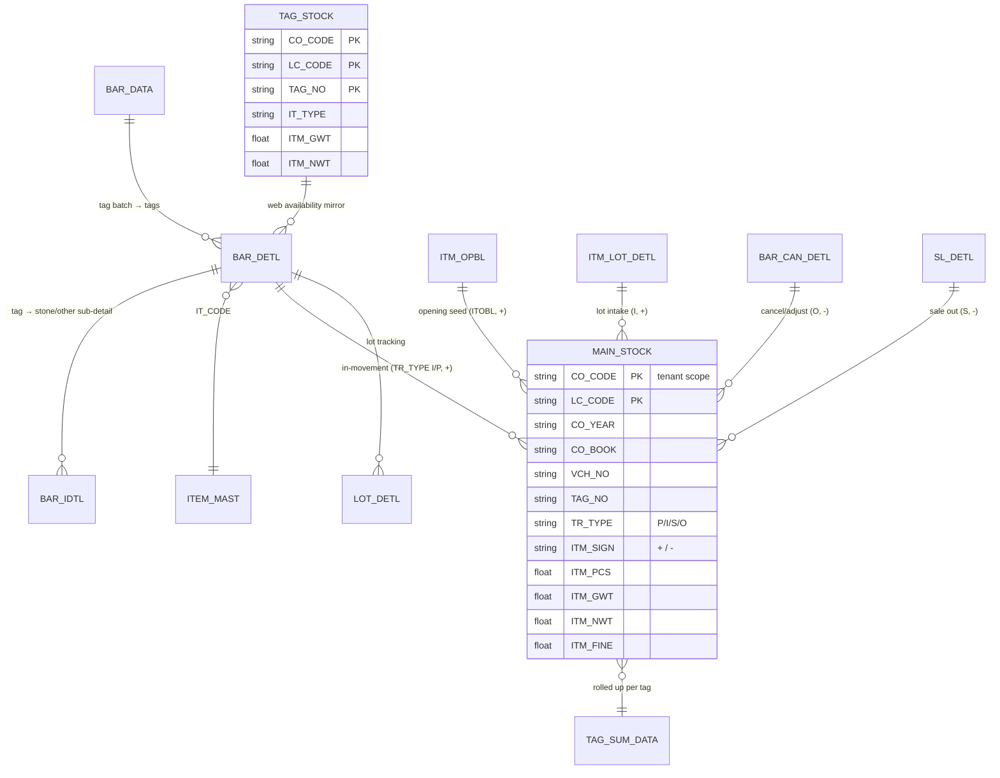
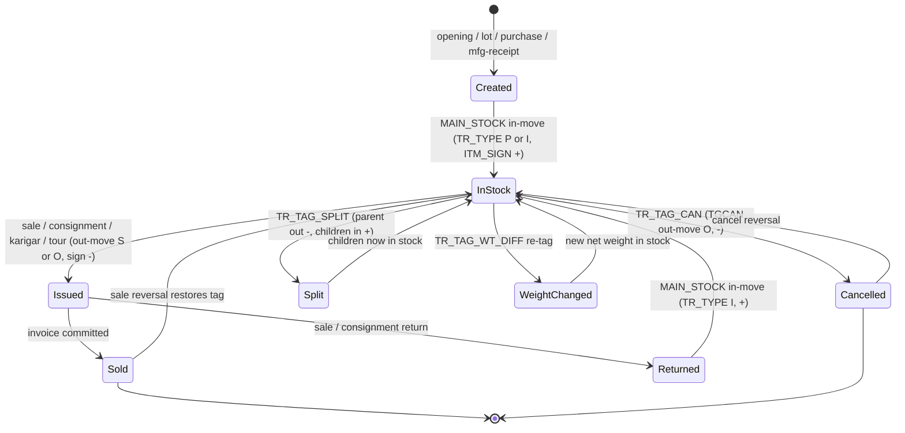

# Module 4 — Inventory / Tags / Stock

> The tagged-inventory backbone. Every physical jewellery item is a **tag** (a barcoded label that
> carries its weight, touch, labour and rate). This module owns the lifecycle of a tag (create →
> in‑stock → issued → returned/sold/cancelled/split) and the **`MAIN_STOCK` movement ledger** that
> every other transaction module (Sales, Purchase, Karigar, Dhrn, Bullion…) posts into. On-hand
> stock (qty / gross / net / **fine**) is the signed net of those movements — never a stored balance.

```
Module: 4_Inventory_Tags  ·  Forms: 11 (6 posting) + Ac_Stock engine
Desktop source: unified/src/csharp/DataCareNext/{Ac_Stock,TR_TAG_SPLIT,TR_TAG_CAN,TR_TAG_WT_DIFF,TR_TAG_OPBL,TR_PHYSTK,TR_ITM_LOT,TR_ITM_OPBL,UT_TAG_PRINT}.cs
Web target: apps/api/src/modules/stock/{stock,tagOps,tagSplit}.ts · apps/web/app/(app)/txn/stock*
Requirements: Req 14 (tag & stock), 8 (double-issue), 12 (fine/weight), 13 (ledger)
Parity: project-memory/parity/verify-stock-tags.md   ·   Status: 📋 SPEC · 🟦 PARTIAL
```

---

## 1. Purpose

DataCareNext is a **tagged-inventory** ERP: each ornament gets a unique **tag number** (`TAG_NO`)
when it enters stock, and that tag is the unit of issue for every downstream transaction. This
module covers:

- **Bringing stock in** — opening balances at year start (`TR_ITM_OPBL`, `TR_TAG_OPBL`), lot intake
  (`TR_ITM_LOT`), and (via Purchase/Karigar/Mfg) tagged purchases.
- **Maintaining tags** — re-tagging by **split** (`TR_TAG_SPLIT`), **weight correction**
  (`TR_TAG_WT_DIFF`), and **cancellation** (`TR_TAG_CAN`).
- **Counting stock** — physical stock-take reconciliation (`TR_PHYSTK`).
- **The stock truth itself** — `Ac_Stock` is the central engine that writes a signed `MAIN_STOCK`
  movement row for *every* voucher in the whole application; on-hand is the net of those rows.
- **Tag printing** — barcode/label generation (`UT_TAG_PRINT`).

It does **not** own the consuming transactions (a sale issues a tag, but lives in Module 2_Sales);
those modules call this module's stock primitives. The deep mechanics of issue/restore/on-hand are
in **[`TAG_STOCK.md`](TAG_STOCK.md)**.

## 2. Form inventory

| Form | Type | Purpose | Tables written | Posting? | Web status |
|---|---|---|---|---|---|
| `Ac_Stock` | engine | Central stock-movement poster — builds the signed `MAIN_STOCK` row for **every** voucher type (sale, purchase, tag op, mfg, dhrn…). | `MAIN_STOCK`, `LOT_DETL`, `TAG_SUM_DATA`, `DM_DATA`, `DM_KR_DATA` | n/a (writes stock, not ledger) | 🟦 `modules/stock/*` (subset) |
| [`TAG_STOCK`](TAG_STOCK.md) | lifecycle | Tag availability model: create / issue / restore / on-hand. | `TAG_STOCK` (+ `MAIN_STOCK` via consumers) | — | 🟩 `stock.ts` |
| [`TR_TAG_SPLIT`](TR_TAG_SPLIT.md) | transaction | Split one parent tag's weight into N child tags. | `BAR_*`, `LBR_ISU_DETL`, `LBR_REC_DETL`, `MAIN_STOCK`, `TAG_SET`, `TAG_PRINT_DATA` | ✅ (stock; fine ledger) | 🟦 `tagSplit.ts` |
| [`TR_PHYSTK`](TR_PHYSTK.md) | transaction | Physical stock-take: reconcile system vs counted; post the adjustment. | `BAR_DETL`, `BAR_IDTL`, `MAIN_STOCK`, `APR_DETL`, `TAG_PRINT_DATA` | ✅ (stock adjust) | 🟦 `stock.ts physicalReconcile` (read-only) |
| `TR_TAG_OPBL` | transaction | Tag opening balance — seed tagged stock at year start. | `BAR_DATA`, `BAR_DETL`, `BAR_IDTL`, `MAIN_STOCK`, `TAG_SET`, `SRNO_MAST` | ✅ (stock in) | 🟩 `stock.ts tagOpening` |
| `TR_ITM_OPBL` | transaction | Item (non-tag) opening balance — seed bulk/loose stock at year start. | `ITM_OPBL` → `MAIN_STOCK`, `DM_DATA` | ✅ (stock in) | ⬛ none |
| `TR_ITM_LOT` | transaction | Lot intake — receive a batch of items as a lot. | `ITM_LOT_DETL`, `BAR_DATA`, `MAIN_STOCK`, `TAG_PRINT_DATA` | ✅ (stock in) | ⬛ none |
| `TR_TAG_CAN` | transaction | Tag cancel / stock-adjust / tag-transfer — remove a tag from stock. | `BAR_CAN_*`, `MAIN_STOCK`, `LOT_DETL`, `DELETE_DATA` | ✅ (stock out) | 🟦 `tagOps.ts tagCancel` |
| `TR_TAG_WT_DIFF` | transaction | Tag weight change — correct a tag's net weight (re-tag). | `BAR_*`, `LBR_ISU_DETL`, `LBR_REC_DETL`, `MAIN_STOCK`, `AC_DATA`, `TAX_DATA` | ✅ (stock + fine ledger) | 🟦 `tagOps.ts tagWeightDiff` |
| `UT_TAG_PRINT` | utility | Generate/print tag barcodes & labels (no stock movement). | `TAG_PRINT_DATA`, `BAR_DETL`, `PRINT_MAST` | — | ⬛ none |
| `ClassTagList` / `TagOthDetail` | helper | In-memory tag-list / other-detail (stones) helpers for the forms above. | — | — | n/a |

Short specs for the variant forms are in **[§9](#9-variant--sibling-forms-short-specs)**.

## 3. Module ER diagram



Table references: [MAIN_STOCK](../../02_Data_Model/tables/MAIN_STOCK.md) · [TAG_STOCK](../../02_Data_Model/tables/TAG_STOCK.md) ·
[BAR_DATA](../../02_Data_Model/tables/BAR_DATA.md) · [BAR_DETL](../../02_Data_Model/tables/BAR_DETL.md) ·
[ITM_LOT_DETL](../../02_Data_Model/tables/ITM_LOT_DETL.md) · [LOT_DETL](../../02_Data_Model/tables/LOT_DETL.md) ·
[APR_DATA](../../02_Data_Model/tables/APR_DATA.md) · [APR_DETL](../../02_Data_Model/tables/APR_DETL.md) ·
[TAG_SET](../../02_Data_Model/tables/TAG_SET.md) · [TAG_SUM_DATA](../../02_Data_Model/tables/TAG_SUM_DATA.md) ·
[TAG_PRINT_DATA](../../02_Data_Model/tables/TAG_PRINT_DATA.md) · [INOUT_DETL](../../02_Data_Model/tables/INOUT_DETL.md)

## 4. Tag lifecycle

A tag is **created** (opening balance, lot, purchase, mfg receipt, or split-child), sits **in stock**
(a positive net in `MAIN_STOCK` / a presence in `TAG_STOCK`), is **issued** out by a consuming
voucher (sale, consignment, karigar, tour…), and from there is **sold**, **returned** (back to
in‑stock), **cancelled**, or **split** into children. Every edge is a signed `MAIN_STOCK` movement;
reversing the voucher walks the edge backwards.



**Reading the diagram.** "In stock" = the tag's signed `MAIN_STOCK` net is positive (and, in the web
availability mirror, a row exists in `TAG_STOCK`). "Issued/Sold" = a `-` movement has driven the net
to zero. Split conserves weight (Σ children net = parent net); weight-change replaces the tag's net
weight. Every reversal (`reverseVoucherTx`) deletes the voucher's `MAIN_STOCK` rows by key, which
arithmetically returns the tag to its prior state — there is no status flag to unwind.

## 5. Shared logic

### 5.1 `MAIN_STOCK` is the single source of stock truth — `Ac_Stock`
The desktop centralises **all** stock movement in one module, `Ac_Stock.cs`: ~50 static methods,
one per voucher type (`Sale_Stk`, `Purc_Stk`, `Tag_Opbl_Stk`, `Tag_Can_Stk`, `Tag_Split_Stk`,
`Kr_Isu_Stk`, `Dhrn_Isu_Stk`, …). Every method is the **same shape** — an
`INSERT INTO MAIN_STOCK (… 50 columns …) SELECT … FROM <detail> LEFT JOIN BOOK_DATA … WHERE
B.MAIN_BOOK IN (…) AND B.BOOK_INOUT = '…'` — so the entire app's stock is a uniform signed ledger:

```csharp
// src: unified/src/csharp/DataCareNext/Ac_Stock.cs  (canonical 50-col movement row; Sale_Stk shown)
INSERT INTO MAIN_STOCK (CO_CODE,LC_CODE,CO_YEAR,CO_BOOK,VCH_NO,SR_NO,ISR_NO,VCH_DATE,STK_DATE,
  VCH_TYPE,BOOK_NAME,AC_CODE,IT_CODE,TAG_NO,VCH_SRNO,TBL_CODE,TR_TYPE,ITM_SIGN,
  ITM_QTY,ITM_PCS,ITM_GWT,ITM_NWT,ITM_TOUCH,ITM_WEST,ITM_FINE,ITM_RATE,ITM_AMT,…,DATA_TYPE,…)
Select A.CO_CODE,…,'S','-', 1,A.ITM_PCS,A.ITM_GWT,A.ITM_NWT,A.ITM_TOUCH,0,A.ITM_FINE,…
FROM SL_DETL AS A LEFT JOIN BOOK_DATA AS B ON … WHERE B.MAIN_BOOK IN ('SALES','B2B SALES') AND B.BOOK_INOUT = 'O'
```

**The two classifier columns** (preserve verbatim):

| Column | Meaning | Values seen in `Ac_Stock` |
|---|---|---|
| `TR_TYPE` | movement class | `P` purchase-in · `I` generic-in · `S` sale-out · `O` generic-out |
| `ITM_SIGN` | arithmetic sign | `+` adds to stock · `-` removes from stock |

In-movements use `('P'|'I','+')`, out-movements use `('S'|'O','-')`. `BOOK_NAME`/`VCH_TYPE` label the
voucher; `TBL_CODE` is the counter; `DATA_TYPE='A'` is stamped on 100% of rows (see [§8 build checklist](#8-build-checklist)).

### 5.2 On-hand = signed net of stock-in minus stock-out — **Req 14.4**
There is **no stored balance**. On-hand qty/gross/net/**fine** for an item (or tag) is the running
sum of `MAIN_STOCK` movements for the active CO/LC, signed by `ITM_SIGN`:

```
onHand(field) = Σ (+movement.field)  −  Σ (−movement.field)      // field ∈ {ITM_PCS, ITM_GWT, ITM_NWT, ITM_FINE}
```

The desktop's per-tag roll-up (`Ac_Stock.ItemSummInsert` → `TAG_SUM_DATA`) keeps a tag only while its
signed net is still positive:

```csharp
// src: Ac_Stock.cs ItemSummInsert  — a tag is "on hand" only if its signed movement sum is still > 0
HAVING SUM(CASE WHEN ITM_SIGN='+' THEN A.VCH_SRNO ELSE -A.VCH_SRNO END) > 0
```

The web computes the same net (see [`TAG_STOCK.md` §4](TAG_STOCK.md) `onHand`). **Money/weight scale
& rounding** follow [`calc-engine.md`](../../04_Cross_Cutting_Engines/calc-engine.md): weights/fine **3 dp**,
amounts **2 dp**, all **HALF-UP**; `fine = netWt × touch / 100`.

### 5.3 Tag availability model (`TAG_STOCK`) & double-issue guard — **Req 14.2/14.3/14.5**
The web mirrors availability as **row presence** in `TAG_STOCK`: a tag in stock has a row; issuing it
**deletes** the row; restoring re-inserts it. The double-issue guard is the affected-row count of an
atomic `DELETE`. The "real" desktop inventory lives in `BAR_DETL`, so a `BAR_DETL` tag counts as
available iff it exists there **and** has no `MAIN_STOCK` out-movement (`ITM_SIGN='-'`). Full mechanics
& code in **[`TAG_STOCK.md`](TAG_STOCK.md)**.

### 5.4 Posting & reversal primitives (shared with every module)
All inventory vouchers write through the same engines (build them first):
[`posting-and-ledger.md`](../../04_Cross_Cutting_Engines/posting-and-ledger.md) (`postVoucherTx` /
`reverseVoucherTx`), [`voucher-numbering.md`](../../04_Cross_Cutting_Engines/voucher-numbering.md)
(`nextVoucherNoTx`), [`calc-engine.md`](../../04_Cross_Cutting_Engines/calc-engine.md) (fine/weight).
Pure-inventory vouchers (opening, lot, cancel, split) pass an **empty `AC_DATA` ledger** to
`postVoucherTx` — no money changes hands; only weight-change posts a balanced value/fine ledger.

## 6. Dependencies

| Depends on | Why |
|---|---|
| `04_Cross_Cutting_Engines/posting-and-ledger` | `postVoucherTx`/`reverseVoucherTx` write `MAIN_STOCK` + (where applicable) `AC_DATA` atomically. |
| `04_Cross_Cutting_Engines/voucher-numbering` | per-scope `VCH_NO` from `SRNO_MAST`. |
| `04_Cross_Cutting_Engines/calc-engine` | `fine = netWt×touch/100`; weight/amount precision (3dp/2dp, HALF-UP). |
| `01_Architecture/multitenancy-scoping` | every row keyed by `CO_CODE,LC_CODE,CO_YEAR,CO_BOOK`; web wraps with `tenant_id`. |
| `MS_ITEM` / `ITEM_MAST` (Masters) | `IT_CODE`, `IT_TYPE`, item-level posting flags (`OTH_DETL_POSTING`, `AC_ITEM`). |
| `MS_BOOK` / `BOOK_DATA` | `MAIN_BOOK` + `BOOK_INOUT` drive which `Ac_Stock` method fires and the in/out direction. |

**Consumed by (downstream modules that call these stock primitives):** Sales (`Sale_Stk`),
Purchase (`Purc_Stk`), Manufacturing/Karigar (`Kr_Isu_Stk`, `Mfg_*`), Dhrn (`Dhrn_*_Stk`),
Bullion/Tour (`Wh_Sale_Stk`, `Tour_*_Stk`), Approval/Consignment (`Apr_*_Stk`).

## 7. API surface

```
POST   /stock/tag-opening          (right: create) → { vchNo, tags }       # TR_TAG_OPBL
DELETE /stock/tag-opening/:vchNo    (right: delete) → { reversed:true }
POST   /stock/tag-cancel            (right: create) → { vchNo, tags }       # TR_TAG_CAN
DELETE /stock/tag-cancel/:vchNo     (right: delete) → { reversed:true }
POST   /stock/tag-weight-diff       (right: create) → { vchNo, tags, diffFine, value }  # TR_TAG_WT_DIFF
DELETE /stock/tag-weight-diff/:vchNo(right: delete) → { reversed:true }
POST   /stock/tag-split             (right: create) → { vchNo, children }   # TR_TAG_SPLIT
DELETE /stock/tag-split/:vchNo      (right: delete) → { reversed:true }
POST   /stock/physical-reconcile    (right: read)   → { matched, missing, extra, … }    # TR_PHYSTK
GET    /stock/tags?coCode&lcCode    (right: read)   → in-stock tag list (BAR_DETL net)
GET    /stock/on-hand?coCode&lcCode (right: read)   → { pcs, gwt, nwt(, fine) }
# tag primitives (used by Sales/Purchase/etc., not direct REST): createTag / issueTag / restoreTag / tagAvailable
```
Per-endpoint request/response and error mapping are in each form doc's §7. RBAC: mutations require
`USER_UPDATE`; deletes `USER_DELETE` (see [`auth-and-rbac.md`](../../04_Cross_Cutting_Engines/auth-and-rbac.md)).

## 8. Build checklist

1. **Engines first** — `money/calc`, `numbering`, `posting` must be green (Module 4 writes nothing
   without them).
2. **`TAG_STOCK` primitives** (`stock.ts`): `createTag`, `issueTagTx`, `restoreTagTx`, `tagAvailable`,
   `onHand`, `listTags` — unit-test the **double-issue guard** (Req 14.5) and **on-hand net** (Req 14.4).
3. **Opening balances** — `tagOpening` (`TR_TAG_OPBL`) and item opening (`TR_ITM_OPBL`); seed at the
   day-before year start (`MOp_dt − 1`), `TR_TYPE='P'`, `ITM_SIGN='+'`.
4. **Tag maintenance** — `tagCancel`, `tagWeightDiff`, `splitTag` (+ deletes). Enforce split weight
   conservation (Σ children net = parent net).
5. **Physical reconcile** — `physicalReconcile` (read-only variance) then the adjustment post.
6. **Parity gate** — match desktop `MAIN_STOCK`/`BAR_*` stamps in
   `project-memory/parity/verify-stock-tags.md`; fix the 6 known stamp bugs (BOOK_NAME `TAG OPBL`,
   `DATA_TYPE='A'`, `TBL_CODE='001'`, BAR_IDTL `TGEN/TAG GEN`, INOUT/ENTRY `I`/`O`). Trial-balance &
   demo invariants (BAR_DETL 1329, MAIN_STOCK 1856, SL_DATA 190 / ₹5,478,196.00) must stay intact.

---

## 9. Variant & sibling forms (short specs)

These reuse the `MAIN_STOCK` movement model and the posting/reversal primitives. Each note gives the
desktop evidence, the movement footprint, and the web status. The three **primary** forms have full
11-section deep-dives: [`TAG_STOCK`](TAG_STOCK.md), [`TR_TAG_SPLIT`](TR_TAG_SPLIT.md), [`TR_PHYSTK`](TR_PHYSTK.md).

### 9.1 `TR_TAG_OPBL` — Tag opening balance  🟩 `stock.ts tagOpening`
Seeds **tagged** stock at the start of a year. Desktop `Ac_Stock.Tag_Opbl_Stk` reads `BAR_DETL` (the
generated tags) joined to `BOOK_DATA` and writes, per tag, a `MAIN_STOCK` in-movement
`VCH_TYPE='TAGOP' / BOOK_NAME='TAG OPBL' / TR_TYPE='P' / ITM_SIGN='+' / TBL_CODE='001'`, then a second
`'TAG GEN'` in-pass (`ISR_NO=2`, `TR_TYPE='I'`) and a grouped item-level OUT (`ISR_NO=3`, `O/-`) for the
consolidated `STK_IT_CODE`. The tag rows themselves are `BAR_DATA`(`OP_STK='Y'`)/`BAR_DETL`/`BAR_IDTL`
stamped `TGEN / TAG GEN / I / O`.
```csharp
// src: Ac_Stock.cs Tag_Opbl_Stk — tag IN
… 'TAGOP','TAG OPBL',… ,'P','+', 1,A.ITM_PCS,A.ITM_GWT,A.ITM_NWT,A.ITM_TOUCH,…,A.ITM_FINE,…
  FROM BAR_DETL A LEFT JOIN BOOK_DATA B … WHERE B.MAIN_BOOK IN ('OPSTK','JDTR TAG','MFG TAG')
```
**Web:** `tagOpening(scope, lines[])` writes `BAR_DATA`+`BAR_DETL`+`BAR_IDTL`+`MAIN_STOCK` (`TAGOP/P/+`),
empty ledger, reversible by key. ⚠ Known parity fixes: `BOOK_NAME` must be `TAG OPBL` (not `TAG OPENING`),
BAR_IDTL must be `TGEN/TAG GEN` with `INOUT_TYPE='I'`/`ENTRY_TYPE='O'`, and `DATA_TYPE='A'`/`TBL_CODE='001'`
on all rows (verify-stock-tags BUG‑1…6).

### 9.2 `TR_ITM_OPBL` — Item (non-tag) opening balance  ⬛ none
Seeds **bulk/loose** (untagged) stock. Desktop `Ac_Stock.Itm_Opbl_Stk` reads `ITM_OPBL` and writes
`MAIN_STOCK` `VCH_TYPE='ITOBL' / BOOK_NAME='ITM OPBL' / TR_TYPE='P' / ITM_SIGN='+'`, **dated the day
before the year open** (`MOp_dt.AddDays(-1)`), in two passes (`DATA_TYPE='A'` then `'B'` — the two
opening buckets). `IT_CODE='N'` tag placeholder.
```csharp
// src: Ac_Stock.cs Itm_Opbl_Stk — opening seed at MOp_dt-1
… 'ITOBL','ITM OPBL','00000',A.IT_CODE,'N',0,'','P','+', A.ITM_PCS,A.ITM_PCS,A.ITM_GWT,… FROM ITM_OPBL A …
  WHERE … AND DATA_TYPE = 'A'    -- second identical pass with DATA_TYPE='B'
```
**Web:** to build — model as `itemOpening(scope, lines[])` → `ITM_OPBL` + `MAIN_STOCK('ITOBL','+')` at
year-start−1, empty ledger. Also fans out `DM_DATA` (stone sub-detail) via `Dm_Itm_Opbl_Detl` when the
item has `OTH_DETL_POSTING='Y'`.

### 9.3 `TR_ITM_LOT` — Lot intake  ⬛ none
Receives a **lot** (batch) of items. Desktop `Ac_Stock.Item_Lot_Stk` reads `ITM_LOT_DETL`
(`B.MAIN_BOOK='ITM LOT'`) and writes a per-line `MAIN_STOCK` in-movement (`I/+`) plus a grouped OUT
(`O/-`) for the consolidated `STK_IT_CODE`; lot tracking rows go to `LOT_DETL`. Delete removes
`BAR_DATA`, `ITM_LOT_DETL`, `MAIN_STOCK` by key.
```csharp
// src: Ac_Stock.cs Item_Lot_Stk — lot items IN
… B.BOOK_SNAME,B.MAIN_BOOK,A.AC_CODE,A.IT_CODE,'N',0,A.TBL_CODE,'I','+', … FROM ITM_LOT_DETL A … WHERE B.MAIN_BOOK = 'ITM LOT'
```
**Web:** to build — `itemLot(scope, lotNo, lines[])` → `ITM_LOT_DETL` + `LOT_DETL` + `MAIN_STOCK(I/+)`.
Key table: [`ITM_LOT_DETL`](../../02_Data_Model/tables/ITM_LOT_DETL.md) (46 cols), [`LOT_DETL`](../../02_Data_Model/tables/LOT_DETL.md) (23 cols, carries `IT_SIGN`).

### 9.4 `TR_TAG_CAN` — Tag cancel / stock-adjust / tag-transfer  🟦 `tagOps.ts tagCancel`
Removes a tag from stock (or transfers it between counters). Desktop `Ac_Stock.Tag_Can_Stk` reads
`BAR_CAN_DETL` (`B.MAIN_BOOK IN ('TAG CANCEL','STOCK ADJUST','TAG TRFR')`) and writes a `MAIN_STOCK`
movement whose direction follows the detail's own sign — `TR_TYPE = CASE WHEN ITM_SIGN='+' THEN 'I' ELSE 'O'`,
`ITM_SIGN = A.ITM_SIGN` — plus a second `TAG TRFR` in-pass for the transfer target item. Save writes
`DELETE_DATA`; delete removes `BAR_CAN_*`, `MAIN_STOCK`, `LOT_DETL`.
```csharp
// src: Ac_Stock.cs Tag_Can_Stk
… B.MAIN_BOOK,'',A.IT_CODE,CASE WHEN A.TAG_NO='' THEN 'N' ELSE A.TAG_NO END,…,
  CASE WHEN A.ITM_SIGN='+' THEN 'I' ELSE 'O' END, A.ITM_SIGN, 1,A.ITM_PCS,A.ITM_GWT,A.ITM_NWT,…
  FROM BAR_CAN_DETL A … WHERE B.MAIN_BOOK IN ('TAG CANCEL','STOCK ADJUST','TAG TRFR')
```
**Web:** `tagCancel(scope, lines[])` → `MAIN_STOCK` `VCH_TYPE='TGCAN' / BOOK_NAME='TAG CANCEL' / TR_TYPE='O' /
ITM_SIGN='-'`, **empty ledger**, reversible. Parity: `VCH_TYPE/BOOK_NAME/TR_TYPE/ITM_SIGN` already match
desktop exactly; only `DATA_TYPE='A'` + `TBL_CODE='001'` need stamping (verify-stock-tags §3).

### 9.5 `TR_TAG_WT_DIFF` — Tag weight change  🟦 `tagOps.ts tagWeightDiff`
Corrects a tag's net weight (physical re-weigh). **Desktop replaces the whole tag**: `Ac_Stock.Tag_Wt_Diff_Stk`
books a full OUT of the old tag (from `LBR_ISU_DETL`, `O/-`), a full IN of the new tag (from `BAR_DETL`,
`I/+`, `BAR_DETL` stamped `TGWTC / TAG WT CHANGE`), and a signed `LBR_REC_DETL` movement — with a parallel
**fine** `AC_DATA` ledger (`Ac_Ledr.Tag_Wt_Diff_Ledr`, `IT_TYPE='G'`) and a `ROJ_MEL_DATA` day-book row.
```csharp
// src: Ac_Stock.cs Tag_Wt_Diff_Stk — old tag OUT then new tag IN
… 'O','-', … FROM LBR_ISU_DETL A … WHERE B.MAIN_BOOK = 'TAG WT CHANGE' AND B.BOOK_INOUT = 'O'   -- old out
… 'I','+', … FROM BAR_DETL    A … WHERE B.MAIN_BOOK = 'TAG WT CHANGE'                            -- new in
```
**Web (simplified, documented divergence):** `tagWeightDiff` books **only the net difference**
(`newNet − oldNet`) as one signed `MAIN_STOCK` movement (`VCH_TYPE='TGWD'`, `+`/`I` if up, `-`/`O` if down,
`ITM_FINE = |diff|·touch/100`) **plus a balanced Dr/Cr value ledger** (`STKADJ`/`WTDIFF` accounts,
`FINE_WT`/`FINE_RATE` carried). Net stock effect is equivalent; the table footprint differs (Category-B
divergence — `tagOps.ts` header; verify-stock-tags §5). Re-architecting to the full replace model is a
future option.

### 9.6 `UT_TAG_PRINT` — Tag barcode/label printing  ⬛ none
No stock movement. Reads `BAR_DETL`/`BAR_IDTL` and writes `TAG_PRINT_DATA` (60-col print snapshot,
[ref](../../02_Data_Model/tables/TAG_PRINT_DATA.md)), updates `BAR_DETL` (print flag) and `PRINT_MAST`.
Most tag-writing forms also push a `TAG_PRINT_DATA` row so the label can be (re)printed. **Web:** a
report/print endpoint that renders the barcode (Code‑39 / QR) from `BAR_DETL` — see
[`reporting-and-integrations.md`](../../04_Cross_Cutting_Engines/reporting-and-integrations.md).

### 9.7 `Ac_Stock` — the engine (not a user form)
Documented as shared logic in [§5.1](#51-main_stock-is-the-single-source-of-stock-truth--ac_stock).
It is the desktop's stock-posting library; the web splits its tag-relevant methods across
`modules/stock/{stock,tagOps,tagSplit}.ts` and folds the consuming-voucher methods (`Sale_Stk`,
`Purc_Stk`, …) into the respective transaction modules, all writing the same `MAIN_STOCK` shape.

## 10. Open questions / risks

- **Web on-hand currently reads `BAR_DETL` − sold, not the full `MAIN_STOCK` net.** `stock.ts onHand`
  returns pcs/gwt/nwt by excluding `BAR_DETL` tags that have a `MAIN_STOCK '-'` row; it does **not**
  return **fine** and does not net non-tag (`ITM_OPBL`/lot/bulk) movements. Req 14.4 wants the full
  signed `MAIN_STOCK` net incl. fine — see [`TAG_STOCK.md` §11](TAG_STOCK.md).
- **6 stamp bugs** on web stock writes (`BOOK_NAME`, `DATA_TYPE='A'`, `TBL_CODE='001'`, BAR_IDTL type,
  INOUT/ENTRY) are catalogued with fixes in `project-memory/parity/verify-stock-tags.md` §3.
- **Weight-change & split table footprints** diverge from desktop (web uses `MAIN_STOCK`; desktop uses
  `BAR_*`+fine `AC_DATA`). Equivalent net, different rows — confirm against a Docker golden-master run.
- `TR_ITM_OPBL`, `TR_ITM_LOT`, `UT_TAG_PRINT` have **no web implementation yet** (specs above).
