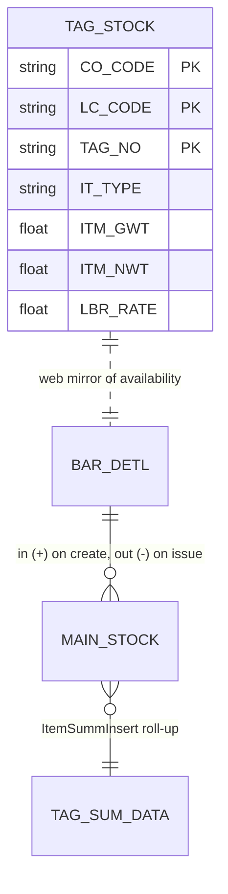
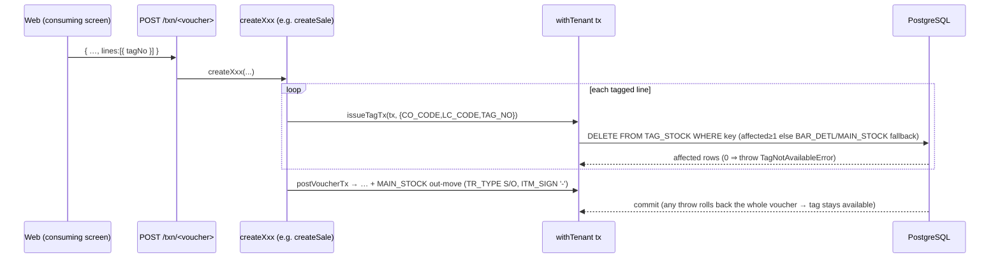

# TAG_STOCK — Tag availability & on-hand (lifecycle deep-dive)

```
Form: TAG_STOCK (lifecycle)  ·  Module: 4_Inventory_Tags  ·  Type: stock primitive (no UI form of its own)
Desktop source: unified/src/csharp/DataCareNext/Ac_Stock.cs (stock-movement engine, 894 lines)
Web target: apps/api/src/modules/stock/stock.ts (createTag/issueTagTx/restoreTagTx/tagAvailable/onHand/listTags)
Requirements: Req 14.1 (create), 14.2 (issue), 14.3 (restore), 14.4 (on-hand net), 14.5 (double-issue guard); Req 8
Parity: project-memory/parity/verify-stock-tags.md   ·   Status: 📋 SPEC · 🟩 BUILT (availability) / 🟦 PARTIAL (on-hand fine)
```

## 1. Purpose & business context

`TAG_STOCK` is not a screen the user opens — it is the **availability layer** for tagged inventory
that every transaction touches. When a tag enters stock (opening balance, lot, tagged purchase, mfg
receipt, split child) it becomes *available*; when a voucher issues it (sale, consignment, karigar,
tour) it becomes *unavailable*; reversing that voucher makes it available again. The desktop models
availability arithmetically through the signed `MAIN_STOCK` ledger (a tag is on-hand while its signed
movement net is positive); the web adds a fast **presence mirror** in the `TAG_STOCK` table (row
present = available). This doc specifies the four primitives the rest of the system calls —
**create, issue, restore, on-hand** — so an implementer can guarantee a tag is never double-issued
(Req 14.5) and on-hand stock equals the net of stock-in minus stock-out (Req 14.4).

## 2. UI / UX specification

**N/A — no standalone form.** `TAG_STOCK` is invoked by other screens:

- **Tag picker / scanner** (in Sales, Purchase-return, Consignment, etc.): the operator scans/types a
  `TAG_NO`; the consuming screen calls `tagAvailable` to validate, then auto-fills the line from the
  tag's stored weight/touch/labour (Req 14.1 / Sales §2 grid `TAG_NO`). On save the consuming voucher
  calls `issueTagTx`.
- **Stock enquiry / on-hand panel** (Reports `RP_STOCK`, `RP_TAG`, `RP_PHY_STOCK`): calls `onHand` /
  `listTags` to show available tags and item-wise balances.

| Element | Source column | Behavior |
|---|---|---|
| Tag scan field | `TAG_NO` (→ `BAR_DETL`/`TAG_STOCK`) | exact-match lookup; rejects if not available |
| Auto-filled line | `IT_CODE,ITM_GWT,ITM_NWT,ITM_TOUCH,ITM_FINE,LBR_*` from the tag | read-only echo of the tag's stored attributes |
| On-hand readout | computed | net pcs/gwt/nwt/fine for CO/LC (see §4) |

Keyboard: tag scanner emits the `TAG_NO` + Enter, adding a row on the consuming grid (see Sales §2).

## 3. Data model touched

**Primary tables**

| Table | Role |
|---|---|
| [`TAG_STOCK`](../../02_Data_Model/tables/TAG_STOCK.md) | Web availability mirror — PK `(CO_CODE,LC_CODE,TAG_NO)`. Row present ⇒ available. 25 cols (item, gwt, nwt, labour). |
| [`MAIN_STOCK`](../../02_Data_Model/tables/MAIN_STOCK.md) | The signed movement ledger (50 cols). On-hand is the net of these rows. Written by `Ac_Stock`/`postVoucherTx`. |
| [`BAR_DETL`](../../02_Data_Model/tables/BAR_DETL.md) | Real desktop tag inventory (108 cols) — the authoritative tag detail; web availability falls back to "exists in `BAR_DETL` AND no `MAIN_STOCK '-'`". |
| [`TAG_SUM_DATA`](../../02_Data_Model/tables/TAG_SUM_DATA.md) | Desktop per-tag roll-up cache (rebuilt by `ItemSummInsert`); keeps tags with positive signed net. |



**Writes:** `createTag` → INSERT `TAG_STOCK`; `issueTagTx` → DELETE `TAG_STOCK` (or validates `BAR_DETL`);
`restoreTagTx` → INSERT `TAG_STOCK`. The `MAIN_STOCK` `+`/`-` rows are written by the **consuming
voucher** through `postVoucherTx`, not by these primitives directly.

## 4. Business logic & calculations (with code)

### 4.1 Availability = row presence; issue = atomic delete (web — `stock.ts`)
```ts
// src: web/apps/api/src/modules/stock/stock.ts
export function buildTagWhere(key: TagKey) {                 // pure WHERE for (CO_CODE,LC_CODE,TAG_NO)
  return { sql: `"CO_CODE"::text=$1 AND "LC_CODE"::text=$2 AND "TAG_NO"::text=$3`,
           params: [key.CO_CODE, key.LC_CODE, key.TAG_NO] };
}
export async function issueTagTx(tx, key) {                   // Req 14.2 + 14.5
  const w = buildTagWhere(key);
  const affected = await tx.$executeRawUnsafe(`DELETE FROM "TAG_STOCK" WHERE ${w.sql}`, ...w.params);
  if (affected && affected >= 1) return;                      // present ⇒ issued exactly once
  // fallback to the real desktop inventory: available iff in BAR_DETL and not already sold
  const inBar = await tx.$queryRawUnsafe(`SELECT count(*)::int n FROM "BAR_DETL" WHERE "CO_CODE"=$1 AND "TAG_NO"=$2`, key.CO_CODE, key.TAG_NO);
  const sold  = await tx.$queryRawUnsafe(`SELECT count(*)::int n FROM "MAIN_STOCK" WHERE "CO_CODE"=$1 AND "TAG_NO"=$2 AND "ITM_SIGN"='-'`, key.CO_CODE, key.TAG_NO);
  if (inBar[0].n > 0 && sold[0].n === 0) return;
  throw new TagNotAvailableError(key.TAG_NO);                 // double-issue guard
}
```
The **double-issue guard** is the `affected`-row count: the `DELETE` either removes exactly one row
(success) or zero (already issued → throw). Because it runs inside the consuming voucher's
transaction, two concurrent sales of the same tag cannot both win — one commits, the other rolls back.

### 4.2 Create / restore (web — `stock.ts`)
```ts
// src: stock.ts — insert rejects a duplicate TAG_NO (Req 14.1)
async function insertTagTx(tx, tenantId, data) {
  if (await existsTx(tx, data)) throw new TagExistsError(data.TAG_NO);
  // INSERT INTO "TAG_STOCK"(tenant_id, <cols…>) VALUES (…)   — identifiers sanitized
}
export const createTagTx  = insertTagTx;   // stock-IN (purchase/opening)
export const restoreTagTx = insertTagTx;   // on reversal of a sale/issue — tag available again (Req 14.3)
```

### 4.3 On-hand = signed net of stock-in − stock-out (Req 14.4)
**Desktop truth** — `Ac_Stock` writes every movement into `MAIN_STOCK` with `ITM_SIGN`; on-hand for an
item/tag is the net. The per-tag roll-up keeps a tag only while that net is positive:
```csharp
// src: Ac_Stock.cs ItemSummInsert → TAG_SUM_DATA (qty/pcs/gwt/nwt/FINE per tag)
//   a tag is still on hand only when its signed movement sum > 0
HAVING SUM(CASE WHEN ITM_SIGN='+' THEN A.VCH_SRNO ELSE -A.VCH_SRNO END) > 0
//   the summed columns: ITM_PCS, ITM_GWT, ITM_NWT, ITM_FINE  (fine included)
```
**Web** — `onHand` sums `BAR_DETL` for tags not yet sold (a simplification of the full net):
```ts
// src: stock.ts onHand — pcs/gwt/nwt for tags with no MAIN_STOCK '-' movement
SELECT sum(ITM_PCS) pcs, sum(ITM_GWT) gwt, sum(ITM_NWT) nwt
FROM "BAR_DETL" WHERE "CO_CODE"=$1 [AND "LC_CODE"=$2]
  AND NOT EXISTS (SELECT 1 FROM "MAIN_STOCK" m
                  WHERE m."CO_CODE"="BAR_DETL"."CO_CODE" AND m."TAG_NO"="BAR_DETL"."TAG_NO" AND m."ITM_SIGN"='-')
```
> **Parity gap (flag).** The web `onHand` returns **pcs/gwt/nwt only** and nets *tagged* `BAR_DETL`
> stock; it does **not** return **fine** and does not include non-tag (`ITM_OPBL`/lot/bulk) movements.
> Req 14.4 wants the full signed `MAIN_STOCK` net incl. fine. Target form (parity-true):
> ```ts
> SELECT sum(CASE WHEN ITM_SIGN='+' THEN ITM_PCS ELSE -ITM_PCS END)  AS pcs,
>        sum(CASE WHEN ITM_SIGN='+' THEN ITM_GWT ELSE -ITM_GWT END)  AS gwt,
>        sum(CASE WHEN ITM_SIGN='+' THEN ITM_NWT ELSE -ITM_NWT END)  AS nwt,
>        sum(CASE WHEN ITM_SIGN='+' THEN ITM_FINE ELSE -ITM_FINE END) AS fine
> FROM "MAIN_STOCK" WHERE "CO_CODE"=$1 [AND "LC_CODE"=$2] [AND "IT_CODE"=$3]
> ```
**Precision:** fine `= netWt × touch / 100`, weights/fine 3 dp, HALF-UP — see
[`calc-engine.md`](../../04_Cross_Cutting_Engines/calc-engine.md).

## 5. Save sequence (create / issue)

These primitives run **inside the consuming voucher's transaction** — they are not standalone saves.
The canonical issue path (e.g. a sale, mirroring [`TR_SALE` §5](../2_Sales/TR_SALE.md)):



Numbered: (1) for each tag line, `issueTagTx` atomically removes the tag from availability (or
validates `BAR_DETL`+not-sold); (2) the voucher posts its `MAIN_STOCK '-'` movement(s); (3) commit. A
**create/restore** is the inverse: `createTagTx`/`restoreTagTx` re-inserts the `TAG_STOCK` row while the
voucher posts a `MAIN_STOCK '+'` movement.

## 6. Delete / reverse sequence

Reversal is driven by the consuming voucher's `reverseVoucherTx`, which deletes that voucher's
`MAIN_STOCK` rows by key; the module then **restores** any tags it had issued:
```ts
// src: TR_SALE §6 pattern — after reverseVoucherTx removes SL_*/AC_DATA/MAIN_STOCK by key:
for (const tag of tagRestores) await restoreTagTx(tx, tenantId, tag);   // re-insert TAG_STOCK row (Req 14.3)
```
Because on-hand is arithmetic, deleting the `-` movement alone already returns the tag to "in stock"
in the `MAIN_STOCK` net; `restoreTagTx` keeps the fast `TAG_STOCK` mirror consistent. `restoreTagTx`
**rejects** if the tag is somehow already present (guards against double-restore). Requires `USER_DELETE`
on the consuming voucher; a `DELETE_DATA` audit row is written by that voucher.

## 7. API contract

`TAG_STOCK` exposes **read** endpoints + internal primitives (mutations happen via consuming vouchers):

```ts
// GET /stock/tags?coCode&lcCode[&limit]    (right: read) → in-stock tag list (BAR_DETL net), capped 500
//   → Array<{ TAG_NO, IT_CODE, ITM_PCS, ITM_GWT, ITM_NWT, ITM_FINE, ITM_MRP }>
// GET /stock/on-hand?coCode[&lcCode][&itCode]  (right: read) → { pcs:number, gwt:number, nwt:number(, fine:number) }
// GET /stock/tag/:tagNo/available?coCode&lcCode (right: read) → { available:boolean }

// Internal primitives (imported by Sales/Purchase/etc. — not REST):
interface TagKey { CO_CODE: string; LC_CODE: string; TAG_NO: string }
createTag(prisma, tenantId, data & TagKey): { created:true }      // INSERT, rejects dup → TagExistsError(409)
issueTagTx(tx, key): void                                          // atomic delete + guard → TagNotAvailableError(400)
restoreTagTx(tx, tenantId, data & TagKey): void                    // re-insert, rejects dup
tagAvailable(prisma, tenantId, key): boolean
onHand(prisma, tenantId, { CO_CODE, LC_CODE? }): { pcs, gwt, nwt }
```
**Errors:** `TagNotAvailableError` → 400 `{ error:'tag-not-available', tag }`; `TagExistsError` → 409
`{ error:'tag-exists', tag }`. (Mapping per [`conventions.md` §5](../../01_Architecture/conventions.md).)

## 8. Validation rules

| Rule | Condition | Desktop message (confirm) | HTTP | req |
|---|---|---|---|---|
| Unique tag on create | `TAG_NO` already in `TAG_STOCK` for CO/LC | "Tag already exists" | 409 | 14.1 |
| Tag exists & available on issue | not in `TAG_STOCK` **and** (not in `BAR_DETL` or already has `MAIN_STOCK '-'`) | "Tag not found / not available" | 400 | 14.2, 14.5 |
| Double-issue guard | concurrent issue — second `DELETE` affects 0 rows | — | 400 | 14.5 |
| Restore only if absent | `restoreTagTx` finds tag already present | — | 409 | 14.3 |
| Scope required | missing `CO_CODE`/`LC_CODE` | — | 400 | 1.x |
| Weight/fine scale | non-numeric or wrong dp | — | 400 | 12 |

## 9. Parity criteria (Definition of Done)

1. **Create** persists a `TAG_STOCK` row with `IT_CODE`, gwt, nwt, touch, labour and a unique `TAG_NO`
   per CO/LC (Req 14.1).
2. **Issue** makes the tag unavailable: a second issue of the same tag is rejected with
   `tag-not-available` (Req 14.2, 14.5). Verified concurrently (two txns; exactly one commits).
3. **Restore** (sale/issue reversal) makes the tag available again (Req 14.3).
4. **On-hand** for an item equals the signed net of all `MAIN_STOCK` in/out for CO/LC across
   pcs/gwt/nwt/**fine** (Req 14.4) — matches the desktop `TAG_SUM_DATA`/stock-report figure to 3 dp.
5. Tag `MAIN_STOCK` rows carry desktop stamps: `TR_TYPE`∈{P,I,S,O}, `ITM_SIGN`∈{+,−}, `DATA_TYPE='A'`,
   `TBL_CODE='001'` (verify-stock-tags BUG‑5/6).
6. Demo invariants intact after create+issue+reverse: `BAR_DETL`=1329, `MAIN_STOCK`=1856, `SL_DATA`=190,
   ΣTOT_AMT=₹5,478,196.00 (verify-stock-tags §7).

Fixtures: `web/apps/api/integration/*stock*.live.mjs`; method & evidence in
`project-memory/parity/verify-stock-tags.md`.

## 10. Variants & edge cases

| Variant | Delta |
|---|---|
| Web presence model vs desktop net | Web `TAG_STOCK` row-presence is a fast mirror; desktop truth is the signed `MAIN_STOCK` net. Keep them consistent (issue deletes mirror **and** posts `-`; restore inserts mirror **and** the `-` is deleted on reversal). |
| `BAR_DETL` fallback | Imported desktop tags live only in `BAR_DETL` (no `TAG_STOCK` row); `issueTagTx` treats them available iff present in `BAR_DETL` and no `MAIN_STOCK '-'`. |
| Untagged stock | Bulk/loose (`ITM_OPBL`, lots, `IT_CODE`-only) has no `TAG_NO`; availability is purely the `MAIN_STOCK` net, not a `TAG_STOCK` row. |
| Old-gold / scrap in | Enters as a `+` movement (`SL_PR_DETL`/`Purc`), typically untagged. |
| Counter transfer | `TAG TRFR` moves a tag OUT of one `TBL_CODE` and IN to another — net company stock unchanged. |
| Split / weight-change | Re-tagging events (see [`TR_TAG_SPLIT`](TR_TAG_SPLIT.md) / [README §9.5](README.md)). |

## 11. Open questions / risks

- **On-hand must return fine and net all movement sources.** Current `stock.ts onHand` omits `ITM_FINE`
  and only nets tagged `BAR_DETL`; switch to the signed `MAIN_STOCK` aggregate in §4.3 to satisfy
  Req 14.4 fully (pcs/gwt/nwt/**fine**, tagged + bulk + lot).
- **Two availability sources of truth.** `TAG_STOCK` mirror vs `MAIN_STOCK`/`BAR_DETL` net can drift if
  a movement is posted without updating the mirror (or vice-versa). Prefer deriving availability from
  the net (single source) or assert the two agree in tests.
- **Confirm desktop tag-not-available / duplicate message strings** from the consuming forms
  (`TR_SALE.cs`, `TR_PURC.cs`) for UI parity.
- **`MAIN_STOCK` stamp bugs** (`DATA_TYPE='A'`, `TBL_CODE='001'`) apply here too — fix globally in
  `postVoucherTx` (verify-stock-tags BUG‑5).
