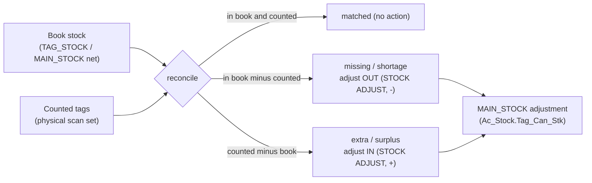

# TR_PHYSTK — Physical Stock (reconcile) (deep-dive)

```
Form: TR_PHYSTK  ·  Module: 4_Inventory_Tags  ·  Type: transaction (stock-take + adjustment)
Desktop source: unified/src/csharp/DataCareNext/TR_PHYSTK.cs (4,891 lines) + Ac_Stock.Tag_Can_Stk (STOCK ADJUST)
Web target: apps/api/src/modules/stock/stock.ts (physicalReconcile) [+ adjustment post: tagOps.tagCancel]
Requirements: Req 14.2/14.3/14.4 (stock net & availability), 12 (fine/weight), 13 (ledger on adjust)
Reports: RP_PHY_STOCK · TagStkRpt.rpt   ·   Parity: project-memory/parity/verify-stock-tags.md
Status: 📋 SPEC · 🟦 PARTIAL (web does the variance read-only; the adjustment post is via tag-cancel/stock-adjust)
```

## 1. Purpose & business context

A periodic **stock-take**: the operator physically scans every tag on the counter/safe and the system
**reconciles** that counted set against the **book** (system) stock — listing what is **missing**
(in book, not counted = shortage), **extra** (counted, not in book = surplus/untagged), and **matched**.
The operator then posts an **adjustment** so the book stock equals the physical count: missing tags are
removed (a `STOCK ADJUST` / `TAG CANCEL` OUT movement), extras are added (an IN movement). `TR_PHYSTK`
also doubles as the desktop's tag **counter-transfer** screen (moving tags between `TBL_CODE` counters).
This keeps on-hand (the signed `MAIN_STOCK` net, Req 14.4) honest against reality.

## 2. UI / UX specification

### Layout
```
┌─ TR_PHYSTK ─ Physical Stock ───────────────────────────── [New][Save F2][Reconcile][Print][Close] ┐
│ Date: [__/__/____]  Counter: [TBL_CODE ▾]  Book/Group filter: [..]                                │
│ ┌ Scan / count ──────────────────────────────┐  ┌ Variance ───────────────────────────────────┐ │
│ │ Scan tag: [__________]  (adds to counted)   │  │ Matched: [n]  Missing: [n]  Extra: [n]       │ │
│ │ # │ TAG_NO │ Item │ N.Wt │ status            │  │ ──────────────────────────────────────────── │ │
│ │ 1 │ …      │ …    │      │ matched/extra     │  │ Missing (shortage) tags → adjust OUT          │ │
│ └─────────────────────────────────────────────┘  │ Extra (surplus) tags    → adjust IN           │ │
│ System (book) on-hand: pcs/gwt/nwt/fine [auto]    └───────────────────────────────────────────────┘ │
└──────────────────────────────────────────────────────────────────────────────────────────────────┘
```

### Field / control table
| Element | Source | Behavior |
|---|---|---|
| Date | `VCH_DATE` | stock-take date; ≤ `CO_SET.LOCK_DATE` blocked for the adjustment post |
| Counter | `TBL_CODE` | scope the count to one counter (optional) |
| Scan tag | `TAG_NO` | each scan appends to the **counted** set; duplicate scan ignored |
| Variance panel | computed | matched / missing / extra (see §4) |
| System on-hand | `MAIN_STOCK` net | book pcs/gwt/nwt/**fine** for the scope |

**Modes:** Count (scan) → **Reconcile** (read-only variance) → **Adjust & Save** (posts the OUT/IN
movements) → Print (`RP_PHY_STOCK`). Reconcile is non-destructive; only Save posts. Counter-transfer
mode reuses the same grid (`MAIN_BOOK='COUNTER TRFR'`).

## 3. Data model touched

**Read (reconcile):** book = `TAG_STOCK` rows (web) / `MAIN_STOCK` net (desktop) for the scope; counted
= scanned `TAG_NO` set. **Write (adjustment post):** the desktop routes adjustments through
`BAR_CAN_DETL` (`MAIN_BOOK IN ('STOCK ADJUST','TAG CANCEL','TAG TRFR')`) → `Ac_Stock.Tag_Can_Stk` →
`MAIN_STOCK` (sign per direction). The form also re-stamps `BAR_DETL`/`APR_DETL` and re-prints
`TAG_PRINT_DATA`.

From the form catalog (`TR_PHYSTK.md`): **INSERT** `BAR_DETL,BAR_IDTL,TAG_PRINT_DATA`; **UPDATE**
`APR_DETL,BAR_DETL,MAIN_STOCK`; **DELETE** `BAR_CAN_DATA,BAR_CAN_DETL,BAR_DETL,BAR_IDTL,DM_DATA,
MAIN_STOCK,REMARK_DATA,TAG_PRINT_DATA,TEMP_BOOK_DATA`.

Table refs: [MAIN_STOCK](../../02_Data_Model/tables/MAIN_STOCK.md) · [TAG_STOCK](../../02_Data_Model/tables/TAG_STOCK.md) ·
[BAR_DETL](../../02_Data_Model/tables/BAR_DETL.md) · [APR_DETL](../../02_Data_Model/tables/APR_DETL.md) ·
[TAG_PRINT_DATA](../../02_Data_Model/tables/TAG_PRINT_DATA.md)



## 4. Business logic & calculations (with code)

### 4.1 Reconcile = set difference book vs counted (web — `stock.ts`, read-only)
```ts
// src: web/apps/api/src/modules/stock/stock.ts physicalReconcile
const book    = new Set(rows.map(r => String(r.TAG_NO)));               // SELECT TAG_NO FROM TAG_STOCK WHERE CO/LC
const counted = new Set(countedTags.map(t => String(t).trim()).filter(Boolean));
const matched = [...counted].filter(t => book.has(t));                  // present in both
const missing = [...book].filter(t => !counted.has(t));                 // in book, not counted → shortage
const extra   = [...counted].filter(t => !book.has(t));                 // counted, not in book → surplus
return { matched, missing, extra,
         bookCount: book.size, countedCount: counted.size,
         matchedCount: matched.length, missingCount: missing.length, extraCount: extra.length };
```
This is **read-only** — it produces the variance the operator acts on; it writes nothing. (Books the
variance against the `TAG_STOCK` mirror; the parity-true source is the signed `MAIN_STOCK` net — see §11.)

### 4.2 System (book) on-hand for the panel
The "System on-hand" figure is the signed `MAIN_STOCK` net (Req 14.4) — pcs/gwt/nwt/**fine** — for the
scope (see [`TAG_STOCK.md` §4.3](TAG_STOCK.md)). The variance count above is the tag-level view of the
same truth.

### 4.3 Adjustment post (desktop — `Ac_Stock.Tag_Can_Stk`, STOCK ADJUST)
Missing/extra tags are posted as a stock adjustment through `BAR_CAN_DETL`; the movement sign comes
from the detail row (`-` to remove a missing tag, `+` to add a surplus one):
```csharp
// src: Ac_Stock.cs Tag_Can_Stk — STOCK ADJUST / TAG CANCEL / TAG TRFR
… B.MAIN_BOOK,'',A.IT_CODE,CASE WHEN A.TAG_NO='' THEN 'N' ELSE A.TAG_NO END,…,
  CASE WHEN A.ITM_SIGN='+' THEN 'I' ELSE 'O' END, A.ITM_SIGN, 1,A.ITM_PCS,A.ITM_GWT,A.ITM_NWT,A.ITM_TOUCH,…,A.ITM_FINE,…
  FROM BAR_CAN_DETL AS A LEFT JOIN BOOK_DATA AS B …
  WHERE B.MAIN_BOOK IN ('TAG CANCEL','STOCK ADJUST','TAG TRFR')
```
**Counter transfer** is the two-leg variant: an OUT (`BAR_CAN_DETL`) + an IN (`BAR_DETL`) under
`MAIN_BOOK='COUNTER TRFR'` (`Ac_Stock.Tag_Counter_trfr_Stk`), net company stock unchanged. The desktop
reconcile query that joins counted scans back to system rows:
```csharp
// src: TR_PHYSTK.cs — match a counted tag to its system MAIN_STOCK/BAR_DETL row
"Select A.TAG_NO,A.VCH_SRNO,B.VCH_TIME FROM MAIN_STOCK AS A LEFT JOIN BAR_DETL AS B
   ON A.LC_CODE=B.LC_CODE AND A.TAG_NO=B.TAG_NO AND A.VCH_SRNO=B.VCH_SRNO WHERE …"
```
**Web adjustment:** post the missing tags via `tagCancel` (a `STOCK ADJUST`/`TGCAN` OUT, `ITM_SIGN='-'`)
and surplus tags via a corresponding IN — reusing the [`tagOps.ts`](README.md) primitives. **Precision:** weights/fine 3 dp HALF-UP; preserve column names.

## 5. Save sequence (reconcile → adjust)

```mermaid
sequenceDiagram
  participant U as Web (physical-stock screen)
  participant A as POST /stock/physical-reconcile  / POST /stock/tag-cancel
  participant S as physicalReconcile / tagCancel
  participant Tx as withTenant tx
  participant DB as PostgreSQL
  U->>A: { scope, countedTags:[…] }
  A->>S: physicalReconcile(scope, countedTags)
  S->>DB: SELECT TAG_NO FROM TAG_STOCK WHERE CO/LC   (read-only)
  S-->>U: { matched, missing[], extra[], counts }
  Note over U: operator reviews variance, confirms adjustment
  U->>A: POST /stock/tag-cancel { lines: missingTags }  (right: create)
  A->>S: tagCancel(...)
  S->>Tx: withTenant → nextVoucherNoTx
  Tx->>DB: postVoucherTx → MAIN_STOCK OUT (STOCK ADJUST / '-') ; empty AC_DATA
  DB-->>Tx: commit
  A-->>U: 201 { vchNo, tags }
```
Numbered: (1) reconcile (read) → variance; (2) operator confirms; (3) post missing as OUT
(`STOCK ADJUST`/`-`) and extra as IN (`+`); (4) commit; (5) print `RP_PHY_STOCK`.

## 6. Delete / reverse

The **reconcile** is read-only — nothing to reverse. The **adjustment** voucher reverses like any tag
movement: `reverseVoucherTx(tx, tenantId, { tables:['MAIN_STOCK'], key })` removes the adjustment rows
by key (desktop also reverses `BAR_CAN_*`, `BAR_DETL`/`BAR_IDTL`, `DM_DATA`, `LOT_DETL`, `TAG_PRINT_DATA`,
`TEMP_BOOK_DATA` — form catalog). Requires `USER_DELETE`; a `DELETE_DATA` audit row is written.

## 7. API contract

```ts
// POST /stock/physical-reconcile   (right: read — non-mutating)
interface PhysicalReconcileBody {
  scope: { coCode; lcCode };                 // tenantId from session
  countedTags: string[];                     // scanned TAG_NOs (trimmed, de-duped server-side)
}
// → 200 { matched:string[], missing:string[], extra:string[],
//         bookCount, countedCount, matchedCount, missingCount, extraCount }

// Adjustment post (reuse tag-cancel / a stock-adjust variant):
// POST /stock/tag-cancel   (right: create) { scope, lines:[{ tagNo, itCode, netWt, touch }] } → { vchNo, tags }
// DELETE /stock/tag-cancel/:vchNo (right: delete) → { reversed:true }
```
Errors: missing scope → 400; reconcile itself cannot fail referentially (pure read). Adjust-post errors
mirror tag-cancel (`PeriodLock…`→400, `ForbiddenError`→403).

## 8. Validation rules

| Rule | Condition | Desktop msg (confirm) | HTTP | req |
|---|---|---|---|---|
| Scope required | missing `CO_CODE`/`LC_CODE` | — | 400 | 1.x |
| Counted set sane | empty `countedTags` ⇒ all book tags reported missing (allowed, warn) | "Nothing counted" | 200 (warn) | 14.4 |
| Save before transfer | counter-transfer row edited on unsaved voucher | "Please Save This Voucher Then Effect…." | 400 | — |
| Confirm destructive removal | counter-transfer row removal | "This Row Record will Removed permantley ?" | confirm | — |
| Period open (adjust) | adjust `VCH_DATE` ≤ `CO_SET.LOCK_DATE` | "Period locked" | 400 | — |
| Adjust right | post without `USER_UPDATE` | — | 403 | 6 |

(Message strings `"Please Save This Voucher Then Effect…."` / `"This Row Record will Removed permantley ?"`
are real — `src: TR_PHYSTK.cs#L2740,L2752`.)

## 9. Parity criteria (Definition of Done)

1. **Reconcile** returns the correct set partition for a given (book, counted): matched = book∩counted,
   missing = book−counted, extra = counted−book, with accurate counts.
2. **System on-hand** shown equals the signed `MAIN_STOCK` net (pcs/gwt/nwt/**fine**) for the scope
   (Req 14.4), matching the desktop stock report.
3. **Adjustment post** writes `MAIN_STOCK` `STOCK ADJUST`/`TGCAN` rows with the right sign (missing→`-`,
   extra→`+`), `DATA_TYPE='A'`, `TBL_CODE='001'`; reversible by key.
4. After adjust, book on-hand equals the physical count (variance → 0 on re-reconcile).
5. Counter-transfer leaves company net stock unchanged (OUT one counter, IN another).
6. Demo invariants intact (`MAIN_STOCK`=1856, `BAR_DETL`=1329) after a scratch reconcile+adjust+reverse
   (verify-stock-tags §7).

Method/evidence: `project-memory/parity/verify-stock-tags.md`; reconcile is exercised read-only against
the live DB.

## 10. Variants & edge cases

| Variant | Delta |
|---|---|
| Counter transfer (`COUNTER TRFR`) | Same screen; posts an OUT (`BAR_CAN_DETL`) + IN (`BAR_DETL`) pair per tag (`Ac_Stock.Tag_Counter_trfr_Stk`); company net unchanged, only `TBL_CODE` changes. Gated by registration SrNo in desktop. |
| Stock adjust (untagged) | Bulk/loose shortage/surplus adjusts by `IT_CODE` (no `TAG_NO`) — sign per direction. |
| Extra/untagged found | A counted tag not in book may be a never-tagged item → operator tags it (creates `BAR_DETL`+`MAIN_STOCK '+'`) rather than a blind surplus. |
| Group/counter scope | Reconcile can be scoped to a `TBL_CODE`/group so only that counter's variance is posted. |
| `RP_PHY_STOCK` | The read-only stock-take report (preview the variance before posting). |

## 11. Open questions / risks

- **Reconcile source should be the `MAIN_STOCK` net, not just `TAG_STOCK`.** `physicalReconcile` reads
  the `TAG_STOCK` mirror; imported desktop tags live in `BAR_DETL` with no `TAG_STOCK` row, so they
  would all appear as "extra". Use the same "in `BAR_DETL` and not sold" / signed-`MAIN_STOCK`-net basis
  as `onHand`/`issueTagTx` so the book set matches true on-hand (see [`TAG_STOCK.md` §11](TAG_STOCK.md)).
- **Adjustment post not yet a dedicated endpoint.** The web exposes the variance (read) but routes the
  fix through `tag-cancel` (missing) / a tag-in (extra); a single `POST /stock/physical-adjust` that
  takes the variance and posts both legs (with a `STOCK ADJUST` book) would match the desktop one-save
  flow. Weight/fine of each adjusted tag must come from `BAR_DETL`.
- **`STOCK ADJUST` book wiring.** Desktop keys adjustments off `BOOK_DATA.MAIN_BOOK='STOCK ADJUST'` with
  `BOOK_TBL_NAME='BAR_CAN_DATA'`; the web must seed an equivalent book/scope.
- **`MAIN_STOCK` stamp fixes** (`DATA_TYPE='A'`, `TBL_CODE='001'`) apply to the adjustment rows
  (verify-stock-tags BUG‑5/6).
- Confirm whether desktop posts a **fine `AC_DATA`** valuation leg on stock-adjust (it does for
  weight-change); if so the adjustment should carry the metal ledger too.
