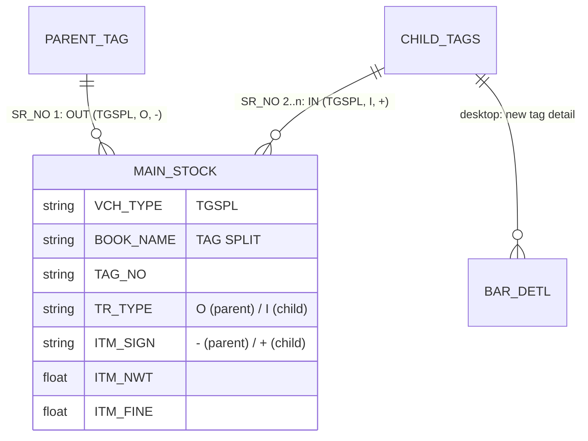

# TR_TAG_SPLIT — Tag Split (deep-dive)

```
Form: TR_TAG_SPLIT  ·  Module: 4_Inventory_Tags  ·  Type: transaction (stock re-tag; fine ledger)
Desktop source: unified/src/csharp/DataCareNext/TR_TAG_SPLIT.cs (12,940 lines) + Ac_Stock.Tag_Split_Stk
Web target: apps/api/src/modules/stock/tagSplit.ts (splitTag / deleteTagSplit) · apps/web/app/(app)/txn/tag-split
Requirements: Req 14 (tag & stock), 12 (fine/weight), 13 (ledger), 8 (numbering)
Reports: TagSplitVch.rpt, TagWtChangSplit.rpt   ·   Parity: project-memory/parity/verify-stock-tags.md
Status: 📋 SPEC · 🟦 PARTIAL (web books MAIN_STOCK; desktop also writes BAR_*/fine ledger)
```

## 1. Purpose & business context

A jeweller often **splits one physical tag into several** — e.g. a 30 g chain tag is cut into a 20 g
and a 10 g piece, each needing its own barcode for separate sale. `TR_TAG_SPLIT` retires the **parent**
tag from stock and brings **child** tags in, conserving weight (the children's net weights must sum to
the parent's). No value changes hands — it is pure inventory re-tagging — so the money ledger is empty;
the desktop additionally tracks the metal as a **fine** `AC_DATA` ledger. It uses book **`TAG SPLIT`**
(`MAIN_BOOK='TAG SPLIT'`), voucher type **`TGSPL`** (web) and prints `TagSplitVch.rpt`.

## 2. UI / UX specification

### Layout
```
┌─ TR_TAG_SPLIT ─ Tag Split ─────────────────────────────── [New][Save F2][Delete][Print][Close] ┐
│ Vch No: [____]  Date: [__/__/____]                                                              │
│ Parent tag: [TAG_NO ▾][scan]  Item:[..] Pcs:[..] G.Wt:[..] N.Wt:[..] Touch:[..] Fine:[calc]     │
│ ┌ Children ────────────────────────────────────────────────────────────────────────────────┐  │
│ │ # │ New Tag │ Item │ Pcs │ G.Wt │ N.Wt │ Touch │ Fine │  (add row per child)               │  │
│ │ 1 │ scan…   │ …    │     │      │      │       │ calc │                                     │  │
│ └────────────────────────────────────────────────────────────────────────────────────────────┘ │
│ Σ children N.Wt: [auto]   must equal Parent N.Wt: [auto]   ✓/✗ balance indicator                 │
└──────────────────────────────────────────────────────────────────────────────────────────────────┘
```

### Field table
| Label | Column | Type | Req | Default | Editable when | Lookup/validation |
|---|---|---|---|---|---|---|
| Vch No | `VCH_NO` | string | auto | next in book | — | from `SRNO_MAST` (book `TSP`) |
| Date | `VCH_DATE` | date | ✓ | today | New | ≤ `CO_SET.LOCK_DATE` blocked |
| Parent tag | `TAG_NO` | lookup→`BAR_DETL`/`TAG_STOCK` | ✓ | — | New | must be **in stock**; auto-fills wt/touch/fine |
| Parent Item/Pcs/GWt/NWt/Touch | from parent tag | num | auto | from tag | read-only | — |
| Parent Fine | `ITM_FINE` | num | auto | `NWt×Touch/100` | read-only | calc |

### Children grid
| Col | Column | Editable | Source/behavior |
|---|---|---|---|
| New Tag | `TAG_NO` | yes | new barcode (must not already exist in stock) |
| Item | `IT_CODE` | yes | lookup→`ITEM_MAST` (defaults to parent's) |
| Pcs | `ITM_PCS` | yes | |
| G.Wt / N.Wt | `ITM_GWT`/`ITM_NWT` | yes | Σ children N.Wt must == parent N.Wt |
| Touch | `ITM_TOUCH` | yes | per child (may differ) |
| Fine | `ITM_FINE` | auto | `NWt×Touch/100` |

### Keyboard / modes
- **F2 = Save**, Enter = next cell, scanner types the new child `TAG_NO`.
- New / Edit (reverse+repost) / Delete (`USER_DELETE`) / Print (`USER_PRINT`).
- _(Confirm exact F-key map + on-screen "weight mismatch" string from `TR_TAG_SPLIT.cs`.)_

## 3. Data model touched

**Writes (web, create):** `MAIN_STOCK` — one parent OUT row (`SR_NO 1`) + one IN row per child
(`SR_NO 2..n`); empty `AC_DATA`. **Desktop also writes:** the new tags into `BAR_DATA`/`BAR_DETL`/`BAR_IDTL`,
the split legs through `LBR_ISU_DETL` (parent) + `LBR_REC_DETL` (children), `TAG_SET`, `TAG_PRINT_DATA`,
`RATE_CUT_ISU_REC`, a **fine** `AC_DATA` ledger and a `ROJ_MEL_DATA` day-book row.

**Deletes/reverses:** web removes `MAIN_STOCK` by key; desktop reverses `MAIN_STOCK,AC_DATA,ROJ_MEL_DATA,
BAR_DATA,BAR_DETL,BAR_IDTL,LBR_DATA,LBR_ISU_DETL,LBR_REC_DETL,TAG_SET,TAG_IMAGE_DATA,SRNO_MAST,
TAG_PRINT_DATA,RATE_CUT_ISU_REC,BILL_OS_DATA,DM_DATA` (form catalog `TR_TAG_SPLIT.md`).

Table refs: [MAIN_STOCK](../../02_Data_Model/tables/MAIN_STOCK.md) · [BAR_DATA](../../02_Data_Model/tables/BAR_DATA.md) ·
[BAR_DETL](../../02_Data_Model/tables/BAR_DETL.md) · [TAG_SET](../../02_Data_Model/tables/TAG_SET.md) ·
[TAG_PRINT_DATA](../../02_Data_Model/tables/TAG_PRINT_DATA.md) · [AC_DATA](../../02_Data_Model/tables/AC_DATA.md)



## 4. Business logic & calculations (with code)

### 4.1 Weight conservation (web — `tagSplit.ts`, pure guard)
```ts
// src: web/apps/api/src/modules/stock/tagSplit.ts
const parentNet = r3(N(parent.netWt));
const childNet  = r3(children.reduce((s, c) => s + N(c.netWt), 0));
if (Math.abs(childNet - parentNet) > NET_TOLERANCE /* 0.01 */)
  throw new TagSplitError(`children net weight ${childNet} must equal parent net weight ${parentNet}`);
const parentFine = parent.fineWt != null ? r3(parent.fineWt) : r3(N(parent.netWt) * N(parent.touch) / 100);
const childFine  = (c) => r3(N(c.netWt) * N(c.touch) / 100);   // fine = net × touch / 100, 3 dp
```
The split **neither creates nor destroys metal**: Σ children net weight must equal parent net weight
(within 0.01 g). Fine is recomputed per child from its own touch (children may carry different touch).

### 4.2 Parent OUT + child IN movements (web — `tagSplit.ts`)
```ts
// SR_NO 1: parent leaves stock in full — TR_TYPE 'O', ITM_SIGN '-'
const parentRow = { ...key, SR_NO:1, ISR_NO:1, VCH_TYPE:'TGSPL', BOOK_NAME:'TAG SPLIT',
  IT_CODE:parent.itCode, TAG_NO:parent.tagNo, TR_TYPE:'O', ITM_SIGN:'-',
  ITM_PCS:N(parent.pcs)||1, ITM_GWT:N(parent.grossWt), ITM_NWT:N(parent.netWt),
  ITM_TOUCH:N(parent.touch), ITM_FINE:parentFine, KR_FINE:parentFine, NET_AMT:0 };
// SR_NO 2..n: each child enters stock — TR_TYPE 'I', ITM_SIGN '+'
const childRows = children.map((c,i) => ({ ...key, SR_NO:i+2, VCH_TYPE:'TGSPL', BOOK_NAME:'TAG SPLIT',
  IT_CODE:c.itCode, TAG_NO:c.tagNo, TR_TYPE:'I', ITM_SIGN:'+',
  ITM_PCS:N(c.pcs)||1, ITM_GWT:N(c.grossWt), ITM_NWT:N(c.netWt), ITM_TOUCH:N(c.touch),
  ITM_FINE:childFine(c), KR_FINE:childFine(c), NET_AMT:0 }));
await postVoucherTx(tx, tenantId, { ledger:{ table:'AC_DATA', lines:[] },   // pure re-tag → no money ledger
  writes:[{ table:'MAIN_STOCK', rows:[parentRow, ...childRows] }] });
```

### 4.3 Desktop evidence (`Ac_Stock.Tag_Split_Stk`)
The desktop routes the parent through `LBR_ISU_DETL` and children through `LBR_REC_DETL` (reusing the
labour issue/receipt detail tables as the split's working set), all under `MAIN_BOOK='TAG SPLIT'`:
```csharp
// src: Ac_Stock.cs Tag_Split_Stk — parent OUT
… B.BOOK_SNAME,B.MAIN_BOOK,A.AC_CODE,A.IT_CODE,A.TAG_NO,…,'O','-', 1,A.ITM_PCS,A.ITM_GWT,A.ITM_NWT,A.ITM_TOUCH,0,A.ITM_FINE,…
  FROM LBR_ISU_DETL AS A LEFT JOIN BOOK_DATA AS B … WHERE B.MAIN_BOOK = 'TAG SPLIT'
// … child IN (sign from the detail row)
… CASE WHEN A.ITM_SIGN='+' THEN 'I' ELSE 'O' END, A.ITM_SIGN, 1,A.ITM_PCS,A.ITM_GWT,A.ITM_NWT,…
  FROM LBR_REC_DETL AS A … WHERE B.MAIN_BOOK = 'TAG SPLIT'
```
The desktop additionally writes the children as real tags (`BAR_DATA/BAR_DETL/BAR_IDTL`), a **fine**
`AC_DATA` ledger (`Ac_Ledr`, `IT_TYPE='G'`, metal-only — money legs net to zero) and `ROJ_MEL_DATA`.
**Web divergence (Category-B):** the web books only the equivalent `MAIN_STOCK` parent-out/child-in and
omits the `BAR_*`/fine-ledger detail; net stock effect matches, table footprint does not (see §11).

**Precision:** weights/fine **3 dp**, HALF-UP ([`calc-engine.md`](../../04_Cross_Cutting_Engines/calc-engine.md)); preserve column names verbatim.

## 5. Save sequence (create / edit)

Edit = reverse prior then repost, one tx. Order (`splitTag`):
```mermaid
sequenceDiagram
  participant U as Web (tag-split screen)
  participant A as POST /stock/tag-split
  participant S as splitTag
  participant Tx as withTenant tx
  participant DB as PostgreSQL
  U->>A: { scope, parent:{tagNo,netWt,touch,…}, children:[{tagNo,netWt,touch,…}] }
  A->>A: assertRight(create)
  A->>S: splitTag(...)
  S->>S: assert Σ children.netWt == parent.netWt (±0.01)
  S->>S: parentFine, childFine = net×touch/100 (3dp)
  S->>Tx: withTenant(tenantId)
  Tx->>DB: nextVoucherNoTx (book TSP)
  S->>S: build parentRow (SR_NO 1, O,-) + childRows (SR_NO 2..n, I,+)
  Tx->>DB: postVoucherTx → MAIN_STOCK [parent OUT, children IN]; empty AC_DATA
  DB-->>Tx: commit (rollback on any throw)
  A-->>U: 201 { vchNo, children:n }
```
Numbered: (1) validate weight conservation; (2) number from book `TSP`; (3) compute parent + child fine;
(4) build parent-OUT + child-IN rows; (5) `postVoucherTx` writes `MAIN_STOCK`; (6) commit.

## 6. Delete / reverse (Req 14)

```ts
// src: tagSplit.ts deleteTagSplit
await reverseVoucherTx(tx, tenantId, { tables:['MAIN_STOCK'], key });   // removes parent OUT + child INs by key
```
One transaction; requires `USER_DELETE`. Deleting the `MAIN_STOCK` rows arithmetically restores the
parent (its `-` is gone) and removes the children (their `+` is gone). **Desktop** additionally reverses
`BAR_*`, the fine `AC_DATA`, `ROJ_MEL_DATA`, `LBR_*`, `TAG_SET`, `TAG_PRINT_DATA`, `RATE_CUT_ISU_REC`,
`SRNO_MAST` and writes the child-tag deactivation — the web must add those when it adopts the full
`BAR_*`/fine-ledger footprint.

## 7. API contract

```ts
// POST /stock/tag-split   (right: create)
interface TagSplitBody {
  scope: { coCode; lcCode; coYear?; coBook? };   // tenantId from session; coBook defaults 'TSP'
  vchDate?: string;
  parent:   { tagNo; itCode; pcs?; netWt?; grossWt?; touch?; fineWt? };
  children: { tagNo; itCode; pcs?; netWt?; grossWt?; touch? }[];   // ≥1
}
// → 201 { vchNo:number, children:number }
// DELETE /stock/tag-split/:vchNo   (right: delete) → { reversed:true }
```
Errors: `TagSplitError` (no parent / no children / weight mismatch) → 400; `ForbiddenError` → 403;
`PeriodLock…` → 400. Validation→HTTP per [`conventions.md` §5](../../01_Architecture/conventions.md).

## 8. Validation rules

| Rule | Condition | Desktop msg (confirm) | HTTP | req |
|---|---|---|---|---|
| Parent required | no `parent.tagNo` | "Select parent tag" | 400 | 14 |
| ≥1 child | empty `children` | "Enter child tags" | 400 | 14 |
| Weight conserved | `|Σ children.netWt − parent.netWt| > 0.01` | "Weight mismatch" | 400 | 12, 14 |
| Parent in stock | parent not available | "Tag not available" | 400 | 14.2/14.5 |
| Child tags new | a child `TAG_NO` already in stock | "Tag already exists" | 409 | 14.1 |
| Period open | `VCH_DATE` ≤ `CO_SET.LOCK_DATE` | "Period locked" | 400 | — |
| Numbering unique | `VCH_NO` per book/scope | — | 409 | 9 |

## 9. Parity criteria (Definition of Done)

1. Given a parent tag + children, the web persists a parent `MAIN_STOCK` OUT (`TGSPL/TAG SPLIT/O/-`) and
   one IN per child (`TGSPL/TAG SPLIT/I/+`), weights/fine to 3 dp.
2. **Weight conserved:** Σ child net = parent net; Σ child fine ≈ parent fine (per-child touch).
3. Parent becomes unavailable, children become available (on-hand net reflects the swap).
4. On delete, all the voucher's `MAIN_STOCK` rows are gone and the pre-split state is restored.
5. `MAIN_STOCK` stamps carry `DATA_TYPE='A'`, `TBL_CODE='001'` (verify-stock-tags BUG‑5/6).
6. **Caveat:** the demo dataset contains **no desktop split voucher** (`BOOK_NAME='TAG SPLIT'` has 0
   rows), so data-to-data parity cannot be run on imported data — certify via a fresh golden-master
   split or unit golden-vectors (verify-stock-tags §5/§6).

## 10. Variants & edge cases

| Variant | Delta vs TR_TAG_SPLIT |
|---|---|
| `TR_TAG_WT_DIFF` | Sibling re-tag that **changes** weight instead of conserving it (replace old tag with new net weight) — see [README §9.5](README.md). Both desktop forms share the `LBR_ISU_DETL`/`LBR_REC_DETL` + fine-ledger pattern and `TagWtChangSplit.rpt`. |
| Single child | A "split" into one child = a re-tag/re-number (same net) — allowed; equivalent to renumber. |
| Different child touch | Each child computes its own `fine = net×touch/100`; Σ child fine may differ slightly from parent fine if touches differ (metal conserved by net weight, not fine). |
| Stones / `BAR_IDTL` | Parent's stone sub-detail must be re-distributed to children in the desktop (`Dm_Tag_Split_Detl` writes `DM_DATA` both legs); web does not yet split sub-detail. |

## 11. Open questions / risks

- **Table-footprint divergence (Category-B).** Web books `MAIN_STOCK` only; desktop writes the children
  as real `BAR_DATA/BAR_DETL/BAR_IDTL` tags + `TAG_SET`/`TAG_PRINT_DATA` + a **fine** `AC_DATA` ledger
  + `ROJ_MEL_DATA`. For full parity (so children are real, printable, reportable tags and the metal
  ledger ties) the web should also create the child tags and the fine ledger. Tracked in
  `tagSplit.ts` header + verify-stock-tags §5.
- **No desktop split in the demo** → parity must come from a Docker golden-master run or unit vectors.
- **Sub-detail (stones) not split** in the web yet (`DM_DATA`).
- Confirm exact desktop weight-mismatch message and whether desktop enforces conservation on **gross**
  too (web checks net only).
- `MAIN_STOCK` `DATA_TYPE`/`TBL_CODE` stamp fix applies (verify-stock-tags BUG‑5/6).
