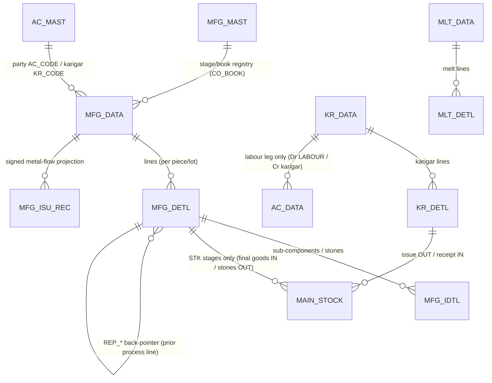
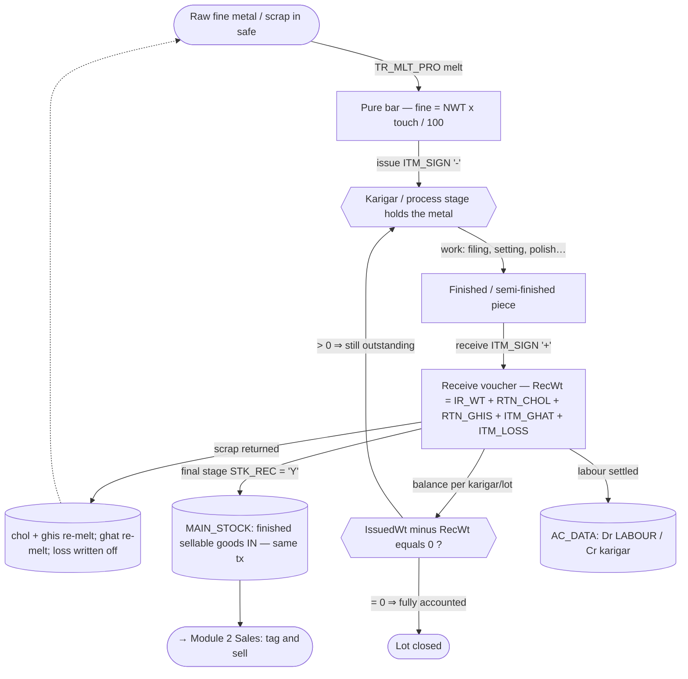

# Module 5 — Manufacturing / Karigar / Job-Work

> The **metal-flow** module. Where Sales/Purchase move *value* (money + GST), manufacturing moves
> *metal* through the shop: raw fine is issued to a goldsmith or process stage, work is done, finished
> metal comes back, and the difference is reconciled into wastage, scrap and loss. Most of these
> vouchers post **no money ledger at all** — they are pure weight movements whose "balance" is a
> fine-weight reconciliation per karigar/lot, not a Dr=Cr trial balance.

This module has **two distinct engines** that share the same tables and vocabulary:

1. **Karigar / job-work** (`TR_KR_ISU`, `TR_REP_REC`): _one issue → one receive → one party_. Issue
   raw fine OUT to a goldsmith, receive finished ornaments IN; wastage is folded into the accountable
   fine on receipt. Two tables (`KR_DATA`/`KR_DETL`), one party, no process pipeline. This is the only
   part of the module with **migrated real data** today (`KR_DATA` 17 rows / `KR_DETL` 22 rows).
2. **Manufacturing process pipeline** (`TR_MFG_ISU_REC`, `TR_MFG_KR_ISU_REC`, `TR_MLT_PRO`, the
   `TR_MFG_*` family): a single physical lot of metal travels through **N sequential shop processes**
   (melting → ghat/cast → filing → pre-polish → mino → setting → assemble → nakshi → polish). Each
   stage is an **Issue** book and a **Receive** book, all writing the same `MFG_DATA`/`MFG_DETL`/
   `MFG_IDTL` trio and projecting signed rows into the central `MFG_ISU_REC` metal-flow ledger.

---

## 1. Purpose

Track every gram of metal from raw bar to finished sellable ornament, attributing recoverable scrap
(`chol`, `ghis`), casting-gate waste (`ghat`) and unrecoverable `loss` at each step, and holding each
karigar/process accountable for the metal in their hands. Finished goods from the final stage enter
sellable `MAIN_STOCK`; labour paid to workers is the only thing that touches the money ledger.

The whole module is **greenfield on the web side** for the `MFG_*` family: every `MFG_*` table exists
in Postgres but is empty, and `MFG_MAST` (the stage/book registry) has 0 rows, so the process
pipeline cannot run until it is seeded. _(src: `project-memory/parity/spec-mfg.md` §0; audit
`project-memory/parity/audit-C-mfg-dhrn.md` §0 — row counts verified against `web-postgres-1`.)_

## 2. Form inventory

| Form | Type | Posting? | Purpose | Tables (header / detail / ledger) | Web status |
|---|---|---|---|---|---|
| `TR_MFG_ISU_REC` | transaction | metal (labour-only AC_DATA) | **Primary** process issue/receive (ghat/process variant) | `MFG_DATA`/`MFG_DETL`/`MFG_IDTL` → `MFG_ISU_REC` (+`MAIN_STOCK`) | 🟦 PARTIAL (`mfg.ts`) |
| `TR_MFG_KR_ISU_REC` | transaction | metal | Lot/order variant of the above (adds `ITM_LOT`, `ORD_*`, `REC_*`) | same + `LOT_DETL` | ⬛ UNBUILT (schema gap) |
| `TR_MLT_PRO` | transaction | metal | **Primary** melting/refining (scrap → pure metal) | `MLT_DATA`/`MLT_DETL` → `MFG_ISU_REC`, `MAIN_STOCK` | 🟦 PARTIAL (`melting.ts`) |
| `TR_KR_ISU` | transaction | metal + labour | **Karigar** issue/receive (goldsmith job-work) | `KR_DATA`/`KR_DETL` → `AC_DATA`(labour), `MAIN_STOCK` | 🟩 BUILT (`karigar.ts`) |
| `TR_MFG_GHAT_REC` | transaction | metal | Ghat (casting-gate) receive — chol/ghis/ghat reconcile | `MFG_DATA`/`MFG_DETL`/`MFG_IDTL` → `MFG_ISU_REC` | ⬛ UNBUILT (variant stub) |
| `TR_MFG_ORD_ISU` | transaction | metal | Design issue **against a sales order** | `MFG_*` + `UPDATE SL_ORD_DETL.DESIGN_ISU='Y'` | ⬛ UNBUILT (variant stub) |
| `TR_MFG_ORD_REC` | transaction | metal | Final receive against an order (assembly) | `MFG_*` + `MFG_ASMBL_DETL` + `MAIN_STOCK` | ⬛ UNBUILT (variant stub) |
| `TR_MFG_WITH_LOT` | transaction | metal | Lot-merge / untagged-lot consumption | `MFG_*` + `LOT_DETL` (`ITM_LOT`) | ⬛ UNBUILT (variant stub) |
| `TR_MFG_ITEM` | transaction | metal | Item-level (non-process) issue/receive | `MFG_*` + `LOT_DETL` | ⬛ UNBUILT |
| `TR_REP_REC` | transaction | metal + money | Repairing / job receipt | `REP_DATA`/`REP_DETL` → `AC_DATA`, `ROJ_MEL_DATA`, `TAX_DATA` | ⬛ UNBUILT (variant stub) |
| `TR_JDT_REC` | transaction | metal + money | Jadtar/job-work receipt (writes `MFG_*`) | `MFG_DATA`/`MFG_DETL`/`MFG_IDTL` → `AC_DATA`, `ROJ_MEL_DATA` | 🟥 WRONG (web aliases karigar) |
| `MS_MFG_MAST` / `Mfg_Module` | master / seeder | — | Stage/book registry seed (`MFG_MAST`, `BOOK_DATA`, `BOOK_IDTL`) | — | ⬜ TODO (must seed) |

_(src: `web-implementation-spec/03_Modules/MODULE_MAP.md` → "Manufacturing / Karigar / Job-Work",
12 forms / 10 posting; `TR_JDT_REC` is listed under Accounting in the map but writes `MFG_*` and
belongs here functionally — audit-C §G2.)_

## 3. Module ER diagram

Composite key on every transaction table: **`(CO_CODE, LC_CODE, CO_YEAR, CO_BOOK, VCH_NO[, SR_NO])`**,
web-scoped by `tenant_id`. Table refs:
[MFG_DATA](../../02_Data_Model/tables/MFG_DATA.md) ·
[MFG_DETL](../../02_Data_Model/tables/MFG_DETL.md) ·
[KR_DATA](../../02_Data_Model/tables/KR_DATA.md) ·
[KR_DETL](../../02_Data_Model/tables/KR_DETL.md) ·
[AC_DATA](../../02_Data_Model/tables/AC_DATA.md) ·
[MAIN_STOCK](../../02_Data_Model/tables/MAIN_STOCK.md) ·
[TAG_STOCK](../../02_Data_Model/tables/TAG_STOCK.md).

## 4. The metal-flow lifecycle (issue → karigar → receive → stock)

The pipeline is the same physical metal moving between hands; the only "stock" event is the **final
stage** depositing finished goods (`STK_REC='Y'`, the `MFG POLISH REC` book), plus stone/diamond
issues out at the setting stage. Everything in between is a metal *custody* movement reconciled by
weight — confirmed in `MFG_MAST` where only `318 MFG POLISH REC` carries `STK_REC='Y'`
(src: `Mfg_Module.cs#L155`).

## 5. Shared logic (the manufacturing engine)

From `web/apps/api/src/modules/manufacturing/` (pure functions are Tier-1 unit-testable):

| Function | Where | Rule | Evidence |
|---|---|---|---|
| `fineWeight(nwt,touch)` | `mfg.ts`, `karigar.ts`, `melting.ts` | `nwt × touch / 100` | `TR_MLT_PRO.cs#L4229`; calc-engine §2 |
| `fineWithWastage(nwt,touch,west)` | `karigar.ts` | `nwt × (touch + west)/100` | **MS_UPDATE parity**; real `KR_DETL` 19.720×97/100=19.128 (audit-C §3) |
| `fineWithGhat(nwt,ghtWt,touch,west)` | `mfg.ts` | `(nwt + ghtWt) × (touch + west)/100` | `TR_MFG_ISU_REC.cs` CommPassTotal (spec-mfg §2.2) |
| `labourAmount(type,…)` | `mfg.ts` | `P`=pcs×rate · `N`=(net+ghat)×rate · `K`=(net+ghat)×rate/1000 · else gross×rate | `TR_MFG_ISU_REC.cs` CommPassTotal (spec-mfg §2.2) |
| `recWt({irWt,rtnChol,rtnGhis,itmGhat,itmLoss})` | `mfg.ts` | `IR_WT + RTN_CHOL + RTN_GHIS + ITM_GHAT + ITM_LOSS` | **verbatim** `TR_MFG_ISU_REC.cs#L5372,#L5376` |
| `lotBalance(issued,received)` | `mfg.ts` | `Σ issued IR_WT − Σ received RecWt` | `TR_MFG_ISU_REC.cs#L5372`; web `mfgLotBalance` |
| `karigarBalance(issued,received)` | `karigar.ts` | `Σ issued fine − Σ received fine` | **Req 16.3**; `karigar.ts balanceTx` |
| `meltLine(line,lossPct)` | `melting.ts` | `partyFine=nwt×touch/100; netFine; lossWt=partyFine−netFine` | `TR_MLT_PRO.cs#L4229-L4236` |

**Posting shape (shared by every process voucher):** the manufacturing voucher is a pure metal/weight
movement → it posts an **empty `AC_DATA` ledger** unless labour/cash is settled, in which case it posts
a single balanced pair **Dr LABOUR (00056) / Cr party**. _(src: `mfg.ts receiveMfg`;
`Mfg_Module.cs` seeds `LABOUR EXP A/C` = `00056` on every receive book's `BOOK_IDTL`.)_

**Precision:** weights **3 dp**, amounts **2 dp**. ⚠️ The module currently rounds with native
`Math.round((n+EPSILON)*10^dp)/10^dp` (`mfg.ts`/`karigar.ts`/`melting.ts`) rather than the shared
`@datacare/core` `decimal.js` HALF-UP `round()`. For full parity this should migrate to the engine
rounding (see `04_Cross_Cutting_Engines/calc-engine.md §1` and §11 risks below).

## 6. Dependencies

- **Engines:** `numbering` (`nextVoucherNoTx` per `CO_CODE/LC_CODE/CO_YEAR/CO_BOOK`), `posting`
  (`postVoucherTx`/`reverseVoucherTx` — used even for empty ledgers to get atomic multi-table writes +
  period-lock), `calc` (fine/labour), `stock` (`MAIN_STOCK` writer), `RBAC`.
- **Masters:** `MFG_MAST` (stage/book registry — must be seeded), `BOOK_DATA`/`BOOK_IDTL` (book +
  contra-account seed), `AC_MAST` (party/karigar), `ITEM_MAST`/`PRODUCT_MAST` (incl. auxiliary items
  Wax/Moti/Mino/Copper seeded by `Mfg_Module.ItemCreate`), `EMP_MAST`.
- **Cross-module:** Module 2 Sales (`SL_ORD_*` order link for the order variant; finished goods feed
  the sales tag pool), Module 3 Inventory (`MAIN_STOCK`/`LOT_DETL`/`TAG_STOCK`), Module 12 GST
  (`Ac_Tax` is the projector that writes `MFG_ISU_REC`).

## 7. API surface (details in the form docs)

| Method | Path | Right | Purpose |
|---|---|---|---|
| POST | `/txn/mfg/:stage/issue` | create | Issue metal OUT to a process stage |
| POST | `/txn/mfg/:stage/receive` | create | Receive metal IN with ghat/loss reconciliation |
| GET | `/txn/mfg/lot/:lot/balance` | — | Live lot balance at a stage |
| GET | `/txn/mfg/stages` | — | `MFG_MAST` stage/book list |
| DELETE | `/txn/mfg/:stage/:vchNo` | delete | Reverse a manufacturing voucher |
| POST | `/txn/karigar/issue` · `/receive` | create | Karigar issue/receive (built) |
| GET | `/txn/karigar/:ac/balance` | — | Karigar metal balance |
| POST | `/txn/melting` | create | Melt/refine |

All endpoints are authenticated (`requireAuth`) and RBAC-guarded (`guard(...,'create'|'delete')`) —
no unauthenticated mutation (audit-C §3). Today the web `mfg-issue`/`mfg-receive` pages still **alias
the karigar form** and POST to `/txn/karigar/*`; replacing that alias is the first build step.

## 8. Build checklist

- [ ] **Seed `MFG_MAST` + `BOOK_DATA`/`BOOK_IDTL`** for the ghat/process chain (matches the current PG
      schema). Use the exact `LAST_TRAN/ENTRY_TYPE/NEXT_TRAN/STK_ISU/STK_REC/MAIN_BOOK` values from
      `Mfg_Module.cs` (see `TR_MFG_ISU_REC.md §10`). Without this, `getStageTx` returns null and the
      pipeline is inert.
- [ ] Engines green: numbering, posting (empty-ledger path), calc (fine/labour golden vectors), stock.
- [ ] `TR_MFG_ISU_REC` issue/receive write `MFG_DATA`/`MFG_DETL`/`MFG_IDTL` + project `MFG_ISU_REC`
      (sign `-`/`+`) + `MAIN_STOCK` on STK stages, all in one tx; delete reverses all of them.
- [ ] `mfgLotBalance` reproduces `RecWt = IR_WT+RTN_CHOL+RTN_GHIS+ITM_GHAT+ITM_LOSS` (the §5 formula).
- [ ] `TR_MLT_PRO` melt: `PARTY_FINE`/`NET_FINE`/`LOSS_WT` match desktop; finished metal to `MAIN_STOCK`.
- [ ] `TR_KR_ISU` karigar: issue=`O`/receipt=`I` on `KR_DETL.INOUT_TYPE`; balance = Σissued−Σreceived.
- [ ] Migrate the manufacturing rounding to `@datacare/core` decimal HALF-UP.
- [ ] Variants (GHAT_REC / ORD_ISU / ORD_REC / WITH_LOT / REP_REC / JDT_REC) each pass their delta.
- [ ] Parity: load a desktop golden `MFG_*` set and diff `MFG_ISU_REC` sign/weight columns
      (`06_Parity/manufacturing.md`); confirm finished `MAIN_STOCK` row exists after final receive and
      `lotBalance ≈ 0`.

## 9. Per-form deep dives

- [`TR_MFG_ISU_REC.md`](TR_MFG_ISU_REC.md) — **primary**: process issue/receive engine + the full
  stage chain, `MFG_ISU_REC` projection, and reconciliation. Covers `TR_MFG_KR_ISU_REC` as its lot variant.
- [`TR_MLT_PRO.md`](TR_MLT_PRO.md) — **primary**: melting / refining.
- [`TR_KR_ISU.md`](TR_KR_ISU.md) — karigar / goldsmith job-work (built; only real-data anchor).
- Variant stubs: [`TR_MFG_GHAT_REC.md`](TR_MFG_GHAT_REC.md) · [`TR_MFG_ORD_ISU.md`](TR_MFG_ORD_ISU.md)
  · [`TR_MFG_ORD_REC.md`](TR_MFG_ORD_REC.md) · [`TR_MFG_WITH_LOT.md`](TR_MFG_WITH_LOT.md) ·
  [`TR_REP_REC.md`](TR_REP_REC.md).
