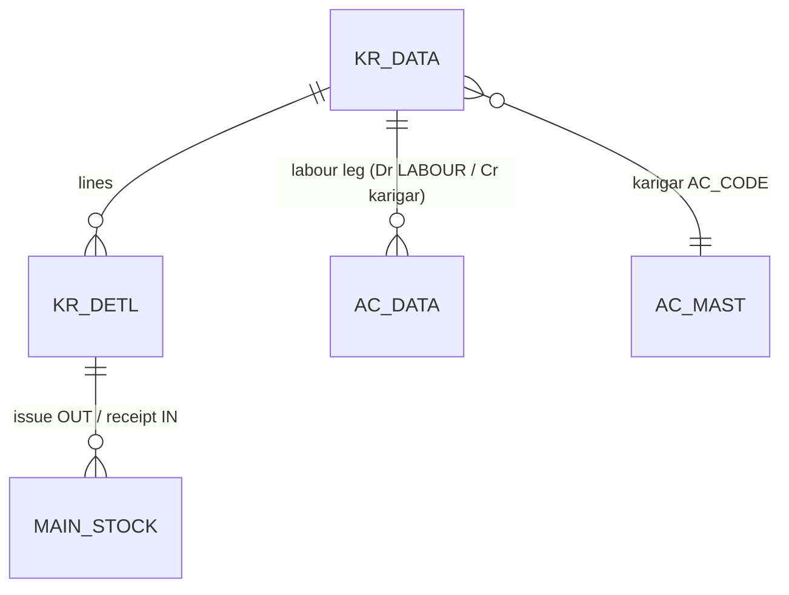

# TR_KR_ISU — Karigar (goldsmith) Issue / Receive (deep-dive)

```
Form: TR_KR_ISU  ·  Module: 5_Manufacturing  ·  Type: transaction (metal-flow + labour ledger)
Desktop source: unified/src/csharp/DataCareNext/TR_KR_ISU.cs (~5.3k lines) + MS_UPDATE.cs (fine formula) + Ac_Stock.cs
Web target: apps/api/src/modules/manufacturing/karigar.ts · apps/web/app/(app)/txn/karigar-{issue,receive}
Requirements: Req 16.1 (karigar issue/receive), Req 16.3 (balance), Req 12 (fine/wastage), Req 13 (labour ledger)
Parity: 06_Parity/manufacturing.md   ·   Status: 🟩 BUILT (karigar.ts) — the only real-data anchor in this module
Evidence: spec project-memory/parity/spec-mfg.md §1.1; audit project-memory/parity/audit-C-mfg-dhrn.md #3/#G1
```

## 1. Purpose & business context

The classic **out-work** voucher: the shop issues **raw fine metal OUT** to a karigar (goldsmith), who
returns **finished ornaments IN**. Unlike the process pipeline (§`TR_MFG_ISU_REC`), this is _one issue
→ one receive → one party_ with no stage chain. Wastage is folded into the accountable fine **on
receipt**. The karigar's standing metal position is `Σ fine issued − Σ fine received` per karigar per
`CO/YEAR` (**Req 16.3**). The only money posted is **labour paid** to the karigar (Dr LABOUR / Cr
karigar). Books: `KARIGAR ISSUE` (issue) and `KARIGAR RECEIPT` (receive). This is the only part of the
module with **migrated real data** (`KR_DATA` 17 rows, `KR_DETL` 22 rows). _(src: `TR_KR_ISU.cs#L4458`
`FormBookInOut = DC_Main.CurBookInOut`; audit-C §0.)_

## 2. UI / UX specification

```
┌─ TR_KR_ISU ─ Karigar <Issue|Receipt> ──────────────── [New][Save F2][Delete][Print][Close] ┐
│ VchNo:[____]  Date:[__/__/____]  Karigar Ac:[AC_CODE ▾][name…]  Ref:[____]                    │
│ ┌ Lines (KR_DETL) ─────────────────────────────────────────────────────────────────────────┐│
│ │ # │ Item │ Pcs │ GrWt │ OthWt │ NetWt │ Touch │ West% │ Fine │ LbrType │ LbrRate │ LbrAmt  ││
│ │ 1 │ …    │     │      │       │       │       │ (rec) │ calc │         │         │         ││
│ └────────────────────────────────────────────────────────────────────────────────────────────┘│
│ Settle (receipt): Net[..] Cash[..] Chq[..] Kasar[..] OS[..]   Totals → Fine:[..] Lbr:[..]       │
└──────────────────────────────────────────────────────────────────────────────────────────────────┘
```

| Label | Column (`KR_DATA`/`KR_DETL`) | Type | Req | Notes |
|---|---|---|---|---|
| Vch No / Date | `VCH_NO` / `VCH_DATE` | auto/date | ✓ | scope numbering; lock-date guard |
| Karigar Ac | `AC_CODE` | lookup→`AC_MAST` | ✓ | the goldsmith |
| In/Out | `INOUT_TYPE` | char | auto | **issue=`O`, receipt=`I`** (`KR_DETL`) |
| Item | `IT_CODE` | lookup→`ITEM_MAST` | ✓ | |
| Pcs / GrWt / NetWt | `ITM_PCS`/`ITM_GWT`/`ITM_NWT` | float | ✓ | |
| Touch / West% | `ITM_TOUCH`/`ITM_WEST_PRC` | % | ✓ | West% only on receipt |
| Fine | `ITM_FINE` | auto | — | issue: `NWT×touch/100`; receipt: `NWT×(touch+west)/100` |
| Labour | `LBR_TYPE`/`LBR_RATE`/`LBR_AMT` | — | — | paid to karigar on receipt |
| Party fine (hdr) | `PARTY_FINE` | wt | auto | Σ line fine |

Modes: New / Edit (delete-then-repost) / View / Delete (`USER_DELETE`) / Print (`KrIsuBill.rpt`,
`KrRecVch.rpt`). F2 = Save.

## 3. Data model touched

**Writes:** `KR_DATA` (header), `KR_DETL` (lines), `MAIN_STOCK` (issue OUT `TR_TYPE='O'`/sign `-`;
receipt IN `TR_TYPE='I'`/sign `+`), `AC_DATA` (labour leg only). _(Desktop also writes `ROJ_MEL_DATA`
day-book, `MFG_ISU_REC`, `TAX_DATA`, `DM_DATA`, `BAR_DETL/IDTL` for tagged pieces, `TEMP_BOOK_DATA`,
`REMARK_DATA` — `TR_KR_ISU.cs#L5179-L5329`; web writes a subset, audit-C §G11.)_
**Reverses:** `KR_DATA, KR_DETL, AC_DATA, MAIN_STOCK` + `DELETE_DATA`.

Table refs: [KR_DATA](../../02_Data_Model/tables/KR_DATA.md) ·
[KR_DETL](../../02_Data_Model/tables/KR_DETL.md) ·
[MAIN_STOCK](../../02_Data_Model/tables/MAIN_STOCK.md) ·
[AC_DATA](../../02_Data_Model/tables/AC_DATA.md).



## 4. Business logic & calculations (with code)

### 4.1 Fine — issue vs receipt (web — `karigar.ts`, pure)
```ts
// issue side: pure fine
export function fineWeight(nwt, touch) { return round3((nwt * touch) / 100); }
// receipt side: wastage folded in — MS_UPDATE.cs parity
export function fineWithWastage(nwt, touch, westPct) { return round3((nwt * (touch + westPct)) / 100); }
```
**Confirmed parity:** real `KR_DETL` row `19.720 × (97+0)/100 = 19.128` ✓ (audit-C §3). The
`NWT × (touch + west)/100` shape is the desktop `MS_UPDATE` rule and the same wastage-into-fine
principle the process form applies via `fineWithGhat`.

### 4.2 Karigar balance — Req 16.3
```ts
// src: karigar.ts karigarBalance + balanceTx
export function karigarBalance(issuedFine, receivedFine) { return round3(issuedFine - receivedFine); }
// balanceTx: SELECT INOUT_TYPE, SUM(ITM_FINE) FROM KR_DETL WHERE AC_CODE=$1 AND CO_CODE=$2 GROUP BY INOUT_TYPE
//   issued   = Σ ITM_FINE where INOUT_TYPE = 'O'   (issue)
//   received = Σ ITM_FINE where INOUT_TYPE = 'I'   (receipt)
//   balance  = issued − received    (> 0 ⇒ karigar still owes fine)
```
The `INOUT_TYPE` convention is **issue=`O`, receipt=`I`** — verified against the migrated Next24 data
(`KARIGAR ISSUE | O | -` × 1, `KARIGAR RECEIPT | I | +` × 21) and the desktop write
`INOUT_TYPE = FormBookInOut`. _(src: `TR_KR_ISU.cs#L5159`; `karigar.ts` `INOUT_ISSUE='O'`/`INOUT_RECEIPT='I'`.)_

### 4.3 Labour ledger (web)
```ts
// receipt only, when labourAmt > 0 — balanced pair:
[{ ...key, AC_CODE: 'LABOUR', DR_AMT: labourAmt, SIGN: 'D' },
 { ...key, AC_CODE: karigarAc, CR_AMT: labourAmt, SIGN: 'C' }]
// + a metal sub-ledger AC_DATA leg: IT_TYPE 'G', SIGN '-'(issue)/'+'(receipt), FINE_WT = fine
```
Issue posts a metal-only `AC_DATA` leg (`IT_TYPE='G'`, `SIGN='-'`, `FINE_WT=fineIssued`); receipt posts
the labour pair **plus** a `+` metal leg (`FINE_WT=PARTY_FINE`). _(src: `karigar.ts` `issueKarigar`/`receiveKarigar`.)_

## 5. Save sequence

`withTenant` tx: `nextVoucherNoTx` → build `KR_DATA`/`KR_DETL`/`MAIN_STOCK` → `postVoucherTx` (ledger =
metal leg [+ labour pair on receipt]). Edit = reverse-then-repost. _(src: `karigar.ts`;
`TR_KR_ISU.cs#L5179` footprint.)_

## 6. Delete / reverse

```ts
await reverseVoucherTx(tx, tenantId, {
  tables: ['KR_DATA','KR_DETL','AC_DATA','MAIN_STOCK'],
  key, deleteLog: { table:'DELETE_DATA', row:{ ...key, VCH_TYPE, DELETE_USER } },
});
```
Requires `USER_DELETE`. _(Add `ROJ_MEL_DATA`/`MFG_ISU_REC`/tag tables when those satellite writes land.)_

## 7. API contract

```ts
// POST /txn/karigar/issue    { scope, karigarAc, karigarName?, vchDate?, lines:[{itCode,pcs,grossWt,netWt,touch}] }
//   → 201 { vchNo, fineIssued }
// POST /txn/karigar/receive  { ...issue, lines:[{...,westPct}], labourAmt?, labourAc? }
//   → 201 { vchNo, fineReceived }
// GET  /txn/karigar/:ac/balance   → { balance }       // Σ issued − Σ received
// DELETE /txn/karigar/:vchNo      (right: delete) → { reversed:true }
```
Errors: `KarigarValidationError`→400 (no karigar / no line), `ForbiddenError`→403, `PeriodLock…`→400.

## 8. Validation rules

| Rule | Condition | HTTP | req |
|---|---|---|---|
| Karigar required | no `karigarAc` | 400 | 16.1 |
| ≥1 line | empty `lines` | 400 | 16.1 |
| Period open | `VCH_DATE ≤ MsLockDt` | 400 | — |
| Labour balanced | Σ Dr ≠ Σ Cr (invariant) | 500 | 13.1 |

## 9. Parity criteria (Definition of Done)

1. `KR_DETL` fine matches: issue `NWT×touch/100`, receipt `NWT×(touch+west)/100` (3 dp) — **real-data verified**.
2. `MAIN_STOCK` direction: issue `O`/`-`, receipt `I`/`+` — **real-data verified** (audit-C §3).
3. `karigarMetalBalance` = `Σ(INOUT='O') − Σ(INOUT='I')` ITM_FINE per karigar/CO.
4. Labour pair balances; metal `FINE_WT` leg present per direction.
5. Delete reverses all four tables + `DELETE_DATA`.

## 10. Variants & edge cases

| Variant | Delta |
|---|---|
| Tagged-piece karigar | adds `BAR_DETL/BAR_IDTL` + tag print (desktop); not yet in web. |
| Stones (`DM_DATA`) | diamond/stone issue tracked separately (desktop `Kr_Isu` stone path). |
| Day-book | desktop posts `ROJ_MEL_DATA` (rojmel) — web omits (audit-C §G11). |
| `TR_REP_REC` | repairing receipt — see [`TR_REP_REC.md`](TR_REP_REC.md). |

## 11. Open questions / risks

- **Satellite footprint gap.** Web writes `KR_DATA/KR_DETL/AC_DATA/MAIN_STOCK`; desktop also writes
  `ROJ_MEL_DATA, MFG_ISU_REC, TAX_DATA, DM_DATA, BAR_DETL/IDTL, TEMP_BOOK_DATA, REMARK_DATA`
  (`TR_KR_ISU.cs#L5179-L5329`). Day-book + tag + stone parity pending.
- **Historical INOUT bug (now fixed).** An earlier web build had `INOUT_ISSUE='I'`/`RECEIPT='O'`
  (inverted), which flipped the migrated-data balance (audit-C §G1). Current `karigar.ts` declares
  `'O'`/`'I'` correctly with a verifying comment — keep it; add a regression test on the real `KR_DETL` set.
- **Rounding** — uses `Math.round`+EPSILON, not `@datacare/core` decimal HALF-UP (conventions §2).
