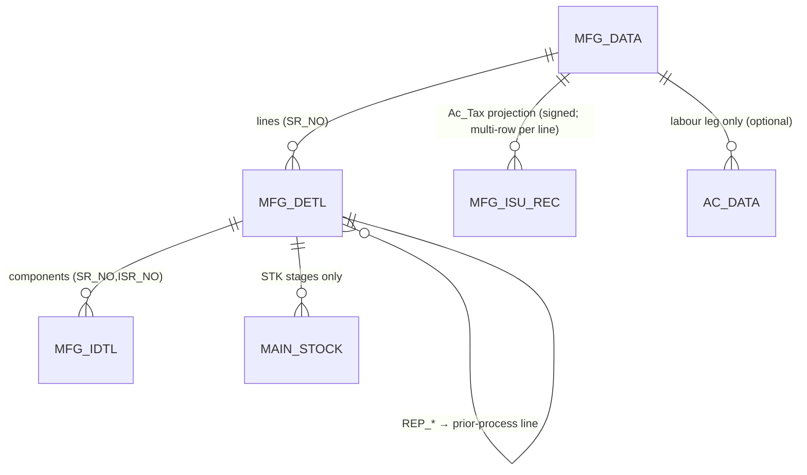
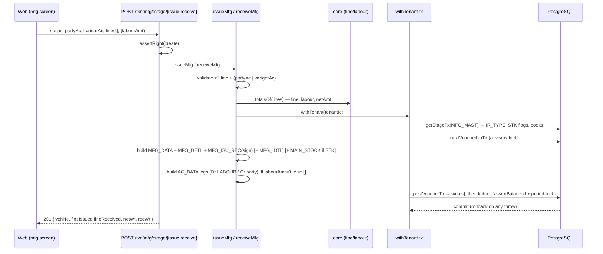

# TR_MFG_ISU_REC — Manufacturing process Issue / Receive (deep-dive)

```
Form: TR_MFG_ISU_REC (+ lot variant TR_MFG_KR_ISU_REC)  ·  Module: 5_Manufacturing  ·  Type: transaction (metal-flow; labour-only ledger)
Desktop source: unified/src/csharp/DataCareNext/TR_MFG_ISU_REC.cs (~7.9k lines) + Ac_Tax.cs (MFG_ISU_REC projection) + Ac_Stock.cs (MAIN_STOCK) + Mfg_Module.cs (MFG_MAST/book seed)
Web target: apps/api/src/modules/manufacturing/mfg.ts · apps/web/app/(app)/txn/mfg-{issue,receive}
Requirements: Req 16.1–16.4 (manufacturing/karigar), Req 12 (weight/fine/labour), Req 13 (atomic post), Req 14 (stock)
Parity: 06_Parity/manufacturing.md   ·   Status: 🟦 PARTIAL (mfg.ts engine built; MFG_MAST unseeded ⇒ pipeline inert)
Evidence: spec project-memory/parity/spec-mfg.md; audit project-memory/parity/audit-C-mfg-dhrn.md
```

## 1. Purpose & business context

This is the **work-in-progress shop floor** screen. A single physical lot of metal is **issued** to a
process (melting, ghat/casting, filing, pre-polish, mino, setting, assemble, nakshi, polish) and later
**received** back when that step is done. The same form serves both directions — the book's
`BOOK_INOUT` flag (`O`=issue/metal-out, `I`=receive/metal-in) and the `MFG_MAST` row for the chosen
`CO_BOOK` decide which. On receive, the goldsmith returns less metal than was issued; the shortfall is
attributed to recoverable scrap (`chol` filings, `ghis` polishing dust), casting-gate waste (`ghat`)
and genuine `loss`. The voucher does **not** post money to the ledger (it is a weight movement) unless
labour is settled. The "balance" that matters is per-karigar/per-lot fine reconciliation, not Dr=Cr.

Each stage is its own book (e.g. `MFG GHAT REC`, `MFG FILE ISU`). The process char is `ENTRY_TYPE`
(a.k.a. `IR_TYPE`); each stage knows its previous (`LAST_TRAN`) and next (`NEXT_TRAN`) process so the
issue screen can pull a lot's **open balance from the prior stage**. _(src: `TR_MFG_ISU_REC.cs#L5138`
`FormBookInOut = DC_Main.CurBookInOut`; `Mfg_Module.cs` `MFG_MAST` inserts.)_

> **Lot variant (`TR_MFG_KR_ISU_REC`)** is the same engine with an order/lot grid (82-col map) adding
> `ITM_LOT` (a consumed `MAIN_STOCK` lot), `ORD_*` (sales-order link) and `REC_*` (receive
> back-pointer). The live web schema is missing `ITM_LOT/LAST_IR_TYPE/REC_*` on `MFG_ISU_REC`, so the
> ghat/process variant documented here is built first; the lot variant is phase-2 (§10/§11).

## 2. UI / UX specification

### Layout
```
┌─ TR_MFG_ISU_REC ─ Mfg <Stage> <Issue|Receive> ─────── [New][Save F2][Delete][Print][Close] ┐
│ Stage/Book: [MFG GHAT REC ▾]  VchNo:[____] Date:[__/__/____] HdVch:[____]                    │
│ Party Ac:[AC_CODE ▾][name…]  Karigar:[KR_CODE ▾]  Employee:[EMP ▾]  Ref/BillNo:[____]        │
│ ┌ Detail (MFG_DETL) ───────────────────────────────────────────────────────────────────────┐│
│ │ Lot/Tag │ Item │ Design │ Pcs │ GrWt │ OthWt │ NetWt │Ght%│GhtWt│Chol│Ghis│Tch│Wst%│ Fine ││
│ │ scan…   │ …    │        │     │      │       │ calc  │    │calc │    │    │   │    │ calc ││
│ │  …more: LbrType│LbrRate│LbrAmt│OthAmt│ItRate│ItAmt│NetAmt│DmPcs│DmWt│KrName    (issue: Dif)││
│ └────────────────────────────────────────────────────────────────────────────────────────────┘│
│ ┌ Components (MFG_IDTL) ─ stones/fittings under the selected line ─────────────────────────────┐│
│ │ Item │ Pcs │ Wt │ Con% │ ConWt │ P/W │ Rate │ ItAmt │ LbrRate │ LbrAmt │ NetAmt │ Old(Y/N) ││
│ └────────────────────────────────────────────────────────────────────────────────────────────┘│
│ Labour settle (MSG2_TOTAL): NetAmt[..] Tax[..] Tot[..] Cash[..] Chq[..] Kasar[..] OS[..]        │
│ Totals → GrWt:[..] NetWt:[..] Fine:[..] Lbr:[..] Oth:[..]                                       │
└──────────────────────────────────────────────────────────────────────────────────────────────────┘
```

### Header field table (→ `MFG_DATA`)
| Label | Column | Type | Req | Default | Editable when | Notes |
|---|---|---|---|---|---|---|
| Stage/Book | `CO_BOOK` | lookup→`MFG_MAST` | ✓ | from menu | New | drives `ENTRY_TYPE`, `INOUT_TYPE`, `BOOK_NAME`(=`MAIN_BOOK`), STK flags |
| Vch No | `VCH_NO` | auto | ✓ | `MAX(VCH_NO)+1` per scope | New | `TR_MFG_ISU_REC.cs#L5743` |
| Date | `VCH_DATE` | date | ✓ | today | New/Edit | blocked outside CO year + ≤ `MsLockDt` (`#L?` lock guard) |
| Party Ac | `AC_CODE` | lookup→`AC_MAST` | ✓ | — | New/Edit | "Please Insert Party and try" if blank (`#L?`) |
| Karigar | `KR_CODE` | lookup→`AC_MAST` | — | — | New/Edit | the worker/process party |
| Employee | `EMP_CODE` | lookup→`EMP_MAST` | — | — | New/Edit | varchar(5) |
| Ref/Bill No | `BILL_NO` | string | — | =`VCH_NO` | New/Edit | |
| Vch Desc | `VCH_DESC` | string(50) | — | — | New/Edit | → `REMARK_DATA` via `Ac_Tax.Vch_Remark` |
| Totals | `GR_WT`,`NET_WT`,`FINE_WT`,`LBR_AMT`,`OTH_AMT`,`NET_AMT`,`TOT_AMT`,`CASH_AMT`,`KASAR_AMT`,`BILL_OS` | money/wt | auto | computed | — | read-only roll-ups |
| GST type | `AC_GST_TYPE` | char | auto | `'L'` | — | manufacturing = labour/no-GST; tax cols all 0 |

### Detail grid columns (→ `MFG_DETL`, one row per piece/lot)
Grid column map (from `CommPassTotal`): 10=GrWt, 11=OthWt, 12=NetWt, 13=Ght%, 14=GhtWt, 15=Chole,
16=Ghis, 19=LbrType, 20=LbrRate, 21=LbrAmt, 22=OthAmt, 23=NetAmt, 27=Touch, 28=West%, 29=Fine,
33=ItRate, 34=ItAmt. _(src: `TR_MFG_ISU_REC.cs#L3934` `CommPassTotal`; spec-mfg §2.2.)_

| Col | Column | Editable | Source / behavior |
|---|---|---|---|
| Lot/Tag | `LOT_NO` / `TAG_NO` | yes | issue: pick a lot ⇒ pre-fill from prior-process open balance (§4.5 query); generated by `ItmTagGen()` for new tags |
| Item | `IT_CODE` | yes | lookup→`ITEM_MAST` |
| Design | `DESIGN_NO` | yes | lookup→`DESIGN_MAST` |
| Pcs | `ITM_PCS` | yes | |
| GrWt / OthWt | `ITM_GWT` / `ITM_OTH_WT` | yes | OthWt = stone/other; rolls up from components |
| NetWt | `ITM_NWT` | auto | `ITM_NWT = ITM_GWT − ITM_OTH_WT` |
| Ght% / GhtWt | `ITM_GHT_PRC` / `ITM_GHT_WT` | yes/auto | `GhtWt = NetWt × Ght% / 100` |
| Chol / Ghis | `RTN_CHOL` / `RTN_GHIS` | receive only | recoverable scrap returned |
| Touch / West% | `ITM_TOUCH` / `ITM_WEST_PRC` | yes | purity / wastage % |
| Fine | `ITM_FINE` | auto | `(NetWt + GhtWt) × (Touch + West)/100`, else NetWt |
| LbrType/Rate/Amt | `LBR_TYPE`/`LBR_RATE`/`LBR_AMT` | yes/auto | by type P/N/K/default (§4.2) |
| OthAmt / NetAmt | `OTH_AMT` / `NET_AMT` | yes/auto | `NetAmt = LbrAmt + OthAmt` |
| ItRate / ItAmt | `ITM_RATE` / `ITM_AMT` | yes | metal valuation (optional) |
| Dm Pcs/Wt | `DM_PCS` / `DM_WT` | yes | diamonds carried alongside (not melted) |
| Dif (issue) | derived | auto | `DifWt = isuGwt − (NetWt+GhtWt+Chole+Ghis+Mtrl)` |

### Sub-component grid (→ `MFG_IDTL`)
`IT_CODE`, `IT_PCS`, `IT_GWT`, `IT_CON_PRC` (consumption %), `IT_CON_WT` (=`gwt×con%/100`),
`IT_RATE_TYPE` (`P`/`W`), `IT_RATE`, `IT_AMT`, `IT_LBR_RATE`, `IT_LBR_AMT`, `IT_NET_AMT`, `OLD_ITM_ISU`
(Y/N), and for setting: `RTN_PCS`/`RTN_GWT`/`BROK_PCS`/`BROK_WT`. `SR_NO` = parent `MFG_DETL.OLD_SRNO`,
`ISR_NO` = component ordinal. _(src: `CommPassTotal_Idtl()` `TR_MFG_ISU_REC.cs#L3522`.)_

### Keyboard / F-keys (desktop → web)
- **F2 = Save**; tag/lot scanner types into `LOT_NO`/`TAG_NO`; Enter adds the row.
- Issue picker on the lot field runs the prior-process balance query (§4.5); web: `LotPicker.tsx`
  bound to `GET /txn/mfg/lot/:lot/balance`.
- _(Confirm exact F-key map from `TR_MFG_ISU_REC.cs` key handlers in a golden-master pass.)_

### Modes
New / Edit (loads header+detail+components, re-saves = delete-then-repost) / View / Delete (needs
`USER_DELETE`; "Lock Date" guard blocks both save and delete) / Print (`MfgVch.rpt`, `MfgGhatRec.rpt`).

## 3. Data model touched

**Writes (create/edit):**
- `MFG_DATA` (header, 1 row) · `MFG_DETL` (one row per piece/lot) · `MFG_IDTL` (components/stones).
- `MFG_ISU_REC` — the **central metal-flow ledger**: deleted for the voucher then re-projected from
  `MFG_DETL` by the stage-specific `Ac_Tax.<Stage>_<Isu|Rec>_Mfg` (one or **several** signed rows per
  detail line, distinguished by `ISR_NO`).
- `MAIN_STOCK` — only for stock-bearing stages (`MFG_MAST.STK_ISU='Y'` or `STK_REC='Y'`): finished
  goods IN at `MFG POLISH REC`, stones/diamonds OUT at `MFG STNG ISU`.
- `TEMP_BOOK_DATA` (voucher-number reservation), `REMARK_DATA` (description), `TAG_PRINT_DATA` (tag).
- `AC_DATA` — **only** when labour/cash is settled (`MSG2_TOTAL`): a balanced Dr `LABOUR EXP (00056)` /
  Cr party pair. The bare metal movement posts **no ledger**.

**Deletes/reverses:** `MFG_DATA, MFG_DETL, MFG_IDTL, MFG_ISU_REC, MAIN_STOCK (if STK), TEMP_BOOK_DATA,
REMARK_DATA` + `DELETE_DATA` audit; also `UPDATE MFG_DETL SET REP_ADJ='N'` to free the consumed prior
lot. _(src: `TR_MFG_ISU_REC.cs#L5753-L5755` delete-then-insert; `#L6089-L6103` delete footprint.)_

Table refs: [MFG_DATA](../../02_Data_Model/tables/MFG_DATA.md) ·
[MFG_DETL](../../02_Data_Model/tables/MFG_DETL.md) ·
[MAIN_STOCK](../../02_Data_Model/tables/MAIN_STOCK.md) ·
[AC_DATA](../../02_Data_Model/tables/AC_DATA.md).



## 4. Business logic & calculations (with code)

### 4.1 Per-line weight & fine (web — `mfg.ts`, pure)
```ts
// fine = explicit override → (net+ghat)×(touch+west)/100 when touch/west present → net
export function fineWithGhat(nwt, ghtWt, touch, westPct) {
  return round3(((nwt + ghtWt) * (touch + westPct)) / 100);   // weights: 3 dp
}
function lineFine(l) {
  if (l.fineWt != null) return round3(l.fineWt);
  if (num(l.touch) === 0 && num(l.westPct) === 0) return round3(l.netWt);
  return fineWithGhat(num(l.netWt), num(l.ghtWt), num(l.touch), num(l.westPct));
}
```
Desktop `CommPassTotal` (col map in §2): `NetWt(12)=Gross(10)−Oth(11)`; `GhtWt(14)=NetWt×Ght%(13)/100`;
`Fine(29)=(NetWt+GhtWt)×(Touch(27)+West(28))/100` (else `=NetWt`). _(src:
`TR_MFG_ISU_REC.cs#L3934` `CommPassTotal()`; spec-mfg §2.2 — formula transcribed from the verified grid map.)_

> **This is the wastage-into-fine rule (Req 16.x / MS_UPDATE parity)**: wastage `West%` and casting-gate
> `Ght%` are *added before dividing by 100*, so the accountable fine already carries the wastage —
> the exact analogue of karigar's `NWT × (touch + west)/100`.

### 4.2 Labour by type (web — `mfg.ts`, pure)
```ts
export function labourAmount(type, { pcs, net, ghtWt, gross, lbrRate }) {
  const rate = num(lbrRate);
  switch (type) {
    case 'P': return round2(num(pcs) * rate);                       // per piece
    case 'N': return round2((num(net) + num(ghtWt)) * rate);        // per (net+ghat) gram
    case 'K': return round2(((num(net) + num(ghtWt)) * rate) / 1000); // per (net+ghat) fine /1000
    default:  return round2(num(gross) * rate);                     // else per gross gram
  }
}
// NetAmt = labour + other
function lineNetAmt(l) { return round2(lineLbrAmt(l) + num(l.othAmt)); }
```
Desktop `CommPassTotal` labour switch on `col19` (`P`/`N`/`K`/default) → `col21` LbrAmt, `col23`
NetAmt = `col21 + col22`. _(src: `TR_MFG_ISU_REC.cs#L3934`; spec-mfg §2.2.)_

### 4.3 The reconciliation formula — RecWt (the heart of the module)
On **receive**, the accountable received weight per line/lot is:
```
RecWt = IR_WT + RTN_CHOL + RTN_GHIS + ITM_GHAT + ITM_LOSS
```
and the **open balance** for a lot at a process is `Σ issued IR_WT − Σ received RecWt` (`> 0` ⇒ still
outstanding). **Verbatim desktop SQL** (issue book, `FormBookInOut='O'`):
```sql
-- src: TR_MFG_ISU_REC.cs#L5372  (BtnSave/lot-balance grid fill)
SELECT A.LOT_NO, B.IT_CODE, B.IT_NAME As Name,
  SUM(CASE WHEN ITM_SIGN = '-' THEN IR_WT ELSE 0 END) As IsuWt,
  SUM(CASE WHEN ITM_SIGN = '+' THEN (IR_WT+RTN_CHOL+RTN_GHIS+ITM_GHAT+ITM_LOSS) ELSE 0 END) As RecWt,
  SUM(CASE WHEN ITM_SIGN = '-' THEN IR_WT ELSE 0 END)
  - SUM(CASE WHEN ITM_SIGN = '+' THEN (IR_WT+RTN_CHOL+RTN_GHIS+ITM_GHAT+ITM_LOSS) ELSE 0 END) As DifWt
FROM MFG_ISU_REC ...
```
The metal-IN variant (`FormBookInOut='I'`, `#L5376`) issues `IR_WT+(ITM_GWT−ITM_NWT)` (adds back the
stone/other weight). A **process-stage variant** (`#L4565`) reconciles *consecutive stages* instead of
sign: `SUM(IR_TYPE=LastProcess THEN IR_WT+DM_WT) − SUM(IR_TYPE=CurProcess THEN IR_WT)`.

Web (pure + the live query):
```ts
// src: mfg.ts  (recWt + mfgLotBalance)
export function recWt({ irWt, rtnChol, rtnGhis, itmGhat, itmLoss }) {
  return round3(num(irWt) + num(rtnChol) + num(rtnGhis) + num(itmGhat) + num(itmLoss));
}
export function lotBalance(issuedWt, recWtTotal) { return round3(issuedWt - recWtTotal); }
// mfgLotBalance(): SUM(ITM_SIGN='-' THEN IR_WT) − SUM(ITM_SIGN='+' THEN IR_WT+RTN_CHOL+RTN_GHIS+ITM_GHAT+ITM_LOSS)
```
This is **confirmed parity** — the desktop expression and `recWt`/`mfgLotBalance` are byte-identical in
column set and arithmetic (audit-C §3, §1).

### 4.4 The `MFG_ISU_REC` projection (Ac_Tax — the signed metal ledger)
After writing `MFG_DETL`, the form deletes `MFG_ISU_REC` for the voucher and re-projects it via the
stage-specific `Ac_Tax.<Stage>_<Isu|Rec>_Mfg(book, vchNo)`, gated by company flags
`MsMfgWithLedger='Y' AND MsMfgOneFormEntry='Y'`. Each projection is an
`INSERT INTO MFG_ISU_REC (…61 cols…) SELECT … FROM MFG_DETL A LEFT JOIN BOOK_DATA B LEFT JOIN ITEM_MAST C
WHERE B.MAIN_BOOK=<book> AND A.ENTRY_TYPE=<IR_TYPE> AND ITM_GWT<>0`.

**Issue stages** emit `ITM_SIGN='-'`, `IR_WT=ITM_NWT`, scrap cols `0`. **Ghat Issue** is special — it
emits **three rows per line** (`ISR_NO` 1/2/3): a `+`/`IR_TYPE='L'` gross row (the incoming melt lot),
a `-` gold net row, and a `-` non-gold/diamond row. _(src: `Ac_Tax.cs#L349` `Ghat_Isu_Mfg`.)_

**Receive stages** emit `ITM_SIGN='+'` and fill the scrap columns. Verbatim shape (Ghat receive):
```sql
-- src: Ac_Tax.cs#L362  Ghat_Rec_Mfg → INSERT INTO MFG_ISU_REC(... ITM_SIGN,IR_TYPE, IR_WT, ... RTN_CHOL,RTN_GHIS,ITM_GHAT,...,RTN_MTRL ...)
SELECT ..., '+', A.ENTRY_TYPE, A.ITM_NWT /*IR_WT*/, ..., A.ITM_FINE, 0,0,0,
  RTN_CHOL, 0, RTN_GHIS, ITM_GHT_WT+DM_GHT /*ITM_GHAT*/, 0, 0, A.MTRL_WT /*RTN_MTRL*/, ...
  A.REP_YRCD, A.REP_DBCD, A.REP_NO, A.REP_SRNO, A.REP_AC_CODE /*IR back-pointer*/, ...
FROM MFG_DETL A ... WHERE B.MAIN_BOOK='MFG GHAT REC' AND A.ENTRY_TYPE='G' AND ITM_GWT<>0
```
Simpler stages set `ITM_GHAT = ITM_GHT_WT` (no `+DM_GHT`), e.g. `Filling_Rec_Mfg`/`PrePolish_Rec_Mfg`.
_(src: `Ac_Tax.cs` `Filling_Rec_Mfg`, `PrePolish_Rec_Mfg`, `Setting_Isu_Mfg` `#L419`.)_

Web simplification (current `mfg.ts isuRecRows`): **one** `MFG_ISU_REC` row per detail line, sign
`-`/`+`, scrap filled on receive. This matches single-component lines but **not** the multi-row
Ghat/Setting cases — see §11.
```ts
// src: mfg.ts isuRecRows (trimmed)
{ ...key, SR_NO: idx+1, ISR_NO: 1, ITM_SIGN: isReceipt ? '+' : '-', IR_TYPE: ctx.irType,
  IR_WT: num(l.netWt), ITM_FINE: lineFine(l),
  RTN_CHOL: isReceipt ? num(l.rtnChol) : 0, RTN_GHIS: isReceipt ? num(l.rtnGhis) : 0,
  ITM_GHAT: isReceipt ? (l.itmGhat ?? num(l.ghtWt)) : 0, ITM_LOSS: isReceipt ? num(l.itmLoss) : 0,
  RTN_MTRL: isReceipt ? num(l.mtrlWt) : 0, DATA_TYPE: 'M' }
```

### 4.5 Prior-process lot picker (read path on issue)
On an issue book, picking a lot pre-fills weights from the prior stage's open balance — the same §4.3
reconciliation grouped by `LOT_NO, IT_CODE`, `HAVING DifWt > 0`. _(src: `TR_MFG_ISU_REC.cs#L5287`
`AcData_Fill` / `#L4561` `KrData_Fill`.)_

### 4.6 Stock & labour posting
- `MAIN_STOCK`: `Ac_Stock.Mfg_Stk` posts final goods IN for `STK_REC='Y'` lines (Polish Rec);
  `Ac_Stock.Mfg_DM_Stk_Less` posts stones OUT for Setting Issue. _(src: `TR_MFG_ISU_REC.cs#L6028,#L6034`.)_
- Web posts `MAIN_STOCK` (`TR_TYPE 'I'/'O'`, sign `+`/`-`) when `stage.stkRec/stkIsu==='Y'`.
- Labour: web `receiveMfg` posts `Dr LABOUR / Cr party` when `labourAmt>0`, else empty ledger
  (`postVoucherTx` still runs for the atomic multi-table write + period-lock).

## 5. Save sequence (create / edit)

Edit = reverse-then-repost in **one** transaction (desktop deletes the voucher rows then re-inserts).
Desktop order (`BtnSave_Click`): (1) validations (licence, party, vchNo, year/lock-date); (2)
`MSG_TOT_FILL` totals; (3) re-check `VCH_NO` collision; (4) **DELETE** `MFG_DATA`/`MFG_DETL`/`MFG_IDTL`
for the key; (5) `TEMP_BOOK_DATA` reservation; (6) insert `MFG_DATA` header; (7) insert `MFG_DETL`
lines; (8) insert `MFG_IDTL` components; (9) **DELETE** `MFG_ISU_REC` then `Ac_Tax.<Stage>_<dir>_Mfg`
re-projection; (10) `MAIN_STOCK` via `Ac_Stock.Mfg_*` for STK stages; (11) `Ac_Tax.Vch_Remark`.
_(src: `TR_MFG_ISU_REC.cs#L5662` `BtnSave_Click`; `#L5753-L5755` deletes; `#L5787` header
`INOUT_TYPE=FormBookInOut`; `#L5966` `DELETE MFG_ISU_REC`; `#L5970-L6022` Ac_Tax dispatch; `#L6028,#L6034`
Ac_Stock; `#L6036` Vch_Remark.)_

Web rule (`mfg.ts issueMfg`/`receiveMfg`) — all inside one `withTenant` tx:



Numbered (web): (1) `totalsOf`; (2) `getStageTx`; (3) `nextVoucherNoTx`; (4) build header/detail/
components; (5) project `MFG_ISU_REC` rows (sign by direction); (6) `MAIN_STOCK` if stage bears stock;
(7) optional labour ledger; (8) `postVoucherTx` writes everything atomically. _(src: `mfg.ts`
`issueMfg`, `receiveMfg`.)_

## 6. Delete / reverse (Req 13.4)

```ts
// src: mfg.ts deleteMfg
await reverseVoucherTx(tx, tenantId, {
  tables: ['MFG_DATA','MFG_DETL','MFG_IDTL','MFG_ISU_REC','MAIN_STOCK','AC_DATA'],
  key,
  deleteLog: { table:'DELETE_DATA', row: { ...key, VCH_TYPE: input.vchType, DELETE_USER } },
});
```
One transaction; requires `USER_DELETE`; blocked when `VCH_DATE ≤ MsLockDt`. Desktop also
`UPDATE MFG_DETL SET REP_ADJ='N'` on the parent line to free the consumed prior-process lot, and
deletes `TEMP_BOOK_DATA`/`REMARK_DATA`. _(src: `TR_MFG_ISU_REC.cs#L6089` `INSERT DELETE_DATA`,
`#L6091` `UPDATE MFG_DETL`, `#L6095-L6103` delete set — add `REP_ADJ` reset + `TEMP_BOOK_DATA`/
`REMARK_DATA` to the web reverse for full parity, see §11.)_

## 7. API contract

```ts
// POST /txn/mfg/:stage/issue   ·   POST /txn/mfg/:stage/receive   (right: create)
interface MfgIssueBody {
  scope: { coCode; lcCode; coYear?; coBook };   // coBook = the stage book; tenantId from session
  partyAc?: string; karigarAc?: string;          // ≥1 required
  empCode?: string; vchDate?: string; billNo?: string; vchDesc?: string;
  irType?: string;                               // overrides MFG_MAST.ENTRY_TYPE if stage unseeded
  postStock?: boolean;                           // force MAIN_STOCK when stage flags absent
  lines: Array<{
    itCode?; lotNo?; tagNo?; designNo?; pcs?; grossWt?; othWt?; netWt; touch; westPct?;
    ghtPct?; ghtWt?; fineWt?;                     // weights
    rtnChol?; rtnGhis?; itmGhat?; itmLoss?; mtrlWt?; mtrlItCode?;  // receive scrap
    dmPcs?; dmWt?; lbrType?; lbrRate?; lbrAmt?; othAmt?; itRate?; itAmt?; netAmt?;
    repYrcd?; repDbcd?; repNo?; repSrno?; repAcCode?;             // pipeline back-pointer (receive)
    components?: Array<{ itCode?; pcs?; grossWt?; conPct?; conWt?; rateType?; rate?; lbrRate?;
                         oldItmIsu?; rtnPcs?; rtnWt?; brokPcs?; brokWt? }>;
  }>;
}
// receive adds: labourAmt?, labourAc?, cashAmt?, kasarAmt?, billOs?
// → 201 issue:   { vchNo:number, fineIssued:number, netWt:number }
//   201 receive: { vchNo:number, fineReceived:number, recWt:number, netWt:number }

// GET    /txn/mfg/lot/:lot/balance?itCode=  (any auth)  → { balance:number }   // §4.3
// GET    /txn/mfg/stages                    (any auth)  → MFG_MAST[]
// DELETE /txn/mfg/:stage/:vchNo             (right: delete) → { reversed:true }
```
Errors: `MfgValidationError`→400 (no line / no party / labour without party), `ForbiddenError`→403,
`PeriodLock…`→400, `UnbalancedError`→500 (only reachable if a labour leg is mis-built — invariant).
RBAC: `assertRight('create')` on issue/receive, `assertRight('delete')` on delete.

## 8. Validation rules

| Rule | Condition | Desktop message | HTTP | req |
|---|---|---|---|---|
| Party required | no `AC_CODE` | "Please Insert Party and try" | 400 | 16.1 |
| Vch No present | no `VCH_NO` | "Please Insert VchNo and try" | 400 | 9 |
| ≥1 line | empty `lines` | — (web `MfgValidationError`) | 400 | 16.1 |
| Party or karigar | neither `partyAc` nor `karigarAc` | — | 400 | 16.1 |
| Date in CO year | `VCH_DATE` outside `MCo_OpDate..MCo_ClDate` | "Voucher Date Not In Current Year" | 400 | — |
| Period open | `VCH_DATE ≤ MsLockDt` | "Lock Date is = …" | 400 | — |
| Bank for cheque | `MSG2_TOTAL` chq amt≠0 & no bank ac | "Please Select Bank Account…" | 400 | — |
| Edit right | edit without `USER_UPDATE`/`UserEdit` | "You Have No Rights" | 403 | 6 |
| Labour needs party | `labourAmt>0` & no party/karigar | — | 400 | 16.x |
| Balanced labour leg | Σ Dr ≠ Σ Cr (invariant) | — | 500 | 13.1 |

_(src: validation guards `TR_MFG_ISU_REC.cs#L5662+` `BtnSave_Click`; web `mfg.ts` `MfgValidationError`.)_

## 9. Parity criteria (Definition of Done)

1. For a desktop process voucher's inputs, the web persists the **same** `MFG_DATA`+`MFG_DETL`
   (+`MFG_IDTL`) rows: `GR_WT/NET_WT/FINE_WT`, per-line `ITM_FINE`, `LBR_AMT`, `NET_AMT`, scrap cols.
2. `MFG_ISU_REC` rows match the desktop **sign + weight** columns (`ITM_SIGN`, `IR_WT`, `RTN_CHOL`,
   `RTN_GHIS`, `ITM_GHAT`, `ITM_LOSS`, `IR_TYPE`) — including the **multi-row** Ghat/Setting shape.
3. `mfgLotBalance(lot)` reproduces `Σ issued − Σ received` to **3 dp**; a fully-worked lot nets ≈ 0.
4. Finished goods enter `MAIN_STOCK` (`TR_TYPE='I'`, sign `+`) in the **same tx** as the `MFG POLISH REC`
   receive (Req 16.4); stones leave at `MFG STNG ISU`.
5. Manufacturing posts **no `AC_DATA`** unless labour is settled; when it is, the Dr LABOUR/Cr party pair
   balances (confirmed-parity: desktop has no AC_DATA write in the bare save — audit-C §3).
6. Delete removes every written row by key + writes `DELETE_DATA` + resets `REP_ADJ`.

Fixtures: load a desktop golden `MFG_*` set, diff `MFG_ISU_REC`; tracked in `06_Parity/manufacturing.md`.
**Runtime status:** all `MFG_*` tables are 0-row today ⇒ parity is currently **code-level only**
(both sides cited); end-to-end row diff is CANNOT-VERIFY until a voucher is posted or a golden set
loaded (audit-C §4).

## 10. Variants & edge cases — the full stage chain

Every stage reuses this engine; the **book** + `MFG_MAST` row is the only difference. Seed values
(verbatim from `Mfg_Module.cs` `Mfg_With_Order()` — `CO_BOOK`, `BOOK_SNAME`, `LAST_TRAN`, `ENTRY_TYPE`,
`NEXT_TRAN`, `STK_ISU`, `STK_REC`, `MAIN_BOOK`):

| CO_BOOK | Short | LAST | ENTRY | NEXT | STK_ISU | STK_REC | MAIN_BOOK |
|---|---|---|---|---|---|---|---|
| 300 | MTLIS | X | X | X | **Y** | N | METAL ISU |
| 300 | MLTNG | L | L | G | N | N | MLT PRO |
| 301 | DISIS | X | D | W | N | N | DESIGN ISU |
| 302 | WXREC | D | W | C | N | N | MFG WEX REC |
| 303 | CSTIS | W | C | C | N | N | MFG CAST ISU |
| 304 | CSTRC | C | C | F | N | N | MFG CAST REC |
| 305 | FILIS | C | F | F | N | N | MFG FILE ISU |
| 306 | FILRC | F | F | R | N | N | MFG FILE REC |
| 307 | PREIS | F | R | R | N | N | MFG PREP ISU |
| 308 | PRERC | R | R | M | N | N | MFG PREP REC |
| 309 | MNOIS | R | M | M | N | N | MFG MINO ISU |
| 310 | MNORC | M | M | S | N | N | MFG MINO REC |
| 311 | STNIS | M | S | S | N | N | MFG STNG ISU |
| 312 | STNRC | S | S | A | N | N | MFG STNG REC |
| 313 | ASMIS | S | A | A | N | N | MFG ASMBL ISU |
| 314 | ASMRC | A | A | N | N | N | MFG ASMBL REC |
| 315 | NKSIS | A | N | N | N | N | MFG NAKSHI ISU |
| 316 | NKSRC | N | N | P | N | N | MFG NAKSHI REC |
| 317 | POLIS | N | P | P | N | N | MFG POLISH ISU |
| 318 | POLRC | P | P | X | N | **Y** | MFG POLISH REC |

_(src: `Mfg_Module.cs#L71-L155` `INSERT INTO MFG_MAST(...)`. Only `300 METAL ISU` (`STK_ISU=Y`) and
`318 MFG POLISH REC` (`STK_REC=Y`) bear `MAIN_STOCK`.)_ `BOOK_IDTL` seeds the contra accounts: issue
books `CASH ON HAND (00001)`; receive books `CASH ON HAND (00001)` + `PURCHASE GOLD A/C (00008)` +
`LABOUR EXP A/C (00056)`; `MLT PRO` adds `KASAR AVAK A/C (00042)`. _(src: `Mfg_Module.cs#L80-L155`.)_

| Variant | Delta vs this form |
|---|---|
| `TR_MFG_KR_ISU_REC` | Lot/order grid: adds `ITM_LOT` (consumed `MAIN_STOCK` lot), `ORD_*` (order link), `REC_*`; writes `LOT_DETL`. Needs `MFG_ISU_REC.ITM_LOT/LAST_IR_TYPE/REC_*` (absent in web schema). |
| `TR_MFG_GHAT_REC` | Ghat (cast-gate) receive: multi-row `MFG_ISU_REC` (`+L` gross / `-` net / `-` DM); `ITM_GHAT=ITM_GHT_WT+DM_GHT`. See [`TR_MFG_GHAT_REC.md`](TR_MFG_GHAT_REC.md). |
| `TR_MFG_ORD_ISU` | Design issue against a sales order; flips `SL_ORD_DETL.DESIGN_ISU='Y'`. See [`TR_MFG_ORD_ISU.md`](TR_MFG_ORD_ISU.md). |
| `TR_MFG_ORD_REC` | Final receive against order; writes `MFG_ASMBL_DETL` + finished `MAIN_STOCK`. See [`TR_MFG_ORD_REC.md`](TR_MFG_ORD_REC.md). |
| `TR_MFG_WITH_LOT` | Lot-merge UI; consumes untagged `MAIN_STOCK` lots; writes `LOT_DETL`. See [`TR_MFG_WITH_LOT.md`](TR_MFG_WITH_LOT.md). |
| `TR_MFG_ITEM` | Item-level (non-process) issue/receive; `LOT_DETL` via `Ac_Stock.Itm_Mfg_Lot`. |
| `TR_REP_REC` / `TR_JDT_REC` | Repairing/jadtar receipt: also posts money (`AC_DATA`), `ROJ_MEL_DATA`, `TAX_DATA`. See [`TR_REP_REC.md`](TR_REP_REC.md). |

## 11. Open questions / risks

- **`MFG_MAST` is unseeded (0 rows)** — `getStageTx` returns null, so the web defaults `IR_TYPE='G'` and
  the LAST/ENTRY/NEXT/STK pipeline is inert. Seed it (§10 table) before any pipeline behaviour works.
- **Single-row vs multi-row `MFG_ISU_REC`** — web `isuRecRows` emits one row/line; desktop Ghat &
  Setting emit 2–3 rows (`ISR_NO` 1/2/3, mixing `+`/`-` and gold/diamond). Build the multi-row
  projection for those stages (Ac_Tax `Ghat_*`/`Setting_*`) or lot-fine balances will drift (audit-C §G9).
- **Consecutive-stage reconciliation** (`#L4565`) not implemented in `mfgLotBalance` (only the sign-based
  variant). Needed for the order+lot pipeline.
- **Schema gaps** — `MFG_ISU_REC` lacks `ITM_LOT, LAST_IR_TYPE, REC_YRCD/DBCD/NO/SRNO, CON_PRC`; required
  for `TR_MFG_KR_ISU_REC`/`TR_MFG_WITH_LOT`. Add via migration behind a flag (spec-mfg §5).
- **Table-ref width** — `02_Data_Model/tables/MFG_DETL.md` is an *older DDL* (62 cols, has `KR_JDT_WT`,
  lacks `RTN_CHOL/RTN_GHIS/MTRL_*/DM_*/ORD_*/FTNG_*`). The live PG schema is wider (91 cols, per
  spec-mfg §5) and the web writer + `Ac_Tax` 61-col `MFG_ISU_REC` insert use it. Regenerate the table
  refs from live PG before treating the DDL column list as authoritative.
- **Rounding** — `mfg.ts` uses `Math.round((n+EPSILON)*10^dp)` not `@datacare/core` decimal HALF-UP.
  Weights are positive so results usually agree, but migrate for guaranteed parity (conventions §2).
- **Reverse parity** — add `UPDATE MFG_DETL SET REP_ADJ='N'` + `TEMP_BOOK_DATA`/`REMARK_DATA` deletes to
  `deleteMfg` (desktop `#L6091-L6103`).
- Confirm exact desktop F-key map and the `MsMfgWithLedger`/`MsMfgOneFormEntry`/`MsMfgWithOrder`/
  `MsMfgWithLot` company-flag matrix in a Docker golden-master pass.
