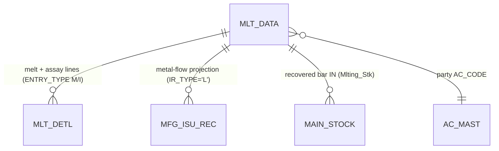
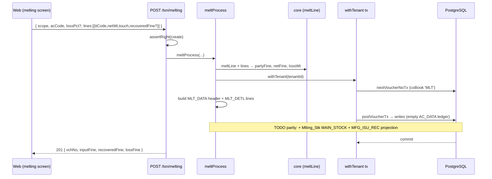

# TR_MLT_PRO — Melting / Refining (deep-dive)

```
Form: TR_MLT_PRO  ·  Module: 5_Manufacturing  ·  Type: transaction (metal-flow; no money ledger)
Desktop source: unified/src/csharp/DataCareNext/TR_MLT_PRO.cs (~4.5k lines) + Ac_Stock.cs (Mlting_Stk) + Ac_Tax (MFG_ISU_REC)
Web target: apps/api/src/modules/manufacturing/melting.ts · apps/web/app/(app)/txn/melting
Requirements: Req 16.2 (melting purity/fine), Req 12.1 (fine), Req 14 (stock)
Parity: 06_Parity/manufacturing.md   ·   Status: 🟦 PARTIAL (melting.ts; MLT_DATA/MLT_DETL only — stock/MFG_ISU_REC not yet written)
Evidence: spec project-memory/parity/spec-mfg.md §G10; audit project-memory/parity/audit-C-mfg-dhrn.md #4
```

## 1. Purpose & business context

The **refinery** step that opens the pipeline. Scrap, old ornaments and broken pieces are melted into
pure metal (a bar/lot). Per input line the screen computes the **input fine** (`PARTY_FINE = NWT ×
touch/100`), the operator enters/assays the **recovered fine** (`NET_FINE`), and the difference is the
**melting loss** (`LOSS_WT = PARTY_FINE − NET_FINE`). It is a pure metal movement: it writes
`MLT_DATA`/`MLT_DETL`, then (desktop) projects a `MFG_ISU_REC` row and posts the recovered bar into
`MAIN_STOCK`. No money ledger. The output bar becomes the lot that the `MLT PRO`→`GHAT ISU` stage
issues to casting. Uses book **`MLT PRO`** (`CO_BOOK 300`, `IR_TYPE='L'`). _(src: `TR_MLT_PRO.cs`;
`Mfg_Module.cs#L79` seeds `MLT PRO` as `L,L,G`.)_

## 2. UI / UX specification

### Layout
```
┌─ TR_MLT_PRO ─ Melting Work ─────────────────────────── [New][Save F2][Delete][Print][Close] ┐
│ VchNo:[____]  Date:[__/__/____]   Party Ac:[AC_CODE ▾][name…]   Lot No:[auto/scan]            │
│ ┌ Main melt grid (MLT_DETL ENTRY_TYPE='M') ───────────────────────────────────────────────┐│
│ │ # │ Item │ ItName │ Pcs │ GrWt │ OthWt │ NetWt │ Touch │ Fine(PARTY_FINE) │ ItType        ││
│ │ 1 │ …    │        │     │      │       │ calc  │       │ calc = NWt×Tch/100│               ││
│ └────────────────────────────────────────────────────────────────────────────────────────────┘│
│ ┌ Assay/component grid (MLT_DETL ENTRY_TYPE='I') ─ recovered split + loss ────────────────────┐│
│ │ # │ Item │ … │ Touch │ PartyFine │ NetFine │ … │ LossWt │ Con% │ ConWt                      ││
│ └────────────────────────────────────────────────────────────────────────────────────────────┘│
│ Totals → InputFine:[..]  RecoveredFine(NET_FINE):[..]  Loss:[..]  NetWt:[..]                    │
└──────────────────────────────────────────────────────────────────────────────────────────────────┘
```

### Header fields (→ `MLT_DATA`)
| Label | Column | Type | Req | Default | Notes |
|---|---|---|---|---|---|
| Vch No | `VCH_NO` | auto | ✓ | `MAX+1` per scope | |
| Date | `VCH_DATE` | date | ✓ | today | CO-year + lock-date guards |
| Party Ac | `AC_CODE` | lookup→`AC_MAST` | — | — | scrap supplier / internal |
| Lot No | `LOT_NO` | string | — | `ItmTagGen()`/`tLotGen` | the output bar's working lot |
| Vch Type | `VCH_TYPE` | const | auto | `'MELT'` | |
| In/Out, Entry | `INOUT_TYPE`,`ENTRY_TYPE` | const | auto | `'M'`,`'I'`(web) | melt direction |
| Totals | `ISU_WT`,`NET_FINE` (hdr) | wt | auto | computed | input weight / recovered fine |

### Grid columns
- **Main grid** (`MLT_DETL`, `ENTRY_TYPE='M'`): `IT_CODE`(1), `IT_NAME`(2), `ITM_PCS`(3), `ITM_GWT`(4),
  `ITM_OTH_WT`(5), `ITM_NWT`(6), `ITM_TOUCH`(7), `PARTY_FINE`(8), `IT_TYPE`(11). On save:
  `NET_FINE = PARTY_FINE`, `LOSS_WT = 0` (loss is carried on the assay grid, not the main grid).
- **Assay/idtl grid** (`MLT_DETL`, `ENTRY_TYPE='I'`): `ITM_TOUCH`(5), `PARTY_FINE`(6), `NET_FINE`(6),
  `LOSS_WT`(16), `CON_PRC`, `CON_WT`. This is where the recovered split + genuine loss live.

_(src: grid→DB map `TR_MLT_PRO.cs#L4227-L4236` main grid, `#L4293-L4306` assay grid;
display `#L3954-L3983`.)_

### Keyboard / modes
F2 = Save; New / Edit (delete-then-repost) / View / Delete (`USER_DELETE`, lock-date guard) / Print
(`MtlIsu.rpt`). Same year/lock-date guards as the process form.

## 3. Data model touched

**Writes:** `MLT_DATA` (header), `MLT_DETL` (main melt lines `ENTRY_TYPE='M'` + assay/component lines
`ENTRY_TYPE='I'`), then **`MFG_ISU_REC`** (metal-flow projection), **`MAIN_STOCK`** (recovered bar IN,
`Ac_Stock.Mlting_Stk`), `TEMP_BOOK_DATA`, `REMARK_DATA`.
**Deletes/reverses:** `MLT_DATA, MLT_DETL, MFG_ISU_REC, MAIN_STOCK` + `DELETE_DATA`.
_(src: `TR_MLT_PRO.cs#L4149-L4150` delete `MLT_DATA`/`MLT_DETL`; `#L4426` `Ac_Stock.Mlting_Stk`;
`#L4427,#L4430,#L4516` delete `MFG_ISU_REC`.)_

**Web today** writes only `MLT_DATA` + `MLT_DETL` (no `MAIN_STOCK`/`MFG_ISU_REC`) — a footprint gap
(audit-C §G10). Table ref: [MAIN_STOCK](../../02_Data_Model/tables/MAIN_STOCK.md).



## 4. Business logic & calculations (with code)

### 4.1 Input fine, recovered fine, loss (web — `melting.ts`, pure)
```ts
// src: melting.ts meltLine
export function meltLine(l, lossPct = 0) {
  const partyFine = round3((num(l.netWt) * num(l.touch)) / 100);             // input fine = NWT × touch/100
  const netFine = l.recoveredFine != null ? round3(num(l.recoveredFine))      // explicit assay result
                                           : round3(partyFine * (1 - lossPct / 100)); // or input × (1−loss%)
  return { partyFine, netFine, lossWt: round3(partyFine - netFine) };         // loss = input − recovered
}
```
Desktop parity: `PARTY_FINE` is the fine column (grid col 8) and on the **main** grid
`NET_FINE = PARTY_FINE`, `LOSS_WT = 0`; the genuine loss is captured on the **assay** grid
(`LOSS_WT` = grid col 16). _(src: `TR_MLT_PRO.cs#L4229` `PARTY_FINE`, `#L4230` `NET_FINE=PARTY_FINE`,
`#L4236` main-grid `LOSS_WT=0`; `#L4306` assay-grid `LOSS_WT` from grid.)_ Real data anchor: the one
migrated MLT row computes `100 × 85/100 = 85` fine (audit-C §4).

> **Model nuance (flag):** desktop keeps `NET_FINE = PARTY_FINE` on the melt line and books loss as a
> *separate assay component line*; the web `meltLine` reduces `NET_FINE` by a *flat `lossPct`*. The
> `recoveredFine` override is the closer analogue. Reconcile the loss model before parity (§11).

### 4.2 Totals (web)
```ts
const inputFine = round3(Σ partyFine);
const recoveredFine = round3(Σ netFine);
const lossFine = round3(inputFine - recoveredFine);
const totalNwt = round3(Σ netWt);
```

### 4.3 Stock projection (desktop, to add in web)
`Ac_Stock.Mlting_Stk(book, vch)` posts the recovered bar into `MAIN_STOCK` (metal IN), and the melt is
projected into `MFG_ISU_REC` (`IR_TYPE='L'`, the start of the lot's history). _(src: `TR_MLT_PRO.cs#L4426`.)_

## 5. Save sequence (create / edit)

Desktop: validate → totals → DELETE `MLT_DATA`/`MLT_DETL` → insert header → insert main melt lines
(`ENTRY_TYPE='M'`, `NET_FINE=PARTY_FINE`, `LOSS_WT=0`) → insert assay lines (`ENTRY_TYPE='I'`, with
`LOSS_WT`) → `Ac_Stock.Mlting_Stk` (MAIN_STOCK) → DELETE+re-project `MFG_ISU_REC` → `TEMP_BOOK_DATA`/
`REMARK_DATA`. _(src: `TR_MLT_PRO.cs#L4149` onward.)_


Web (`melting.ts meltProcess`): `meltLine` per line → totals → `nextVoucherNoTx({coBook:'MLT'})` →
build `MLT_DATA`/`MLT_DETL` → `postVoucherTx` with empty ledger. _(src: `melting.ts`.)_

## 6. Delete / reverse

```ts
await reverseVoucherTx(tx, tenantId, {
  tables: ['MLT_DATA','MLT_DETL','MFG_ISU_REC','MAIN_STOCK'],   // web today: MLT_DATA/MLT_DETL only
  key, deleteLog: { table:'DELETE_DATA', row:{ ...key, VCH_TYPE:'MELT', DELETE_USER } },
});
```
One tx; requires `USER_DELETE`; blocked by lock date. Add `MFG_ISU_REC`/`MAIN_STOCK` to the web reverse
once they are written on save. _(src: `TR_MLT_PRO.cs#L4427,#L4516` delete `MFG_ISU_REC`.)_

## 7. API contract

```ts
// POST /txn/melting   (right: create)
interface MeltBody {
  scope: { coCode; lcCode; coYear?; coBook? };  // coBook forced to 'MLT'; tenantId from session
  acCode?: string; acName?: string; lossPct?: number; vchDate?: string;
  lines: Array<{ itCode?: string; netWt: number; touch: number; recoveredFine?: number }>;
}
// → 201 { vchNo:number, inputFine:number, recoveredFine:number, lossFine:number }
// DELETE /txn/melting/:vchNo   (right: delete) → { reversed:true }
```
Errors: `MeltingError`→400 (no line), `ForbiddenError`→403, `PeriodLock…`→400.

## 8. Validation rules

| Rule | Condition | Desktop message | HTTP | req |
|---|---|---|---|---|
| ≥1 melt line | empty `lines` | — (`MeltingError`) | 400 | 16.2 |
| Date in CO year | outside `MCo_OpDate..MCo_ClDate` | "Voucher Date Not In Current Year" | 400 | — |
| Period open | `VCH_DATE ≤ MsLockDt` | "Lock Date is = …" | 400 | — |
| Delete right | no `USER_DELETE` | "You Have No Rights" | 403 | 6 |

## 9. Parity criteria (Definition of Done)

1. `meltLine` reproduces desktop `PARTY_FINE`/`NET_FINE`/`LOSS_WT` per line to 3 dp (`NWT×touch/100`).
2. `MLT_DATA`/`MLT_DETL` rows match (main `ENTRY_TYPE='M'` + assay `ENTRY_TYPE='I'`), incl. `LOSS_WT`
   split (assay grid), `IT_TYPE`, `CON_PRC`/`CON_WT`.
3. Recovered bar appears in `MAIN_STOCK` (metal IN) and a `MFG_ISU_REC` `IR_TYPE='L'` row exists —
   **once those writes are added** (currently a gap).
4. Loss model matches desktop (separate assay component, not a flat `lossPct`) — see §11.

Runtime: 1 web-created MLT row exists (`VCH_TYPE='MELT'`); the desktop `MLT_*` set is otherwise empty
⇒ formula verified by code + the single row, full parity CANNOT-VERIFY until a golden set loads (audit-C §4).

## 10. Variants & edge cases

| Variant | Delta |
|---|---|
| Assay split | recovered fine entered per assay component on the `ENTRY_TYPE='I'` grid; `CON_PRC/CON_WT` carry consumed-fraction. |
| Multi-metal melt | gold vs silver lines separated by `IT_TYPE`; fine/loss tracked per metal. |
| Loss as component | desktop books loss on the assay grid (`LOSS_WT`), not by reducing the melt-line `NET_FINE`. |
| Feeds `GHAT ISU` | the recovered lot (`LOT_NO`) is the input the `MLT PRO → GHAT ISU` stage issues (`IR_TYPE` `L→G`). |

## 11. Open questions / risks

- **Loss model divergence (flag).** Web reduces `NET_FINE` by a flat `lossPct`; desktop sets
  `NET_FINE = PARTY_FINE` on the melt line and books `LOSS_WT` as a separate assay component (`#L4230`,
  `#L4236`, `#L4306`). Use the `recoveredFine` override + an explicit assay grid to match.
- **Footprint gap.** Web writes only `MLT_DATA`/`MLT_DETL`; add `Ac_Stock.Mlting_Stk` (`MAIN_STOCK`),
  the `MFG_ISU_REC` `IR_TYPE='L'` projection, `TEMP_BOOK_DATA` and `REMARK_DATA` for parity (audit-C §G10).
- **Lot linkage.** Confirm `LOT_NO` generation (`ItmTagGen` vs `tLotGen`) so the melt output lot matches
  what `GHAT ISU` expects to pick from the prior-process balance.
- Confirm whether melting ever settles cash/kasar to `AC_DATA` (the `MLT PRO` book seeds
  `CASH ON HAND`/`KASAR AVAK A/C` contras — `Mfg_Module.cs#L80-L81`) in a golden-master pass.
