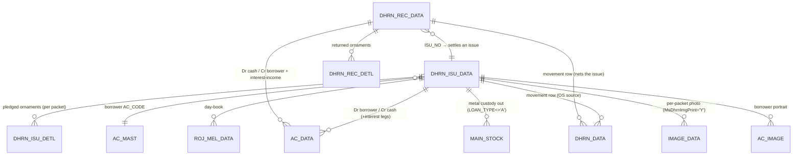
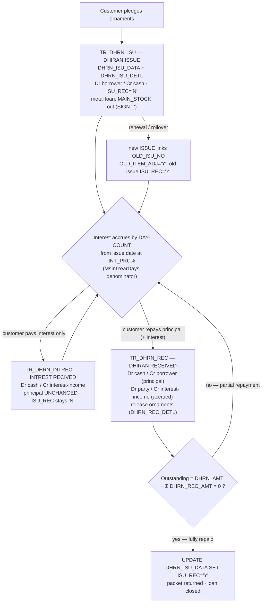

# Module 6 — Loans / Dhrn (gold pledge loan)

> The pawn-broking / gold-loan subsystem. A jeweller lends **money against pledged ornaments**
> (Gujarati *dhiran* / *dharna*), holds the ornaments in a numbered packet, accrues **simple
> day-count interest** on the outstanding principal, collects interest periodically, and releases
> the ornaments on full repayment. The mirror **LOAN** side records money the firm itself borrowed.
> Three transaction forms drive the lifecycle; two reports expose outstanding + accrued interest.
>
> Build the deep-dives in this order — they share one interest engine and one posting engine:
> [`TR_DHRN_ISU.md`](TR_DHRN_ISU.md) (issue) → [`TR_DHRN_REC.md`](TR_DHRN_REC.md) (repayment) →
> [`TR_DHRN_INTREC.md`](TR_DHRN_INTREC.md) (interest-only).

## 1. Purpose

A customer brings gold/silver ornaments and asks for a cash loan. The operator opens a **DHIRAN
ISSUE** voucher: records the borrower, the **principal** (`DHRN_AMT`), the **annual interest rate**
(`INT_PRC`), the loan period in months (`INT_MONTH`), and a grid of the **pledged ornaments**
(weights/touch/fine) which are stored as detail rows and sealed into a numbered **packet**
(`PACKET_NO`). On save the app pays cash out of a cash/bank account, books the borrower as a
**receivable**, and (for metal loans) moves the lent metal out of custody — all atomically.

Thereafter the loan accrues **interest by day-count from the issue date** at the applicable rate.
The customer may pay interest only (**INTREST RECIVED**) any number of times without touching
principal, and eventually repays principal (**DHIRAN RECEIVED**), which reduces the outstanding and,
on full repayment, **releases the ornaments** and closes the loan (`ISU_REC='Y'`). Outstanding
principal at any moment = **issue principal − Σ receipts** (the basis of `RP_DHRN_OS`).

There is **no GST** on pledge interest — `TAX_DATA` is never written by this module.

## 2. Form inventory

| Form | Type | Posting | Purpose | Web status |
|---|---|---|---|---|
| `TR_DHRN_ISU` | transaction | ✅ | **Issue**: pay loan principal, record pledged items, hold packet. Reused for `LOAN REC` (book a receivable the mirror way). | 🟩 BUILT (`dhrn.ts → issueDhrn`) |
| `TR_DHRN_REC` | transaction | ✅ | **Repayment**: receive principal (+ accrued interest), release ornaments, close on full repay. Reused for `LOAN ISSUE` (disburse a loan). | 🟩 BUILT (`dhrn.ts → receiveDhrn`) |
| `TR_DHRN_INTREC` | transaction | ✅ | **Interest-only**: collect accrued interest without reducing principal; `OS LETTER` mode = print only. Reused for `LOAN INT ENTRY`. | 🟩 BUILT (`dhrn.ts → receiveDhrnInterest`) |
| `RP_DHRN_OS` | report | — | **Outstanding register**: principal outstanding + accrued interest to a report date + aging buckets. | 🟦 PARTIAL (`outstanding()`) |
| `RP_DHRN_LOAN` | report | — | Loan-wise dhiran register / packet list (also rebuilds `DHRN_DATA` movement rows). | ⬜ TODO |

> **One form, several books.** Each desktop form is reused across several `MAIN_BOOK` values via
> `FormMainBook`. The **DHIRAN** side (we lend to customers) and the **LOAN** side (we borrowed) are
> mirror images: ISSUE↔REC roles swap. Implement the **DHIRAN** side fully first; stub the LOAN
> mirror. `// src: TR_DHRN_ISU.cs#L5083 (FormMainBook 'DHIRAN ISSUE' | 'LOAN REC')`

## 3. Module ER diagram

Composite key on every table: `(CO_CODE, LC_CODE, CO_YEAR, CO_BOOK, VCH_NO)` (+ `SR_NO` on detail/stock),
plus `tenant_id` on the web-migrated tables. Column names are kept **verbatim** from the desktop.
Table refs: [DHRN_ISU_DATA](../../02_Data_Model/tables/DHRN_ISU_DATA.md) ·
[DHRN_ISU_DETL](../../02_Data_Model/tables/DHRN_ISU_DETL.md) ·
[DHRN_REC_DATA](../../02_Data_Model/tables/DHRN_REC_DATA.md) ·
[AC_DATA](../../02_Data_Model/tables/AC_DATA.md).

## 4. Loan lifecycle (issue → interest accrual → receipt → closure)

**Interest is the heart of the module** — one formula, used at issue, at every receipt, and in the
OS report:

> **Interest = OutstandingPrincipal × (INT_PRC ÷ 100) × days ÷ `MsIntYearDays`**

- At **issue** the principal is `DHRN_AMT` and `days = INT_MONTH × 30` (monthly mode).
  `// src: TR_DHRN_ISU.cs#L6108-L6121 (BILL_TOTAL)`
- At **receipt / interest** the principal is the **outstanding** (`nPandingDhrn`) and `days` is the
  elapsed period (whole-month-bucketed in monthly mode), with optional **annual compounding**.
  `// src: TR_DHRN_REC.cs#L6915-L7035 (BILL_TOTAL)`
- Rounding precision is **loan-type dependent**: cash loans (`LOAN_TYPE='A'`) round interest to
  **0 dp (whole rupees)**; metal loans (`G`/`S`) round to **3 dp (fine grams)**. This is *not* the
  usual 2-dp money rule — see each deep-dive §4 and the risk in §11.

## 5. Shared logic (the dhrn engine, reused by all three forms)

From `apps/api/src/modules/dhrn/dhrn.ts`:
- `accruedInterest(outstandingPrincipal, annualRatePct, days, yearDays)` → `round2(P × rate/100 × days/yearDays)` — the day-count engine (web defaults `yearDays=360`, `DEFAULT_YEAR_DAYS`). `// web: dhrn.ts#accruedInterest`
- `monthlyTermInterest(principal, monthlyRatePct, months)` → desktop monthly mode (`CO_SET.DHRN_INT_TYPE='M'`).
- `dhrnInterest({ type, principal, ratePct, months, days, yearDays })` → dispatcher honouring the company interest-type flag.
- `buildDhrnIssueLedger` / `buildDhrnReceiptLedger` → the **balanced** `AC_DATA` legs (Dr borrower / Cr cash at issue; Dr cash / Cr borrower + interest-income at receipt).
- `outstanding(scope, isuNo)` → `principal − Σ DHRN_REC_AMT` (RP_DHRN_OS parity).
- `issueDhrn` / `receiveDhrn` / `receiveDhrnInterest` / `deleteDhrn` → compose numbering + posting + detail + movement in one `withTenant` transaction; delete = `reverseVoucherTx` of the whole derived set.

The desktop resolves interest-income / other-charge / kasar accounts from **`BOOK_DETL`** sub-rows
(`SR_NO=1` principal control, `SR_NO=2` interest income, `SR_NO=3` charges); metal rate-cut uses
fixed codes (`00003` gold, `00004` silver) and kasar `00057`. The web reference currently uses
generic `DHRN`/`CASH`/`INTINC` codes — see each deep-dive §11.

## 6. Dependencies

- Engines: **posting/ledger** (`AC_DATA`, metal `IT_TYPE/SIGN/FINE_WT` legs), **numbering**
  (`SRNO_MAST` per book/year), **calc** (`decimal.js`, HALF-UP — but note the dp nuance above),
  **stock** (`MAIN_STOCK` custody for metal loans), **RBAC** (`USER_UPDATE/DELETE/PRINT`).
  No **GST** engine (pledge interest is untaxed).
- Masters: `AC_MAST` (borrower + cash/bank ledger), `ITEM_MAST` (pledged item codes), `BOOK_DATA`/`BOOK_DETL`
  (book + sub-account resolution), `EMP_MAST` (employee), `RATE_MAST` (metal rate for rate-cut settlement).
- Company config (`CO_SET` / `DC_Main` globals): `MsIntYearDays`, `MsDhrnIntType`, `MsDhrnImgPrint`,
  `MsTradFine`, `MsOpDhiran`/`MsOpLoan`, `MsLockDt`, `MCo_OpDate/ClDate`, `MOp_dt`.
- Reports: `RP_DHRN_OS` (outstanding + accrued + aging), `RP_DHRN_LOAN` (loan register),
  Crystal templates `DhrnIssue.rpt`, `DhrnIntRec.rpt`, `DhrnOsLetter.rpt`, `DharnDue.rpt`, `LoanStock.rpt` (Module 12).

## 7. API surface (see each form doc §7 for full contracts)

| Method | Path | Right | Purpose |
|---|---|---|---|
| POST | `/txn/dhrn/issue` | create | Issue a pledge loan (principal + collateral grid) |
| POST | `/txn/dhrn/receipt` | create | Repay principal (+ interest), release ornaments |
| POST | `/txn/dhrn/interest` | create | Collect interest only (principal unchanged) |
| GET | `/txn/dhrn/:isuNo/outstanding` | — | Outstanding principal = issue − Σ receipts |
| DELETE | `/txn/dhrn/:vchNo` | delete | Reverse a dhrn voucher (header + detail + AC_DATA + movement) |
| GET | `/reports/dhrn-os` | print | Outstanding + accrued interest + aging |

> **SECURITY.** These routes mutate financial ledgers and store customer PII + collateral photos.
> They MUST sit behind authentication + per-tenant authorization + CSRF protection. Never expose
> unauthenticated. (The reference `dhrn.ts` service is auth-agnostic; routing must enforce it.)

## 8. Build checklist

- [ ] Engines built + parity-green (posting incl. metal legs, numbering, stock custody, calc with the dp-by-loan-type rule).
- [ ] Surface company config (`MsIntYearDays`, `MsDhrnIntType`, …) — interest denominator is **configurable**, not a hard-coded 360.
- [ ] `dhrnInterest` reproduces the desktop day-count + whole-month bucketing + optional annual compounding (golden-vector tests).
- [ ] `TR_DHRN_ISU` create/delete: `DHRN_ISU_DATA` + `DHRN_ISU_DETL` + balanced `AC_DATA` + `DHRN_DATA` + (metal) `MAIN_STOCK` match desktop rows — `06_Parity/dhrn.md`.
- [ ] `TR_DHRN_REC` reduces outstanding, books interest separately, releases ornaments, sets `ISU_REC='Y'` on full repay; over-repayment guarded.
- [ ] `TR_DHRN_INTREC` collects interest without changing principal; `OS LETTER` mode prints only.
- [ ] `outstanding()` = `DHRN_AMT − Σ DHRN_REC_AMT` matches `RP_DHRN_OS` for a sample of real loans.
- [ ] Idempotent re-save (delete-then-insert) produces no double-posting.
- [ ] Trial balance still nets to zero after a batch of issue/interest/repay/delete.
