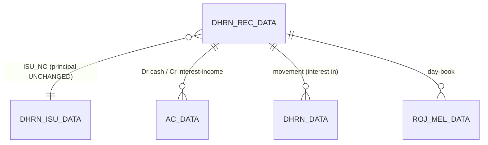
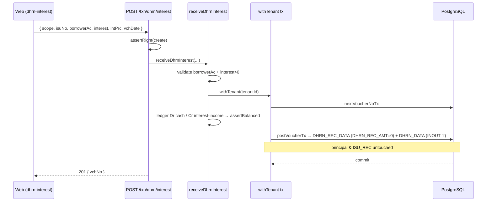

# TR_DHRN_INTREC — Dhrn / Interest-Only Receipt (deep-dive)

```
Form: TR_DHRN_INTREC  ·  Module: 6_Dhrn_Loans  ·  Type: transaction (posting)
Desktop source: unified/src/csharp/DataCareNext/TR_DHRN_INTREC.cs (6,576 lines)
                + Ac_Ledr.cs (DhrnIntRec_Ledr@1150), Ac_Tax.cs (DhrnIntRec_Data), Ac_Stock.cs (Dhrn_Int_Stk), Ac_Rojmel.cs (DhrnIntRec_RojMel)
Web target: apps/api/src/modules/dhrn/dhrn.ts (receiveDhrnInterest) · apps/web/app/(app)/txn/dhrn-interest
Requirements: Req 15.3 (day-count interest), 15.1 (interest booked separately, principal untouched), 13 (ledger)
Parity: 06_Parity/dhrn.md   ·   Status: 📋 SPEC · 🟩 BUILT
Evidence: spec project-memory/parity/spec-dhrn.md §3; form catalog project-memory/catalogs/forms/TR_DHRN_INTREC.md
```

## 1. Purpose & business context

The periodic **interest collection** counter. On a live pledge loan the customer pays only the
**accrued interest** (e.g. monthly), leaving the principal — and the pledged ornaments — exactly as
they are. The operator picks the source **issue**, the app auto-computes interest to date (same
day-count engine as repayment), and the customer pays it. Nothing reduces the outstanding principal
and the loan stays open (`ISU_REC` is **never** changed). It writes the **same `DHRN_REC_DATA` /
`DHRN_REC_DETL` tables** as repayment — distinguished only by `BOOK_NAME='INTREST RECIVED'` — so
there is **no separate `DHRN_INTREC_DATA` table**. A dedicated **`OS LETTER`** mode prints an
outstanding letter with **no posting at all**. Uses book **`INTREST RECIVED`** (`INOUT='I'`,
`ENTRY_TYPE='D'`); the mirror **`LOAN INT ENTRY`** (`ENTRY_TYPE='L'`) records interest on a loan we took.

> **Tables note (verified):** `DHRN_INTREC_DATA` and `DHRN_INT_DATA` **do not exist** — interest-only
> receipts persist into `DHRN_REC_DATA`. `// src: spec-dhrn.md §5; TR_DHRN_INTREC.cs#L4634 writes DHRN_REC_DATA`

## 2. UI / UX specification

### Layout
```
┌─ TR_DHRN_INTREC ─ INTREST RECIVED ──────────────────── [New][Save F2][Delete][Print][Close] ┐
│ VchNo:[_____] Date:[__/__/____]  Bill:[____]  Party:[AC_CODE ▾][AC_NAME .........] Paid-to:[__]│
│ Source Issue No:[____] IsuDate:[__/__/__]  FromDate:[__/__/__] ToDate:[__/__/__]  ☐ chkInt    │
│ Outstanding principal:[______ (display; UNCHANGED)]   Int%(INT_PRC):[____]                    │
│ IntMonths (cboIntMonth):[__]  /month amt (MONTH_INT_AMT):[____]  IntDays:[auto]               │
│ Interest due (INT_AMT):[auto]  Interest recd (INT_REC_AMT):[____]  Kasar:[____]               │
│ Advance (UNCHAK_DHRN_REC):[____]    Rate-cut (metal): FineRate/RcutAmt/PayAmt/OsAmt[____]      │
│ Narration:[................]                                  [Mode: ○ Interest  ○ OS Letter ] │
└────────────────────────────────────────────────────────────────────────────────────────────────┘
```

### Header field table (`DHRN_REC_DATA`, `BOOK_NAME='INTREST RECIVED'`)
| Label | Column | Type | Req | Default | Notes |
|---|---|---|---|---|---|
| VchNo / Date / Bill | `VCH_NO`/`VCH_DATE`/`DHRN_BILL` | — | ✓ | — | lock-date guard |
| Party | `AC_CODE`,`AC_NAME` | lookup | ✓ | — | borrower |
| Paid-to a/c | `LEDR_ACCD` | lookup | — | — | cash/bank receiving the interest |
| Source issue | `ISU_NO`,`ISU_LC`,`ISU_YRCD`,`ISU_DBCD` | lookup→`DHRN_ISU_DATA` | ✓ | — | which dhiran |
| Issue date | `DHRN_DATE` | date | auto | from issue | |
| From / To date | `FROM_DATE`/`TO_DATE` | date | ✓ | — | interest period collected |
| Int months | `INT_MONTH` (cboIntMonth) | int | — | — | period in months |
| Per-month amt | `MONTH_INT_AMT` | money | — | 0 | flat monthly interest (overrides formula) |
| Int days | `INT_DAY` | int | auto | — | derived (§4) |
| Annual int % | `INT_PRC` | % | auto | from issue | |
| Interest due | `INT_AMT` | money/fine | **auto** | computed | server-side (§4) |
| Interest received | `INT_REC_AMT` | money | — | =`INT_AMT` | interest actually collected |
| Interest kasar | `KASAR_AMT` | money | — | 0 | rounding write-off (account `00057`) |
| Advance / unchecked | `UNCHAK_DHRN_REC` | money | — | 0 | advance principal collected alongside |
| Principal received | `DHRN_REC_AMT` | money | — | 0 | usually 0 (interest-only) |
| Rate-cut (metal) | `RCUT_RATE`/`RCUT_AMT`/`RCUT_PAY_AMT`/`RCUT_OS_AMT` | — | — | 0 | metal interest by rate-cut |

No collateral-release amounts: `GOLD_AMT=GOLD_WT=0`, `PAN_ADJ_AMT=ADJ_INT=ADJ_DHRN=0`, `PACKET_NO=''`.
`// src: spec-dhrn.md §3.1`

### Modes
**Interest** (posts) vs **OS Letter** (prints `DhrnOsLetter.RPT`, **no posting**). New/Edit/View/Delete/Print
as the other forms; edit suppresses recompute.

## 3. Data model touched

**Writes (create)** — delete-then-insert (`// src: TR_DHRN_INTREC.cs#L4706-L4821`); the header row is
written only if `INT_AMT+INT_REC_AMT+DHRN_REC_AMT+UNCHAK_DHRN_REC ≠ 0` `// src: TR_DHRN_INTREC.cs#L4709`:
1. `TEMP_BOOK_DATA`, `DHRN_REC_DATA` (header; columns as TR_DHRN_REC **plus** `MONTH_INT_AMT`; `GOLD_AMT/GOLD_WT=0`).
2. `AC_DATA` via `Ac_Ledr.DhrnIntRec_Ledr` (`Loan_IntRec_Ledr` for LOAN INT ENTRY). See §4.3.
3. `ROJ_MEL_DATA` via `Ac_Rojmel.DhrnIntRec_RojMel`.
4. `DHRN_DATA` via `Ac_Tax.DhrnIntRec_Data` (movement: `INT_REC_AMT = INT_REC_AMT + KASAR_AMT`, principal 0).
5. `MAIN_STOCK` via `Ac_Stock.Dhrn_Int_Stk` — metal only, `ITM_SIGN='+'`, when `MONTH_INT_AMT=0 AND RCUT_AMT=0`.
6. `Ac_Tax.Vch_Remark(book,vch,0)`. **Does NOT touch `ISU_REC`** (interest never closes a loan).
7. `OS LETTER` mode: **no posting** — prints only.

**Deletes/reverses:** `REMARK_DATA, TEMP_BOOK_DATA, DHRN_DATA, AC_DATA, ROJ_MEL_DATA, MAIN_STOCK,
DHRN_REC_DATA, DHRN_REC_DETL` + `DELETE_DATA` (`VCH_VAL_CR=INT_REC_AMT`). `// src: TR_DHRN_INTREC.cs#L4874-L4883`

Table refs: [DHRN_REC_DATA](../../02_Data_Model/tables/DHRN_REC_DATA.md) ·
[DHRN_ISU_DATA](../../02_Data_Model/tables/DHRN_ISU_DATA.md) · [AC_DATA](../../02_Data_Model/tables/AC_DATA.md) ·
[DHRN_DATA](../../02_Data_Model/tables/DHRN_DATA.md)



## 4. Business logic & calculations (with code)

### 4.1 Interest engine — identical to repayment
Interest uses the **same day-count engine** as `TR_DHRN_REC` §4.2 (`MsIntYearDays` denominator,
whole-month bucketing in monthly mode, optional `chkInt` annual compounding), charged on the
**outstanding principal** (`nPandingDhrn`) — which is **not** reduced. When a flat `MONTH_INT_AMT`
is set, `INT_AMT = MONTH_INT_AMT × INT_MONTH`. `INT_REC_AMT` is the interest actually collected;
`DHRN_REC_AMT`/`UNCHAK_DHRN_REC` capture any principal/advance taken alongside. `dp = (cash?0:metal?3)`.
`// src: TR_DHRN_INTREC.cs#L4634 BtnSave_Click; formula per spec-dhrn.md §3.2`

### 4.2 Web target (`dhrn.ts → receiveDhrnInterest`)
```ts
// web: dhrn.ts#receiveDhrnInterest — collect interest WITHOUT repaying principal
if (!input.borrowerAc) throw new DhrnValidationError('borrower account is required');
if (!(input.interest > 0)) throw new DhrnValidationError('interest must be positive');
const interest = round2(input.interest);
const ledger: LedgerLine[] = [                              // Dr cash / Cr interest-income
  { ...base, AC_CODE: cashAc,   DR_AMT: interest, CR_AMT: 0, SIGN: 'D' },
  { ...base, AC_CODE: intIncAc, DR_AMT: 0, CR_AMT: interest, SIGN: 'C' },
];
assertBalanced(ledger);                                     // no loan-receivable leg, no DHRN_REC_AMT
await postVoucherTx(tx, tenantId, { ledger:{ table:'AC_DATA', lines:ledger }, bookName:'DHIRAN',
  writes:[{ table:'DHRN_REC_DATA', rows:[recHeader] },      // DHRN_REC_AMT:0, INT_AMT/INT_REC_AMT:interest
          { table:'DHRN_DATA', rows:[movement] }] });       // INOUT 'I', principal untouched
```
> **The outstanding is unchanged: no `Cr borrower (principal)` leg, no `DHRN_REC_AMT`.** Just
> Dr cash / Cr interest-income for the interest collected.

### 4.3 Balanced `AC_DATA` legs — `DhrnIntRec_Ledr` (cash `LOAN_TYPE='A'`)
`// src: Ac_Ledr.cs#L1150 DhrnIntRec_Ledr` — `MAIN_BOOK='INTREST RECIVED' AND BOOK_INOUT='I'`. Salient legs:

| leg | Dr | Cr | amount | condition |
|---|---|---|---|---|
| 01/02 | cash `LEDR_ACCD` | borrower | `DHRN_REC_AMT + UNCHAK_DHRN_REC` | any principal/advance taken alongside |
| 03/04 | borrower | interest-income (`SR_NO=2`) | `INT_AMT` | interest accrued booked |
| 05/06 | cash `LEDR_ACCD` | borrower | `INT_REC_AMT` | **interest received** |
| 07/08 | borrower | kasar **`00057`** (`SR_NO=1`) | `KASAR_AMT` | interest rounding write-off |
| 09 | — | — | `DHRN_REC_AMT+UNCHAK` | metal: `SIGN='+'` |
| 10 | — | — | `INT_AMT` | metal: `SIGN='-'`, `MONTH_INT_AMT=0` |
| 11 | — | — | `INT_REC_AMT` | metal: `SIGN='+'`, `MONTH_INT_AMT=0` |
| 12/13 | gold `00003` / silver `00004` | borrower | `RCUT_AMT` | metal rate-cut |
| 14/15 | cash | borrower | `RCUT_PAY_AMT` | rate-cut cash |
| 16–22 | (opening) | | — | `MsOpDhiran='Y'`, pre-`MOp_dt` |

> Net for a pure interest collection: **Dr cash / Cr interest-income** (legs 05/06 with INT_REC_AMT;
> 03/04 book the accrual against the borrower). The kasar account here is the fixed **`00057`** (dhiran-interest kasar).

### 4.4 Precision & rounding
Same as repayment: `dp = LOAN_TYPE==='A' ? 0 : 3`; web `round2` (HALF-UP) vs desktop banker's — see §11.

## 5. Save sequence (create)

`// src: TR_DHRN_INTREC.cs#L4634 BtnSave_Click`

Desktop order: guards (licence/type/lock/rights/party/vchno) → collision bump → delete-then-insert
`TEMP_BOOK_DATA`/`DHRN_REC_DATA`/`DHRN_REC_DETL` → `DhrnIntRec_Ledr` → `DhrnIntRec_RojMel` →
`DhrnIntRec_Data` → `Dhrn_Int_Stk` (metal) → `Vch_Remark`. **No `ISU_REC` update.** OS-Letter mode prints only.

## 6. Delete / reverse sequence

`// src: TR_DHRN_INTREC.cs#L4860 BtnDelete_Click` — block on lock-date / no `USER_DELETE`; confirm;
`DELETE_DATA` (`VCH_VAL_CR=INT_REC_AMT`); purge `REMARK_DATA, TEMP_BOOK_DATA, DHRN_DATA, AC_DATA,
ROJ_MEL_DATA, MAIN_STOCK, DHRN_REC_DATA, DHRN_REC_DETL`. **No `ISU_REC` reset** (interest never closed it).
Web: `deleteDhrn({ headerTable:'DHRN_REC_DATA', book:'DIN', vchType:'DINT' })` (one tx, `USER_DELETE`).

## 7. API contract

```ts
// POST /txn/dhrn/interest   (right: create)
interface DhrnInterestInput {
  scope: VoucherScope;
  isuNo: number|string;          // ISU_NO this interest is booked against (required)
  borrowerAc: string; borrowerName?: string;
  interest: number;              // INT_REC_AMT collected (> 0); principal left untouched
  intPrc?: number;
  cashAc?: string;  intIncAc?: string;   // defaults 'CASH' / 'INTINC'
  vchDate?: string|Date;
}
// → 201 { vchNo:number }    // NOTE: no outstanding change
```
Errors: `DhrnValidationError`→400 (missing borrower; interest ≤ 0), `ForbiddenError`→403, `PeriodLockValidationError`→400.

## 8. Validation rules

| Rule | Condition | Desktop message | HTTP | req |
|---|---|---|---|---|
| Licence valid | `MsSoftNoUse='Y'` & Add | "You Cant Save New Entry Because Your lIcence Has been Expired …" | 403/400 | — |
| Company type | `MCo_Type='B'` & Add | "You Cant Save This Voucher Becouse This Company Type is B……" | 400 | — |
| Period open | `MsLockDt ≥ VCH_DATE` | "You Cant Save and Delete … Lock Date is = …" | 400 | — |
| Rights | no `USER_UPDATE` on edit | "You Have No Rights....." | 403 | 6.x |
| Party required | `AC_CODE=''` | "Please Insert Party and try" | 400 | 15.1 |
| VchNo present | `VCH_NO=''` | "Please Insert VchNo and try" | 400 | 9 |
| Interest > 0 | `interest ≤ 0` | (web) "interest must be positive" | 400 | 15.3 |
| Header write skip | `INT_AMT+INT_REC_AMT+DHRN_REC_AMT+UNCHAK_DHRN_REC = 0` | — (no row) | — | — |
| Balanced ledger | ΣCR≠ΣDR | — (invariant) | 500 | 13.1 |

`// src: TR_DHRN_INTREC.cs#L4645-L4676 (guards), #L4709 (header-write condition)`

## 9. Parity criteria (Definition of Done)

1. Interest reproduces the §4.2 / `TR_DHRN_REC §4.2` engine on the **outstanding** principal, at the
   loan-type dp; flat `MONTH_INT_AMT × INT_MONTH` honoured.
2. **Principal/outstanding is unchanged**: no `DHRN_REC_AMT` principal leg; `DHRN_ISU_DATA.ISU_REC`
   untouched; `outstanding(isuNo)` identical before and after.
3. Row lands in `DHRN_REC_DATA` with `BOOK_NAME='INTREST RECIVED'`, `MONTH_INT_AMT` populated,
   `GOLD_AMT/GOLD_WT=0` (no separate `DHRN_INTREC_*` table).
4. `AC_DATA` legs match `DhrnIntRec_Ledr` (Dr cash / Cr interest-income; kasar via `00057`); ΣCR=ΣDR.
5. `DHRN_DATA` movement records interest-in (`INT_REC_AMT + KASAR_AMT`, principal 0); metal returns custody only when `MONTH_INT_AMT=0 AND RCUT_AMT=0`.
6. `OS LETTER` mode performs **no** writes (print-only).
Fixtures: `06_Parity/dhrn.md`. Reconcile: issue → N interest receipts → outstanding stays = issue principal.

## 10. Variants & edge cases

| Variant | Delta vs INTREST RECIVED |
|---|---|
| `LOAN INT ENTRY` (same form, `ENTRY_TYPE='L'`) | Mirror: interest on a loan **we** took, via `Loan_IntRec_Ledr`/`Loan_IntRec_RojMel`/`Loan_IntIsu_Data`/`Loan_Int_Stk`. |
| `OS LETTER` mode | Prints `DhrnOsLetter.RPT` only — **no posting**. |
| Flat monthly interest | `MONTH_INT_AMT≠0` ⇒ `INT_AMT = MONTH_INT_AMT × INT_MONTH`; suppresses the metal fine interest legs (`MONTH_INT_AMT=0` guards legs 10/11). |
| Interest + advance principal | `DHRN_REC_AMT`/`UNCHAK_DHRN_REC` taken alongside interest (legs 01/02) — reduces outstanding via the movement. |
| Interest kasar | `KASAR_AMT` write-off to `00057` (legs 07/08). |
| Metal rate-cut | `RCUT_*` settle metal-loan interest by fine-rate cut (legs 12–15). |
| `SSRegSrNo='AK030NPAK'` licensee | appends 3 custom expiry/interest clauses to the WhatsApp/letter text. |

## 11. Open questions / risks

- **Shared table semantics.** Interest-only and repayment **share `DHRN_REC_DATA`**; queries/reports
  must distinguish them by `BOOK_NAME` (`'INTREST RECIVED'` vs `'DHIRAN RECEIVED'`), not by table.
  The web writes `BOOK_NAME='DHIRAN'` for both — fix to the exact MAIN_BOOK string for report parity.
- **Rounding mode + dp.** As issue/receipt: desktop banker's rounding at 0 dp (cash) / 3 dp (metal);
  web `round2` HALF-UP. Reconcile on the golden master.
- **Outstanding read.** Interest is charged on the live outstanding; the web `receiveDhrnInterest`
  takes interest pre-computed and does not read the issue. Wire the server-side accrual (issue/last
  `TO_DATE` → today) so the operator sees the same figure the desktop computes.
- **Unwritten satellites.** Web `receiveDhrnInterest` does not yet write `ROJ_MEL_DATA`, `MAIN_STOCK`
  (metal), kasar (`00057`)/rate-cut legs, or honour the `OS LETTER` print-only mode.
- **`MONTH_INT_AMT` interplay.** A flat monthly amount overrides the day-count formula and suppresses
  the metal fine-interest legs — ensure the web mirrors both effects when porting metal loans.
