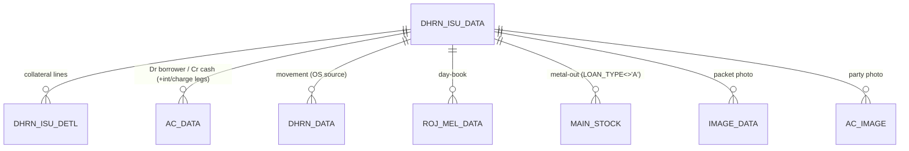
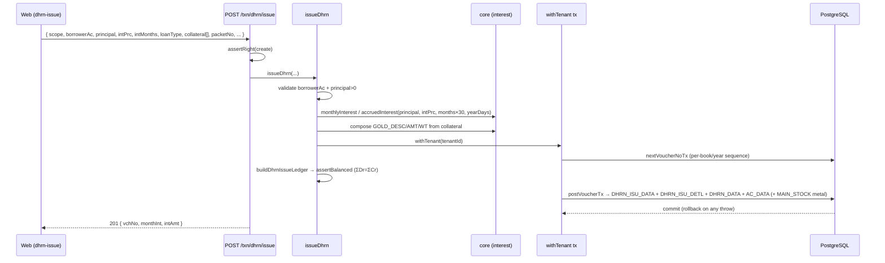

# TR_DHRN_ISU — Dhrn / Pledge-Loan Issue (deep-dive)

```
Form: TR_DHRN_ISU  ·  Module: 6_Dhrn_Loans  ·  Type: transaction (posting)
Desktop source: unified/src/csharp/DataCareNext/TR_DHRN_ISU.cs (6,895 lines)
                + Ac_Ledr.cs (DhrnIsu_Ledr@1064), Ac_Tax.cs (DhrrnIsu_Data), Ac_Stock.cs (Dhrn_Isu_Stk), Ac_Rojmel.cs (DhrnIsu_RojMel)
Web target: apps/api/src/modules/dhrn/dhrn.ts (issueDhrn) · apps/web/app/(app)/txn/dhrn-issue
Requirements: Req 15.1 (issue records principal + collateral + ledger in one tx), 15.3 (day-count interest), 9 (numbering), 13 (ledger)
Parity: 06_Parity/dhrn.md   ·   Status: 📋 SPEC · 🟩 BUILT
Evidence: spec project-memory/parity/spec-dhrn.md §1; form catalog project-memory/catalogs/forms/TR_DHRN_ISU.md
```

## 1. Purpose & business context

The pawn-broking counter. A customer pledges gold/silver ornaments for a cash loan. The operator
selects the borrower, the cash/bank account the money is paid from, the **loan type** (cash / gold /
silver), the **principal**, the **annual interest rate** and the **loan period (months)**, and
enters the pledged ornaments into a grid (each with weight/touch/fine). On save the app numbers the
voucher, writes the header + the collateral detail rows, posts a **balanced** borrower↔cash ledger
(plus any interest/charges collected up-front), records a **movement row** the outstanding report
sums, and — for **metal** loans — moves the lent metal out of stock custody. Optionally it captures
a **photo of each packet** and the borrower. Uses book **`DHIRAN ISSUE`** (`INOUT='O'`, `ENTRY_TYPE='D'`);
the same form serves **`LOAN REC`** (`ENTRY_TYPE='L'`) for booking a receivable the mirror way.

## 2. UI / UX specification

### Layout
```
┌─ TR_DHRN_ISU ─ DHIRAN ISSUE ─────────────────────── [New][Save F2][Delete][Print][Photo][Close] ┐
│ VchNo:[_____] Date:[__/__/____]  Bill(ticket):[____]   Party:[AC_CODE ▾][AC_NAME .............]   │
│ Paid-from A/c (LEDR_ACCD):[____]  LoanType:[Amount▾]  Packet:[____]   Emp:[__]  DueDate:[__/__/__]│
│ ┌ Pledged ornaments (MSG grid → DHRN_ISU_DETL) ───────────────────────────────────────────────┐ │
│ │ Sr│ItCode│ItName│Pcs│GrWt│OthWt│NetWt│Touch│West%│Fine│Rate│ItAmt│NetAmt│(IT_TYPE)(IT_DESC)  │ │
│ │  1│ …    │ …    │   │    │     │     │     │     │    │    │     │      │                    │ │
│ └────────────────────────────────────────────────────────────────────────────────────────────┘ │
│ Principal (DHRN_AMT):[______]  Months (INT_MONTH):[__]  ToDate:[auto]  LoanMonths:[__]            │
│ Annual int% (INT_PRC):[____]  Monthly int%:[__]  /month amt:[____]  IntDays:[auto] IntAmt:[auto]  │
│ Other charges:[____]  Interest recd now (INT_REC_AMT = IntAmt+OthChg):[auto]   Narration:[......] │
│ Gold: Desc[auto ≤255]  Amt[Σ NetAmt]  Wt[Σ GrWt]            [Party photo] [Per-packet photo]      │
└──────────────────────────────────────────────────────────────────────────────────────────────────┘
```

### Header field table
| Label | Column (`DHRN_ISU_DATA`) | Type | Req | Default | Notes |
|---|---|---|---|---|---|
| VchNo | `VCH_NO` | string(8) | auto | next seq | re-checked & bumped on Add (collision) |
| Header link | `HD_VCH_NO` | string | auto | seq in `TEMP_BOOK_DATA` | links header↔detail |
| Date | `VCH_DATE` / `VCH_TIME`(=date+" "+time) | date | ✓ | today | blocked if ≤ `MsLockDt`; within open/close |
| Bill (ticket) | `DHRN_BILL` | string(8) | — | — | printed pledge-ticket no |
| Party (borrower) | `AC_CODE`,`AC_NAME` | lookup→`AC_MAST` | ✓ | — | mandatory; drives receivable |
| Paid-from a/c | `LEDR_ACCD` | lookup→`AC_MAST` | — | — | cash/bank account money is paid out from |
| Loan Type | `LOAN_TYPE` (A/G/S) | combo | ✓ | A | `Mid(cboLoanType.Text,1,1)`; drives money-vs-fine + dp |
| Packet No | `PACKET_NO` | string(15) | — | — | physical packet/locker id |
| Due Date | `DHRN_DUE_DATE` | date | — | null | nullable (only if a valid date) |
| To / Maturity | `TO_DATE` | date | auto | from months | calendar month-stepping (see §4) |
| Principal | `DHRN_AMT` | money/fine | ✓ | — | money (A) or **fine weight gms** (G/S) |
| Dhiran months | `INT_MONTH` | int | — | — | interest period in months |
| Loan months | `DHRN_MONTH` | int | — | — | tenure (separate from int months) |
| Annual int % | `INT_PRC` | % | — | — | `= monthly% × 12` |
| Monthly int % | (not stored) | % | — | — | derives `INT_PRC` (`= INT_PRC/12`) |
| Per-month amt | `MONTH_INT_AMT` | money | — | 0 | optional flat monthly interest |
| Interest days | `INT_DAYS` | int | auto | — | derived (§4) |
| Interest amount | `INT_AMT` | money/fine | auto | — | derived (§4) |
| Interest recd now | `INT_REC_AMT` | money | — | `IntAmt+OthChg` | interest collected at issue |
| Other charges | `OTH_AMT` | money | — | 0 | processing/doc charges |
| Employee | `EMP_CODE` | lookup→`EMP_MAST` | cond | — | mandatory iff `MsEmpCodeMendetry='Y'` |
| Narration | `VCH_DESC` | string(255) | — | — | "Text Hear" placeholder → "" |
| Renewal source | `OLD_ISU_NO`/`_YRCD`/`_DBCD` | — | — | self | rollover linkage (blank ⇒ self) |
| (auto) renewal flag | `OLD_ITEM_ADJ` | 'Y'/'N' | auto | 'N' | 'Y' when renewing an old issue |
| (auto) lifecycle | `ISU_REC` | 'Y'/'N' | auto | 'N' | open='N'; set 'Y' on full repay |
| (auto) gold summary | `GOLD_DESC`(≤255),`GOLD_AMT`,`GOLD_WT`,`GOLD_NWT`,`SILVER_NWT` | — | auto | from grid | see §4.4 |

### Grid columns → `DHRN_ISU_DETL` (one row per pledged packet)
MSFlexGrid `MSG`, 27 columns (`// src: TR_DHRN_ISU.cs#L3802 MSG_CLEAR`). Persisted columns:

| col | header (DHIRAN) | DETL column | type |
|---|---|---|---|
| 0 | Sr | `SR_NO`,`OLD_SRNO` | int |
| 3 | ItCode | `IT_CODE` | item code (req) |
| 4 | ItName | `IT_NAME` | text |
| 5 | Pcs | `ITM_PCS` | num |
| 6 | GrWt | `ITM_GWT` | gross weight |
| 7 | OthWt | `ITM_OTH_WT` | stone/other wt |
| 8 | NetWt | `ITM_NWT` | net weight |
| 9 | Touch | `ITM_TOUCH` | touch % |
| 10 | West% | `ITM_WEST_PRC` | wastage % |
| 11 | Fine | `ITM_FINE` | fine weight |
| 12 | Rate | `ITM_RATE` | rate |
| 13 | ItAmt | `ITM_AMT` | item amount |
| 14 | NetAmt | `NET_AMT` | net amount |
| 17 | (hidden) | `IT_DESC` (≤100) | description → feeds `GOLD_DESC` |
| 15/16 | (hidden) | `IT_TYPE` / `RATE_TYPE` | G/S, rate type |
| 23/24/25 | (hidden) | `DHRN_NO`/`_YRCD`/`_DBCD` | source issue (renewal) |

A grid line is **persisted only if `(ITM_NWT + NET_AMT) ≠ 0 AND IT_CODE ≠ ''`**.
`// src: TR_DHRN_ISU.cs#L5270 (MSG[i,8]+MSG[i,14] <> 0 AND MSG[i,3] <> '')`
Column visibility/labels are re-skinnable from `RsClDetl` (`BOOK_NAME='DHRN_ISU'`).

### Keyboard / F-keys (desktop → web)
- Enter advances cell-to-cell; `nDhrnAmt`/`nMonthlyInt` Enter triggers `BILL_TOTAL()` then `{TAB}`.
  `// src: TR_DHRN_ISU.cs#L6300 nDhrnAmt_KeyDown, #L6315 nMonthlyInt_KeyDown`
- F2 = Save; Photo button opens packet/party capture (web: multipart upload).
- Web mirrors with `LookupPicker` for party/item, an editable collateral grid, and read-only computed interest.

### Lookups (pickers)
- Party → `AC_MAST` (code, name, mobile). Paid-from a/c → `AC_MAST` (cash/bank). Item → `ITEM_MAST`.
  Special: party `00050` makes `AC_NAME` editable (walk-in). `// src: TR_DHRN_ISU.cs#L6190 tAcName_GotFocus`

### Modes
New / Edit (loads header+grid, re-posts on save) / View / Delete (`USER_DELETE`) / Print (`USER_PRINT`).
Edit (`EntryMode='E'`) **suppresses** interest auto-recalc so a manually-adjusted `INT_AMT` is preserved.

## 3. Data model touched

**Writes (create)** — delete-then-insert per voucher, in order (`// src: TR_DHRN_ISU.cs#L5083 BtnSave_Click`):
1. `TEMP_BOOK_DATA` — header-book link (`VCH_NO=HD_VCH_NO`, `BOOK_NAME=FormName`); only if `DHRN_AMT≠0 AND LEDR_ACCD≠''`.
2. `DHRN_ISU_DATA` — header (§2 columns + `DATA_TRFR='N'`,`USER_UPDATE='N'`,`USER_DELETE='N'`).
3. `DHRN_ISU_DETL` — pledged-ornament lines (§2 grid).
4. `AC_DATA` — balanced ledger via `Ac_Ledr.DhrnIsu_Ledr` (`Loan_Rec_Ledr` for LOAN REC). See §4.5.
5. `ROJ_MEL_DATA` — day-book via `Ac_Rojmel.DhrnIsu_RojMel`.
6. `DHRN_DATA` — movement row via `Ac_Tax.DhrrnIsu_Data` (**the row `RP_DHRN_OS` sums**).
7. `MAIN_STOCK` — metal custody **out** via `Ac_Stock.Dhrn_Isu_Stk` — **only `LOAN_TYPE≠'A'`**.
8. `IMAGE_DATA` / `AC_IMAGE` — packet + party photos (if `MsDhrnImgPrint='Y'`). `// src: TR_DHRN_ISU.cs#L5405 DhirnImgPrint`
9. `REMARK_DATA` — narration via `Ac_Tax.Vch_Remark`.
10. (LOAN REC only) `UPDATE DHRN_ISU_DATA SET ISU_REC='Y'` on the rolled-over source issue.

**Deletes/reverses:** `REMARK_DATA, TEMP_BOOK_DATA, DHRN_DATA, AC_DATA, ROJ_MEL_DATA, MAIN_STOCK,
DHRN_ISU_DATA, DHRN_ISU_DETL` (+ `AC_IMAGE`) + `DELETE_DATA` audit row.
`// src: TR_DHRN_ISU.cs#L5517-L5524`

Table refs: [DHRN_ISU_DATA](../../02_Data_Model/tables/DHRN_ISU_DATA.md) ·
[DHRN_ISU_DETL](../../02_Data_Model/tables/DHRN_ISU_DETL.md) ·
[AC_DATA](../../02_Data_Model/tables/AC_DATA.md) · [DHRN_DATA](../../02_Data_Model/tables/DHRN_DATA.md) ·
[MAIN_STOCK](../../02_Data_Model/tables/MAIN_STOCK.md)



## 4. Business logic & calculations (with code)

### 4.1 Loan type drives money-vs-fine + rounding precision
`LOAN_TYPE = Mid(cboLoanType.Text,1,1)`. `cboLoanType.SelectedIndex==0` ⇒ **cash** (`'A'`):
`DHRN_AMT` is money, amounts round to **0 dp** displayed `"0.00"`. `SelectedIndex≠0` ⇒ **metal**
(`'G'`/`'S'`): `DHRN_AMT` is **fine weight (gms)**, amounts round to **3 dp** `"0.000"`.
`// src: TR_DHRN_ISU.cs#L6300 (nDhrnAmt_KeyDown formats 0.000 vs 0.00)`

### 4.2 EXACT interest formula at issue — desktop evidence
```csharp
// src: TR_DHRN_ISU.cs#L6089-L6121 (BILL_TOTAL)
// (a) interest DAYS
if (DC_Main.MsDhrnIntType == "M")              // monthly mode
    nIntDays = cboIntMonth * 30.0;             // months × 30
else                                           // actual-day mode
    nIntDays = toDate - vchDate;               // calendar days

// (b) interest AMOUNT  (only when DHRN_AMT<>0 AND INT_PRC<>0)
if (cboLoanType.SelectedIndex != 0) {          // METAL loan → 3 dp
    if (nMonthIntAmt != 0)
        nIntAmt = Round(nMonthIntAmt * cboIntMonth, 3);                                   // "0.000"
    else
        nIntAmt = Round(nDhrnAmt * (nIntPrc/100.0) * (30.0*cboIntMonth) / MsIntYearDays, 3);
} else {                                        // CASH loan → 0 dp
    if (nMonthIntAmt != 0)
        nIntAmt = Round(nMonthIntAmt * cboIntMonth, 0);                                   // "0.00"
    else
        nIntAmt = Round(nDhrnAmt * (nIntPrc/100.0) * (30.0*cboIntMonth) / MsIntYearDays, 0);
}
// (c) money to collect now, and rate conversions
nRecAmt /*INT_REC_AMT*/ = nIntAmt + nOtherCharges;     // src: BILL_TOTAL tail
nIntPrc = nMonthlyInt * 12;  nMonthlyInt = nIntPrc / 12; // src: nMonthlyInt_KeyDown #L6315
```

> **Interest = Principal × annual-rate% × (months × 30 days) ÷ `MsIntYearDays`.** With the common
> `MsIntYearDays = 360` this collapses to `Principal × rate% × months / 12`. A flat `MONTH_INT_AMT`
> overrides the formula (`MONTH_INT_AMT × months`).

### 4.3 Maturity `TO_DATE` from months — calendar month stepping
`// src: TR_DHRN_ISU.cs#L6398 cboIntMonth_KeyDown / #L6685 mToDate_KeyDown`
```text
toDate = vchDate
repeat INT_MONTH times:
    m = month(toDate)
    toDate += (m ∈ {1,3,5,7,8,10,12} ? 31 : m==2 ? 28 : 30) days
```

### 4.4 Gold summary (auto, from the grid)
```csharp
// src: TR_DHRN_ISU.cs#L5246-L5262
GoldDesc = Σ over grid: "{IT_DESC}, N {NetWt} / T {Touch} / F {Fine}"  // joined by ", "
GOLD_DESC = Mid(GoldDesc, 1, 255);
GOLD_AMT  = MSG_TOT[0,14];   // Σ NetAmt
GOLD_WT   = MSG_TOT[0,6];    // Σ GrWt
GOLD_NWT  = ItGoldWt;  SILVER_NWT = ItSilverWt;
```

### 4.5 Balanced `AC_DATA` legs — `DhrnIsu_Ledr` (cash `LOAN_TYPE='A'`)
`// src: Ac_Ledr.cs#L1064 DhrnIsu_Ledr` — filter `MAIN_BOOK='DHIRAN ISSUE' AND BOOK_INOUT='O'`,
`LEDR_KEY = CO+LC+YEAR+BOOK+VCH_NO+nn` (nn = 2-digit leg).

| leg (nn) | Dr (DR_AMT on AC_CODE) | Cr (CR_AMT) | amount | condition |
|---|---|---|---|---|
| 01 | **borrower `AC_CODE`** (contra `LEDR_ACCD`) | — | `DHRN_AMT` | `DHRN_AMT≠0` — receivable up |
| 02 | — | **`LEDR_ACCD` cash** | `DHRN_AMT` | money paid out |
| 03 | borrower | — | `INT_AMT` | `INT_AMT≠0 AND BOOK_DETL.SR_NO=2` |
| 04 | — | interest-income (`SR_NO=2`) | `INT_AMT` | accrued interest booked |
| 05 | — | borrower | `INT_REC_AMT` | `INT_REC_AMT≠0 AND SR_NO=1` |
| 06 | `LEDR_ACCD` cash | — | `INT_REC_AMT` | interest collected now |
| 07 | borrower | — | `OTH_AMT` | `OTH_AMT≠0 AND SR_NO=3` |
| 08 | — | other-charge (`SR_NO=3`) | `OTH_AMT` | processing charge |

For **metal loans** (`LOAN_TYPE≠'A'`) leg `09` is a **fine-weight journal** instead of legs 01/02:
`IT_TYPE=LOAN_TYPE, SIGN='-', FINE_WT=DHRN_AMT, DR_AMT=CR_AMT=0`. If `MsTradFine='Y'` a `'+'`
mirror (leg 10) is emitted. If `MsOpDhiran='Y'`, legs `11..16` repeat for opening vouchers
(`VCH_DATE < MOp_dt`). `// src: Ac_Ledr.cs#L1064-L1104`

> **Net effect at issue:** Dr borrower (receivable) `DHRN_AMT`, Cr cash `DHRN_AMT`; plus, if interest
> is collected up-front, Dr cash / Cr interest-income. ΣDr = ΣCr. Metal balances flow on the
> `IT_TYPE/SIGN/FINE_WT` legs, independent of money — **money-only rows break parity**.

### 4.6 Web target (`dhrn.ts → issueDhrn`)
```ts
// web: dhrn.ts#issueDhrn — INT_AMT = principal × annual% × (months×30) ÷ yearDays
const monthInt = monthlyInterest(input.principal, input.intPrc, input.yearDays);   // 30-day month
const intAmt   = months > 0 ? accruedInterest(input.principal, input.intPrc, months*30, input.yearDays) : 0;
const ledger   = buildDhrnIssueLedger(key, loanAc, cashAc, input.principal);       // Dr loanAc / Cr cash
assertBalanced(ledger);
await postVoucherTx(tx, tenantId, {
  ledger: { table: 'AC_DATA', lines: ledger }, bookName: 'DHIRAN',
  writes: [{ table:'DHRN_ISU_DATA', rows:[header] },
           ...(detl.length ? [{ table:'DHRN_ISU_DETL', rows:detl }] : []),
           { table:'DHRN_DATA', rows:[movement] }],
});
```
> **Parity deltas to close (web simplifications):** the web debits a generic `loanAc='DHRN'`
> (desktop debits the **actual borrower `AC_CODE`**, contra `LEDR_ACCD`); rounds interest to 2 dp
> (desktop = 0 dp cash / 3 dp metal); writes `BOOK_NAME='DHIRAN'` (desktop `'DHIRAN ISSUE'`); and
> does not yet write `ROJ_MEL_DATA`, `MAIN_STOCK` (metal), photos, or resolve `BOOK_DETL` sub-accounts.

### 4.7 Precision & rounding
Money/fine use `decimal.js`; **HALF-UP** per `conventions.md`. **But the desktop interest rounding
is loan-type dependent: 0 dp (cash) / 3 dp (metal)** — and .NET `Math.Round` defaults to **banker's
rounding (ToEven)**, not HALF-UP. Pin `dp = LOAN_TYPE==='A' ? 0 : 3` and reconcile the midpoint mode
against the golden master (see §11).

## 5. Save sequence (create / edit)

Validations first, then number-collision re-check (Add), then delete-then-insert, then post, all in one tx.
`// src: TR_DHRN_ISU.cs#L5083 BtnSave_Click`



Numbered (desktop): (1) licence/company-type/lock-date/rights/party/vchno guards; (2) on Add,
`MAX(VCH_NO)+1` collision bump for both `DHRN_ISU_DATA` and `TEMP_BOOK_DATA`; (3) `DELETE` the
voucher rows from every derived table; (4) insert `TEMP_BOOK_DATA` → `DHRN_ISU_DATA` →
`DHRN_ISU_DETL`; (5) `DhrnIsu_Ledr` → `DhrnIsu_RojMel` → `DhrrnIsu_Data` → `Dhrn_Isu_Stk`; (6) photos;
(7) `Vch_Remark`; (8) LOAN-REC rollover `ISU_REC='Y'`; (9) recompute party balance + print.
**Edit = delete-then-repost** (desktop in-place; web rule = `reverseVoucherTx` then `postVoucherTx`
in one tx). Edit mode suppresses interest recompute (preserves stored `INT_AMT`).

## 6. Delete / reverse sequence

`// src: TR_DHRN_ISU.cs#L5493 BtnDelete_Click`
- Block if `MsLockDt ≥ VCH_DATE` ("You Cant Save and Delete … Lock Date is = …") or no `USER_DELETE` ("You Have No Rights.....").
- Confirm "Are You Sure To Delete This Voucher now?".
- Write a rich `DELETE_DATA` row: `VCH_VAL_DR=DHRN_AMT, VCH_VAL_CR=0, FINE_TYPE='A', VCH_FINE_DR/CR=0, HD_VCH_NO, DELETE_USER, VCH_DESC=SUBSTRING(GOLD_DESC,1,149)`.
- For **LOAN REC**, reset `ISU_REC='N'` on the rolled-over source issue.
- `DELETE FROM` `REMARK_DATA, TEMP_BOOK_DATA, DHRN_DATA, AC_DATA, ROJ_MEL_DATA, MAIN_STOCK, DHRN_ISU_DATA, DHRN_ISU_DETL` (+ `AC_IMAGE`).

Web: `deleteDhrn({ headerTable:'DHRN_ISU_DATA', book:'DIS', vchType:'DISU' })` →
`reverseVoucherTx(tables:['DHRN_ISU_DATA','DHRN_ISU_DETL','DHRN_DATA','AC_DATA'], deleteLog:DELETE_DATA)`.
One transaction; requires `USER_DELETE`. (Web set must add `ROJ_MEL_DATA`/`MAIN_STOCK`/`REMARK_DATA` for full parity.)

## 7. API contract

```ts
// POST /txn/dhrn/issue   (right: create)
interface DhrnIssueInput {
  scope: VoucherScope;                       // { tenantId, coCode, lcCode, coYear?, coBook? }
  borrowerAc: string; borrowerName?: string; // AC_CODE / AC_NAME (required borrowerAc)
  principal: number;                         // DHRN_AMT (money for 'A'; fine-wt for 'G'/'S')
  intPrc: number;                            // INT_PRC annual rate %
  intMonths?: number;                        // INT_MONTH
  loanType?: 'A'|'G'|'S';                    // default 'A'
  packetNo?: string; otherCharges?: number;  // PACKET_NO / OTH_AMT
  fromDate?: string|Date; toDate?: string|Date;
  loanAc?: string;  // receivable ledger (default 'DHRN' — see §4.6 parity delta)
  cashAc?: string;  // funding ledger   (default 'CASH')
  yearDays?: number; // MsIntYearDays (configurable; web default 360)
  collateral?: DhrnCollateral[]; // → DHRN_ISU_DETL (itCode, pcs, grossWt, otherWt, netWt, touch, westPct, fineWt, rate, amount, packet, itDesc)
}
// → 201 { vchNo:number, monthInt:number, intAmt:number }
// DELETE /txn/dhrn/:vchNo  (right: delete) → { reversed:true }
// GET    /txn/dhrn/:isuNo/outstanding → { outstanding:number }
```
Errors: `DhrnValidationError`→400 (missing borrower / principal ≤ 0), `ForbiddenError`→403,
`PeriodLockValidationError`→400, `UnbalancedError`→500 (invariant).

## 8. Validation rules

| Rule | Condition | Desktop message | HTTP | req |
|---|---|---|---|---|
| Licence valid | `MsSoftNoUse='Y'` & Add | "You Cant Save New Entry Because Your lIcence Has been Expired …" | 403/400 | — |
| Company type | `MCo_Type='B'` & Add | "You Cant Save This Voucher Becouse This Company Type is B……" | 400 | — |
| Period open | `MsLockDt ≥ VCH_DATE` | "You Cant Save and Delete This Voucher Becouse Lock Date is = …" | 400 | — |
| Rights | no `USER_UPDATE` on edit | "You Have No Rights....." | 403 | 6.x |
| Party required | `AC_CODE=''` | "Please Insert Party and try" | 400 | 15.1 |
| VchNo present | `VCH_NO=''` | "Please Insert VchNo and try" | 400 | 9 |
| Principal > 0 | `DHRN_AMT ≤ 0` | (web) "principal must be positive" | 400 | 15.1 |
| ≥1 collateral line persisted | `(ITM_NWT+NET_AMT)≠0 AND IT_CODE≠''` per row | — (silent skip) | — | 15.1 |
| Balanced ledger | ΣCR≠ΣDR | — (invariant) | 500 | 13.1 |
| Number collision | `VCH_NO` exists on Add | "Current Voucher No has been changd New Voucher No is '…'" (auto-bump) | — | 9 |

`// src: TR_DHRN_ISU.cs#L5094-L5126 (guards), #L5135 (collision bump)`

## 9. Parity criteria (Definition of Done)

1. Given a desktop issue's inputs, the web persists the **same** `DHRN_ISU_DATA` header
   (`DHRN_AMT, INT_PRC, INT_MONTH, INT_DAYS, INT_AMT, INT_REC_AMT, OTH_AMT, MONTH_INT_AMT,
   GOLD_DESC/AMT/WT/NWT, TO_DATE, LOAN_TYPE, ISU_REC='N'`) field-for-field.
2. `DHRN_ISU_DETL` rows match per pledged item (pcs/gwt/othwt/nwt/touch/west%/fine/rate/amt/netamt/desc),
   only persisting `(ITM_NWT+NET_AMT)≠0 AND IT_CODE≠''`.
3. `AC_DATA` legs match `DhrnIsu_Ledr` (borrower Dr / cash Cr for principal; interest/charge legs;
   metal `IT_TYPE/SIGN/FINE_WT` legs for `G`/`S`) and ΣCR=ΣDR.
4. `DHRN_DATA` movement row written (`RP_DHRN_OS` sums it); for metal loans `MAIN_STOCK` out-movement
   (`IT_CODE` `999`|`FSL`, `TR_TYPE='O'`, `ITM_SIGN='-'`, qty=`DHRN_AMT`).
5. `INT_AMT` reproduces `Principal × INT_PRC% × months×30 ÷ MsIntYearDays` at the **loan-type dp**
   (0 cash / 3 metal).
6. On delete, no rows remain for the key and a `DELETE_DATA` row exists; LOAN-REC rollover resets source `ISU_REC='N'`.
Fixtures/scripts: tracked in `06_Parity/dhrn.md`; reconcile one real loan end-to-end vs the desktop tables.

## 10. Variants & edge cases

| Variant | Delta vs DHIRAN ISSUE |
|---|---|
| `LOAN REC` (same form, `ENTRY_TYPE='L'`) | Mirror: books a **receivable we lent** via `Loan_Rec_Ledr`/`Loan_Rec_RojMel`/`Loan_Rec_Data`/`Loan_Rec_Stk`; updates source issue `ISU_REC='Y'`. |
| Metal loan (`LOAN_TYPE='G'/'S'`) | `DHRN_AMT` = fine weight; posts fine-weight legs (leg 09) + `MAIN_STOCK` out (`999`/`FSL`); 3-dp rounding; `MsTradFine='Y'` adds a `'+'` mirror leg. |
| Renewal / rollover | New issue sets `OLD_ISU_NO/_YRCD/_DBCD` to the source, `OLD_ITEM_ADJ='Y'`; old issue closed. |
| Up-front interest / charges | `INT_REC_AMT = INT_AMT + OTH_AMT` collected at issue → legs 05–08. |
| Opening dhiran (`MsOpDhiran='Y'`) | Pre-`MOp_dt` vouchers post extra opening legs 11–16. |
| Per-packet photos (`MsDhrnImgPrint='Y'`) | `IMAGE_DATA` per grid line + `AC_IMAGE` party portrait (keyed `{co}{lc}{yr}{vch}{ac}{sr}`). |
| Flat monthly interest | `MONTH_INT_AMT≠0` ⇒ `INT_AMT = MONTH_INT_AMT × INT_MONTH` (overrides the day-count formula). |

## 11. Open questions / risks

- **Rounding mode + dp.** Desktop uses `Math.Round` (default **banker's/ToEven**) with **0 dp for
  cash, 3 dp for metal** interest; the web uses `round2` (HALF-UP, 2 dp). This diverges at exact
  midpoints and on every cash loan — pin `dp` by loan type and confirm midpoint behaviour on the Docker golden master.
- **Receivable account.** Desktop debits the **actual borrower `AC_CODE`** (contra `LEDR_ACCD`); the
  web debits a generic `'DHRN'`. Decide whether to keep a control account or post per-party for ledger parity.
- **`MsIntYearDays`.** The denominator (360 vs 365) is **company-configurable**; do not hard-code 360.
  The web `DEFAULT_YEAR_DAYS=360` matches the Next24 golden master (monthly type, `INT_YEAR_DAYS=0`) but must be surfaced from config.
- **Unwritten satellites.** Web `issueDhrn` does not yet write `ROJ_MEL_DATA`, `MAIN_STOCK` (metal),
  `REMARK_DATA`, photos, or resolve `BOOK_DETL` sub-accounts (`SR_NO 1/2/3`) — needed for full parity.
- **`VCH_TYPE`/`BOOK_NAME`.** Desktop stores `VCH_TYPE=BOOK_SNAME` and `BOOK_NAME='DHIRAN ISSUE'`;
  web uses `'DISU'`/`'DHIRAN'`. Align the stored codes or document the mapping for report joins.
- **LEDR_KEY suffix.** Desktop uses a literal 2-digit leg suffix (`…+VCH_NO+'01'`); the generic
  posting engine pads `(VCH_NO,6)+(srno,2)` — verify the exact key string for cross-DB diffing.
