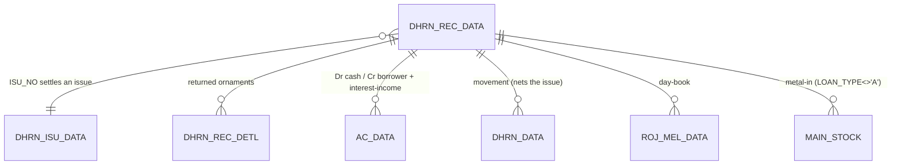
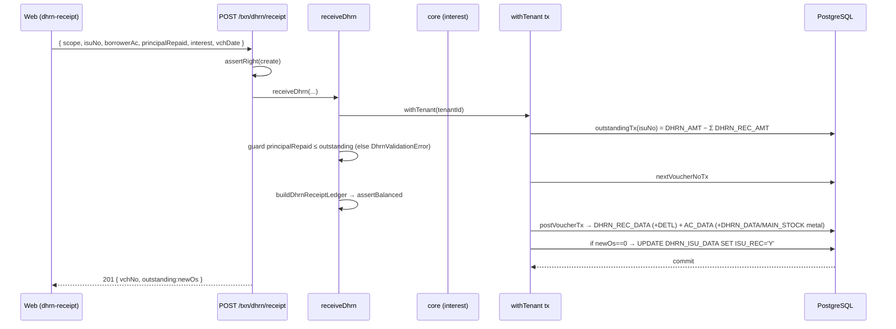

# TR_DHRN_REC — Dhrn / Pledge-Loan Repayment (deep-dive)

```
Form: TR_DHRN_REC  ·  Module: 6_Dhrn_Loans  ·  Type: transaction (posting)
Desktop source: unified/src/csharp/DataCareNext/TR_DHRN_REC.cs (8,063 lines)
                + Ac_Ledr.cs (DhrnRec_Ledr@1105), Ac_Tax.cs (DhrnRec_Data), Ac_Stock.cs (Dhrn_Rec_Stk), Ac_Rojmel.cs (DhrnRec_RojMel)
Web target: apps/api/src/modules/dhrn/dhrn.ts (receiveDhrn, outstanding) · apps/web/app/(app)/txn/dhrn-receipt
Requirements: Req 15.1 (receipt reduces principal + records interest separately), 15.3 (day-count interest), 13 (ledger)
Parity: 06_Parity/dhrn.md   ·   Status: 📋 SPEC · 🟩 BUILT
Evidence: spec project-memory/parity/spec-dhrn.md §2; form catalog project-memory/catalogs/forms/TR_DHRN_REC.md
```

## 1. Purpose & business context

The repayment counter. The customer comes to redeem a pledge: the operator picks the source
**issue** (`ISU_NO`), the app **auto-computes the accrued interest** on the outstanding principal
from the issue/last-settled date to today, and the customer pays **principal + interest**. The
principal portion reduces the **outstanding** (`DHRN_AMT − Σ receipts`); the interest portion is
booked to **interest income** separately. The redeemed ornaments are listed in a returned-items grid
(`DHRN_REC_DETL`) and, on **full** repayment, the source issue is closed (`ISU_REC='Y'`) and the
packet released. Rounding write-offs (`KASAR_AMT`), advance receipts (`UNCHAK_DHRN_REC`), and
metal **rate-cut** settlement (`RCUT_*`) are supported. Uses book **`DHIRAN RECEIVED`**
(`INOUT='I'`, `ENTRY_TYPE='D'`); the same form serves **`LOAN ISSUE`** (`ENTRY_TYPE='L'`) to disburse
a loan (the mirror).

## 2. UI / UX specification

### Layout
```
┌─ TR_DHRN_REC ─ DHIRAN RECEIVED ─────────────────────── [New][Save F2][Delete][Print][Close] ┐
│ VchNo:[_____] Date:[__/__/____]  Bill:[____]  Party:[AC_CODE ▾][AC_NAME .........] Paid-to:[__]│
│ Source Issue No:[____] IsuDate:[__/__/__]  FromDate:[__/__/__] ToDate:[__/__/__]  ☐ chkInt    │
│ Original principal:[______]   Outstanding (nPandingDhrn):[______]                            │
│ IntMonths:[auto] IntDays:[auto]  Int%(INT_PRC):[____]   Interest due (INT_AMT):[auto]         │
│ Principal recd (DHRN_REC_AMT):[______]  Interest recd (INT_REC_AMT):[auto]  Kasar:[____]      │
│ Advance/unchecked (UNCHAK_DHRN_REC):[____]  Dhiran adjust (DHRN_ADJ_AMT):[____]               │
│ Rate-cut (metal): FineRate[____] RcutAmt[____] PayAmt[____] OsAmt[____]                       │
│ ┌ Returned ornaments (→ DHRN_REC_DETL) ───────────────────────────────────────────────────┐  │
│ │ Sr│ItCode│ItName│Pcs│RecQty│GrWt│NetWt│RecNwt│Touch│Fine│Rate│ItAmt│NetAmt│ Packet        │  │
│ └────────────────────────────────────────────────────────────────────────────────────────┘  │
│ Gold: Amt[Σ NetAmt]  Wt[Σ GrWt]      OutstandingAfter (DHRN_OS_AMT):[auto]   Narration:[.....]│
└────────────────────────────────────────────────────────────────────────────────────────────────┘
```

### Header field table (`DHRN_REC_DATA`)
| Label | Column | Type | Req | Default | Notes |
|---|---|---|---|---|---|
| VchNo / Date / Bill | `VCH_NO`/`VCH_DATE`/`DHRN_BILL` | — | ✓ | — | as issue; lock-date guard |
| Party | `AC_CODE`,`AC_NAME` | lookup | ✓ | — | borrower being settled |
| Paid-to a/c | `LEDR_ACCD` | lookup→`AC_MAST` | — | — | cash/bank receiving the money |
| Source issue | `ISU_NO`,`ISU_LC`,`ISU_YRCD`,`ISU_DBCD` | lookup→`DHRN_ISU_DATA` | ✓ | — | which dhiran is repaid |
| Issue date | `DHRN_DATE` | date | auto | from issue | original issue date |
| From / To date | `FROM_DATE`/`TO_DATE` | date | ✓ | — | interest period being settled |
| Original principal | `DHRN_AMT` | money/fine | auto | from issue | of the source issue |
| Outstanding | `nPandingDhrn` (→ `DHRN_OS_AMT`) | money | auto | issue−Σrec | principal still due **before** this receipt |
| Principal received | `DHRN_REC_AMT` | money | — | =outstanding | principal repaid now |
| Advance / unchecked | `UNCHAK_DHRN_REC` | money | — | 0 | advance dhiran receipt |
| Dhiran adjust | `DHRN_ADJ_AMT` | money | — | 0 | adjustment to principal |
| Months / Int days | `INT_MONTH`/`INT_DAY` | int | auto | — | derived (§4.2) |
| Annual int % | `INT_PRC` | % | auto | from issue | |
| Interest due | `INT_AMT` | money/fine | **auto** | computed | server-side (§4.2) |
| Interest received | `INT_REC_AMT` | money | — | =`INT_AMT` | |
| Interest kasar | `KASAR_AMT` | money | — | 0 | rounding write-off |
| Pending-int / adj | `PAN_ADJ_AMT`/`ADJ_INT`/`ADJ_DHRN` | money | — | 0 | adjustments |
| `chkInt` checkbox | — | bool | — | off | enable annual compounding when tenure > 1 yr |
| Rate-cut (metal) | `RCUT_RATE`/`RCUT_AMT`/`RCUT_PAY_AMT`/`RCUT_OS_AMT` | — | — | 0 | settle a metal loan by fine-rate cut |
| Gold summary | `GOLD_AMT`(Σ NetAmt),`GOLD_WT`(Σ GrWt) | — | auto | from grid | released items |

A grid of **returned packets** writes `DHRN_REC_DETL` (mirror of `DHRN_ISU_DETL` + `REC_QTY,REC_NWT,
ISU_SRNO,ISU_NO/_LC/_YRCD`). The header `DHRN_REC_DATA` row is written **only if
`INT_AMT+INT_REC_AMT+DHRN_REC_AMT+KASAR_AMT ≠ 0`**. `// src: TR_DHRN_REC.cs#L6049 BtnSave_Click`

### Keyboard / F-keys, Lookups, Modes
- Picking the source issue loads its principal, rate, and outstanding; interest is then computed
  **server-side** (read-only to the operator, who may override received/kasar/advance). Edit mode
  (`EntryMode='E'`) suppresses recompute. Party `00050` ⇒ editable name. Same guard/print rights as issue.

## 3. Data model touched

**Writes (create)** — delete-then-insert per voucher (`// src: TR_DHRN_REC.cs#L6122-L6294`):
1. `TEMP_BOOK_DATA`, `DHRN_REC_DATA` (header), `DHRN_REC_DETL` (returned-items grid).
2. `AC_DATA` via `Ac_Ledr.DhrnRec_Ledr` (`Loan_Isu_Ledr` for LOAN ISSUE). See §4.4.
3. `ROJ_MEL_DATA` via `Ac_Rojmel.DhrnRec_RojMel`.
4. `DHRN_DATA` via `Ac_Tax.DhrnRec_Data` (movement that **nets the issue** in `RP_DHRN_OS`).
5. `MAIN_STOCK` via `Ac_Stock.Dhrn_Rec_Stk` — metal loans only; `ITM_SIGN='+'` (custody returns),
   qty=`DHRN_REC_AMT+INT_REC_AMT`, where `RCUT_AMT=0`.
6. `UPDATE DHRN_ISU_DATA SET ISU_REC='Y'` when the source issue is fully repaid (joined via `ISU_NO`).
7. `Ac_Tax.Vch_Remark(book,vch,0)`.

**Deletes/reverses:** `REMARK_DATA, TEMP_BOOK_DATA, DHRN_DATA, AC_DATA, ROJ_MEL_DATA, MAIN_STOCK,
DHRN_REC_DATA, DHRN_REC_DETL` + reset source `ISU_REC='N'` + `DELETE_DATA`. `// src: TR_DHRN_REC.cs#L6365-L6386`

Table refs: [DHRN_REC_DATA](../../02_Data_Model/tables/DHRN_REC_DATA.md) ·
[DHRN_ISU_DATA](../../02_Data_Model/tables/DHRN_ISU_DATA.md) ·
[AC_DATA](../../02_Data_Model/tables/AC_DATA.md) · [DHRN_DATA](../../02_Data_Model/tables/DHRN_DATA.md)



## 4. Business logic & calculations (with code)

### 4.1 Outstanding principal (the basis of everything)
`nPandingDhrn` = source issue principal − Σ prior receipts (per `ISU_NO`). This is the principal the
interest is charged on and the maximum that can be repaid.
```ts
// web: dhrn.ts#outstandingTx — RP_DHRN_OS parity
principal = SELECT DHRN_AMT FROM DHRN_ISU_DATA WHERE VCH_NO=:isuNo
recovered = SELECT sum(DHRN_REC_AMT) FROM DHRN_REC_DATA WHERE ISU_NO=:isuNo
outstanding = round2(principal − recovered)
```
> Desktop `RP_DHRN_OS` nets **`DHRN_REC_AMT + UNCHAK_DHRN_REC`** (advance included); the web currently
> ignores `UNCHAK_DHRN_REC` — see §11.

### 4.2 EXACT interest auto-computation — desktop evidence (the authoritative formula)
`// src: TR_DHRN_REC.cs#L6879-L7035 (BILL_TOTAL)` — runs server-side, **not** when `EntryMode='E'`.
Let `P = nPandingDhrn` (outstanding), `dp = (cboLoanType.SelectedIndex==0 ? 0 : 3)`.

```csharp
// STEP A — interest DAYS
if (MsIntDayCalc == "2") nIntDays = |DateDiff(day, toDate, fromDate)| + 1;   // inclusive variant
else                     nIntDays = |DateDiff(day, toDate, fromDate)|;       // actual days

if (CurIntTypeCalc == "M") {                 // MONTHLY mode: bucket days to whole 30-day months
    months   = Round(|DateDiff(day,toDate,fromDate)| / 365.0 * 360.0 / 30.0);  // nIntMonth
    nIntDays = months * 30;
    nIntDays = nIntDays - |nIntDays - Round(nIntDays/30.0)*30.0|;               // snap to ×30
}
nIntYear = nIntDays / 365.0;

// STEP B — interest AMOUNT
if (chkInt.Checked && nIntYear > 1) {        // ANNUAL COMPOUNDING (360-day years)
    num = P; acc = 0; consumed = 0;
    for (y = 1; y <= Round(nIntYear); y++) {
        yrInt = Round( num * (INT_PRC/100.0) / MsIntYearDays * 360.0 , 2);   // "0.00"
        acc += yrInt;  num += yrInt;  consumed += 360;                       // capitalise each year
    }
    nIntAmt = Round( num * (INT_PRC/100.0) / MsIntYearDays * (nIntDays - consumed) + acc , dp);
} else {                                      // SIMPLE interest
    nIntAmt = Round( P * (INT_PRC/100.0) / MsIntYearDays * nIntDays , dp);
}

// STEP C — defaults (non-edit mode)
INT_REC_AMT = nIntAmt;  DHRN_REC_AMT /*received*/ = nPandingDhrn;
DHRN_OS_AMT = nPandingDhrn - (UNCHAK_DHRN_REC + DHRN_ADJ_AMT);
```

> **Net: simple interest = OutstandingPrincipal × INT_PRC% × days ÷ `MsIntYearDays`,** with `days`
> bucketed to whole months×30 in monthly mode; optional **annual compounding** (360-day years,
> interest capitalised yearly) when `chkInt` is checked and tenure > 1 year. The receipt defaults to
> repaying the **full outstanding** with interest **equal to** the accrued amount.

### 4.3 Web target (`dhrn.ts → receiveDhrn`)
```ts
// web: dhrn.ts#receiveDhrn — reduce outstanding, book interest separately, guard over-repayment
const before = await outstandingTx(tx, scope, isuNo);
if (principalRepaid > before + 1e-6)
  throw new DhrnValidationError(`principal repaid (${principalRepaid}) exceeds outstanding (${before})`);
const newOs  = round2(before - principalRepaid);
const ledger = buildDhrnReceiptLedger(key, loanAc, cashAc, intIncAc, principalRepaid, interest);
assertBalanced(ledger);                       // ΣDr = ΣCr
await postVoucherTx(tx, tenantId, { ledger:{ table:'AC_DATA', lines:ledger },
  writes:[{ table:'DHRN_REC_DATA', rows:[{ ...key, DHRN_REC_AMT:principalRepaid,
            INT_AMT:interest, INT_REC_AMT:interest, DHRN_OS_AMT:newOs, ISU_NO:String(isuNo) }] }] });
return { vchNo, outstanding: newOs };
```
`buildDhrnReceiptLedger`: **Dr cash `(principal+interest)` / Cr borrower `principal` / Cr interest-income `interest`** (interest leg only when `interest>0`).

### 4.4 Balanced `AC_DATA` legs — `DhrnRec_Ledr` (cash `LOAN_TYPE='A'`)
`// src: Ac_Ledr.cs#L1105 DhrnRec_Ledr` — `MAIN_BOOK='DHIRAN RECEIVED' AND BOOK_INOUT='I'`. 17 legs; salient:

| leg | Dr | Cr | amount | condition |
|---|---|---|---|---|
| 01/02 | cash `LEDR_ACCD` | borrower | `DHRN_REC_AMT − KASAR_AMT` | principal only, `INT_REC_AMT=0` |
| 03/04 | cash `LEDR_ACCD` | borrower | `DHRN_REC_AMT` | principal when interest also received |
| 05/06 | borrower | interest-income (`SR_NO=2`) | `INT_AMT` | **accrued interest booked** |
| 07/08 | cash `LEDR_ACCD` | borrower | `INT_REC_AMT − KASAR_AMT` | **interest received** |
| 09/10 | borrower | kasar (`SR_NO=3`) | `KASAR_AMT` | rounding write-off |
| 11 | — | — | `DHRN_REC_AMT−KASAR_AMT` | metal: `SIGN='+'`, `FINE_WT` (custody returns) |
| 12 | — | — | `INT_AMT` | metal: `SIGN='-'` interest accrued (fine) |
| 13 | — | — | `INT_REC_AMT` | metal: `SIGN='+'` interest received (fine) |
| 14/15 | gold `00003` / silver `00004` | borrower | `RCUT_AMT` | metal rate-cut settlement (`RCUT_RATE≠0`) |
| 16/17 | cash `LEDR_ACCD` | borrower | `RCUT_PAY_AMT` | rate-cut cash leg |
| 18/19 | (opening) | | `DHRN_REC_AMT`/`INT_AMT` | `MsOpDhiran='Y'`, pre-`MOp_dt` |

> **Principal repaid reduces the receivable (Cr borrower); interest is a separate Cr to
> interest-income — never mixed into principal.** This separation is the key parity requirement (Req 15.1).

### 4.5 Precision & rounding
`dp = LOAN_TYPE==='A' ? 0 : 3` (cash whole-rupees / metal fine-grams). Compounding sub-steps round to
2 dp; the final amount to `dp`. Desktop `Math.Round` defaults to **banker's rounding** — reconcile vs HALF-UP (see §11).

## 5. Save sequence (create / edit)

`// src: TR_DHRN_REC.cs#L6049 BtnSave_Click`

Desktop order: guards (licence/type/lock/rights/party/vchno; **"Please Select Dhiran Isu No and Try…."**
if no source issue `// src: TR_DHRN_REC.cs#L8008`) → collision bump → delete-then-insert
`TEMP_BOOK_DATA`/`DHRN_REC_DATA`/`DHRN_REC_DETL` → `DhrnRec_Ledr` → `DhrnRec_RojMel` → `DhrnRec_Data` →
`Dhrn_Rec_Stk` (metal) → `ISU_REC='Y'` on full repay → `Vch_Remark`. **Edit = delete-then-repost.**

## 6. Delete / reverse sequence

`// src: TR_DHRN_REC.cs#L6348 BtnDelete_Click` — block on lock-date / no `USER_DELETE`; confirm;
write `DELETE_DATA`; **reset source issue `ISU_REC='N'`** (re-opens the loan); purge
`DHRN_DATA, AC_DATA, ROJ_MEL_DATA, MAIN_STOCK, DHRN_REC_DATA, DHRN_REC_DETL, REMARK_DATA, TEMP_BOOK_DATA`.
Web: `deleteDhrn({ headerTable:'DHRN_REC_DATA', book:'DRC', vchType:'DREC' })` (one tx, `USER_DELETE`).
> The web reversal must also reset the source issue `ISU_REC='N'`, else a deleted full-repayment leaves the loan wrongly closed.

## 7. API contract

```ts
// POST /txn/dhrn/receipt   (right: create)
interface DhrnReceiptInput {
  scope: VoucherScope;
  isuNo: number|string;          // ISU_NO — the issue being repaid (required)
  borrowerAc: string; borrowerName?: string;
  principalRepaid: number;       // DHRN_REC_AMT (>= 0)
  interest: number;              // INT_REC_AMT (>= 0)  — booked to interest-income separately
  intPrc?: number;               // INT_PRC (for the row)
  loanAc?: string;  cashAc?: string;  intIncAc?: string;  // defaults 'DHRN' / 'CASH' / 'INTINC'
  vchDate?: string|Date;
}
// → 201 { vchNo:number, outstanding:number }   // outstanding AFTER this receipt
```
Errors: `DhrnValidationError`→400 (negative amounts; **principalRepaid > outstanding**; zero repayment),
`ForbiddenError`→403, `PeriodLockValidationError`→400.

## 8. Validation rules

| Rule | Condition | Desktop message | HTTP | req |
|---|---|---|---|---|
| Source issue required | no `ISU_NO` | "Please Select Dhiran Isu No and Try…." | 400 | 15.1 |
| Party required | `AC_CODE=''` | "Please Insert Party and try" | 400 | 15.1 |
| VchNo present | `VCH_NO=''` | "Please Insert VchNo and try" | 400 | 9 |
| Period open | `MsLockDt ≥ VCH_DATE` | "You Cant Save and Delete … Lock Date is = …" | 400 | — |
| Rights | no `USER_UPDATE` on edit | "You Have No Rights....." | 403 | 6.x |
| **Over-repayment guarded** | `principalRepaid > outstanding` | (web) "principal repaid (x) exceeds outstanding (y)" | 400 | 15.1 |
| Positive repayment | `principalRepaid+interest ≤ 0` | (web) "repayment must be positive" | 400 | 15.1 |
| Non-negative amounts | `principalRepaid<0 OR interest<0` | (web) "amounts must be non-negative" | 400 | 15.1 |
| Header write skip | `INT_AMT+INT_REC_AMT+DHRN_REC_AMT+KASAR_AMT = 0` | — (no row written) | — | — |
| Balanced ledger | ΣCR≠ΣDR | — (invariant) | 500 | 13.1 |

> **Over-repayment is the one guard the desktop does *not* hard-enforce** — it defaults
> `DHRN_REC_AMT = nPandingDhrn` (full outstanding) and trusts the operator. The web adds an explicit
> guard (`principalRepaid > outstanding` → 400). Keep the web guard; document the desktop default.
`// src: TR_DHRN_REC.cs#L6960 (nDhrnReceived = nPandingDhrn); web: dhrn.ts#receiveDhrn over-repay check`

## 9. Parity criteria (Definition of Done)

1. `outstanding(isuNo)` = `DHRN_AMT − Σ DHRN_REC_AMT` matches `RP_DHRN_OS` for the issue (advance handling agreed).
2. `INT_AMT` reproduces the §4.2 day-count engine (whole-month bucketing in monthly mode; annual
   compounding when `chkInt` & tenure>1 yr) at the loan-type dp (0 cash / 3 metal).
3. `DHRN_REC_DATA` persists `DHRN_REC_AMT, INT_AMT, INT_REC_AMT, KASAR_AMT, DHRN_OS_AMT, UNCHAK_DHRN_REC,
   ISU_NO/_LC/_YRCD/_DBCD` matching the desktop.
4. `AC_DATA` legs match `DhrnRec_Ledr`: **principal repaid → Cr borrower; interest → Cr interest-income**
   (separated); kasar/rate-cut/advance legs present; ΣCR=ΣDR.
5. `DHRN_DATA` movement nets the right issue; metal loans return custody via `MAIN_STOCK` (`ITM_SIGN='+'`).
6. Full repayment sets source `ISU_REC='Y'`; partial leaves it `'N'`. Delete reverses and resets `ISU_REC='N'`.
Fixtures: `06_Parity/dhrn.md`. Golden vector: `P=100000, INT_PRC=24, 3 months monthly, yearDays=360 ⇒ days=90, interest = 100000×0.24×90/360 = 6000`.

## 10. Variants & edge cases

| Variant | Delta vs DHIRAN RECEIVED |
|---|---|
| `LOAN ISSUE` (same form, `ENTRY_TYPE='L'`) | Mirror: **disburses** a loan via `Loan_Isu_Ledr`/`Loan_Isu_RojMel`/`Loan_Isu_Data`/`Loan_Isu_Stk`. |
| Partial repayment | `DHRN_REC_AMT < outstanding` ⇒ `DHRN_OS_AMT>0`, `ISU_REC` stays `'N'`; interest charged on remaining balance next time. |
| Annual compounding | `chkInt` + tenure > 1 yr ⇒ interest capitalised each 360-day year (§4.2 loop). |
| Interest kasar | `KASAR_AMT` writes off rounding; legs 09/10 (`SR_NO=3`); reduces cash legs by KASAR. |
| Advance / unchecked | `UNCHAK_DHRN_REC` advance receipt; nets outstanding in `RP_DHRN_OS`. |
| Metal rate-cut | `RCUT_RATE/RCUT_AMT/RCUT_PAY_AMT/RCUT_OS_AMT` settle a `G`/`S` loan by fine-rate cut (legs 14–17, `00003`/`00004`). |
| Renewal | Repayment that rolls into a fresh issue (linked via `OLD_ISU_*` on the new `TR_DHRN_ISU`). |

## 11. Open questions / risks

- **Advance in outstanding.** `RP_DHRN_OS` nets `DHRN_REC_AMT + UNCHAK_DHRN_REC`; the web
  `outstandingTx` nets only `DHRN_REC_AMT`. Add `UNCHAK_DHRN_REC` (and decide on `DHRN_ADJ_AMT`) for report parity.
- **Rounding mode + dp.** Same risk as issue: desktop `Math.Round` (banker's) at 0 dp (cash) / 3 dp
  (metal); web `round2` HALF-UP. The compounding loop rounds yearly interest to 2 dp regardless — confirm on the golden master.
- **Interest source date.** `FROM_DATE` defaults from the issue / last settled `TO_DATE`; the web
  passes interest in pre-computed. Wire the OS "as-of" date logic (`RP_DHRN_OS` uses the latest `DHRN_DATA.TO_DATE`).
- **Unwritten satellites.** Web `receiveDhrn` does not yet write `ROJ_MEL_DATA`, `MAIN_STOCK` (metal
  return), `DHRN_REC_DETL` (returned items), kasar/rate-cut/advance legs, or reset `ISU_REC` on delete.
- **Receivable account.** As in issue, the web Cr's a generic `'DHRN'`; the desktop credits the actual borrower `AC_CODE`.
- **`MsIntDayCalc`/inclusive day.** The `+1` inclusive-day variant (`MsIntDayCalc='2'`) changes day
  counts by one; surface this flag rather than assuming exclusive day-count.
