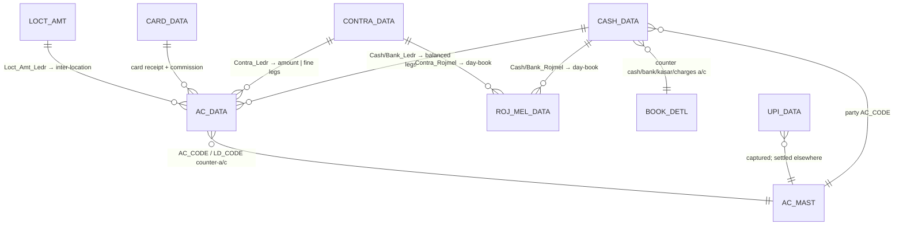

# Module 7 — Finance / Cash-Bank

> The money side of every party ledger: cash & bank **receipts** and **payments**, account-to-account
> **contra/journal** transfers, and the card / UPI / cheque / inter-location settlement variants.
> Every voucher here posts a **balanced** `AC_DATA` ledger (Req 17.1) and a parallel `ROJ_MEL_DATA`
> day-book, so the trial balance and the daily cash/bank book tie to the desktop to the paisa.
> Deep-dives: [`TR_CASH.md`](TR_CASH.md) (receipt **and** payment) and [`TR_CONTRA.md`](TR_CONTRA.md)
> (transfer / fine-journal). Variants reuse those engines and document only their deltas.

## 1. Purpose

This module records **non-trading money movement** — settling what customers owe and what we owe
suppliers/expenses, moving funds between cash and bank, and capturing the instrument detail
(cheque, card, UPI). It does **not** sell or buy goods (that is Sales/Purchase); it touches no stock
or tags. Its job is purely accounting: hit the right ledger accounts, keep debits = credits, and
feed the cash/bank day-book (`RojMel`) and trial balance. Books used: **`CASH REC`**, **`CASH PAY`**,
**`BANK REC`**, **`BANK PAY`**, **`CONTRA`**, **`FINE JV`** (and inter-location for `TR_LOCT_AMT`).

## 2. Form inventory

| Form | Type | Posting | Purpose | Tables (header → ledger) | Web status |
|---|---|---|---|---|---|
| [`TR_CASH`](TR_CASH.md) | transaction | ✅ | Receipt **&** payment, cash **&** bank — one form, driven by the book's `INOUT_TYPE` | `CASH_DATA` → `AC_DATA` + `ROJ_MEL_DATA` (+ `APR_IDTL`, `REMARK_DATA`) | 🟩 BUILT (`finance.ts` `postReceipt`/`postPayment`) |
| [`TR_CONTRA`](TR_CONTRA.md) | transaction | ✅ | Account→account transfer (cash↔bank, ledger↔ledger) **&** fine/metal journal (`FINE JV`) | `CONTRA_DATA` → `AC_DATA` + `ROJ_MEL_DATA` | 🟩 BUILT (`finance.ts` `postContra`; `journal.ts` `postJournal`) |
| [`TR_CARD_REC`](TR_CARD_REC.md) | transaction | ✅ | Card receipt with acquirer **commission** split; can settle a gold-loan (dhrn) | `CARD_DATA` → `AC_DATA` + `ROJ_MEL_DATA` (+ `DHRN_*`, `MAIN_STOCK`) | 🟩 PARTIAL (`finance.ts` `postReceipt` mode=`card`) |
| [`TR_UPI_REC`](TR_UPI_REC.md) | transaction | ⚠️ no | UPI receipt **capture/reconciliation register** (no ledger of its own) | `UPI_DATA` only | 🟦 PARTIAL (web folds into `postReceipt` mode=`upi`) |
| [`TR_LOCT_AMT`](TR_LOCT_AMT.md) | transaction | ✅ | Inter-**location** (branch) fund transfer/settlement | `LOCT_AMT` → `AC_DATA` + `ROJ_MEL_DATA` | ⬛ UNBUILT |
| `UT_BANK` | utility | — | Bank reconciliation / cheque-clearing utility (updates `AC_DATA`, `CASH_DATA` clearing) | `AC_DATA`, `CASH_DATA` | ⬛ UNBUILT |

`src:` form set from `03_Modules/MODULE_MAP.md` (Module "Finance / Cash-Bank", 6 forms, 4 posting).
`UT_BANK` is documented in Utilities; it is listed here for completeness because it mutates
`CASH_DATA.CLR_DATE` / `AC_DATA` for cheque clearing.

## 3. Module ER diagram



`AC_DATA` (the double-entry ledger), `ROJ_MEL_DATA` (the day-book), `AC_MAST` (accounts), and
`BOOK_DETL` (per-book counter-account config) are **shared** — see
[`02_Data_Model/tables`](../../02_Data_Model/tables/). Table refs:
[CASH_DATA](../../02_Data_Model/tables/CASH_DATA.md) ·
[CONTRA_DATA](../../02_Data_Model/tables/CONTRA_DATA.md) ·
[CARD_DATA](../../02_Data_Model/tables/CARD_DATA.md) ·
[UPI_DATA](../../02_Data_Model/tables/UPI_DATA.md) ·
[AC_DATA](../../02_Data_Model/tables/AC_DATA.md) ·
[ROJ_MEL_DATA](../../02_Data_Model/tables/ROJ_MEL_DATA.md).

## 4. Shared logic (the finance posting engine)

The whole module is a thin UI over the **posting engine** ([`04_Cross_Cutting_Engines/posting-and-ledger.md`](../../04_Cross_Cutting_Engines/posting-and-ledger.md)).
Desktop centralizes posting in `Ac_Ledr.cs` (ledger) + `Ac_Rojmel.cs` (day-book); the web reference
is `apps/api/src/modules/finance/{finance,journal}.ts`.

- **Direction is data, not code.** The same form/table serves receipt and payment; the *book* it is
  opened under carries `MAIN_BOOK` (`CASH REC`/`CASH PAY`/`BANK REC`/`BANK PAY`) and `BOOK_INOUT`
  (`I`/`O`). The save stamps `CASH_DATA.INOUT_TYPE = FormBookInOut`. `src: TR_CASH.cs#L3031`.
- **Counter accounts come from `BOOK_DETL`,** not hard-code: `B.SR_NO=1` = the cash/bank control
  a/c, `SR_NO=2` = kasar (cash-discount) a/c, `SR_NO=3` = bank-charges a/c. `Cash_Ledr`/`Bank_Ledr`
  `LEFT JOIN BOOK_DETL` to resolve them. `src: Ac_Ledr.cs#L565,#L585`.
- **Receipt = Dr cash/bank, Cr party. Payment = Dr party, Cr cash/bank** (Req 17.4). Each money
  movement writes **two** balanced `AC_DATA` rows (the party leg + the cash/bank leg). `KASAR_AMT`
  (rounding/cash-discount) and `BANK_CHARGES` add their own balanced pairs. `src: Ac_Ledr.cs#L567-L583`.
- **Contra = Dr one account / Cr another for the same amount** (Req 17.3); `FINE JV` does the same
  with metal `FINE_WT` legs instead of money. `src: Ac_Ledr.cs#L840` (`Contra_Ledr`).
- **Day-book mirror:** every posted voucher also writes `ROJ_MEL_DATA` (both sides) so the RojMel
  cash/bank book reconciles; bank legs key on **`CLR_DATE`** (cheque clearing), not voucher date.
  `src: Ac_Rojmel.cs#L179` (`Cash_Rojmel`), `#L195` (`Bank_Rojmel`).
- **Money precision:** amounts `NUMERIC(_,2)`, **HALF-UP**; metal `FINE_WT` 3 dp (see
  [`conventions.md §2`](../../01_Architecture/conventions.md)). No rounding mode may change without an ADR.

Web entry points (the spec):
```ts
// apps/api/src/modules/finance/finance.ts
postReceipt(prisma, { scope, partyAc, amount, mode, bankAc?, chqNo?, pan? })  // Dr cash/bank · Cr party
postPayment(prisma, { scope, partyAc, amount, mode, bankAc?, chqNo?, pan? })  // Dr party · Cr cash/bank
postContra (prisma, { scope, fromAc, toAc, amount })                          // Dr toAc · Cr fromAc
deleteFinance(prisma, { scope, vchNo, headerTable, book, vchType })           // reverse + DELETE_DATA
// apps/api/src/modules/finance/journal.ts
postJournal(prisma, { scope, lines:[{acCode,drAmt?,crAmt?}], narration? })    // n-line balanced JV → AC_DATA
```

## 5. Dependencies

- **Engines (build first):** posting/ledger, voucher-numbering, RBAC, period-lock. No calc/GST/stock
  engine is needed (no item math, no tax, no tags) — this is what makes Finance the *simplest*
  posting module and a good second target after Sales.
- **Masters:** `AC_MAST` (party + cash/bank/expense accounts), `BOOK_DATA`/`BOOK_DETL` (book →
  counter-account map), `EMP_MAST` (optional `EMP_CODE`), `CO_SET` (`LOCK_DATE`, `CASH_LIMIT`).
- **Day-book/reports:** `ROJ_MEL_DATA` feeds `RojMelCash.rpt` / `RP_ROJMEL`; receipts/payments print
  `CashBankBill.rpt` / `PaymentVch.rpt`; contra prints `ContraBill.rpt`.
- **Cross-module:** `TR_CARD_REC` can settle a **dhrn** (gold-loan) — Module 6.

## 6. API surface (full contracts in the form deep-dives)

| Method | Path | Right | Purpose |
|---|---|---|---|
| POST | `/txn/receipts` | create | Cash/bank/card/UPI/cheque receipt (`postReceipt`) |
| POST | `/txn/payments` | create | Cash/bank/cheque payment (`postPayment`) |
| POST | `/txn/contra` | create | Account↔account transfer (`postContra`) |
| POST | `/txn/journal` | create | Free-form n-line journal (`postJournal`) |
| DELETE | `/txn/{receipts\|payments\|contra\|journal}/:vchNo` | delete | Reverse + `DELETE_DATA` |
| GET | `/txn/receipts` etc. | — | List / register |

> ⚠️ **Security:** every mutation must be RBAC-guarded (`assertRight(create\|delete)`); these
> endpoints move money and must never be exposed unauthenticated.

## 7. Build checklist

- [ ] Posting + numbering engines parity-green (a finance voucher is the smallest posting unit).
- [ ] `TR_CASH` receipt **and** payment, cash **and** bank, persist `CASH_DATA` + the **2-leg**
      `AC_DATA` (+ KASAR/charges legs) field-for-field vs desktop; ΣCr = ΣDr.
- [ ] `ROJ_MEL_DATA` day-book rows written (both sides; bank on `CLR_DATE`) — **gap in current web**.
- [ ] `TR_CONTRA` transfer posts Dr/Cr same amount; `FINE JV` posts metal legs.
- [ ] Cash-limit rule implemented per the **resolved** Req 17.2 decision (see §11 of `TR_CASH.md`).
- [ ] Delete reverses the header + `AC_DATA` (+ `ROJ_MEL_DATA`) and writes `DELETE_DATA`; needs `USER_DELETE`.
- [ ] Card commission split (`CARD_DATA`) and UPI capture (`UPI_DATA`) match desktop.
- [ ] Trial balance over all `AC_DATA` still nets to zero after a batch of receipts/payments/contra + deletes.
- [ ] Parity fixtures under `06_Parity/finance.md` (cross-ref `project-memory/parity/verify-finance.md`).
