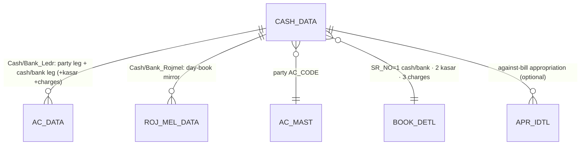

# TR_CASH — Cash / Bank Receipt & Payment (deep-dive)

```
Form: TR_CASH  ·  Module: 7_Finance_CashBank  ·  Type: transaction (posting)
Desktop source: unified/src/csharp/DataCareNext/TR_CASH.cs (3,849 lines) + Ac_Ledr.cs (Cash_Ledr/Bank_Ledr), Ac_Rojmel.cs (Cash_Rojmel/Bank_Rojmel), DC_Main.cs (LedrCash, MsCashLimit)
Web target: apps/api/src/modules/finance/finance.ts (postReceipt/postPayment/deleteFinance) · apps/web/app/(app)/txn/{receipts,payments}
Requirements: Req 17.1 (balanced 2-leg), 17.2 (cash-limit/PAN), 17.4 (card/UPI/cheque → bank), 13.1/13.4 (balanced/reverse), 9 (numbering)
Parity: 06_Parity/finance.md  ·  cross-ref project-memory/parity/verify-finance.md
Status: 📋 SPEC · 🟩 BUILT (web postReceipt/postPayment)
Evidence: form catalog project-memory/catalogs/forms/TR_CASH.md
```

## 1. Purpose & business context

The cash/bank counter. A user picks a party (customer or supplier), enters the amount received or
paid, optionally a cheque/clearing date, a kasar (cash discount / round-off given) and (for bank)
bank charges, then saves. **One form serves four flows** — cash receipt, cash payment, bank receipt,
bank payment — decided entirely by the **book** the form is launched under
(`MAIN_BOOK ∈ {CASH REC, CASH PAY, BANK REC, BANK PAY}`, `BOOK_INOUT ∈ {I, O}`). On save the app
numbers the voucher, writes one `CASH_DATA` row per grid line, posts a **balanced** party↔cash/bank
`AC_DATA` ledger, mirrors it into the `ROJ_MEL_DATA` day-book, optionally adjusts outstanding bills
(`APR_IDTL`), and prints a receipt/payment voucher. It touches **no stock and no tax**.

> **Receipt vs payment is a type flag, confirmed.** The save stamps
> `CASH_DATA.INOUT_TYPE = FormBookInOut` and `VCH_TYPE = FormBookSname` from the launching book; the
> ledger router then calls `Cash_Ledr`/`Bank_Ledr` which branch on `B.MAIN_BOOK`. One form, one
> table, direction carried by data. `src: TR_CASH.cs#L3030-L3032`.

## 2. UI / UX specification

### Layout
```
┌─ TR_CASH ─ [book: CASH REC | CASH PAY | BANK REC | BANK PAY] ──── [New][Save F2][Del][Print][Close] ┐
│ Vch No: [_____]  Date: [__/__/____]   HdVchNo: [_____]   Emp: [__ ▾]                                │
│ ┌ Lines ───────────────────────────────────────────────────────────────────────────────────────┐  │
│ │ Sr │ AcCode │ Ac Name │ Chq No │ Clearing Dt │ Amount │ Bank Charges │ Kasar │ … │ Narration │  │
│ │  1 │ [____] │ …       │        │  __/__/____ │  ____  │    (bank)    │  ___  │   │           │  │
│ └─────────────────────────────────────────────────────────────────────────────────────────────┘  │
│ Totals → Amount: [....]   Kasar: [....]                                            (no tax/stock)   │
└─────────────────────────────────────────────────────────────────────────────────────────────────┘
```

### Header field table
| Label | Column (`CASH_DATA`) | Type | Req | Default | Editable when | Notes |
|---|---|---|---|---|---|---|
| Vch No | `VCH_NO` | string(8) | ✓ | next per book/year | New | re-allocated to MAX+1 on Add-mode collision · `src: TR_CASH.cs#L2972-L2986` |
| Date | `VCH_DATE` | date | ✓ | today | New/Edit | must be in open year and `> CO_SET.LOCK_DATE` |
| HdVchNo | `HD_VCH_NO` | string(10) | — | next | New | header/group voucher no (`TEMP_BOOK_DATA`) |
| Emp | `EMP_CODE` | lookup→`EMP_MAST` | cfg | — | New/Edit | required if `MsEmpCodeMendetry='Y'` · `src: TR_CASH.cs#L2901` |
| (book) | `BOOK_NAME`/`VCH_TYPE`/`INOUT_TYPE`/`ENTRY_TYPE` | — | auto | from book | — | `BOOK_NAME=FormMainBook`, `VCH_TYPE=FormBookSname`, `INOUT_TYPE=FormBookInOut`, `ENTRY_TYPE='C'` |

### Line grid columns (`CASH_DATA`, one row per non-empty line)
| Col # | Label | Column | Editable | Source / behavior |
|---|---|---|---|---|
| 0 | Sr | `SR_NO` | auto | line ordinal · `src: TR_CASH.cs#L1745` |
| 1 | AcCode | `AC_CODE` | yes | lookup→`AC_MAST`; first non-empty row → `PartyAcCode` · `src: #L1750,#L3033` |
| 2 | Ac Name | `AC_NAME` | from master | `src: #L1753` |
| 3 | Chq No | `CHQ_NO` | yes (bank) | cheque number · `src: #L1756` |
| 4 | Clearing Dt | `CLR_DATE` | yes (bank) | defaults to `VCH_DATE` if blank · `src: #L1759,#L3024-L3028` |
| 5 | Amount | `REC_AMT` | yes | the received/paid amount (the cash-limit input) · `src: #L3041` |
| 6 | Bank Charges | `BANK_CHARGES` | yes (bank) | bank fee on the txn · `src: #L3042` |
| 7 | Kasar | `KASAR_AMT` | yes | cash discount / round-off given (`const cKasarAmt = 7`) · `src: #L219,#L3043` |
| 9 | Narration | `IT_DESC` | yes | free text · `src: #L3044` |
| 11 | (cheque print name) | `CHQ_PRINT_NAME` | yes (bank) | payee for cheque print · `src: #L3046` |
| 12 | Bank Name | `BANK_NAME` | yes (bank) | drawee/depositing bank · `src: #L3047` |

> A line is **persisted only if** `AC_CODE <> '' AND (REC_AMT + KASAR_AMT) <> 0`.
> `src: TR_CASH.cs#L3015` (`(mSG[i,1]<>'') & (Val(mSG[i,7])+Val(mSG[i,5])<>0)`).

### Keyboard / F-keys (desktop → web)
- **F2 = Save**; Enter = next cell; F-key lookup on `AcCode` → `AC_MAST`.
- Web: account `LookupPicker.tsx` on the AcCode cell; Enter advances; Save button = F2.
- _(Confirm exact F-key map from `TR_CASH.cs` key handlers before final UI.)_

### Lookups
- **AcCode** → `AC_MAST` (party + cash/bank/expense accounts), scoped to `CO_CODE`/`LC_CODE`.
- **Emp** → `EMP_MAST`.

### Modes
New / Edit (loads `CASH_DATA` + re-posts on save = delete-then-repost) / View / Delete (needs
`USER_DELETE`; `USER_UPDATE` for edit) / Print (`CashBankBill.rpt` receipt, `PaymentVch.rpt` payment).

## 3. Data model touched

**Writes (create):** `CASH_DATA` (one row per line), then derived `AC_DATA` (balanced legs) and
`ROJ_MEL_DATA` (day-book), plus `REMARK_DATA` (narration via `Ac_Tax.Vch_Remark(...,3)`), `APR_IDTL`
(against-bill appropriation when the receipt is applied to specific bills), and `TEMP_BOOK_DATA`
(header/group voucher bookkeeping).

**Deletes/reverses:** `CASH_DATA, APR_IDTL, AC_DATA, ROJ_MEL_DATA, REMARK_DATA, TEMP_BOOK_DATA` by
voucher key + write `DELETE_DATA`. `src:` form catalog `project-memory/catalogs/forms/TR_CASH.md`;
`src: TR_CASH.cs#L3217-L3223`.

Table refs: [CASH_DATA](../../02_Data_Model/tables/CASH_DATA.md) ·
[AC_DATA](../../02_Data_Model/tables/AC_DATA.md) ·
[ROJ_MEL_DATA](../../02_Data_Model/tables/ROJ_MEL_DATA.md).



> `CASH_DATA` stores **money only** (`REC_AMT`, `KASAR_AMT`, `BANK_CHARGES`). There are **no** metal,
> tax, or stock columns — finance vouchers never move gold/silver fine or GST.

## 4. Business logic & calculations (with code)

There is essentially **no arithmetic on the form** — the amounts are entered, not computed. The
"logic" is the **posting**: turning each `CASH_DATA` row into balanced ledger legs. The desktop does
this server-side with `INSERT … SELECT` from `CASH_DATA` joined to `BOOK_DETL`.

### 4.1 Cash receipt posting (desktop evidence — `Cash_Ledr`)
```csharp
// src: Ac_Ledr.cs#L565  Cash_Ledr(MsBook, MsVchNo)  — CASH REC (B.MAIN_BOOK='CASH REC', BOOK_INOUT='I')
// Leg '01': Cr the PARTY for REC_AMT
INSERT INTO AC_DATA(... AC_CODE,LD_CODE,CR_AMT,DR_AMT,IT_TYPE,SIGN,DATA_TYPE ...)
SELECT ... A.AC_CODE, B.AC_CODE, REC_AMT, 0, 'A','', B.DATA_TYPE
FROM CASH_DATA A LEFT JOIN BOOK_DETL B ON … WHERE B.MAIN_BOOK='CASH REC' AND B.SR_NO=1 AND A.REC_AMT<>0
// Leg '02': Dr the CASH a/c (B.AC_CODE @ SR_NO=1) for REC_AMT
SELECT ... B.AC_CODE, A.AC_CODE, 0, REC_AMT, 'A','', …      // mirror leg
// Legs '03'/'04': Kasar (cash discount) — Cr party / Dr kasar a/c (B.AC_CODE @ SR_NO=2)
```
So **cash receipt → Cr party + Dr cash** for `REC_AMT`, and any `KASAR_AMT` → Cr party + Dr kasar
expense. `LEDR_KEY = CO_CODE+LC_CODE+CO_YEAR+CO_BOOK+VCH_NO+STR(SR_NO)+'01..'` (line-unique).
`LD_CODE` carries the **counter-account** code. `IT_TYPE='A'` (money). `src: Ac_Ledr.cs#L567-L573`.

### 4.2 Cash payment posting (desktop evidence)
```csharp
// src: Ac_Ledr.cs#L575  — CASH PAY (B.MAIN_BOOK='CASH PAY', BOOK_INOUT='O')
// Leg '05': Dr the PARTY (supplier) for REC_AMT ;  Leg '06': Cr the CASH a/c for REC_AMT
SELECT ... A.AC_CODE, B.AC_CODE, 0, REC_AMT … (Dr party)
SELECT ... B.AC_CODE, A.AC_CODE, REC_AMT, 0 … (Cr cash)
// Legs '07'/'08': Kasar
```
So **cash payment → Dr supplier + Cr cash**. (Note: in this table the *party* leg uses `REC_AMT` as
the field name for the entered amount regardless of direction; the Dr/Cr placement flips by book.)

### 4.3 Bank variant deltas (`Bank_Ledr`)
```csharp
// src: Ac_Ledr.cs#L585  Bank_Ledr — BANK REC / BANK PAY
//  • ENTRY_TIME/VCH_DATE = CASE WHEN A.VCH_DATE=A.CLR_DATE THEN A.VCH_TIME ELSE A.CLR_DATE END  (posts on CLEARING date)
//  • CHQ_NO = A.CHQ_NO
//  • BANK_CHARGES legs: Dr charges-expense (BOOK_DETL C.AC_CODE @ SR_NO=3) / Cr bank
```
Bank receipts/payments are otherwise identical to cash but (a) recognized on the **cheque clearing
date** and (b) add a bank-charges pair using a third `BOOK_DETL` account. `src: Ac_Ledr.cs#L585-L660`.

### 4.4 Day-book (`ROJ_MEL_DATA`)
```csharp
// src: Ac_Rojmel.cs#L179 Cash_Rojmel — mirrors both sides into the day-book, filtered VCH_DATE >= CO opening date
INSERT INTO ROJ_MEL_DATA(... AC_CODE,LD_CODE,CR_AMT,DR_AMT,AC_NAME, ITM_*=0, DATA_TYPE)
SELECT ... A.AC_CODE,B.AC_CODE,REC_AMT,0,A.AC_NAME, 0…0, B.DATA_TYPE  -- CASH REC leg 01 (party Cr)
// kasar leg labels AC_NAME as 'KSR - '+A.AC_NAME ; Bank_Rojmel uses A.CLR_DATE and nets REC_AMT-BANK_CHARGES to bank
```
`ROJ_MEL_DATA` carries the full item/metal column set but they are all **0** for money vouchers.

### 4.5 Web target (the spec — `finance.ts`)
```ts
// src: web/apps/api/src/modules/finance/finance.ts
export function buildTransferLedger(key, vchType, drAc, crAc, amount): LedgerLine[] {
  const base = { ...key, VCH_TYPE: vchType };
  return [
    { ...base, AC_CODE: drAc, DR_AMT: amount, CR_AMT: 0, SIGN: 'D' },   // Dr cash/bank (receipt) | Dr party (payment)
    { ...base, AC_CODE: crAc, DR_AMT: 0, CR_AMT: amount, SIGN: 'C' },   // Cr party (receipt)      | Cr cash/bank (payment)
  ];
}
export const settlementAc = (mode, bankAc) => mode === 'cash' ? 'CASH' : (bankAc ?? 'BANK'); // Req 17.4

await postReceipt(prisma, { scope, partyAc, amount, mode, bankAc, chqNo, pan });
//   → Dr settlementAc · Cr party ; CASH_DATA header ; bookName 'CASH REC'|'BANK REC' ; vchType 'CREC'|'BREC'
await postPayment(prisma, { scope, partyAc, amount, mode, bankAc, chqNo, pan });
//   → Dr party · Cr settlementAc ; PAY_DATA header ; bookName 'CASH PAY'|'BANK PAY' ; vchType 'CPAY'|'BPAY'
```
Money scale = 2 dp HALF-UP (`@datacare/core` `round`); `assertBalanced` rejects ΣCr≠ΣDr before write.

> **Parity gaps vs desktop (current web), flag for build:** (1) web posts a **single** party/cash
> pair and **omits** the `KASAR_AMT`/`BANK_CHARGES` legs and the `ROJ_MEL_DATA` day-book; (2) web
> uses symbolic `'CASH'`/`'BANK'` account codes instead of the `BOOK_DETL`-configured numeric
> counter-accounts; (3) web writes **`PAY_DATA`** for payments whereas desktop uses **one
> `CASH_DATA`** table with `INOUT_TYPE` for both directions. See §11.

## 5. Save sequence (create / edit)

Edit = delete prior voucher then repost — desktop does this inline; the web rule is reverse+repost
in **one** `withTenant` tx. Numbered (from `TR_CASH.cs` BtnSave + `finance.ts postReceipt`):

1. **Guards** (abort on any): licence, employee-mandatory, **cash-limit** (§8), company-type ≠ B,
   date-in-open-year, **period lock** (`MsLockDt`), rights (`USER_UPDATE`/edit), VchNo present.
   `src: TR_CASH.cs#L2895-L2960`.
2. On Add-mode, re-check `CASH_DATA`/`TEMP_BOOK_DATA` for VchNo collision → bump to MAX+1.
3. `DELETE FROM CASH_DATA … VCH_NO`; `DELETE FROM APR_IDTL …` (clear prior). `src: #L2988-L2989`.
4. Write `TEMP_BOOK_DATA` header row; insert one `CASH_DATA` row per non-empty grid line.
5. `DELETE FROM AC_DATA … VCH_NO`; then `Bank_Ledr` (if book BANK REC/PAY) **else** `Cash_Ledr`.
   `src: TR_CASH.cs#L3071` + the `if (FormMainBook IN 'BANK REC','BANK PAY')` router.
6. `DELETE FROM ROJ_MEL_DATA …`; then `Bank_Rojmel` else `Cash_Rojmel`. `src: #L3081`.
7. `Ac_Tax.Vch_Remark(book, vchNo, 3)` → `REMARK_DATA`; recompute party balance; print; WhatsApp.

```mermaid
sequenceDiagram
  participant U as Web (receipt/payment screen)
  participant A as POST /txn/receipts
  participant S as postReceipt / postPayment
  participant Tx as withTenant tx
  participant DB as PostgreSQL
  U->>A: { scope, partyAc, amount, mode, bankAc?, chqNo?, pan? }
  A->>A: assertRight(create)
  A->>S: postReceipt(...)
  S->>S: validate party + amount>0 ; assertCashLimit(mode,amount,pan)
  S->>Tx: withTenant(tenantId)
  Tx->>DB: nextVoucherNoTx (per-scope sequence)
  S->>S: buildTransferLedger → assertBalanced (ΣCr=ΣDr)
  Tx->>DB: postVoucherTx → CASH_DATA (+CARD_DATA/UPI_DATA) + AC_DATA legs
  Note over Tx,DB: TODO parity: also ROJ_MEL_DATA day-book + KASAR/charges legs
  DB-->>Tx: commit (rollback on any throw)
  A-->>U: 201 { vchNo }
```

## 6. Delete / reverse sequence

Desktop deletes `REMARK_DATA, TEMP_BOOK_DATA, AC_DATA, ROJ_MEL_DATA, CASH_DATA, APR_IDTL` by key and
writes a `DELETE_DATA` audit row (`src: TR_CASH.cs#L3217-L3223`). Web:
```ts
// src: finance.ts deleteFinance
await reverseVoucherTx(tx, tenantId, {
  tables: ['CASH_DATA','AC_DATA'],         // ⚠ also add ROJ_MEL_DATA, APR_IDTL, REMARK_DATA for full parity
  key,                                      // { CO_CODE, LC_CODE, CO_YEAR, CO_BOOK, VCH_NO }
  deleteLog: { table:'DELETE_DATA', row:{ ...key, VCH_TYPE, DELETE_USER } },
});
```
One transaction; requires **`USER_DELETE`**. No stock/tag restore (finance touches none). Blocked by
period lock (same `LOCK_DATE` guard as save).

## 7. API contract

```ts
// POST /txn/receipts   (right: create)
interface ReceiptBody {
  scope: { coCode; lcCode; coYear?; coBook? };       // tenantId from session
  partyAc: string; partyName?: string;
  amount: number;                                    // > 0
  mode: 'cash'|'cheque'|'card'|'upi'|'bank';
  bankAc?: string;                                   // cash/bank ledger receiving (defaults by mode)
  chqNo?: string; pan?: string; vchDate?: string; cashLimit?: number;
  cardCommissionPct?: number; bankName?: string; upiId?: string;  // card/upi detail
}
// → 201 { vchNo:number }

// POST /txn/payments  (right: create) — same shape minus card/upi detail; Dr party / Cr cash-bank
// DELETE /txn/{receipts|payments}/:vchNo  (right: delete) → { reversed:true }
// GET    /txn/receipts | /txn/payments    (list/register)
```
Errors: `FinanceValidationError` → 400 (missing party, amount ≤ 0, **PAN-required-over-limit**);
`ForbiddenError` → 403; `PeriodLockValidationError` → 400; `UnbalancedError` → 500 (invariant).
`src: finance.ts` (FinanceValidationError, assertCashLimit, postReceipt/postPayment).

## 8. Validation rules

| Rule | Condition | Desktop message (verbatim) | HTTP | req: |
|---|---|---|---|---|
| Party required | no `AC_CODE` | — (web: "party account is required") | 400 | 17.1 |
| Amount positive | `REC_AMT+KASAR_AMT = 0` ⇒ line skipped; all-zero ⇒ nothing posts | — | 400 | 17.1 |
| **Cash limit** (desktop) | book `CASH REC` & `MsCashLimit>0` & `REC_AMT + AcCash > MsCashLimit` | "Cash Recieved Limit Amount = … You Can Not Receive More Then Cash Limit… Party Name Is …" → **blocks save** | 400 | 17.2 |
| **Cash→PAN** (web) | `mode='cash'` & `amount > limit(=200000)` & no `pan` | (web) "PAN required for cash transaction over 200000" | 400 | 17.2 |
| Employee code | `MsEmpCodeMendetry='Y'` & empty `EMP_CODE` | "Please Select Employee Code and Try……" | 400 | — |
| Period open | `VCH_DATE ≤ CO_SET.LOCK_DATE` (`MsLockDt`) | "You Cant Save and Delete This Voucher Becouse Lock Date is = …" | 400 | — |
| Date in year | `VCH_DATE` outside `MCo_OpDate…MCo_ClDate` | "…Voucher Date Not In Current Year…" | 400 | — |
| Company type | `MCo_Type='B'` on Add | "You Cant Save This Voucher Becouse This Company Type is B……" | 400 | — |
| Rights (edit) | `UsUPdate≠'Y'` (or `UserEdit≠'Y'`) on Edit | "You Have No Rights….." | 403 | 6.x |
| Balanced ledger | ΣCR ≠ ΣDR (invariant) | — | 500 | 13.1 |

`src:` cash-limit `TR_CASH.cs#L2913-L2925`; period-lock/company/date/employee `#L2895-L2960`; web
`finance.ts assertCashLimit`.

> **Cash-limit mechanics (verified).** `MsCashLimit` is loaded from company `CASH_LIMIT`
> (`src: MS_OPNCOMP.cs#L713`, settings `UT_SETTING_MAIN.cs#L9173`; `<0 ⇒ 0` = disabled). `AcCash` =
> the party's existing cash-ledger credit, computed by `DC_Main.LedrCash` as
> `SUM(CR_AMT) FROM AC_DATA WHERE AC_CODE=party AND LD_CODE='00001'`, **minus** the current
> voucher's own contribution (so edits don't double-count). `src: DC_Main.cs#L2149-L2167`. The check
> is therefore a **cumulative per-party cash ceiling** (the same guard appears in `TR_SALE`,
> `TR_SALE_RTN`, `TR_BILL_TO`, etc., with a hard-coded exempt account `00045`/`00020`).

## 9. Parity criteria (Definition of Done)

1. For a given desktop receipt/payment input, the web persists the **same `CASH_DATA` row(s)**
   (`AC_CODE, REC_AMT, KASAR_AMT, BANK_CHARGES, CHQ_NO, CLR_DATE, INOUT_TYPE, VCH_TYPE, BOOK_NAME`).
2. `AC_DATA` legs match field-for-field: the **party leg** + the **cash/bank leg** (+ kasar +
   bank-charges pairs), with identical `AC_CODE`/`LD_CODE`(counter), `CR_AMT`/`DR_AMT`, `LEDR_KEY`,
   `BOOK_NAME`, `IT_TYPE='A'`, and **ΣCR = ΣDR**.
3. `ROJ_MEL_DATA` day-book rows match (both sides; bank on `CLR_DATE`; kasar labelled `KSR - <name>`).
4. Cash-limit / PAN rule fires at the desktop boundary (per the §11 resolution).
5. Delete removes the header + `AC_DATA` (+ `ROJ_MEL_DATA`, `APR_IDTL`, `REMARK_DATA`) and writes a
   `DELETE_DATA` row; trial balance still nets to zero.
6. Receipt/payment voucher PDF carries the same fields as `CashBankBill.rpt` / `PaymentVch.rpt`.

Fixtures/scripts: `06_Parity/finance.md`; cross-ref `project-memory/parity/verify-finance.md`.

## 10. Variants & edge cases

| Variant | Delta vs TR_CASH |
|---|---|
| **Cash receipt** (`CASH REC`, `INOUT_TYPE='I'`) | Cr party / Dr cash; subject to cash-limit. |
| **Cash payment** (`CASH PAY`, `'O'`) | Dr party / Cr cash. |
| **Bank receipt** (`BANK REC`, `'I'`) | + `CHQ_NO`, posts on `CLR_DATE`, bank-charges pair. |
| **Bank payment** (`BANK PAY`, `'O'`) | as bank receipt, reversed. |
| Kasar line | `KASAR_AMT` adds its own balanced Cr-party/Dr-kasar (receipt) pair. |
| Against-bill receipt | populates `APR_IDTL` to appropriate the receipt to specific outstanding bills. |
| [`TR_CARD_REC`](TR_CARD_REC.md) | card receipt + acquirer commission split → `CARD_DATA`. |
| [`TR_UPI_REC`](TR_UPI_REC.md) | UPI capture register → `UPI_DATA` only (no ledger of its own). |
| [`TR_LOCT_AMT`](TR_LOCT_AMT.md) | inter-location fund transfer → `LOCT_AMT` + `Loct_Amt_Ledr`. |
| `UT_BANK` | cheque-clearing utility: stamps `CLR_DATE`/posts bank legs on realisation. |

## 11. Open questions / risks

- **Req 17.2 is two different rules; pick one and record an ADR.** Desktop `TR_CASH` enforces a
  **cumulative per-party cash *ceiling*** (`MsCashLimit`/`CASH_LIMIT`) that *blocks* the save — it
  does **not** capture PAN. The **PAN-above-threshold** rule (`MsPanCardVal`/`PAN_CARD_VAL`, default
  **₹2,00,000**, `src: MS_OPNCOMP.cs#L857-L859`) lives on the **Sales** forms (`TR_SALE`/`TR_SALE_HM`
  have `tPanNo`, `src: TR_SALE.cs#L2505`); `TR_CASH` has no PAN field. The web `finance.ts` collapses
  both into `assertCashLimit` (PAN required > 200000). **Decision needed:** replicate the desktop
  cash-ceiling *block* in finance, keep the web PAN-gate, or implement both. Until resolved, parity
  on cash-limit behaviour cannot be certified.
- **Receipt/payment table shape.** Desktop persists both directions in **`CASH_DATA`** (one table,
  `INOUT_TYPE` flag). Web writes `CASH_DATA` for receipts but **`PAY_DATA`** for payments — confirm
  whether `PAY_DATA` exists in the golden master or whether payments must also land in `CASH_DATA`.
- **Day-book + kasar/charges legs missing in web.** `ROJ_MEL_DATA`, `KASAR_AMT` and `BANK_CHARGES`
  ledger pairs, and `BOOK_DETL`-driven counter-accounts are in the desktop save set but not yet in
  `postReceipt`/`postPayment` — add for full parity (RojMel report + trial-balance correctness).
- **Account-code mapping.** Desktop uses numeric `AC_CODE` (cash/bank/kasar/charges from `BOOK_DETL`,
  exempt cash a/c `00045`/`00020`); the web placeholders `'CASH'/'BANK'` need a tenant-configured map.
- **Voucher numbering** depends on the `SRNO_MAST` per-book/per-year recovery (shared with Sales;
  Docker golden-master pass).
