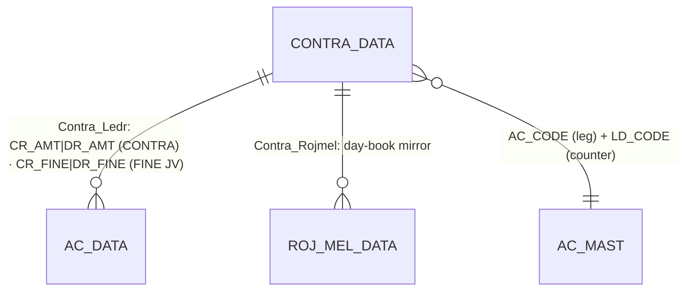
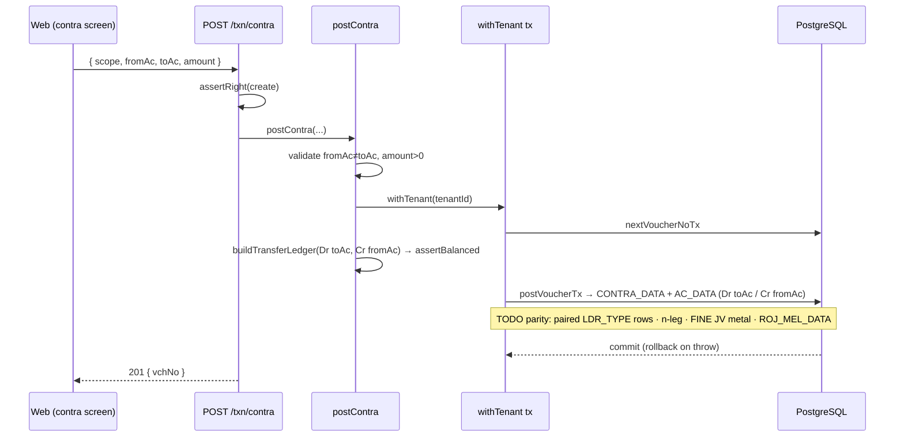

# TR_CONTRA — Contra / Fine-Journal (deep-dive)

```
Form: TR_CONTRA  ·  Module: 7_Finance_CashBank  ·  Type: transaction (posting)
Desktop source: unified/src/csharp/DataCareNext/TR_CONTRA.cs (3,450 lines) + Ac_Ledr.cs (Contra_Ledr), Ac_Rojmel.cs (Contra_Rojmel)
Web target: apps/api/src/modules/finance/finance.ts (postContra/deleteFinance) · apps/api/src/modules/finance/journal.ts (postJournal) · apps/web/app/(app)/txn/contra
Requirements: Req 17.1 (balanced n-leg), 17.3 (contra Dr one / Cr another, same amount), 13.1/13.4 (balanced/reverse), 9 (numbering)
Parity: 06_Parity/finance.md  ·  cross-ref project-memory/parity/verify-finance.md
Status: 📋 SPEC · 🟩 BUILT (web postContra/postJournal)
Evidence: form catalog project-memory/catalogs/forms/TR_CONTRA.md
```

## 1. Purpose & business context

The **transfer/journal** voucher. The user names one **main account** (header row) and one or more
**counter accounts** (grid rows), each with a Credit or Debit amount, and the form posts a balanced
double-entry adjustment that moves value **between accounts without any cash instrument, stock, or
tax**. Typical uses: move funds cash→bank or bank→bank, settle one ledger against another, book an
expense/income adjustment. The **same form** also serves **`FINE JV`** — a *metal* journal that
transfers gold/silver **fine weight** between accounts instead of money. Books: **`CONTRA`**
(`BOOK_INOUT='O'`, money) and **`FINE JV`** (`BOOK_INOUT='I'`, metal). `ENTRY_TYPE='J'`.

> **It is an n-leg voucher, not strictly 2-leg.** One main account is paired against *each* counter
> row, so a contra with k counter lines posts k balanced pairs (Σ counter Cr/Dr = main Dr/Cr). The
> simplest, most common case is exactly the Req 17.3 "Dr one / Cr another for the same amount".
> `src: TR_CONTRA.cs#L2778-L2900`.

## 2. UI / UX specification

### Layout
```
┌─ TR_CONTRA ─ [book: CONTRA | FINE JV] ───────────────────── [New][Save F2][Del][Print][Close] ┐
│ Vch No: [_____]   Date: [__/__/____]   HdVchNo: [_____]   Emp: [__ ▾]   ItemType(FINE JV): [G▾] │
│ ┌ Lines ──────────────────────────────────────────────────────────────────────────────────┐  │
│ │ Sr │ Cr/Dr │ AcCode │ Ac Name │ It Desc │ Credit │ Debit │ (FINE JV: Cr Fine / Dr Fine) │  │
│ │  1 │  (main account — the "from"/header leg)                                            │  │
│ │  2 │  Dr   │ [____] │ …       │         │        │ ____  │                             │  │
│ │  3 │  Cr   │ [____] │ …       │         │  ____  │       │                             │  │
│ └──────────────────────────────────────────────────────────────────────────────────────────┘ │
│ Totals → Credit: [....]   Debit: [....]   (must net to the main account; no tax/stock)         │
└────────────────────────────────────────────────────────────────────────────────────────────────┘
```

### Header field table
| Label | Column (`CONTRA_DATA`) | Type | Req | Default | Notes |
|---|---|---|---|---|---|
| Vch No | `VCH_NO` | string(8) | ✓ | next per book/year | re-allocated on Add-mode collision · `src: TR_CONTRA.cs#L2715-L2729` |
| Date | `VCH_DATE` | date | ✓ | today | open-year + `> LOCK_DATE` |
| HdVchNo | `HD_VCH_NO` | string(8) | — | next | `TEMP_BOOK_DATA` group no |
| Emp | `EMP_CODE` | lookup→`EMP_MAST` | cfg | — | `MsEmpCodeMendetry` |
| ItemType | `IT_TYPE` (FINE JV) | combo `G`/`S` | FINE JV only | — | `Mid(cboItemTyp.Text,1,1)` · `src: #L2800` |
| (book) | `BOOK_NAME`/`VCH_TYPE`/`INOUT_TYPE`/`ENTRY_TYPE` | — | auto | from book | `ENTRY_TYPE='J'` |

### Line grid columns (`CONTRA_DATA`)
| Col # | Label | Column | Editable | Source / behavior |
|---|---|---|---|---|
| 0 | Sr | `SR_NO` | auto | line ordinal (re-sequenced on save) · `src: #L1426` |
| 1 | Cr/Dr | `CRDR_TYPE` | yes | the leg's nature · `src: #L1429,#L3xx` |
| 2 | AcCode | `AC_CODE` | yes | lookup→`AC_MAST`; **row 1 = main account** · `src: #L1432` |
| 3 | Ac Name | `AC_NAME` | from master | `src: #L1435` |
| 4 | It Desc | `IT_DESC` | yes | per-line narration · `src: #L1438` |
| 5 | Credit | `CR_AMT` (money) / `CR_FINE` (FINE JV) | yes | credit amount/fine · `src: #L2810,#L2802` |
| 6 | Debit | `DR_AMT` (money) / `DR_FINE` (FINE JV) | yes | debit amount/fine · `src: #L2811` |

> Persist rule: a counter line is written only if `AC_CODE <> '' AND (CR_AMT + DR_AMT) <> 0`.
> `src: TR_CONTRA.cs#L2777`.

### Keyboard / F-keys & lookups / modes
- **F2 = Save**; Enter = next cell; F-key lookup on `AcCode` → `AC_MAST`. _(confirm F-key map.)_
- Modes: New / Edit (delete-then-repost) / View / Delete (`USER_DELETE`) / Print (`ContraBill.rpt`).

## 3. Data model touched

**Writes (create):** `CONTRA_DATA` (the paired Dr/Cr rows — see §4), then derived `AC_DATA`
(balanced legs) and `ROJ_MEL_DATA` (day-book), plus `REMARK_DATA`, `APR_IDTL`, `TEMP_BOOK_DATA`.

**Deletes/reverses:** `CONTRA_DATA, APR_IDTL, AC_DATA, ROJ_MEL_DATA, REMARK_DATA, TEMP_BOOK_DATA` by
key + `DELETE_DATA`. `src:` catalog `project-memory/catalogs/forms/TR_CONTRA.md`; `TR_CONTRA.cs#L2961-L2968`.

Table refs: [CONTRA_DATA](../../02_Data_Model/tables/CONTRA_DATA.md) ·
[AC_DATA](../../02_Data_Model/tables/AC_DATA.md) ·
[ROJ_MEL_DATA](../../02_Data_Model/tables/ROJ_MEL_DATA.md).



`CONTRA_DATA` (PK `CO_CODE,LC_CODE,CO_YEAR,CO_BOOK,VCH_NO,SR_NO`) holds `DR_AMT`,`CR_AMT`,`CRDR_TYPE`,
`LD_CODE`, `LDR_TYPE`, plus (FINE JV) `CR_FINE`/`DR_FINE` (not in the DDL column list — see §11).

## 4. Business logic & calculations (with code)

### 4.1 Writing the paired CONTRA_DATA rows (desktop)
The form **pre-computes both sides** of every transfer into `CONTRA_DATA`. Grid **row 1** is the main
account; rows 2..N are counters. For each counter row `i`, the save writes **two** rows:

```csharp
// src: TR_CONTRA.cs#L2778-L2890  (loop i = 2..N)
// Leg A — the COUNTER account (LDR_TYPE="0"), its own Cr/Dr, pointing at the main a/c
dataRow2["AC_CODE"]  = mSG[i,2];                 dataRow2["LD_CODE"] = mSG[1,2];   // counter ← main
dataRow2["LDR_TYPE"] = "0";  dataRow2["CRDR_TYPE"] = mSG[i,1];
if (FormMainBook == "FINE JV") { dataRow2["IT_TYPE"]=Mid(cboItemTyp,1,1);
    dataRow2["CR_FINE"]=Val(mSG[i,5]); dataRow2["DR_FINE"]=Val(mSG[i,6]); dataRow2["CR_AMT"]=0; dataRow2["DR_AMT"]=0; }
else { dataRow2["IT_TYPE"]="A";
    dataRow2["CR_AMT"]=Val(mSG[i,5]);  dataRow2["DR_AMT"]=Val(mSG[i,6]);  dataRow2["CR_FINE"]=0; dataRow2["DR_FINE"]=0; }
// Leg B — the MAIN account (LDR_TYPE="1"), MIRRORED amount, pointing back at the counter a/c
dataRow2["AC_CODE"]  = mSG[1,2];                 dataRow2["LD_CODE"] = mSG[i,2];   // main ← counter
dataRow2["LDR_TYPE"] = "1";  dataRow2["CRDR_TYPE"] = mSG[1,1];
//   if counter had DR(col6) → main gets CR ;  if counter had CR(col5) → main gets DR   (mirror)
```
So **each counter line yields a balanced pair in `CONTRA_DATA` itself** — the desktop's double entry
lives in the source table, cross-linked by `LD_CODE` and tagged `LDR_TYPE` 0 (counter) / 1 (main).
This is exactly **Dr one account / Cr another for the same amount** (Req 17.3), generalized to many
counters against one main. `src: TR_CONTRA.cs#L2783-L2880`.

### 4.2 Posting to the ledger (desktop — `Contra_Ledr`)
```csharp
// src: Ac_Ledr.cs#L840  Contra_Ledr(MsBook, MsVchNo)
// CONTRA (B.MAIN_BOOK='CONTRA', BOOK_INOUT='O') — money legs straight from CONTRA_DATA:
//   '01': AC_CODE=A.AC_CODE, LD_CODE=A.LD_CODE, CR_AMT=A.CR_AMT, IT_TYPE='A'   WHERE A.CR_AMT<>0
//   '02': AC_CODE=A.AC_CODE, LD_CODE=A.LD_CODE, DR_AMT=A.DR_AMT, IT_TYPE='A'   WHERE A.DR_AMT<>0
// FINE JV (B.MAIN_BOOK='FINE JV', BOOK_INOUT='I') — metal legs:
//   '03': FINE_WT=A.CR_FINE, SIGN=CASE WHEN CR_FINE<>0 THEN '+' ELSE '-', IT_TYPE=A.IT_TYPE  WHERE A.CR_FINE<>0
//   '04': FINE_WT=A.DR_FINE, SIGN=CASE WHEN DR_FINE<>0 THEN '-' ELSE '+', IT_TYPE=A.IT_TYPE  WHERE A.DR_FINE<>0
```
`Contra_Ledr` simply **projects each `CONTRA_DATA` row into one `AC_DATA` leg** (the pairing is
already balanced in `CONTRA_DATA`). Money contra → `IT_TYPE='A'`, `CR_AMT`/`DR_AMT`. Fine JV → metal
legs with `FINE_WT` + `SIGN` and `IT_TYPE='G'|'S'` (money fields 0). `LEDR_KEY = …+STR(SR_NO)+'01..'`.
`src: Ac_Ledr.cs#L842-L876`.

### 4.3 Day-book + remark
`Contra_Rojmel` mirrors the legs into `ROJ_MEL_DATA`; `Ac_Tax.Vch_Remark(book, vchNo, 3)` writes
`REMARK_DATA`. `src: TR_CONTRA.cs#L2885-L2887` (router), Ac_Rojmel.cs.

### 4.4 Web target (the spec)
```ts
// src: web/apps/api/src/modules/finance/finance.ts  — 2-account transfer
export async function postContra(prisma, { scope, fromAc, toAc, amount }) {
  if (fromAc === toAc) throw new FinanceValidationError('fromAc and toAc must differ');
  const ledger = buildTransferLedger(key, 'JV', /*Dr*/ toAc, /*Cr*/ fromAc, amount); // Dr toAc · Cr fromAc
  assertBalanced(ledger);
  await postVoucherTx(tx, tenantId, {
    ledger: { table:'AC_DATA', lines: ledger }, bookName: 'CONTRA',
    writes: [{ table:'CONTRA_DATA', rows:[{ ...key, VCH_TYPE:'JV', SR_NO:1,
               AC_CODE: toAc, LD_CODE: fromAc, DR_AMT: amount, CR_AMT: amount, VCH_DATE }] }],
  });
}
```
```ts
// src: web/apps/api/src/modules/finance/journal.ts  — free-form n-line journal (general JV / LEDR_ADJ / EMP_JV)
export async function postJournal(prisma, { scope, lines, narration }) {
  // ≥2 lines; each line exactly one of drAmt/crAmt > 0; Σ Dr == Σ Cr
  const ledger = lines.map(l => ({ ...key, VCH_TYPE:'JV', AC_CODE:l.acCode,
      DR_AMT:num(l.drAmt), CR_AMT:num(l.crAmt), SIGN: num(l.drAmt)>0?'D':'C', IT_DESC: l.desc ?? narration }));
  assertBalanced(ledger);                       // Req 13.1
  await postVoucherTx(tx, tenantId, { ledger:{ table:'AC_DATA', lines: ledger }, bookName:'JOURNAL' });
}
```
Money 2 dp / fine 3 dp, **HALF-UP**; `assertBalanced` rejects ΣCr≠ΣDr before any write.

> **Parity note (web vs desktop):** the web `postContra` writes a **single** `CONTRA_DATA` row with
> *both* `DR_AMT` and `CR_AMT` set to `amount` (AC_CODE=toAc, LD_CODE=fromAc) and is **2-account
> only**; desktop writes the **paired** `LDR_TYPE` 0/1 rows and supports **n** counter accounts.
> `postJournal` covers the free-form/multi-line case but emits only `AC_DATA` (no `CONTRA_DATA`).
> Neither web path writes `ROJ_MEL_DATA` or handles **`FINE JV`** metal legs yet. See §11.

## 5. Save sequence (create / edit)

1. **Guards** (same as `TR_CASH`): licence, employee-mandatory, company-type ≠ B, date-in-year,
   **period lock**, rights, VchNo present. (No cash-limit on contra.) `src: TR_CONTRA.cs#L2700-L2740`.
2. Add-mode VchNo collision → bump to MAX+1.
3. `DELETE FROM CONTRA_DATA … VCH_NO`; write `TEMP_BOOK_DATA`; insert the paired `CONTRA_DATA` rows
   (§4.1). `src: #L2739-L2742`.
4. `DELETE FROM AC_DATA …` → `Ac_Ledr.Contra_Ledr(book, vchNo)`. `src: #L2884`.
5. `DELETE FROM ROJ_MEL_DATA …` → `Ac_Rojmel.Contra_Rojmel(book, vchNo)`. `src: #L2887`.
6. `Ac_Tax.Vch_Remark(book, vchNo, 3)` → `REMARK_DATA`; recompute balance; print.



## 6. Delete / reverse sequence

Desktop deletes `REMARK_DATA, TEMP_BOOK_DATA, AC_DATA, ROJ_MEL_DATA, CONTRA_DATA, APR_IDTL` + writes
`DELETE_DATA` (`src: TR_CONTRA.cs#L2961-L2968`). Web `deleteFinance({ headerTable:'CONTRA_DATA', … })`
reverses `['CONTRA_DATA','AC_DATA']` + `DELETE_DATA` in one tx (add `ROJ_MEL_DATA`/`APR_IDTL`/
`REMARK_DATA` for full parity). Requires **`USER_DELETE`**; period-lock guarded.

## 7. API contract

```ts
// POST /txn/contra   (right: create)
interface ContraBody { scope:{coCode;lcCode;coYear?;coBook?}; fromAc:string; toAc:string; amount:number; vchDate?:string; }
// → 201 { vchNo:number }

// POST /txn/journal  (right: create) — free-form n-line JV
interface JournalBody { scope:{…}; narration?:string; lines:{ acCode:string; drAmt?:number; crAmt?:number; desc?:string }[]; }
// → 201 { vchNo:number }

// DELETE /txn/{contra|journal}/:vchNo  (right: delete) → { reversed:true }
```
Errors: `FinanceValidationError`/`JournalValidationError` → 400 (fromAc=toAc, amount ≤ 0, <2 lines,
unbalanced, line not exactly-one-of Dr/Cr); `ForbiddenError` → 403; `PeriodLockValidationError` → 400.
`src: finance.ts postContra`, `journal.ts postJournal`.

## 8. Validation rules

| Rule | Condition | Desktop message | HTTP | req: |
|---|---|---|---|---|
| Accounts differ | `fromAc = toAc` | — (web: "fromAc and toAc must differ") | 400 | 17.3 |
| Amount positive | `amount ≤ 0` / line `CR_AMT+DR_AMT=0` skipped | — | 400 | 17.1 |
| ≥2 lines (journal) | `< 2` lines | — (web: "journal voucher requires at least 2 lines") | 400 | 17.1 |
| Dr xor Cr (journal) | a line has both or neither | (web) `line "<ac>" must have exactly one of debit or credit` | 400 | 13.1 |
| Balanced | ΣCR ≠ ΣDR | — (invariant) | 400/500 | 13.1 |
| Period open | `VCH_DATE ≤ LOCK_DATE` | "…Lock Date is = …" | 400 | — |
| Date in year | outside `MCo_OpDate…MCo_ClDate` | "…Not In Current Year…" | 400 | — |
| Rights (edit) | `UsUPdate≠'Y'`/edit | "You Have No Rights….." | 403 | 6.x |

## 9. Parity criteria (Definition of Done)

1. `CONTRA_DATA` persists the **paired** legs (`LDR_TYPE` 0/1, `AC_CODE`/`LD_CODE` cross-linked,
   `CR_AMT`/`DR_AMT` or `CR_FINE`/`DR_FINE`, `CRDR_TYPE`, `IT_TYPE`) for every counter line.
2. `AC_DATA` legs from `Contra_Ledr` match: money (`IT_TYPE='A'`, `CR_AMT`/`DR_AMT`) for `CONTRA`,
   metal (`FINE_WT`+`SIGN`, `IT_TYPE='G'|'S'`) for `FINE JV`; **ΣCR=ΣDR** (and Σ metal-in=Σ metal-out).
3. `ROJ_MEL_DATA` day-book rows match (money or metal).
4. Delete removes header + `AC_DATA` (+ day-book/appropriation/remark) and writes `DELETE_DATA`;
   trial balance still nets to zero (and the metal trial-balance for FINE JV).
5. Voucher PDF matches `ContraBill.rpt`.

Fixtures: `06_Parity/finance.md`; cross-ref `project-memory/parity/verify-finance.md`.

## 10. Variants & edge cases

| Variant | Delta vs TR_CONTRA |
|---|---|
| **CONTRA** (`BOOK_INOUT='O'`) | money transfer; `IT_TYPE='A'`; cash↔bank, ledger↔ledger. |
| **FINE JV** (`BOOK_INOUT='I'`) | metal transfer; `IT_TYPE='G'/'S'`; posts `CR_FINE`/`DR_FINE` → `FINE_WT` legs; report `FineJvBill.rpt`. |
| n-leg contra | one main account vs many counters → many balanced pairs (single VchNo). |
| General journal (web) | `journal.ts postJournal` — free-form n-line balanced JV → `AC_DATA` only; maps desktop `TR_LEDR_ADJ`/`TR_EMP_JV`/`LEDR_ADJ` (Module 8). |
| `TR_AC_OPBL` | opening-balance voucher also writes `CONTRA_DATA` (Module 8). |

## 11. Open questions / risks

- **CONTRA_DATA shape mismatch (web).** Web `postContra` writes **one** row with both `DR_AMT` and
  `CR_AMT = amount`; desktop writes **paired** `LDR_TYPE` 0/1 rows cross-linked by `LD_CODE`. Align
  the web write to the paired shape (and support **n** counter accounts) before parity certification.
- **`FINE JV` (metal journal) not implemented in web.** `CR_FINE`/`DR_FINE` columns are referenced by
  the desktop save (`src: TR_CONTRA.cs#L2802-L2808`) and `Contra_Ledr` (`src: Ac_Ledr.cs#L848-L876`)
  but are **absent from `CONTRA_DATA`'s recovered DDL** (27 cols). Confirm these columns in the
  golden master and add the metal-journal path (posts `AC_DATA` metal legs, no money).
- **Day-book missing in web.** `Contra_Rojmel` → `ROJ_MEL_DATA` is not yet reproduced by `postContra`.
- **`CRDR_TYPE`/`LDR_TYPE` semantics** — confirm the exact stored values vs the grid `Cr/Dr` flag for
  byte-exact parity (desktop sets `LDR_TYPE='0'` counter / `'1'` main; `CRDR_TYPE = mSG[i,1]`/`mSG[1,1]`).
- **Numbering** shares the `SRNO_MAST` per-book/year recovery with the rest of the suite.
