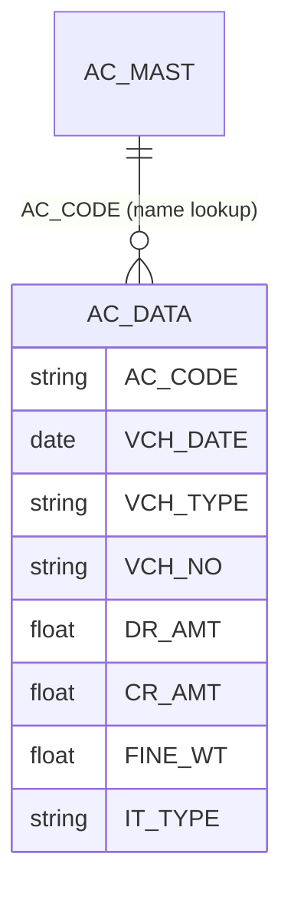

# Account Ledger — one-account statement (deep-dive)

```
Form: Ac_Ledr (read-model)  ·  Module: 8_Accounting  ·  Type: report (read-only over AC_DATA)
Desktop source: unified/src/csharp/DataCareNext/Ac_Ledr.cs (1.4 MB) + RP_LEDR.cs · Crystal AcLedger.rpt / AcLedgerSelected.rpt
Web target: apps/api/src/modules/accounting/accounting.ts (accountLedger, applyRunningBalance)
            route apps/api/src/routes/txn.ts → GET /reports/account-ledger/:acCode
Requirements: Req 13.2 (opening + period Dr/Cr + closing), 13.4 (deletes drop legs), 13.5 (metal ledger)
Parity: 06_Parity/accounting.md   ·   Status: 📋 SPEC · 🟩 BUILT
Evidence: accounting.ts#accountLedger; Ac_Ledr.cs (AC_DATA INSERT shape); data-model AC_DATA.md
```

## 1. Purpose & business context

The account ledger is the single most-used accountant screen: pick a party/ledger account and a date
range, and see its **opening balance**, every **dated debit/credit line** in the period, a **running
balance** after each line, and the **closing balance**. It is the read-back of the double-entry hub
`AC_DATA` — no document is recomputed, the posted legs are simply selected, ordered by date and
summed. The desktop renders it through `AcLedger.rpt`; the web exposes it as a JSON dataset that the
ledger screen and PDF both consume. This is a **read-only** view: it writes nothing.

## 2. UI / UX specification (report screen)

### Layout
```
┌─ Account Ledger ─────────────────────────────────────────────── [Run][Print][Export][Close] ┐
│ Account: [AC_CODE ▾][AC_NAME ........................] (F-lookup → AC_MAST)                    │
│ From: [__/__/____]   To: [__/__/____]    Company: [CO] Year: [CO_YEAR] Location: [LC ▾(opt)]   │
├───────────────────────────────────────────────────────────────────────────────────────────────┤
│ Date       │ Vch Type │ Vch No │ Particulars / IT_DESC      │  Debit  │  Credit │  Balance Dr/Cr │
│            │          │        │ Opening Balance            │         │         │   12,500.00 Dr │
│ 02/04/2025 │ SALE     │ 000123 │ Sale bill                  │ 8,400.00│         │   20,900.00 Dr │
│ 05/04/2025 │ RCPT     │ 000077 │ Cash received              │         │ 5,000.00│   15,900.00 Dr │
│ …          │          │        │                            │         │         │                │
│            │          │        │ Period Total / Closing     │ Σ dr    │ Σ cr    │   closing Dr/Cr│
└───────────────────────────────────────────────────────────────────────────────────────────────┘
```

### Filter / input fields
| Label | Source | Type | Req | Default | Notes |
|---|---|---|---|---|---|
| Account | `AC_DATA.AC_CODE` (name from `AC_MAST.AC_NAME`) | lookup→`AC_MAST` | ✓ | — | path param `:acCode`; F-lookup picker |
| From date | `AC_DATA.VCH_DATE` | date | — | year start | rows `< fromDate` collapse into **opening** |
| To date | `AC_DATA.VCH_DATE` | date | — | today | rows `> toDate` excluded |
| Company / Year | `CO_CODE` / `CO_YEAR` | scope | ✓ | session | from `readScope(req)` |
| Location | `LC_CODE` | scope | — | (all) | only filters when explicitly selected |

### Result columns (`LedgerRow`)
| Col | Source | Type | Notes |
|---|---|---|---|
| Date | `VCH_DATE` | date | order key #1 |
| Vch Type | `VCH_TYPE` | string(6) | `SALE`/`PURC`/`RCPT`/`JV`/`ACOP`/… |
| Vch No | `VCH_NO` | string(8) | order key #2 |
| Particulars | `IT_DESC` (desktop) | string | line narration (web `LedgerRow` carries vch fields; add `IT_DESC` for display parity — see §11) |
| Debit | `DR_AMT` | money 2dp | one of Dr/Cr per leg |
| Credit | `CR_AMT` | money 2dp | |
| Balance | running | money 2dp | opening + Σ(dr−cr) up to this row; shown **Dr** if ≥0 else **Cr** |

### Modes / keyboard
- **Run** (F-key in desktop) executes the query; **Print** → `AcLedger.rpt` PDF; **Export** → xlsx/csv.
- No New/Edit/Delete here — it is read-only. (Voucher edits happen on the source forms; this view
  reflects them because it re-queries `AC_DATA`.)

### Variant: metal (fine) ledger
The same screen in **fine mode** sums `FINE_WT` instead of money, scoped to the metal legs
(`IT_TYPE IN ('G','S')`) — the desktop has `AcFineGold.rpt` / `AcFineSilver.rpt`. Gold and silver
balance on their own (Req 13.5); see §4.4.

## 3. Data model touched

**Writes:** none (read-only).

**Reads:** `AC_DATA` (the ledger legs), joined to `AC_MAST` only for the account name.

Table refs: [AC_DATA](../../02_Data_Model/tables/AC_DATA.md) · [AC_MAST](../../02_Data_Model/tables/AC_MAST.md)



## 4. Business logic & calculations (with code)

The ledger has three parts: **opening** (everything strictly before `fromDate`), **period rows**
(within `[fromDate,toDate]`, ordered, each carrying a running balance), and **closing** (opening + Σ
of the period). The web computes the running balance with a SQL window function and folds it onto the
opening offset.

### 4.1 Web — opening balance (everything before fromDate)
```ts
// src: apps/api/src/modules/accounting/accounting.ts → accountLedger
let opening = 0;
if (opts.fromDate) {
  const openRows = await tx.$queryRawUnsafe(
    `SELECT coalesce(sum("DR_AMT"-"CR_AMT"),0) AS ob FROM "AC_DATA"
     WHERE "AC_CODE"=$1 AND ${base.sql} AND "VCH_DATE" < $${acParams.length + 1}`,
    ...acParams, new Date(opts.fromDate));
  opening = Number(openRows[0]?.ob ?? 0);   // debit-positive: Σ(DR-CR) before the period
}
```

### 4.2 Web — period rows with a running balance (SQL window function)
```ts
// src: accounting.ts → accountLedger (period query)
const rows = await tx.$queryRawUnsafe(
  `SELECT "VCH_NO", "VCH_TYPE", "VCH_DATE", "DR_AMT" AS dr, "CR_AMT" AS cr,
          sum("DR_AMT"-"CR_AMT") OVER (ORDER BY "VCH_DATE","VCH_NO"
              ROWS BETWEEN UNBOUNDED PRECEDING AND CURRENT ROW) AS rb
   FROM "AC_DATA" WHERE ${conds.join(' AND ')} ORDER BY "VCH_DATE","VCH_NO"`,
  ...params);
```

### 4.3 Web — fold opening + emit closing (pure)
```ts
// src: accounting.ts → applyRunningBalance (pure, unit-testable)
export function applyRunningBalance(opening, rows) {
  let bal = round2(opening);
  const out = rows.map((r) => {
    const dr = round2(Number(r.dr ?? 0));
    const cr = round2(Number(r.cr ?? 0));
    bal = round2(bal + dr - cr);                 // running balance, debit-positive
    return { vchNo: r.VCH_NO, vchType: r.VCH_TYPE, vchDate: r.VCH_DATE ?? null, dr, cr, runningBalance: bal };
  });
  return { opening: round2(opening), rows: out, closing: bal };   // closing = opening + Σ(dr-cr)
}
// round2(n) = Math.round((n + Number.EPSILON) * 100) / 100   → 2 dp
```
So **closing = opening + Σ(period Dr) − Σ(period Cr)**, and each line's `runningBalance` is the
balance *after* that line. A positive balance is a **debit** balance (receivable / asset); negative
is a **credit** balance (payable / liability).

### 4.4 Desktop evidence & sign convention
`AC_DATA` is written by `Ac_Ledr.cs` with money and metal on one row:
```
// src: unified/src/csharp/DataCareNext/Ac_Ledr.cs#L13
INSERT INTO AC_DATA (CO_CODE,LC_CODE,CO_YEAR,CO_BOOK,VCH_TYPE,VCH_NO,VCH_DATE,LEDR_KEY,BOOK_NAME,
  BILL_NO,BILL_DATE,CHQ_NO,AC_CODE,LD_CODE,CR_AMT,DR_AMT,IT_TYPE,SIGN,FINE_WT,IT_DESC,ENTRY_TIME,
  HD_VCH_NO,CLR_DATE,DATA_TYPE,DATA_TRFR,MAIN_USER,FINE_RATE,PARTY_AC_CODE,LDR_NAME) Select … 'ACOP' …
```
The desktop ledger/balance code nets **credit-positive** — e.g. `Ac_Final.cs#AcBalInsert`:
```
// src: unified/src/csharp/DataCareNext/Ac_Final.cs (AcBalInsert)
Select B.AC_GR, A.AC_CODE, ROUND(SUM(CR_AMT-DR_AMT),2) AS BalAmt
FROM AC_DATA A LEFT JOIN AC_MAST B ON A.CO_CODE=B.CO_CODE AND A.AC_CODE=B.AC_CODE
WHERE … GROUP BY B.AC_GR, A.AC_CODE HAVING ROUND(SUM(CR_AMT-DR_AMT),2) <> 0 ORDER BY A.AC_CODE
```
The web `accountLedger` nets **debit-positive** (`DR_AMT-CR_AMT`). Both are the same magnitude with
opposite sign; the display layer labels `≥0 ⇒ Dr`, `<0 ⇒ Cr`. **Pick one convention and keep it**
(web = debit-positive); when diffing against a desktop figure, negate. _(req: 13.2)_

**Rounding:** amounts to **2 dp** (`round2`). The conventions mandate decimal.js HALF-UP at 2 dp for
money; the read-model's numeric `round2` is acceptable for read-only aggregation but should be
reconciled to HALF-UP for exact paisa parity (see §11).

**Metal (fine) ledger — Req 13.5:** run the same opening/period/closing over `FINE_WT` with
`IT_TYPE IN ('G','S')` (split gold vs silver), `SIGN '+'` adding and `'-'` subtracting. Metal balances
independently of the money ledger — a party can be square on cash but hold a gold fine balance.

## 5. Save sequence (create / edit)

`N/A — read-only.` The ledger never writes. It reflects whatever the **source** voucher forms posted
into `AC_DATA`; an edit on a source voucher (reverse + repost) is visible on the next query because
the legs are re-selected. The only "freshness" rule: the running balance is computed at query time,
so it always reflects the current `AC_DATA` state.

## 6. Delete / reverse sequence

`N/A — read-only.` But Req 13.4 is observed **through** this view: when a source voucher is deleted,
`reverseVoucherTx` removes its `AC_DATA` rows by voucher key, so the ledger's opening/period/closing
**exclude** the deleted voucher on the next run. Parity test: capture a closing balance, delete a
voucher in the range, re-run → balance drops by exactly that voucher's net.

## 7. API contract

```ts
// GET /reports/account-ledger/:acCode?fromDate=YYYY-MM-DD&toDate=YYYY-MM-DD     (auth)
// src: apps/api/src/routes/txn.ts
app.get('/reports/account-ledger/:acCode', auth,
  async (req) => accountLedger(prisma, readScope(req), req.params.acCode, range(req)));

interface LedgerRow { vchNo: string; vchType: string; vchDate: Date | null; dr: number; cr: number; runningBalance: number; }
interface AccountLedgerResponse {
  acCode: string;
  opening: number;          // debit-positive
  rows: LedgerRow[];        // ordered by VCH_DATE, VCH_NO
  closing: number;          // opening + Σ(dr-cr)
}
```
- **Scope** comes from the session (`readScope`): `CO_CODE` + `CO_YEAR` always; `LC_CODE` only when a
  location is explicitly selected (do not default `LC_CODE` to `CO_CODE` — that hides multi-location
  data).
- **Errors:** read-only; auth required (401 if unauthenticated). An unknown `acCode` returns
  `opening:0, rows:[], closing:0` (not a 404) — matching the desktop's empty ledger.

## 8. Validation rules

| Rule | Condition | Desktop msg (confirm) | HTTP | req |
|---|---|---|---|---|
| Account required | no `:acCode` | "Select account" | 404 (route) | 13.2 |
| Auth | no session | — | 401 | 6.x |
| Date order | `fromDate > toDate` | (returns empty period) | 200 | 13.2 |
| Scope present | no `CO_CODE`/`CO_YEAR` in session | — | 400/401 | 1.x |

There are no write-side guards (read-only). Invalid dates fall through to "no rows".

## 9. Parity criteria (Definition of Done)

1. For a fixed account + Company/Year + date range, the web **opening** equals the desktop
   `AcLedger.rpt` opening (to the paisa, after sign normalisation).
2. The **period rows** match one-for-one (same `VCH_DATE`,`VCH_TYPE`,`VCH_NO`,`DR_AMT`,`CR_AMT`),
   ordered by `VCH_DATE` then `VCH_NO`.
3. Each **running balance** equals opening + cumulative Σ(dr−cr); **closing** equals the desktop
   closing.
4. **Metal mode:** gold/silver fine opening/closing match `AcFineGold.rpt`/`AcFineSilver.rpt`,
   independent of the money ledger (Req 13.5).
5. **Delete invariant (Req 13.4):** deleting a voucher in the range reduces the closing by exactly
   that voucher's net.
Fixtures: `web/apps/api/integration/*.live.mjs` (account-ledger live check against real Postgres);
tracked in `06_Parity/accounting.md`.

## 10. Variants & edge cases

| Variant | Delta vs the base ledger |
|---|---|
| **Account summary** (`AcSumm.rpt`/`AcSummLdr.rpt`) | one balance per account (no line detail) = the trial-balance row for that account |
| **Fine/metal ledger** (`AcFineGold/Silver.rpt`) | sum `FINE_WT` over `IT_TYPE='G'/'S'` instead of money (Req 13.5) |
| **Selected ledger** (`AcLedgerSelected.rpt`) | multiple accounts in one run (loop the same query per `AC_CODE`) |
| **With-weight ledger** (`AcWithWt*.rpt`) | money **and** fine columns side-by-side per line |
| **Outstanding/area** (`RP_OS`, `AcOsArea.rpt`) | closing balance filtered to debtor/creditor groups, grouped by area |
| **Day-scoped / opening modes** | desktop `Ac_Final.AcBalInsert` parameterises `VCH_DATE < opDt` (opening), `= today` (today-bal), `between` (period) — the web `fromDate/toDate` cover the same modes |

## 11. Open questions / risks

- **`IT_DESC` / particulars:** the web `LedgerRow` currently omits the line narration; add `IT_DESC`
  (and optionally `BILL_NO`) to match the desktop "Particulars" column. Real column on `AC_DATA`.
- **Rounding mode:** `round2` uses `Math.round(n + EPSILON)`; confirm it equals decimal.js HALF-UP at
  2 dp for negative balances before certifying paisa parity (conventions §2).
- **Opening vs `CO_BOOK='999'`:** the desktop opening query excludes the closing-stock book
  (`AND CO_BOOK <> '999'`, `Ac_Final.cs`). The web opening currently sums **all** `AC_DATA` before
  `fromDate`; if closing-stock legs (book `999`) exist in the year, exclude `CO_BOOK='999'` from the
  opening to match (flag for the golden-master pass).
- **Multi-year carry-forward:** confirm whether opening should also pull the prior year's closing
  (cross-`CO_YEAR`) or only the current year — desktop uses per-year DBs; the web is single-DB with a
  `CO_YEAR` column, so opening must be `CO_YEAR`-scoped (verify against `Ac_Final` opening logic).
