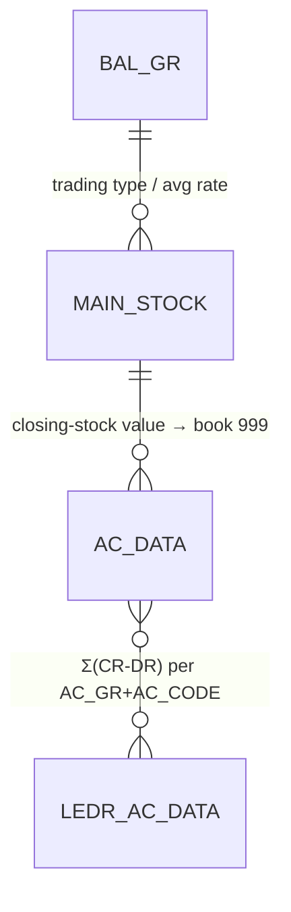

# Ac_Final — Final Accounts (Balance Sheet / P&L rollup) (deep-dive)

```
Form: Ac_Final  ·  Module: 8_Accounting  ·  Type: other (finalisation engine + report feed)
Desktop source: unified/src/csharp/DataCareNext/Ac_Final.cs (30 KB) — Trading_Stock, AcBalInsert
Web target: apps/api/src/modules/reports/reports.ts (balanceSheet, accountBalances) — PARTIAL
Requirements: Req 13.3 (BS/P&L are the grouped trial balance), 13.5 (metal columns), 13.1
Parity: 06_Parity/accounting.md   ·   Status: 📋 SPEC · 🟦 PARTIAL
Evidence: Ac_Final.cs#Trading_Stock (closing stock → AC_DATA book 999); Ac_Final.cs#AcBalInsert (→ LEDR_AC_DATA); LEDR_AC_DATA.md
```

## 1. Purpose & business context

`Ac_Final` produces the **final accounts** — the Balance Sheet and Profit & Loss — by (a) valuing
**closing stock** (which this ERP keeps *outside* the running ledger) and posting it as a balancing
leg, and (b) **rolling up** every account's net into the summary table `LEDR_AC_DATA`, split into
Balance-Sheet groups (`AC_MAIN_GR < '3'`) and P&L groups (`AC_MAIN_GR >= '3'`). The rollup carries
money **and** separate gold/silver fine columns so the metal position appears on the final accounts
(Req 13.5). This is the only "accounting" routine that **writes** during reporting; the BS/P&L
printed reports (`BalanceHz.rpt`, `ProfitLossHz.rpt`) read `LEDR_AC_DATA`.

## 2. UI / UX specification (report screen)

### Filters
| Label | Source | Type | Notes |
|---|---|---|---|
| Op / Close date | `FinalOpDt` / `FinalClDt` | date | period window; or "today balance" / "opening" modes |
| Report data | `RptData` | enum | `T` = all (trial), `P` = P&L (`AC_MAIN_GR >= '3'`), else BS (`< '3'`) |
| Balance-sheet type | `MsBalanceSheetType` | enum | `F` = **fine-based** (value stock by gold/silver rate); else amount-based |
| Gold / Silver rate | `GoldRate`/`SilverRate` | money | required in fine mode to value closing stock |
| Data type | `MsDataType` | `A`/`B`/`C` | parallel-book selector |
| Location | `FinalLc` | scope | blank = all locations |

### Output columns (`LEDR_AC_DATA`)
`AC_GR`, `AC_CODE`, `CR_AMT`/`DR_AMT` (money side of the net), and the metal columns
`CR_FINE_WT`/`DR_FINE_WT` (gold) + `CR_SL_FINE`/`DR_SL_FINE` (silver), plus `DATA_TYPE`, `VCH_DT`. The
printed BS/P&L group these by `AC_GR`.

## 3. Data model touched

**Writes:**
- `AC_DATA` (book `999`, `BOOK_NAME='CLGBL'`, `IT_DESC='FINAL BALANCE'`) — the **closing-stock**
  valuation leg(s), per trading type (gold `GO`, silver `SL`, …), as a Dr/Cr pair against the
  configured `CLG_AC`/`CLOSING_AC` accounts.
- `LEDR_AC_DATA` — one summary row per `AC_GR`+`AC_CODE` net (money + gold-fine + silver-fine).

**Deletes (re-run):** `AC_DATA` where `CO_BOOK='999'` (clear prior closing leg); `LEDR_AC_DATA`
(full clear before re-insert).

Table refs: [AC_DATA](../../02_Data_Model/tables/AC_DATA.md) · [LEDR_AC_DATA](../../02_Data_Model/tables/LEDR_AC_DATA.md) · [AC_MAST](../../02_Data_Model/tables/AC_MAST.md)



## 4. Business logic & calculations (with code)

### 4.1 Closing-stock valuation → `AC_DATA` book `999`
```
// src: unified/src/csharp/DataCareNext/Ac_Final.cs → Trading_Stock
Delete from AC_DATA where CO_CODE=… AND CO_YEAR=… AND CO_BOOK='999';      // clear prior
// fine mode (MsBalanceSheetType='F'): value each trading type by metal rate
gold  : num2 = (ClFine adjusted by AcLdrFineGold)  * (GoldRate / 10.0);    // ÷10 = per-gram from per-10g rate
silver: num3 = (ClFine adjusted by AcLdrFineSilver) * (SilverRate / 10.0);
// else amount mode: num9 = ClNwt*ClRate ; num10 = ClPcs*PCS_RATE
INSERT INTO AC_DATA (…,CO_BOOK,VCH_TYPE…,BOOK_NAME,…,AC_CODE,LD_CODE,CR_AMT,DR_AMT,…,IT_DESC,…)
  VALUES (…,'999',…,'CLGBL',…, <CLG_AC>, '00001', 0, <value>, …, 'FINAL BALANCE', …);  // + the contra leg
```
Two legs per trading type (Dr `CLG_AC` / Cr `CLOSING_AC` and the mirror) so the closing-stock entry
is itself balanced. `AcLdrFineGold`/`AcLdrFineSilver` are running fine accumulators from the metal
ledger, used to reconcile book stock to ledger fine before valuing. Rate is **per 10 g** → divide by
10 for per-gram value.

### 4.2 Account rollup → `LEDR_AC_DATA`
```
// src: Ac_Final.cs → AcBalInsert
DELETE FROM LEDR_AC_DATA;
Select B.AC_GR, A.AC_CODE, ROUND(SUM(A.CR_AMT-A.DR_AMT),2) AS BalAmt
FROM AC_DATA A LEFT JOIN AC_MAST B ON A.CO_CODE=B.CO_CODE AND A.AC_CODE=B.AC_CODE
WHERE A.CO_CODE=… AND A.CO_YEAR=…
  -- group slice:   P → AC_MAIN_GR >= '3' (P&L) ; (BS) → AC_MAIN_GR < '3' ; T → all
  -- date mode:     opening → VCH_DATE < MOp_dt AND CO_BOOK <> '999'
  --                today   → VCH_DATE = today ;  period → VCH_DATE BETWEEN op AND cl ;  else <= cl
  -- data type:     AND A.DATA_TYPE = <MsDataType>  (unless 'C')
GROUP BY B.AC_GR, A.AC_CODE HAVING ROUND(SUM(A.CR_AMT-A.DR_AMT),2) <> 0 ORDER BY A.AC_CODE;
// then per row, by sign:
INSERT INTO LEDR_AC_DATA (…,AC_CODE,CR_AMT,DR_AMT,CR_FINE_WT,DR_FINE_WT,CR_SL_FINE,DR_SL_FINE,DATA_TYPE,AC_GR)
  VALUES(…, BalAmt>0 ? (CR side) : (DR side = |BalAmt|), … gold-fine …, … silver-fine …, …);
```
- **BalAmt > 0** → credit balance → fill `CR_AMT`; **< 0** → debit balance → fill `DR_AMT = |BalAmt|`.
- Metal columns are populated from the parallel fine rollup: **gold** → `CR_FINE_WT`/`DR_FINE_WT`,
  **silver** → `CR_SL_FINE`/`DR_SL_FINE` (Req 13.5 — gold and silver are separate columns, both
  independent of the money columns).
- **Opening mode excludes `CO_BOOK='999'`** so the closing-stock leg never pollutes opening balances.

### 4.3 Web mapping
The web currently exposes the **read** side (`balanceSheet`, `accountBalances` in `reports.ts`) which
re-derives the grouped net directly from `AC_DATA` at query time (no `LEDR_AC_DATA` materialisation).
To reach full parity, port `AcBalInsert` as a `finalizeAccounts(scope, {opDt, clDt, mode, dataType,
rates})` that (1) values closing stock into `AC_DATA` book `999` and (2) materialises `LEDR_AC_DATA`
with the gold/silver fine columns. **Scale:** money 2 dp HALF-UP, fine 3 dp HALF-UP.

## 5. Save sequence (finalisation)

1. `Trading_Stock`: delete prior book-`999` legs → value closing stock (fine or amount mode) → insert
   balanced closing-stock legs into `AC_DATA` (`BOOK_NAME='CLGBL'`, `IT_DESC='FINAL BALANCE'`).
2. `AcBalInsert`: clear `LEDR_AC_DATA` → group `AC_DATA` net by `AC_GR`+`AC_CODE` (with the chosen
   date/group/data-type filters) → insert summary rows (money + gold/silver fine).
3. Print `BalanceHz.rpt` / `ProfitLossHz.rpt` from `LEDR_AC_DATA`.

(Web rule when ported: wrap both writes in **one** `withTenant` tx so a half-finalised state can't be
read; re-runnable — both steps clear before insert.)

## 6. Delete / reverse sequence

Re-running finalisation is the "reverse": it `DELETE`s book-`999` `AC_DATA` and the whole
`LEDR_AC_DATA` before re-inserting. There is no per-voucher `DELETE_DATA` — these are derived
aggregates, safe to rebuild. (Deleting a *source* voucher is handled by that voucher's form and is
reflected on the next finalisation.)

## 7. API contract

```ts
// Current (read): GET /reports/balance-sheet         (auth) → grouped BS net from AC_DATA
//                 GET /reports/account-balances       (auth) → closing balance per account
// Proposed (write): POST /accounting/finalize         (right: update)
interface FinalizeBody { scope; opDt: string; clDt: string; mode:'opening'|'today'|'period'|'ason';
                         dataType:'A'|'B'|'C'; balanceSheetType:'F'|'A'; goldRate?:number; silverRate?:number; }
// → { ledgerRows:number, closingStockValue:number }
```

## 8. Validation rules

| Rule | Condition | Desktop message | HTTP | req |
|---|---|---|---|---|
| Rates in fine mode | `balanceSheetType='F'` & `GoldRate+SilverRate=0` | "Please Insert Gold And Silver Rate" | 400 | 13.5 |
| Data type chosen | none selected | "Select Data Type…" | 400 | — |
| Scope present | no `CO_CODE`/`CO_YEAR` | — | 400 | 1.x |

## 9. Parity criteria (Definition of Done)

1. Closing-stock value posted to `AC_DATA` book `999` equals the desktop (fine mode: `fine ×
   rate/10` per metal + pcs×rate; amount mode: `nwt×rate + pcs×pcsRate`), as balanced Dr/Cr legs.
2. `LEDR_AC_DATA` rows match the desktop: per `AC_GR`+`AC_CODE`, `BalAmt>0 → CR_AMT`, `<0 → DR_AMT`,
   zero-net dropped; gold fine in `CR_FINE_WT/DR_FINE_WT`, silver in `CR_SL_FINE/DR_SL_FINE` (Req 13.5).
3. Group slices reproduce BS (`AC_MAIN_GR < '3'`) and P&L (`>= '3'`).
4. After finalisation the trial balance ties (the book-`999` leg closes the off-ledger gap — see
   [`TRIAL_BALANCE.md`](TRIAL_BALANCE.md) §4.5).

## 10. Variants & edge cases

| Variant | Delta |
|---|---|
| **Balance Sheet** (`BalanceHz.rpt`) | `LEDR_AC_DATA` where `AC_MAIN_GR < '3'`, grouped by `AC_GR` |
| **Profit & Loss** (`ProfitLossHz.rpt`) | `LEDR_AC_DATA` where `AC_MAIN_GR >= '3'` |
| **Fine vs amount mode** | `MsBalanceSheetType='F'` values stock by metal rate; else by avg amount/pcs rate |
| **Opening / today / period / as-on** | the four `AcBalInsert` date windows |
| **Data type A/B/C** | parallel books; `C` = consolidated (no `DATA_TYPE` filter) |

## 11. Open questions / risks

- **Materialise vs derive:** decide whether the web keeps deriving BS/P&L live from `AC_DATA` or ports
  the `LEDR_AC_DATA` materialisation. The metal (gold/silver fine) columns currently have no live
  equivalent — needed for Req 13.5 on the final accounts.
- **`AcLdrFineGold/Silver` accumulators:** confirm how the ledger fine reconciliation feeds the
  closing-stock fine adjustment (read the full accumulation path in `Ac_Final.cs` during the
  golden-master pass).
- **Rate scale:** `rate/10` assumes a per-10-gram rate; verify against the rate master units before
  valuing.
- **`CLG_AC`/`CLOSING_AC`:** these come from `BAL_GR` per trading type; ensure those master rows exist
  or the closing leg is skipped (desktop only inserts when value ≠ 0).
