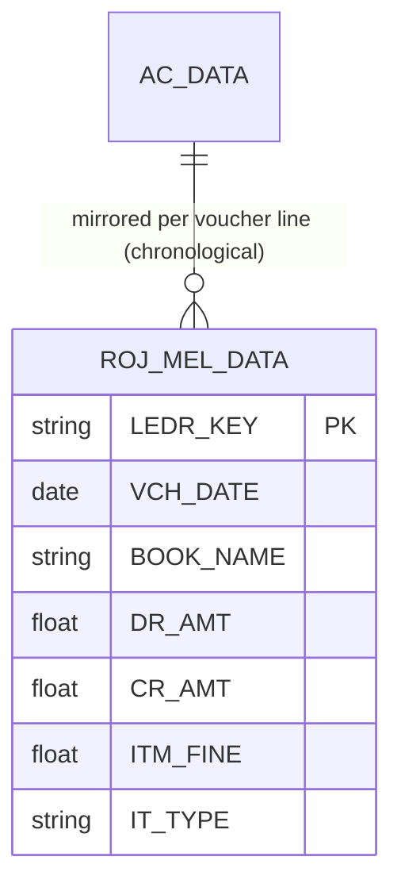

# Ac_Rojmel — Day Book (Rojmel) (deep-dive)

```
Form: Ac_Rojmel  ·  Module: 8_Accounting  ·  Type: other (day-book mirror + report feed)
Desktop source: unified/src/csharp/DataCareNext/Ac_Rojmel.cs (664 KB) — INSERT INTO ROJ_MEL_DATA … SELECT (per voucher source)
Web target: apps/api/src/modules/reports/reports.ts (dayBook) · reports8.ts (cashDaySummary) — PARTIAL
Requirements: Req 13.2 (chronological postings), 13.5 (metal columns on the day-book), 13.1
Parity: 06_Parity/accounting.md   ·   Status: 📋 SPEC · 🟦 PARTIAL
Evidence: Ac_Rojmel.cs#L11 (ROJ_MEL_DATA 34-col INSERT…SELECT); ROJ_MEL_DATA.md
```

## 1. Purpose & business context

The **Rojmel** (Gujarati for "day book") is the chronological register of every voucher's
money-and-metal movement — the running daily journal a jeweller reads to see "what happened today,
in cash and in gold." `Ac_Rojmel` **mirrors** each posting voucher (sale, purchase, receipt, payment,
contra, dhrn, mfg, journal) into one denormalised table, `ROJ_MEL_DATA`, carrying both the money
(`CR_AMT`/`DR_AMT`) and the metal/item detail (`ITM_NWT`, `ITM_FINE`, `ITM_RATE`, …) on each line so
the day book and the cash/metal reports (`RojMel*.rpt`) render without joining back to every source
table. It is a **derived mirror**, not a primary book.

## 2. UI / UX specification (report screen)

### Filters
| Label | Source | Type | Notes |
|---|---|---|---|
| Date / range | `ROJ_MEL_DATA.VCH_DATE` | date | the day(s) to show |
| Company / Year / Location | `CO_CODE`/`CO_YEAR`/`LC_CODE` | scope | active scope |
| Book / type filter | `BOOK_NAME` / `VCH_TYPE` | enum | optionally restrict to cash, sales, etc. |
| Mode | — | enum | cash day-book (`RojMelCash.rpt`), jma/udhar (`RojMelJmaUdhar.rpt`), item (`RojMelItem.rpt`), Cr/Dr (`RojMelCrDr.rpt`) |

### Columns (`ROJ_MEL_DATA`, 34)
`VCH_DATE`, `VCH_TYPE`, `VCH_NO`, `BOOK_NAME`, `AC_CODE`/`AC_NAME`, `IT_DESC`, money `DR_AMT`/`CR_AMT`,
metal `ITM_PCS`/`ITM_GWT`/`ITM_NWT`/`ITM_TOUCH`/`ITM_WEST`/`ITM_FINE`/`ITM_RATE`/`ITM_AMT`, charges
`LBR_RATE`/`LBR_AMT`/`OTH_AMT`/`NET_AMT`, `IT_TYPE`, `SIGN`, `REF_NO`, `MEMB_CODE`, `SCHM_CODE`. PK is
`LEDR_KEY`.

## 3. Data model touched

**Writes:** `ROJ_MEL_DATA` (one row per source voucher line, via `INSERT … SELECT` from the source
voucher's data table). **Deletes:** `ROJ_MEL_DATA` by voucher key when the source voucher is reversed
(seen across `TR_LEDR_ADJ`, `TR_JDT_REC`, `TR_EMP_JV` delete sequences).

Table refs: [ROJ_MEL_DATA](../../02_Data_Model/tables/ROJ_MEL_DATA.md) · [AC_DATA](../../02_Data_Model/tables/AC_DATA.md)



## 4. Business logic & calculations (with code)

```
// src: unified/src/csharp/DataCareNext/Ac_Rojmel.cs#L11
INSERT INTO ROJ_MEL_DATA(CO_CODE,LC_CODE,CO_YEAR,CO_BOOK,VCH_NO,LEDR_KEY,VCH_DATE,VCH_TYPE,BOOK_NAME,
  AC_CODE,LD_CODE,CR_AMT,DR_AMT,AC_NAME,IT_TYPE,SIGN,ITM_PCS,ITM_GWT,ITM_NWT,ITM_TOUCH,ITM_WEST,
  ITM_FINE,ITM_RATE,ITM_AMT,LBR_RATE,LBR_AMT,OTH_AMT,NET_AMT,IT_DESC,IT_CODE,MEMB_CODE,SCHM_CODE,
  REF_NO,DATA_TYPE) Select A.CO_CODE,A.LC_CODE,A.CO_YEAR,A.CO_BOOK,A.VCH_NO,… FROM <source voucher>
```
- One `INSERT … SELECT` **per source book** (sales, purchase, cash, contra, dhrn, mfg, journal, …) —
  `Ac_Rojmel.cs` has ~430 such statements, one shape per voucher type, all targeting the same 34-col
  `ROJ_MEL_DATA`.
- Money columns `CR_AMT`/`DR_AMT` mirror the ledger; metal columns mirror the item line so the day
  book shows **both** the rupee and the fine movement on one row (Req 13.5).
- It **reads** every voucher table (`SL_DATA`, `PR_DATA`, `CASH_DATA`, `CONTRA_DATA`, `MFG_DATA`,
  `KR_DATA`, `DHRN_*`, `REP_*`, …) — see the catalog's "Tables read" list.

**Web mapping:** rather than maintain a denormalised mirror, the web `dayBook`/`cashDaySummary`
**derive** the day book live from `AC_DATA` (chronological, scoped, money in/out per day):
```ts
// src: apps/api/src/modules/reports/reports8.ts → cashDaySummary (shape)
SELECT d."VCH_DATE" AS date, sum(NN(d."DR_AMT")) AS "inAmt", sum(NN(d."CR_AMT")) AS "outAmt"
FROM "AC_DATA" d WHERE d."CO_CODE"=$1 AND (cash/bank account match) GROUP BY d."VCH_DATE" ORDER BY date
```
For full Rojmel parity (item/fine columns) the web would either (a) extend the day-book query to join
the source detail, or (b) materialise `ROJ_MEL_DATA` on post. **Scale:** money 2 dp, fine 3 dp, HALF-UP.

## 5. Save sequence

`Ac_Rojmel` is invoked by each posting voucher as part of its save (mirror step). Web (when ported):
inside the voucher's existing `withTenant` tx, after `postVoucherTx`, also insert the
`ROJ_MEL_DATA` mirror rows so the day book and ledger commit atomically.

## 6. Delete / reverse sequence

When a source voucher is reversed, its `ROJ_MEL_DATA` rows are deleted by voucher key alongside its
`AC_DATA` rows (evidence: `TR_LEDR_ADJ`/`TR_JDT_REC`/`TR_EMP_JV` delete `AC_DATA` **and**
`ROJ_MEL_DATA`). Add `ROJ_MEL_DATA` to each voucher's reverse `tables` list once the mirror is
written (Req 13.4).

## 7. API contract

```ts
// GET /reports/day-book?fromDate&toDate     (auth) → chronological voucher register
// GET /reports/cash-day-summary             (auth) → per-day cash/bank in/out
```
Read-only, auth-only. No mutation endpoint today (mirror is a side effect of posting).

## 8. Validation rules

`N/A — derived mirror.` No user-entered guards; correctness is "every posted/reversed voucher is
mirrored/un-mirrored." Scope + auth as for all reports.

## 9. Parity criteria (Definition of Done)

1. For a given day + scope, the day-book rows equal the desktop `RojMel*.rpt` dataset: same vouchers,
   `DR_AMT`/`CR_AMT`, and the metal columns (`ITM_NWT`/`ITM_FINE`/`ITM_RATE`).
2. Σ debit / Σ credit for the day matches `cashDaySummary` and the cash book.
3. Reversing a source voucher removes its day-book rows (Req 13.4).

## 10. Variants & edge cases

| Variant (report) | Focus |
|---|---|
| `RojMelCash.rpt` | cash-only day book |
| `RojMelJmaUdhar.rpt` | jma (credit) / udhar (debit) split |
| `RojMelItem.rpt` | item/metal movement day book |
| `RojMelCrDr.rpt` / `RojMelGr.rpt` | Cr/Dr and group-wise day book |
| `RojMelEstmat.rpt` | estimate day book |

## 11. Open questions / risks

- **Mirror vs derive:** the biggest design choice — materialise `ROJ_MEL_DATA` on each post (true
  desktop parity, needed for the item/fine Rojmel reports) vs derive the day book from `AC_DATA` live
  (simpler, but lacks per-line metal detail). Recommend materialising for report parity.
- **`ROJMEL_BAL`:** `RP_ROJMEL` also touches a `ROJMEL_BAL` running-balance table — confirm whether
  the day book carries an opening/closing cash balance per day.
- **34-column SELECT shapes:** each source voucher has its own `INSERT … SELECT` column mapping; port
  them per book during the golden-master pass (the catalog lists every source table read).
