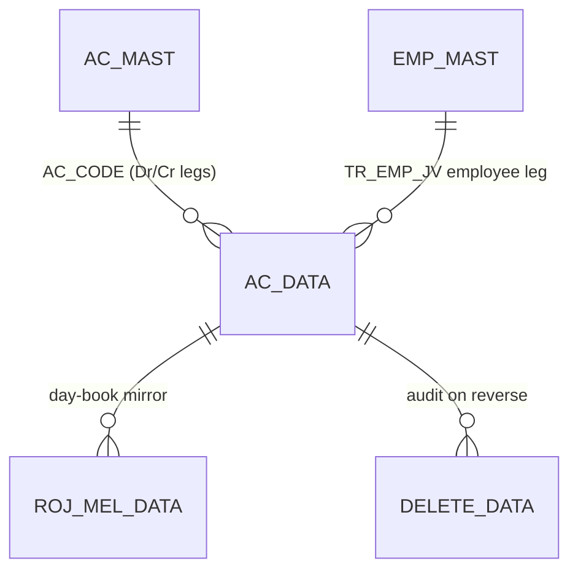
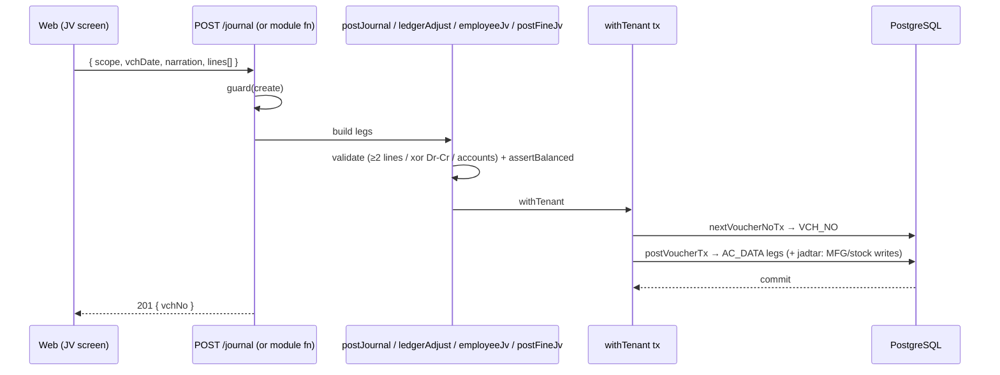

# Journal Vouchers — JV / Ledger-Adjust / Jadtar / Employee-JV (deep-dive)

```
Forms: TR_LEDR_ADJ · TR_JDT_REC · TR_EMP_JV (+ general JV, fine-JV)  ·  Module: 8_Accounting  ·  Type: transaction (posting, account-only / metal)
Desktop source: unified/src/csharp/DataCareNext/{TR_LEDR_ADJ.cs (137 KB), TR_JDT_REC.cs (316 KB), TR_EMP_JV.cs (129 KB)}
Web target: apps/api/src/modules/finance/{journal,ledgerAdjust,employeeJv,fineJv}.ts
            routes POST/DELETE /journal · /fine-jv  (ledger-adjust & emp-JV via their modules)
Requirements: Req 13.1 (balanced), 13.4 (reverse on delete), 13.5 (metal/fine JV), 17.x (financial vouchers)
Parity: 06_Parity/accounting.md   ·   Status: 📋 SPEC · 🟩 BUILT (JV/adjust/emp/fine) · 🟦 PARTIAL (jadtar)
Evidence: journal.ts; ledgerAdjust.ts; employeeJv.ts; fineJv.ts; catalogs TR_LEDR_ADJ/TR_JDT_REC/TR_EMP_JV
```

## 1. Purpose & business context

These are the **manual / adjustment vouchers** that write the ledger directly without a trade
document. They share one engine — _"build balanced `AC_DATA` legs → `postVoucherTx`"_ — and differ
only in inputs, book code and which satellite tables they touch:

| Form | Web module | Book / type | What it does |
|---|---|---|---|
| **General JV** | `journal.ts` | `JV` / `JOURNAL` | Free-form n-line Dr/Cr journal (≥2 lines, Dr xor Cr per line) |
| **`TR_LEDR_ADJ`** | `ledgerAdjust.ts` | `LADJ` | Two-line ledger **adjustment** (move/contra between two accounts with a remark) |
| **`TR_EMP_JV`** | `employeeJv.ts` | `EJV` | Employee **journal** — salary Dr, paid/TDS/PF Cr |
| **`TR_JDT_REC`** | `journal.ts` (partial) | `JDT` | **Jadtar** receipt — journal **plus** metal/stock movement (`MFG_DATA`, `MAIN_STOCK`) |
| **Fine-JV** | `fineJv.ts` | `FJV` | Pure **metal-weight** transfer between two parties (no money) — Req 13.5 |

All are account-only (no item/tax/stock) **except** `TR_JDT_REC`, which also moves jadtar metal/stock.

## 2. UI / UX specification

### Layout (general JV / ledger-adjust)
```
┌─ Journal Voucher ───────────────────────────────────── [New][Save F2][Delete][Print][Close] ┐
│ Vch No: [____]   Date: [__/__/____]   Narration: [..............................]            │
│ ┌ Lines ─────────────────────────────────────────────────────────────────────────────────┐ │
│ │ # │ Account (AC_CODE ▾ name)        │ Dr Amount │ Cr Amount │ Particulars (IT_DESC)       │ │
│ │ 1 │ 000310 INTEREST EXPENSE         │ 1,200.00  │           │ Interest for Mar            │ │
│ │ 2 │ 000123 RAMESH JEWELLERS         │           │ 1,200.00  │ Interest for Mar            │ │
│ └────────────────────────────────────────────────────────────────────────────────────────┘ │
│ Totals → Σ Dr: [........]  Σ Cr: [........]   (must be equal)                                 │
└────────────────────────────────────────────────────────────────────────────────────────────┘
```

### Field tables
**Header:** Vch No (auto), Date (`VCH_DATE`, ✓), Narration (→ each line's `IT_DESC` fallback).

**Lines (`JournalLineInput` / `ledgerAdjust`):**
| Col | Source | Type | Req | Behaviour |
|---|---|---|---|---|
| Account | `AC_CODE` | lookup→`AC_MAST` | ✓ | required per line |
| Dr Amount | `DR_AMT` | money 2dp | one-of | exactly one of Dr/Cr per line (xor) |
| Cr Amount | `CR_AMT` | money 2dp | one-of | |
| Particulars | `IT_DESC` | string | — | per-line desc, else voucher narration |

**Employee-JV (`employeeJv.ts`):** Employee account (`empAc`), Salary (Dr), Paid (Cr), TDS (Cr,
default acct `TDS`), PF (Cr, default `PF`).

**Fine-JV (`fineJv.ts`):** From party (`fromAc`), To party (`toAc`), Fine weight (`fineWt`, 3dp),
Metal (`G`/`S`).

### Modes / F-keys
F2 save, Enter next cell, F-lookup → `AC_MAST`/`EMP_MAST`. New/Edit/Delete(`USER_DELETE`)/Print
(`USER_PRINT`). _(Confirm exact desktop F-map + messages from the `.cs` key handlers.)_

## 3. Data model touched

| Form | Writes | Reverses (delete) |
|---|---|---|
| JV / Ledger-Adjust | `AC_DATA` (+ `LDR_ADJ_DATA`, `ROJ_MEL_DATA` for adjust) | `AC_DATA`, `LDR_ADJ_DATA`, `ROJ_MEL_DATA`, `REMARK_DATA`, `TEMP_BOOK_DATA` + `DELETE_DATA` |
| Employee-JV | `AC_DATA` (+ `EMP_DATA`) | `AC_DATA`, `EMP_DATA`, `ROJ_MEL_DATA`, `APR_IDTL`, `REMARK_DATA` + `DELETE_DATA` |
| Jadtar (`TR_JDT_REC`) | `AC_DATA`, `MFG_DATA/DETL/IDTL`, `MAIN_STOCK`, `ROJ_MEL_DATA`, `TAG_PRINT_DATA` | all of those + `SL_ORD_ADJ`, `TAG_IMAGE_DATA` + `DELETE_DATA` |
| Fine-JV | `AC_DATA` (two `G`/`S` legs) | `AC_DATA` + `DELETE_DATA` |

Table refs: [AC_DATA](../../02_Data_Model/tables/AC_DATA.md) · [AC_MAST](../../02_Data_Model/tables/AC_MAST.md) · [ROJ_MEL_DATA](../../02_Data_Model/tables/ROJ_MEL_DATA.md)



## 4. Business logic & calculations (with code)

### 4.1 General journal — n balanced lines (Req 13.1)
```ts
// src: apps/api/src/modules/finance/journal.ts → postJournal
if (rawLines.length < 2) throw new JournalValidationError('journal voucher requires at least 2 lines');
for (const l of rawLines) {                 // each line: account + exactly one of Dr/Cr (xor)
  if (!l.acCode?.trim()) throw new JournalValidationError('every journal line needs an account code');
  const dr = num(l.drAmt), cr = num(l.crAmt);
  if (dr < 0 || cr < 0) throw new JournalValidationError('journal amounts cannot be negative');
  if ((dr > 0) === (cr > 0)) throw new JournalValidationError(`line "${l.acCode}" must have exactly one of debit or credit`);
}
const ledger = rawLines.map((l) => ({ ...key, VCH_TYPE:'JV', VCH_DATE:vchDate, AC_CODE:l.acCode,
  DR_AMT:num(l.drAmt), CR_AMT:num(l.crAmt), SIGN: num(l.drAmt)>0?'D':'C',
  IT_DESC: (l.desc?.trim()) || narration }));   // AC_DATA has no VCH_DESC; narration lives in IT_DESC
assertBalanced(ledger);                          // Σ Dr == Σ Cr
await postVoucherTx(tx, tenantId, { ledger:{ table:'AC_DATA', lines:ledger }, bookName:'JOURNAL' });
```

### 4.2 Ledger adjustment — two-line move (`TR_LEDR_ADJ`)
```ts
// src: apps/api/src/modules/finance/ledgerAdjust.ts (shape)
const ledger = [
  { ...key, VCH_TYPE:'LADJ', VCH_DATE:vchDate, AC_CODE:drAc, DR_AMT:amount, CR_AMT:0, SIGN:'D', IT_DESC:remark },
  { ...key, VCH_TYPE:'LADJ', VCH_DATE:vchDate, AC_CODE:crAc, DR_AMT:0, CR_AMT:amount, SIGN:'C', IT_DESC:remark },
];   // balanced by construction; desktop also clears LDR_ADJ_DATA/REMARK_DATA/ROJ_MEL_DATA on reverse
```

### 4.3 Employee JV — salary / TDS / PF (`TR_EMP_JV`)
```ts
// src: apps/api/src/modules/finance/employeeJv.ts (shape)
ledger.push({ ...base, AC_CODE: empAc, DR_AMT: salary, CR_AMT: 0, SIGN:'D', IT_DESC: desc });
if (net > 0) ledger.push({ ...base, AC_CODE: paidAc,            DR_AMT:0, CR_AMT: net, SIGN:'C', IT_DESC:'Salary paid' });
if (tds > 0) ledger.push({ ...base, AC_CODE: tdsAc || 'TDS',    DR_AMT:0, CR_AMT: tds, SIGN:'C', IT_DESC:'TDS' });
if (pf  > 0) ledger.push({ ...base, AC_CODE: pfAc  || 'PF',     DR_AMT:0, CR_AMT: pf,  SIGN:'C', IT_DESC:'PF' });
// salary(Dr) == net+tds+pf (Cr) ⇒ balanced
```

### 4.4 Fine-JV — pure metal transfer, no money (Req 13.5)
```ts
// src: apps/api/src/modules/finance/fineJv.ts → postFineJv
const base = { ...key, VCH_TYPE:'FJV', VCH_DATE:vchDate, IT_TYPE:metal /* 'G'|'S' */,
               FINE_WT:fineWt, FINE_RATE:0, DR_AMT:0, CR_AMT:0 };
const ledger = [
  { ...base, AC_CODE: toAc,   LD_CODE: fromAc, SIGN:'+' },   // TO party receives fine (contra = FROM)
  { ...base, AC_CODE: fromAc, LD_CODE: toAc,   SIGN:'-' },   // FROM party gives fine (contra = TO)
];   // money columns 0 on both legs ⇒ Σ Dr == Σ Cr trivially; the FINE_WT nets +fine / -fine per metal
```
This is the canonical **separate metal ledger** (Req 13.5): the gold/silver fine moves between two
parties while **no money moves**; the money trial balance is untouched, and the metal (fine) ledger
balances on its own. Fine is carried to **3 dp**.

**Scale / rounding:** money 2 dp HALF-UP, fine 3 dp HALF-UP (conventions §2).

### 4.5 Desktop evidence
The desktop forms are large screens (jadtar also moves metal/stock), but their **ledger** effect is
the balanced `AC_DATA` set above. Their delete sequences confirm the satellite tables to clean:
```
// src: TR_LEDR_ADJ.cs (op-seq) → DELETE LDR_ADJ_DATA, TEMP_BOOK_DATA, AC_DATA, ROJ_MEL_DATA, REMARK_DATA
// src: TR_EMP_JV.cs   (op-seq) → DELETE EMP_DATA, APR_IDTL, TEMP_BOOK_DATA, AC_DATA, ROJ_MEL_DATA
// src: TR_JDT_REC.cs  (op-seq) → DELETE MFG_DATA/DETL/IDTL, MAIN_STOCK, AC_DATA, ROJ_MEL_DATA, SL_ORD_ADJ, TAG_*
```

## 5. Save sequence (create / edit)


Edit = `reverseVoucherTx` then `postVoucherTx` in the same tx. Jadtar additionally writes
`MFG_DATA`/`MAIN_STOCK` inside the same tx (so metal + ledger commit together).

## 6. Delete / reverse sequence

```ts
// src: journal.ts → deleteJournal (the pattern; adjust/emp/jadtar add their satellite tables)
await reverseVoucherTx(tx, tenantId, {
  tables: ['AC_DATA'],                         // adjust: +['LDR_ADJ_DATA','ROJ_MEL_DATA','REMARK_DATA']
                                               // emp:    +['EMP_DATA','ROJ_MEL_DATA']
                                               // jadtar: +['MFG_DATA','MFG_DETL','MFG_IDTL','MAIN_STOCK','ROJ_MEL_DATA',…]
  key,
  deleteLog: { table:'DELETE_DATA', row:{ ...key, VCH_TYPE, BOOK_NAME, DELETE_USER } },
});
```
One tx; requires `USER_DELETE`; removes the voucher's ledger (and satellite) rows so balances exclude
it (Req 13.4). Jadtar also **restores stock/tags**.

## 7. API contract

```ts
// POST /journal           (create)   { scope, vchDate?, narration?, lines:[{acCode,drAmt?,crAmt?,desc?}] } → 201 {vchNo}
// DELETE /journal/:vchNo   (delete)   { book? } → { reversed:true }
// POST /fine-jv            (create)   { scope, fromAc, toAc, fineWt, metal:'G'|'S', vchDate? } → 201 {vchNo}
// DELETE /fine-jv/:vchNo   (delete)   { book? } → { reversed:true }
// ledger-adjust / employee-JV exposed via their modules (ledgerAdjust.ts / employeeJv.ts)
```
RBAC: `assertRight(create|delete)`. Errors: `*ValidationError` → 400, `UnbalancedError` → 500
(invariant), `ForbiddenError` → 403.

## 8. Validation rules

| Rule | Condition | Desktop message (confirm) | HTTP | req |
|---|---|---|---|---|
| ≥2 lines (JV) | `lines.length < 2` | "Enter at least two lines" | 400 | 13.1 |
| Account per line | blank `acCode` | "Enter party / account" | 400 | 13.2 |
| Dr xor Cr | both or neither set | "Each line must be debit or credit" | 400 | 13.1 |
| Non-negative | `dr<0 \|\| cr<0` | — | 400 | 13.1 |
| Balanced | `Σ Dr ≠ Σ Cr` | "Debit and credit must be equal" | 500/400 | 13.1 |
| Fine-JV parties | `fromAc==toAc` or `fineWt<=0` | "Select two parties / enter fine" | 400 | 13.5 |
| Delete right | no `USER_DELETE` | "You Have No Rights….." | 403 | 6.x |

## 9. Parity criteria (Definition of Done)

1. Persisted `AC_DATA` legs match the desktop for each form: accounts, `DR_AMT`/`CR_AMT`, `SIGN`,
   `IT_DESC`, `BOOK_NAME`/`VCH_TYPE`, `LEDR_KEY`.
2. Σ Dr = Σ Cr (Req 13.1) for JV/adjust/emp; **fine-JV** nets +fine/−fine per metal with money
   untouched (Req 13.5).
3. Employee-JV: `salary(Dr) == paid + TDS + PF (Cr)`.
4. Delete removes all the voucher's rows (ledger + satellites + day-book) and writes `DELETE_DATA`
   (Req 13.4); jadtar restores stock/tags.
5. Day-book mirror (`ROJ_MEL_DATA`) reflects the voucher and is removed on reverse.
Fixtures: `06_Parity/accounting.md` + finance live integration checks.

## 10. Variants & edge cases

| Variant | Delta |
|---|---|
| **General JV** (`journal.ts`) | n free lines, Dr xor Cr, ≥2 lines |
| **Ledger-Adjust** (`TR_LEDR_ADJ`) | exactly 2 legs (move between accounts) + `LDR_ADJ_DATA`/`REMARK_DATA` |
| **Employee-JV** (`TR_EMP_JV`) | salary Dr + paid/TDS/PF Cr + `EMP_DATA` |
| **Jadtar** (`TR_JDT_REC`) | JV **plus** metal/stock movement (`MFG_*`, `MAIN_STOCK`, tags) — partial in web |
| **Fine-JV** (`FJV`) | metal-only transfer, no money (Req 13.5) |
| **Contra** (`TR_CONTRA`, Module 7) | bank↔cash Dr/Cr — same 2-leg pattern, different book |

## 11. Open questions / risks

- **Jadtar (`TR_JDT_REC`) is only partially mapped** — it moves jadtar metal + stock (`MFG_DATA`,
  `MAIN_STOCK`, tags) in addition to the ledger. Port the stock/metal legs (and add them to the
  reverse `tables`) for full parity; today only the ledger side is covered by `journal.ts`.
- **Book/type codes** (`LADJ`/`EJV`/`JDT`/`FJV`) are the web's chosen `VCH_TYPE`/book; confirm the
  exact desktop `CO_BOOK`/`VCH_TYPE` strings so reverse-by-key matches the persisted rows.
- **`ROJ_MEL_DATA` mirror** is in the desktop delete set for all three forms but not yet written by
  the web (see [`Ac_Rojmel.md`](Ac_Rojmel.md)); add it to writes + reverse once the day-book mirror
  lands.
- **Exact desktop validation strings & F-keys** from the three `.cs` files (the catalog flagged "no
  user-facing messages auto-detected" — recover them in the golden-master pass).
