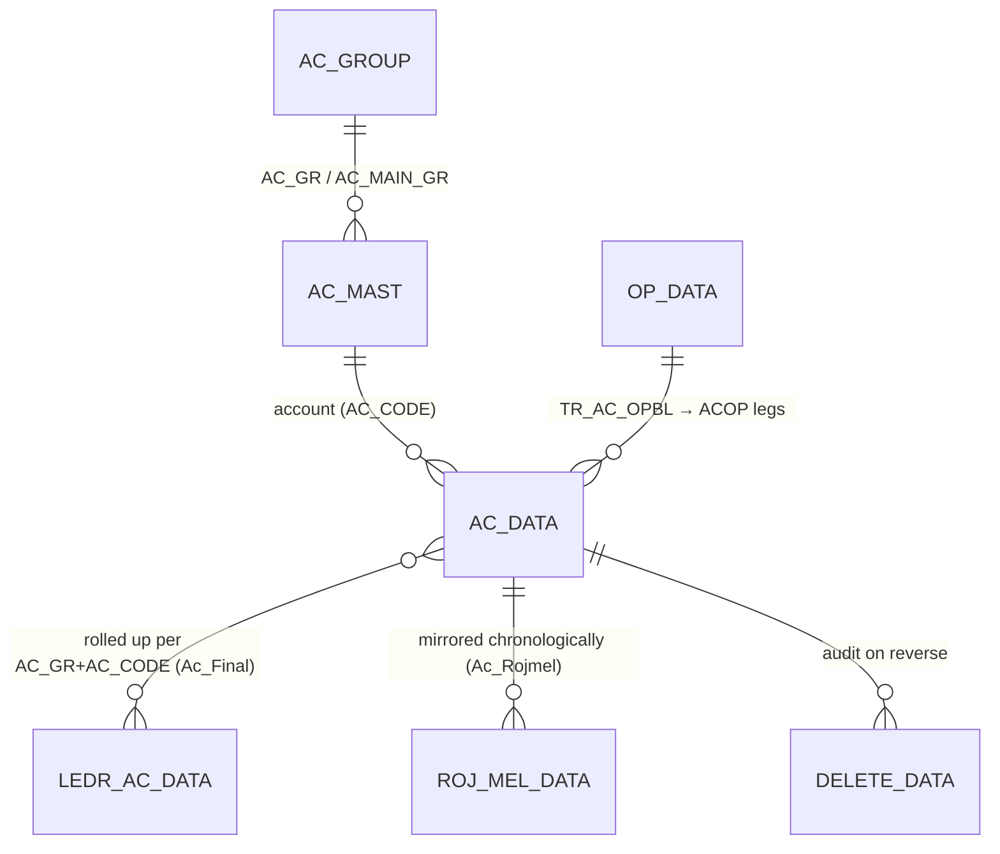

# Module 8 — Accounting / Ledgers / Final Accounts

> The **books of account** of the ERP. Every posting module (Sales, Purchase, Finance, Dhrn, Mfg,
> GST) feeds the single double-entry hub `AC_DATA`; this module is where those legs are **read back**
> as ledgers, trial balance and final accounts, and where the few **account-only vouchers** (opening
> balances, journals, ledger adjustments) are entered directly. Nothing here recomputes business
> documents — it reads/writes the ledger itself. The posting machinery lives in the
> [posting engine](../../04_Cross_Cutting_Engines/posting-and-ledger.md); this module is its
> reporting + manual-entry surface.

## 1. Purpose

In business terms this module answers "what does each account owe / hold, and do the books
balance?" It provides:

- **Account Ledger** — a dated statement for one account: opening balance + period Dr/Cr lines +
  running balance + closing (Req 13.2). See [`ACCOUNT_LEDGER.md`](ACCOUNT_LEDGER.md).
- **Trial Balance** — Σ Dr and Σ Cr per account with a grand Dr = Cr check for the active
  Company/Year (Req 13.3). See [`TRIAL_BALANCE.md`](TRIAL_BALANCE.md).
- **Final Accounts** — Balance Sheet & Profit/Loss rollup of `AC_DATA` into `LEDR_AC_DATA`, plus the
  off-ledger **closing-stock** valuation (`Ac_Final`). See [`Ac_Final.md`](Ac_Final.md).
- **Day Book (Rojmel)** — the chronological cash/voucher day register `ROJ_MEL_DATA`
  (`Ac_Rojmel`). See [`Ac_Rojmel.md`](Ac_Rojmel.md).
- **Account-only vouchers** — opening balances (`TR_AC_OPBL`) and journals / ledger adjustments /
  employee JV (`TR_LEDR_ADJ`, `TR_JDT_REC`, `TR_EMP_JV`). See [`TR_AC_OPBL.md`](TR_AC_OPBL.md) and
  [`JOURNAL_VOUCHERS.md`](JOURNAL_VOUCHERS.md).

The double-entry hub is `AC_DATA`: **money** (`CR_AMT`/`DR_AMT`) and **metal** (`FINE_WT`/`FINE_RATE`)
live on the **same row**, discriminated by `IT_TYPE` (`A` = amount/money leg, `G`/`S` = gold/silver
metal leg). Money legs balance Σ Dr = Σ Cr; metal legs balance **independently** as a parallel
fine-weight ledger (Req 13.5).

## 2. Form inventory

| Form | Type | Posting | Purpose | Tables | Web status |
|---|---|---|---|---|---|
| [**Account Ledger**](ACCOUNT_LEDGER.md) (`Ac_Ledr` read-model) | report | — | One-account statement: opening + dated Dr/Cr + closing | reads `AC_DATA` | 🟩 BUILT (`accounting.ts` `accountLedger`) |
| [**Trial Balance**](TRIAL_BALANCE.md) (`RP_BALANCE`/`Ac_Final` read-model) | report | — | Σ Dr/Σ Cr per account, grand Dr=Cr | reads `AC_DATA`, `AC_MAST` | 🟩 BUILT (`accounting.ts` `trialBalance`; `reports8.ts` `trialBalanceFull`) |
| [`Ac_Final`](Ac_Final.md) | other | ✅ (finalisation) | Balance Sheet / P&L rollup + closing-stock valuation | writes `LEDR_AC_DATA`, `AC_DATA` (book `999`) | 🟦 PARTIAL (`reports.ts` `balanceSheet`) |
| [`Ac_Rojmel`](Ac_Rojmel.md) | other | ✅ (mirror) | Day book — chronological voucher register | writes `ROJ_MEL_DATA` | 🟦 PARTIAL (`reports.ts` `dayBook`) |
| [`TR_AC_OPBL`](TR_AC_OPBL.md) | transaction | ✅ | Account **opening balances** (money + metal) | `OP_DATA`, `CONTRA_DATA`, `AC_DATA`(`ACOP`) | 🟩 BUILT (`finance/acOpening.ts`) |
| [`TR_LEDR_ADJ`](JOURNAL_VOUCHERS.md) | transaction | ✅ | Ledger adjustment / contra Dr↔Cr | `AC_DATA`, `LDR_ADJ_DATA`, `ROJ_MEL_DATA` | 🟩 BUILT (`finance/ledgerAdjust.ts`) |
| [`TR_JDT_REC`](JOURNAL_VOUCHERS.md) | transaction | ✅ | Jadtar/journal receipt (metal + ledger) | `AC_DATA`, `MFG_DATA`, `MAIN_STOCK`, `ROJ_MEL_DATA` | 🟦 PARTIAL (`finance/journal.ts`) |
| [`TR_EMP_JV`](JOURNAL_VOUCHERS.md) | transaction | ✅ | Employee journal voucher (salary/TDS/PF) | `AC_DATA`, `EMP_DATA`, `ROJ_MEL_DATA` | 🟩 BUILT (`finance/employeeJv.ts`) |
| [_(metal JV)_ `FJV`](JOURNAL_VOUCHERS.md) | transaction | ✅ | Pure fine-weight transfer between parties (Req 13.5) | `AC_DATA` (`G`/`S` legs) | 🟩 BUILT (`finance/fineJv.ts`) |

Posting legend: ✅ = writes the `AC_DATA` ledger (directly or by mirroring source vouchers). The two
read-models post **nothing** — they are pure aggregations over `AC_DATA`.

## 3. Module ER diagram

- `AC_DATA` — the double-entry hub (29 cols): scope key, account, `CR_AMT`/`DR_AMT` (money),
  `FINE_WT`/`FINE_RATE` (metal), `IT_TYPE` (`A`/`G`/`S`), `SIGN`, `LEDR_KEY`, `BOOK_NAME`, `VCH_TYPE`.
  [ref](../../02_Data_Model/tables/AC_DATA.md)
- `AC_MAST` — chart of accounts (party/ledger master); carries `AC_GR`, `AC_MAIN_GR` (group → BS/P&L),
  `AC_GST_TYPE`, `AC_TYPE`. [ref](../../02_Data_Model/tables/AC_MAST.md)
- `AC_GROUP` — account groups (`AC_GR`, `AC_MAIN_GR`, `AC_SUB_GR`). [ref](../../02_Data_Model/tables/AC_GROUP.md)
- `LEDR_AC_DATA` — final-accounts summary: per `AC_GR`+`AC_CODE` net, with **separate** gold
  (`CR_FINE_WT`/`DR_FINE_WT`) and silver (`CR_SL_FINE`/`DR_SL_FINE`) fine columns.
  [ref](../../02_Data_Model/tables/LEDR_AC_DATA.md)
- `ROJ_MEL_DATA` — day book (34 cols), money + metal per line; PK `LEDR_KEY`.
  [ref](../../02_Data_Model/tables/ROJ_MEL_DATA.md)

## 4. Shared logic

| Concern | Where | Notes |
|---|---|---|
| Balanced posting + reverse | [posting engine](../../04_Cross_Cutting_Engines/posting-and-ledger.md) (`modules/posting/posting.ts`) | `postVoucherTx` asserts Σ Cr = Σ Dr, enriches `LEDR_KEY`/`IT_TYPE='A'`/`LD_CODE`/`BOOK_NAME`; `reverseVoucherTx` deletes by key + writes `DELETE_DATA` |
| Trial-balance rollup | `accounting.ts` `summarizeTrialBalance` (pure) | per-account Σ dr / Σ cr, grand Dr=Cr |
| Running balance | `accounting.ts` `applyRunningBalance` (pure) | opening + Σ(dr−cr) per row → closing |
| Opening / journal / adjust / emp-jv / fine-jv | `finance/{acOpening,journal,ledgerAdjust,employeeJv,fineJv}.ts` | all reduce to "build balanced `AC_DATA` legs → `postVoucherTx`" |
| Money / metal scale | [conventions](../../01_Architecture/conventions.md) §2 | amounts **2 dp HALF-UP**, weights/fine **3 dp HALF-UP**; columns `NUMERIC`, never float |

**Sign conventions (important for parity):**
- Money leg: `SIGN='D'` (debit, `DR_AMT>0`) or `SIGN='C'` (credit, `CR_AMT>0`).
- Metal leg: `IT_TYPE='G'|'S'`, `SIGN='+'` (fine in / debit-asset) or `'-'` (fine out / credit),
  `FINE_WT=|fine|`, money columns 0 so the **money** balance is untouched.
- The desktop final-accounts net is **credit-positive** (`SUM(CR_AMT-DR_AMT)`, `Ac_Final`); the web
  account-ledger/trial-balance balance column is **debit-positive** (`dr-cr`, `accounting.ts`). Same
  zero-sum, opposite display sign — see each deep-dive §4.

## 5. Dependencies

- **Engines:** posting/ledger (must be parity-green first), voucher-numbering (opening/journal/adjust
  vouchers allocate a `VCH_NO`), auth/RBAC (`assertRight`), multitenancy/scoping (`withTenant`).
- **Masters:** `AC_MAST` (names, `AC_GR`/`AC_MAIN_GR` for BS/P&L), `AC_GROUP`, `EMP_MAST` (emp JV),
  `BAL_GR`/`ITEM_MAST` (closing-stock valuation in `Ac_Final`).
- **Upstream feeders (post into `AC_DATA`):** Sales (2), Purchase (3), Finance/Cash-Bank (7),
  Loans/Dhrn (6), Manufacturing (5), GST (9), Bullion (10). This module never recomputes those — it
  only reads/reverses the legs they wrote.
- **Reports:** Crystal `AcLedger.rpt`, `AcSumm.rpt`, `TRialBalHz.rpt`, `BalanceHz.rpt`,
  `ProfitLossHz.rpt`, `RojMel*.rpt` → re-rendered as HTML/PDF (Module 5 / `packages/reports`).

## 6. API surface

| Method | Path | Right | Purpose |
|---|---|---|---|
| GET | `/reports/account-ledger/:acCode` | auth | One-account ledger (`?fromDate&toDate`) — Req 13.2 |
| GET | `/reports/trial-balance` | auth | Per-account Σ Dr/Σ Cr + grand Dr=Cr — Req 13.3 |
| GET | `/reports/trial-balance-full` | auth | Trial balance with `AC_MAST` names + totals |
| GET | `/reports/balance-sheet` | auth | BS rollup (groups `< 3`) |
| GET | `/reports/account-balances` | auth | Closing balance per account |
| GET | `/reports/day-book` | auth | Chronological day register (Rojmel) |
| GET | `/reports/cash-day-summary` | auth | Cash/bank in/out per day |
| POST/DELETE | `/ac-opbl` , `/ac-opbl/:vchNo` | create / delete | Opening balances — `TR_AC_OPBL` |
| POST/DELETE | `/journal` , `/journal/:vchNo` | create / delete | General journal voucher |
| POST/DELETE | `/fine-jv` , `/fine-jv/:vchNo` | create / delete | Metal-weight transfer (Req 13.5) |

Read endpoints are auth-only; mutations are `assertRight`-guarded. Full request/response contracts
are in each form's §7.

## 7. Build checklist

1. **Posting engine green first** — `postVoucherTx`/`reverseVoucherTx`, `assertBalanced`,
   `enrichLedgerLine` parity-verified (this whole module rests on it).
2. **Read-models** — implement `accountLedger` (opening + window running balance + closing) and
   `trialBalance` (Σ Dr/Σ Cr + grand check); verify against a desktop `AcLedger.rpt` /
   `TRialBalHz.rpt` dataset for the same Company/Year.
3. **Account vouchers** — `TR_AC_OPBL` (money + separate G/S metal legs), then journal /
   ledger-adjust / employee-JV / fine-JV; each must `assertBalanced` and reverse cleanly.
4. **Final accounts** — `Ac_Final` BS/P&L rollup into `LEDR_AC_DATA` (group split `AC_MAIN_GR < 3`
   vs `>= 3`) + off-ledger closing-stock valuation (book `999`).
5. **Day book** — `Ac_Rojmel` mirror / `dayBook` read.
6. **Parity gate** — for a fixed Company/Year: account-ledger opening/closing matches desktop to the
   paisa; trial-balance grand Σ Dr = Σ Cr (accounting for the documented off-ledger closing-stock
   residual); metal (fine) ledger balances independently of money; deleting a voucher removes its
   `AC_DATA` rows so balances exclude it (Req 13.4). Tracked in `06_Parity/`.
