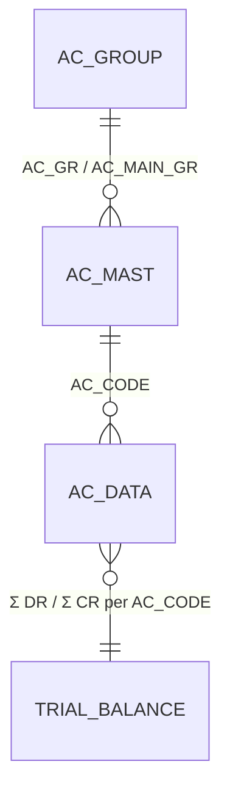

# Trial Balance — Σ per account, Dr = Cr (deep-dive)

```
Form: RP_BALANCE / Ac_Final (read-model)  ·  Module: 8_Accounting  ·  Type: report (read-only over AC_DATA)
Desktop source: unified/src/csharp/DataCareNext/Ac_Final.cs (AcBalInsert) + RP_BALANCE.cs · Crystal TRialBalHz.rpt
Web target: apps/api/src/modules/accounting/accounting.ts (trialBalance, summarizeTrialBalance)
            apps/api/src/modules/reports/reports8.ts (trialBalanceFull)
            routes GET /reports/trial-balance · GET /reports/trial-balance-full
Requirements: Req 13.3 (Σ Dr = Σ Cr across all accounts for active CO/YEAR), 13.1, 13.4
Parity: 06_Parity/accounting.md   ·   Status: 📋 SPEC · 🟩 BUILT
Evidence: accounting.ts#trialBalance/summarizeTrialBalance; reports8.ts#trialBalanceFull; Ac_Final.cs#AcBalInsert
```

## 1. Purpose & business context

The trial balance is the books' **proof of arithmetic**: for the active Company/Year it sums every
account's debits and credits and asserts that the grand totals are equal. It is the accountant's
"are we balanced?" check and the spine of the Balance Sheet and P&L (which are just the trial balance
sliced by account group). Like the account ledger it is **read-only** — a pure aggregation over the
double-entry hub `AC_DATA`. The desktop renders `TRialBalHz.rpt`; the web returns a JSON dataset with
a grand Dr = Cr flag.

## 2. UI / UX specification (report screen)

### Layout
```
┌─ Trial Balance ────────────────────────────────── Company [CO] · Year [CO_YEAR] [Run][Print][xls] ┐
│ As-on / period: [__/__/____] – [__/__/____]   Location: [LC ▾(opt)]   Group filter: (All|BS|P&L)   │
├─────────────────────────────────────────────────────────────────────────────────────────────────┤
│ AC_CODE │ Account name (AC_MAST)        │       Debit │      Credit │      Balance (Dr−Cr)          │
│ 000123  │ RAMESH JEWELLERS              │   88,400.00 │             │    88,400.00 Dr               │
│ 000477  │ SALES A/C                     │             │ 5,33,847.00 │  −5,33,847.00 Cr               │
│ …       │ …                             │       …     │      …      │        …                      │
├─────────────────────────────────────────────────────────────────────────────────────────────────┤
│ GRAND TOTAL                             │ Σ DR_AMT    │ Σ CR_AMT    │  balanced ✔ / off-by Δ        │
└─────────────────────────────────────────────────────────────────────────────────────────────────┘
```

### Filter / input fields
| Label | Source | Type | Req | Default | Notes |
|---|---|---|---|---|---|
| Company / Year | `CO_CODE` / `CO_YEAR` | scope | ✓ | session | active company + fiscal year |
| Location | `LC_CODE` | scope | — | (all) | only filters when selected |
| Period | `VCH_DATE` | date range | — | full year | desktop variants: opening / today / between (`Ac_Final`) |
| Group filter | `AC_MAST.AC_MAIN_GR` | enum | — | All | All / Balance-Sheet (`< 3`) / P&L (`>= 3`) — see §4.4 |

### Result columns (`TrialBalanceRow`)
| Col | Source | Type | Notes |
|---|---|---|---|
| AC_CODE | `AC_DATA.AC_CODE` | string(8) | group key |
| Name | `AC_MAST.AC_NAME` | string | from correlated subquery (full TB only) |
| Debit | `Σ DR_AMT` | money 2dp | `coalesce(sum("DR_AMT"),0)` |
| Credit | `Σ CR_AMT` | money 2dp | `coalesce(sum("CR_AMT"),0)` |
| Balance | `dr − cr` | money 2dp | debit-positive; show `Dr` if ≥0 else `Cr` |
| **Grand** | `Σ dr`, `Σ cr`, `balanced` | — | `grandDr === grandCr` |

### Modes / keyboard
- **Run** executes; **Print** → `TRialBalHz.rpt` PDF; **Export** → xlsx. Read-only — no
  New/Edit/Delete. Sort: full TB orders by `|balance|` desc (largest movers first); the lightweight
  TB orders by `AC_CODE`.

## 3. Data model touched

**Writes:** none for the read-model. _(The `Ac_Final` finalisation pass writes `LEDR_AC_DATA` and a
closing-stock leg into `AC_DATA` book `999` — documented in [`Ac_Final.md`](Ac_Final.md), not here.)_

**Reads:** `AC_DATA` grouped by `AC_CODE`; `AC_MAST` for names and `AC_MAIN_GR` group split.

Table refs: [AC_DATA](../../02_Data_Model/tables/AC_DATA.md) · [AC_MAST](../../02_Data_Model/tables/AC_MAST.md) · [AC_GROUP](../../02_Data_Model/tables/AC_GROUP.md)



## 4. Business logic & calculations (with code)

### 4.1 Web — the live query (per-account Σ Dr / Σ Cr)
```ts
// src: apps/api/src/modules/accounting/accounting.ts → trialBalance
const rows = await tx.$queryRawUnsafe(
  `SELECT "AC_CODE", coalesce(sum("DR_AMT"),0) AS dr, coalesce(sum("CR_AMT"),0) AS cr
   FROM "AC_DATA" WHERE ${w.sql} GROUP BY "AC_CODE" ORDER BY "AC_CODE"`,
  ...w.params);                       // w.sql scopes CO_CODE [+ LC_CODE] [+ CO_YEAR]
return summarizeTrialBalance(rows);
```

### 4.2 Web — the pure rollup + balance check (Req 13.3)
```ts
// src: accounting.ts → summarizeTrialBalance (pure, unit-testable)
export function summarizeTrialBalance(rows) {
  const accounts = rows.map((r) => {
    const dr = round2(Number(r.dr ?? 0));
    const cr = round2(Number(r.cr ?? 0));
    return { acCode: r.AC_CODE, dr, cr, balance: round2(dr - cr) };  // debit-positive balance
  });
  const grandDr = round2(accounts.reduce((s, a) => s + a.dr, 0));
  const grandCr = round2(accounts.reduce((s, a) => s + a.cr, 0));
  return { accounts, grandDr, grandCr, balanced: grandDr === grandCr };  // Req 13.3
}
```

### 4.3 Web — full trial balance with names (and the off-ledger note)
```ts
// src: apps/api/src/modules/reports/reports8.ts → trialBalanceFull
SELECT d."AC_CODE" AS "acCode",
       (SELECT m."AC_NAME" FROM "AC_MAST" m
          WHERE m."AC_CODE"::text=d."AC_CODE"::text AND m."CO_CODE"::text=d."CO_CODE"::text LIMIT 1) AS name,
       sum(NN(d."DR_AMT")) AS dr, sum(NN(d."CR_AMT")) AS cr
FROM "AC_DATA" d WHERE d."CO_CODE"=$1 [AND d."CO_YEAR"=$2]
GROUP BY d."AC_CODE", d."CO_CODE"
ORDER BY abs(sum(NN(d."DR_AMT")) - sum(NN(d."CR_AMT"))) DESC
// NN(c) = coalesce(NULLIF(c::text,'')::numeric, 0)  — desktop amount columns can be text/empty
```

### 4.4 Desktop evidence — group split & sign convention
The desktop computes the same per-account net, **credit-positive**, and slices it by account group:
```
// src: unified/src/csharp/DataCareNext/Ac_Final.cs → AcBalInsert
Select B.AC_GR, A.AC_CODE, ROUND(SUM(CR_AMT-DR_AMT),2) AS BalAmt
FROM AC_DATA A LEFT JOIN AC_MAST B ON A.CO_CODE=B.CO_CODE AND A.AC_CODE=B.AC_CODE
WHERE A.CO_CODE=… AND A.CO_YEAR=…
  -- RptData 'P' → P&L:  AND B.AC_MAIN_GR >= '3'
  -- RptData (BS)→ B/S:  AND B.AC_MAIN_GR <  '3'
  -- RptData 'T' → ALL (trial balance, no group filter)
GROUP BY B.AC_GR, A.AC_CODE HAVING ROUND(SUM(CR_AMT-DR_AMT),2) <> 0 ORDER BY A.AC_CODE
```
Key facts this proves:
- **Group meaning:** `AC_MAIN_GR < '3'` = Balance-Sheet accounts (assets/liabilities); `>= '3'` =
  Profit & Loss (income/expense). The trial balance is `RptData='T'` (no group filter).
- **`HAVING … <> 0`:** zero-net accounts are dropped from the listing (cosmetic; doesn't affect the
  grand total).
- **Sign:** desktop `SUM(CR_AMT-DR_AMT)` is credit-positive; web `dr-cr` is debit-positive. Same
  zero-sum; normalise sign when diffing a single account.

**Rounding:** 2 dp (`round2`). The grand check uses `===` on 2-dp numbers, so accumulation must round
each account first (it does). For exact parity reconcile `round2` to decimal.js HALF-UP (conventions §2).

### 4.5 The Dr = Cr tie — what "balanced" really means here (critical parity nuance)
A textbook trial balance has Σ Dr = Σ Cr exactly. This jewellery ERP holds **closing stock OUTSIDE
the ledger** until finalisation: `Ac_Final.Trading_Stock` posts the stock valuation into `AC_DATA`
under `CO_BOOK='999'` only when the balance sheet is finalised. Therefore **raw `AC_DATA` does not
tie exactly mid-year** — the residual `Σ Cr − Σ Dr` is the off-ledger closing-stock / trading figure:
```ts
// src: reports8.ts header note (trialBalanceFull)
// Live sanity (CO_CODE='01'): 300 accounts, Σ dr 55,180,589.47, Σ cr 56,302,194.65
//   gap 1,121,605.18 = the off-ledger closing stock; top |balance| 000858 "JAN-24 TO DEC-25" −8,781,900.00
```
So `balanced:true` is expected **after** the closing-stock leg (book `999`) is posted, or when the
report explicitly adds the trading figure. Document the gap rather than "fixing" it — it is desktop
behaviour. _(req: 13.3)_

### 4.6 Metal (fine) trial balance — Req 13.5
A parallel trial balance over `FINE_WT` (`IT_TYPE='G'` and `='S'` summed separately) must also tie:
Σ fine-in = Σ fine-out per metal. Gold and silver are independent of each other and of money. The
desktop's fine balancing is visible in `Ac_Final` (`AcLdrFineGold`/`AcLdrFineSilver` accumulators
feeding the closing-stock fine adjustment).

## 5. Save sequence (create / edit)

`N/A — read-only.` The trial balance writes nothing. (Finalisation that writes `LEDR_AC_DATA` +
book-`999` legs is `Ac_Final`, documented separately.)

## 6. Delete / reverse sequence

`N/A — read-only.` Req 13.4 is observed through it: deleting a voucher removes its `AC_DATA` rows, so
both the account's row and the grand totals shrink by that voucher's Dr/Cr on the next run.

## 7. API contract

```ts
// GET /reports/trial-balance            (auth)  → light, code-ordered
// GET /reports/trial-balance-full       (auth)  → with names, |balance|-ordered, totals
// src: apps/api/src/routes/txn.ts
app.get('/reports/trial-balance',      auth, async (req) => trialBalance(prisma, readScope(req)));
app.get('/reports/trial-balance-full', auth, async (req) => trialBalanceFull(prisma, readScope(req)));

interface TrialBalanceRow { acCode: string; dr: number; cr: number; balance: number; }
interface TrialBalance {
  accounts: TrialBalanceRow[];
  grandDr: number; grandCr: number;
  balanced: boolean;                    // grandDr === grandCr (Req 13.3)
}
// trialBalanceFull → ListReport { rows: {acCode,name,dr,cr,balance}[], totals: {accounts,dr,cr} }
```
- **Scope:** `CO_CODE` + `CO_YEAR` from session (active company/year); `LC_CODE` only when selected.
- **Errors:** read-only; 401 if unauthenticated. Always returns a dataset (never 404).

## 8. Validation rules

| Rule | Condition | Desktop msg (confirm) | HTTP | req |
|---|---|---|---|---|
| Auth | no session | — | 401 | 6.x |
| Scope present | no `CO_CODE`/`CO_YEAR` | — | 400/401 | 1.x |
| Grand balance invariant | `grandDr !== grandCr` | (info: off by Δ = closing stock) | 200 (flagged) | 13.3 |
| Data type filter | desktop `MsDataType` (`A`/`B`/`C`) | "Select Data Type A or B…" | — | — |

No write-side guards. The `balanced` flag is informational, not an error (see §4.5).

## 9. Parity criteria (Definition of Done)

1. Per-account `dr`/`cr` equal the desktop `TRialBalHz.rpt` figures for the same Company/Year (sign
   normalised: web debit-positive vs desktop credit-positive).
2. Account set matches after applying the desktop `HAVING SUM(CR-DR) <> 0` (drop zero-net rows).
3. `grandDr` and `grandCr` equal the desktop grand totals; the residual `grandCr − grandDr` equals
   the documented off-ledger closing-stock figure (book `999`) for that year.
4. **Group slices:** filtering `AC_MAIN_GR < 3` reproduces the Balance-Sheet account set; `>= 3` the
   P&L set.
5. **Metal TB (Req 13.5):** gold and silver fine totals each tie independently.
6. **Delete (Req 13.4):** removing a voucher reduces the relevant account row and grand totals by its
   Dr/Cr.
Fixtures: `06_Parity/accounting.md` + a live check against the SQL-Server golden master via
`packages/parity` (the `trialBalanceFull` header records a live `CO_CODE='01'` sanity vector).

## 10. Variants & edge cases

| Variant | Delta |
|---|---|
| **Balance Sheet** (`BalanceHz.rpt`) | TB filtered to `AC_MAIN_GR < '3'`, grouped by `AC_GR`; assets vs liabilities |
| **Profit & Loss** (`ProfitLossHz.rpt`) | TB filtered to `AC_MAIN_GR >= '3'`, grouped by `AC_GR`; income vs expense |
| **Group summary** (`AcGroupRpt.rpt`) | TB rolled to `AC_GR` (drop `AC_CODE` detail) |
| **Account balances** (`/reports/account-balances`) | closing balance per account (no Dr/Cr split) |
| **Fine trial balance** | sum `FINE_WT` per metal (`IT_TYPE='G'/'S'`) instead of money (Req 13.5) |
| **As-on / opening / period modes** | desktop `Ac_Final.AcBalInsert` parameterises the date window (`< opDt` opening / `= today` / `between`); the web adds an optional date range |
| **Data type A/B/C** | desktop `MsDataType` segregates parallel books (e.g. statutory vs management); web maps to a `DATA_TYPE` filter when enabled |

## 11. Open questions / risks

- **Off-ledger closing stock:** decide whether `/reports/trial-balance` should (a) report raw
  `AC_DATA` (current — `balanced:false` mid-year by the closing-stock residual), or (b) include the
  book-`999` trading figure so it ties. Document the chosen mode in `06_Parity/`. This is the single
  biggest parity gotcha in the module.
- **`balanced` with float round:** `grandDr === grandCr` compares 2-dp numbers; ensure per-account
  rounding happens before summation (it does) and reconcile `round2` to decimal.js HALF-UP for exact
  paisa equality.
- **Group thresholds:** `AC_MAIN_GR < '3'` is a **string** comparison in the desktop SQL — confirm
  group codes are zero-padded/consistent so the `< '3'` / `>= '3'` split is correct for all
  companies (golden-master pass).
- **`CO_YEAR` scope:** the light `trialBalance` includes `CO_YEAR` only when present in scope; ensure
  the active-year filter is always applied for Req 13.3 ("active Company and Year").
