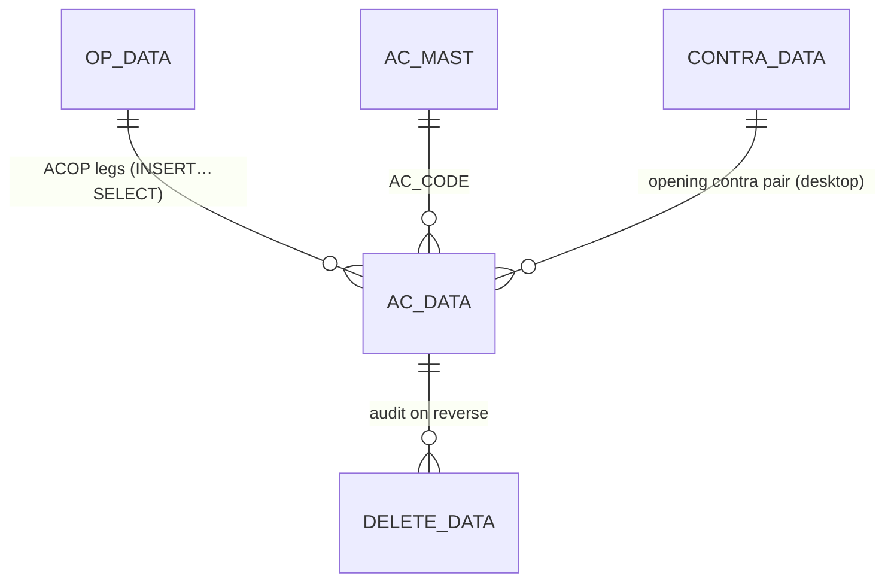
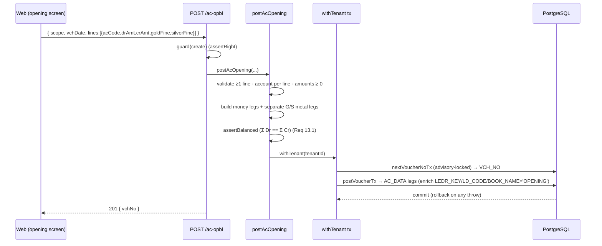

# TR_AC_OPBL — Account Opening Balances (deep-dive)

```
Form: TR_AC_OPBL  ·  Module: 8_Accounting  ·  Type: transaction (posting, account-only)
Desktop source: unified/src/csharp/DataCareNext/TR_AC_OPBL.cs (142 KB) + Ac_Ledr.cs (AC_DATA insert)
Web target: apps/api/src/modules/finance/acOpening.ts (postAcOpening, deleteAcOpening)
            routes apps/api/src/routes/txn.ts → POST /ac-opbl · DELETE /ac-opbl/:vchNo
Requirements: Req 13.1 (balanced), 13.2 (feeds opening balance), 13.4 (reverse on delete), 13.5 (metal opening)
Parity: 06_Parity/accounting.md   ·   Status: 📋 SPEC · 🟩 BUILT
Evidence: acOpening.ts; TR_AC_OPBL.cs (OP_DATA/CONTRA_DATA/AC_DATA, MsgBox guards); Ac_Ledr.cs#L13 ('ACOP')
```

## 1. Purpose & business context

At the **start of a fiscal year** (or when on-boarding a company) the accountant seeds every ledger
account's **opening balance** — what each party owes or is owed, and what metal (gold/silver fine)
each holds — so the year's ledgers and trial balance start from the correct base. `TR_AC_OPBL` is the
data-entry screen for these openings. On save it writes the opening master rows (`OP_DATA`), any
contra pairing (`CONTRA_DATA`), and the **balanced** ledger legs into `AC_DATA` stamped with voucher
type **`ACOP`** (book **`ACO`** / `BOOK_NAME='OPENING'`). It is an **account-only** voucher: no
item/detail/tax/stock rows — just the ledger.

## 2. UI / UX specification

### Layout
```
┌─ TR_AC_OPBL ─ Account Opening Balances ─────────────────── [New][Save F2][Delete][Print][Close] ┐
│ Data Type: (A|B)   Vch No: [____]   Op. Date: [__/__/____]   Company [CO] · Year [CO_YEAR]        │
│ ┌ Opening lines ───────────────────────────────────────────────────────────────────────────────┐│
│ │ # │ Account (AC_CODE ▾ name)      │ Dr Amount │ Cr Amount │ Gold Fine │ Silver Fine │ SIGN      ││
│ │ 1 │ 000123 RAMESH JEWELLERS       │ 88,400.00 │           │    0.000  │      0.000  │  D        ││
│ │ 2 │ 000900 OPENING EQUITY/CONTRA  │           │ 88,400.00 │           │             │  C        ││
│ │ 3 │ 000777 GOLD ON HAND           │           │           │  125.500  │             │  + (G)    ││
│ └────────────────────────────────────────────────────────────────────────────────────────────────┘│
│ Totals → Σ Dr: [........]   Σ Cr: [........]   (must be equal)   Σ Gold fine / Σ Silver fine        │
└─────────────────────────────────────────────────────────────────────────────────────────────────────┘
```

### Header field table
| Label | Source | Type | Req | Default | Notes |
|---|---|---|---|---|---|
| Data Type | desktop `MsDataType` (`A`/`B`) | enum | ✓ | A | parallel-book selector; `C` is read-only ("can't change in Data Type = C") |
| Vch No | `OP_DATA.VCH_NO` / `AC_DATA.VCH_NO` | string(8) | auto | next | from numbering engine |
| Op. Date | `AC_DATA.VCH_DATE` | date | ✓ | year-start | stamped on every leg so opening shows in date-scoped reports |
| Company / Year | `CO_CODE`/`CO_YEAR` | scope | ✓ | session | |

### Line grid columns (`AcOpeningLineInput`)
| Col | Source | Type | Editable | Behaviour |
|---|---|---|---|---|
| Account | `AC_CODE` | lookup→`AC_MAST` | yes | required per line; "Enter Party First" if blank |
| Dr Amount | `DR_AMT` | money 2dp | yes | money debit (asset/receivable opening) |
| Cr Amount | `CR_AMT` | money 2dp | yes | money credit (liability/payable opening); exactly one side per money leg |
| Gold Fine | `goldFine` → `FINE_WT` (`IT_TYPE='G'`) | weight 3dp | yes | emits a **separate** `G` metal leg; SIGN `+` if ≥0 else `-` |
| Silver Fine | `silverFine` → `FINE_WT` (`IT_TYPE='S'`) | weight 3dp | yes | emits a **separate** `S` metal leg |
| SIGN | `SIGN` | `D`/`C`/`+`/`-` | auto | money: `D`/`C`; metal: `+`/`-` |

### Keyboard / F-keys
- **F2 = Save**, Enter = next cell, F-lookup on Account → `AC_MAST` picker. (Confirm exact F-map from
  `TR_AC_OPBL.cs` key handlers.)

### Modes
New / Edit (load lines, re-post on save) / Delete (needs `USER_DELETE`) / Print (`USER_PRINT`). Data
Type `C` rows are **view-only** (desktop blocks edits).

### Wireframe note
This is a grid-of-accounts screen — no metal/stock pickers. The only "lookup" is the account picker.

## 3. Data model touched

**Writes (create):**
- `AC_DATA` — the balanced opening legs (`VCH_TYPE='ACOP'`, `BOOK_NAME='OPENING'`); money leg
  (`IT_TYPE='A'`) + optional separate gold (`'G'`) and silver (`'S'`) metal legs.
- `OP_DATA` — opening master rows (desktop source the `ACOP` AC_DATA is generated from).
- `CONTRA_DATA` — opening contra pairing (desktop).
- `USER_DATA` — audit (desktop).

**Deletes / reverses:** `AC_DATA` + `OP_DATA` (desktop also re-derives `CONTRA_DATA`) + `DELETE_DATA`
audit row. The web reverses `AC_DATA` (the only table it writes) + `DELETE_DATA`.

Table refs: [AC_DATA](../../02_Data_Model/tables/AC_DATA.md) · [AC_MAST](../../02_Data_Model/tables/AC_MAST.md)
(`OP_DATA`, `CONTRA_DATA` are desktop opening-staging tables.)



## 4. Business logic & calculations (with code)

An opening voucher is the simplest balanced voucher: each line names an account and carries a money
debit **or** credit, plus optional gold/silver opening fine. The money legs must net Σ Dr = Σ Cr; the
metal legs are **separate rows with zero money** so they don't disturb the money balance (Req 13.5).

### 4.1 Web — money leg + separate metal legs
```ts
// src: apps/api/src/modules/finance/acOpening.ts → postAcOpening
const ledger = rawLines.flatMap((l) => {
  const dr = num(l.drAmt), cr = num(l.crAmt);
  const moneyLeg = { ...key, VCH_TYPE:'ACOP', VCH_DATE:vchDate, AC_CODE:l.acCode,
                     DR_AMT:dr, CR_AMT:cr, SIGN: dr>0?'D':'C',
                     FINE_WT:l.fineWt ?? 0, IT_TYPE:l.itType ?? 'A' };
  const legs = [moneyLeg];
  const gold = num(l.goldFine);   if (gold   !== 0) legs.push(metalLeg(key, vchDate, l.acCode, 'G', gold));
  const silver = num(l.silverFine); if (silver !== 0) legs.push(metalLeg(key, vchDate, l.acCode, 'S', silver));
  return legs;
});
assertBalanced(ledger);   // Σ Dr == Σ Cr (Req 13.1) — metal legs carry 0 money so they don't affect it
```

### 4.2 Web — the metal leg (Req 13.5)
```ts
// src: acOpening.ts → metalLeg  (a SEPARATE AC_DATA row, money columns 0)
function metalLeg(key, vchDate, acCode, itType /* 'G'|'S' */, fine) {
  return { ...key, VCH_TYPE:'ACOP', VCH_DATE:vchDate, AC_CODE:acCode,
           IT_TYPE: itType, SIGN: fine >= 0 ? '+' : '-',   // + debit/asset opening, - credit
           FINE_WT: Math.abs(fine), FINE_RATE: 0,
           DR_AMT: 0, CR_AMT: 0 };                          // money 0 ⇒ Σ Dr == Σ Cr untouched
}
```
`postVoucherTx.enrichLedgerLine` only defaults `IT_TYPE` to `'A'` when it is null, so the caller-set
`'G'`/`'S'` survives — the money lives on the `'A'` leg, the fine on its own `'G'`/`'S'` leg. Gold and
silver each balance independently (Req 13.5).

### 4.3 Desktop evidence — the `ACOP` AC_DATA generation
```
// src: unified/src/csharp/DataCareNext/Ac_Ledr.cs#L13  (opening copy → AC_DATA)
INSERT INTO AC_DATA (CO_CODE,LC_CODE,CO_YEAR,CO_BOOK,VCH_TYPE,VCH_NO,VCH_DATE,LEDR_KEY,BOOK_NAME,…,
  AC_CODE,LD_CODE,CR_AMT,DR_AMT,IT_TYPE,SIGN,FINE_WT,…,FINE_RATE,PARTY_AC_CODE,LDR_NAME)
  Select CO_CODE,LC_CODE,CO_YEAR,CO_BOOK,'ACOP',VCH_NO,'…  -- VCH_TYPE forced to 'ACOP'
```
`TR_AC_OPBL.cs` stages openings in `OP_DATA`/`CONTRA_DATA`, then `Ac_Ledr` generates the `ACOP` legs.
On reverse it deletes `OP_DATA` then `AC_DATA` (op-sequence L2694/L2774, L2876/L2878).

**Scale / rounding:** money **2 dp HALF-UP**, fine **3 dp HALF-UP** (conventions §2). Opening amounts
must be **≥ 0** (sign is expressed by Dr-vs-Cr / `+`-vs-`-`, not by a negative number).

### 4.4 Opening feeds the account-ledger opening balance
The `ACOP` legs are dated on `VCH_DATE` (op-date), so the account-ledger/trial-balance pick them up.
Crucially, the desktop **opening-balance** query in `Ac_Final` excludes the closing-stock book
(`AND CO_BOOK <> '999'`) — opening accounts come from real vouchers + `ACOP`, never the trading leg.

## 5. Save sequence (create / edit)

Edit = reverse prior `ACOP` voucher then repost, **all in one tx**.


Numbered: (1) validate lines; (2) build legs (money `A` + metal `G`/`S`); (3) `assertBalanced`;
(4) `nextVoucherNoTx`; (5) `postVoucherTx` writes the `AC_DATA` legs (`BOOK_NAME='OPENING'`, type
`ACOP`); (6) commit. _(Desktop additionally stages `OP_DATA`/`CONTRA_DATA`/`USER_DATA`; add those
writes for full satellite parity — see §11.)_

## 6. Delete / reverse sequence

```ts
// src: acOpening.ts → deleteAcOpening
await reverseVoucherTx(tx, tenantId, {
  tables: ['AC_DATA'],                                  // web writes only AC_DATA
  key,                                                  // {CO_CODE,LC_CODE,CO_YEAR,CO_BOOK='ACO',VCH_NO}
  deleteLog: { table: 'DELETE_DATA',
    row: { ...key, VCH_TYPE:'ACOP', BOOK_NAME:'OPENING', DELETE_USER } },
});
```
One transaction; requires `USER_DELETE`. Removes the opening legs so subsequent balances exclude them
(Req 13.4). _(Desktop also deletes `OP_DATA` and re-derives `CONTRA_DATA` — add when those tables are
written.)_

## 7. API contract

```ts
// POST /ac-opbl                     (right: create)
interface AcOpeningBody {
  scope: { coCode; lcCode; coYear?; coBook? };       // tenantId from session
  vchDate?: string;
  lines: { acCode: string; drAmt?: number; crAmt?: number;
           goldFine?: number; silverFine?: number;
           fineWt?: number; itType?: string; }[];     // fineWt/itType: legacy single-leg form
}
// → 201 { vchNo:number }
// DELETE /ac-opbl/:vchNo  (right: delete)  body { book? } → { reversed:true }
```
- RBAC: `assertRight(session.rights,'create'|'delete')` via the route `guard`.
- Errors: `AcOpeningValidationError` → 400 (name ends `ValidationError`); `UnbalancedError` → 500
  (invariant; should never reach a user since the service pre-asserts); `ForbiddenError` → 403.

## 8. Validation rules

| Rule | Condition | Desktop message | HTTP | req |
|---|---|---|---|---|
| ≥1 line | `lines.length < 1` | "Please Insert Vch No and Try…" / "Please Insert Gold fine or Silver fine or Net Amount…" | 400 | 13.1 |
| Account per line | blank `acCode` | "Please Enter Party First…" | 400 | 13.2 |
| Non-negative amounts | `drAmt<0 \|\| crAmt<0` | — | 400 | 13.1 |
| Balanced money | `Σ Dr ≠ Σ Cr` | (opening must balance) | 500/400 | 13.1 |
| Data Type chosen | no `A`/`B` selected | "Please Select Data Type A or B then Try…" | 400 | — |
| Data Type C immutable | edit on `C` rows | "…You Cant Change in Data Type = C…" | 403 | — |
| Print right | no `USER_PRINT` | "You Have No Print Rights….." | 403 | 6.x |
| Delete right | no `USER_DELETE` | "You Have No Rights….." | 403 | 6.x |

## 9. Parity criteria (Definition of Done)

1. For a given set of opening lines, the persisted `AC_DATA` legs match the desktop `ACOP` rows:
   accounts, `DR_AMT`/`CR_AMT`, `IT_TYPE`, `SIGN`, `BOOK_NAME='OPENING'`, `VCH_TYPE='ACOP'`, and
   `LEDR_KEY` shape.
2. Σ Dr = Σ Cr on the money legs (Req 13.1).
3. **Metal opening (Req 13.5):** a gold/silver opening creates a separate `G`/`S` leg with
   `FINE_WT=|fine|`, `SIGN '+'/'−'`, money 0; gold and silver totals balance independently and do not
   alter the money balance.
4. The opening shows up as the **opening balance** in the account ledger for dates ≥ op-date and is
   excluded from period movement.
5. **Delete (Req 13.4):** reversing removes the legs and writes `DELETE_DATA`; balances drop the
   opening.
Fixtures: `06_Parity/accounting.md`; opening vectors in `web/apps/api/integration/*.live.mjs`.

## 10. Variants & edge cases

| Variant | Delta vs TR_AC_OPBL |
|---|---|
| **Money-only opening** | omit `goldFine`/`silverFine` → only the `A` money leg (no metal legs) |
| **Metal-only opening** | `drAmt=crAmt=0`, set `goldFine`/`silverFine` → only `G`/`S` legs (money balance trivially 0=0) |
| **Legacy single-leg fine** | `fineWt`+`itType` stamp `FINE_WT`/`IT_TYPE` on the money leg itself (back-compat; new callers prefer `goldFine`/`silverFine`) |
| **Item opening** (`TR_ITM_OPBL`) | opening **stock** (not ledger) → `MAIN_STOCK`/`ITEM_MAST`, no `AC_DATA` (Module 4) |
| **Tag opening** (`TR_TAG_OPBL`) | opening **tagged** stock → `TAG_STOCK`/`BAR_DETL` (Module 4) |
| **Data Type A/B/C** | parallel opening books; `C` is system/consolidated (immutable in UI) |

## 11. Open questions / risks

- **`OP_DATA`/`CONTRA_DATA` satellites:** the desktop stages openings in `OP_DATA` (+ `CONTRA_DATA`,
  `USER_DATA`) before generating `ACOP` legs; the web writes only `AC_DATA`. Add `OP_DATA` writes (and
  the reverse) for full satellite parity and so the desktop opening-edit screen can round-trip.
- **`CO_BOOK` for openings:** web uses `CO_BOOK='ACO'`; the desktop opening copy in `Ac_Ledr` selects
  the source book and forces `VCH_TYPE='ACOP'`. Confirm the persisted `CO_BOOK` matches the desktop
  (book vs type) so the reverse-by-key hits the same rows.
- **Exact desktop validation strings & F-keys** from `TR_AC_OPBL.cs` (the messages above are quoted
  from `MsgBox` evidence; confirm the precise trigger order).
- **Opening exclusion of book `999`:** ensure opening queries exclude the closing-stock book so a
  prior-year trading leg never leaks into this year's opening (see `Ac_Final` opening branch).
