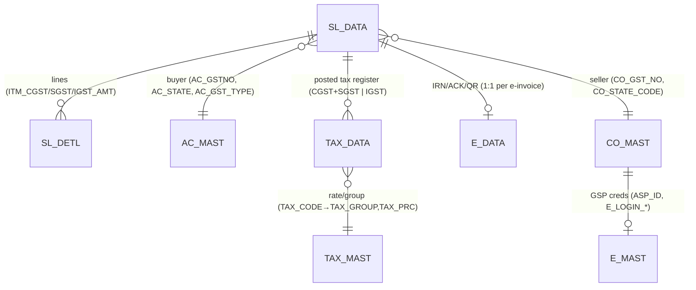

# Module 9 — GST & E-Invoice

```
Module: 9_GST_EInvoice  ·  Type: read-models (returns) + outbound integration (IRN)
Desktop source: RP_GST.cs (Crystal GSTR launcher), TR_SL_EBILL.cs (IRN form), UT_E_INVOICE.cs (bulk IRN),
                IRNClass.cs / IRNData.cs (GSP DTOs), Ac_Tax.cs (TAX_DATA posting engine)
Web target: apps/api/src/modules/gst/gst.ts · apps/api/src/modules/einvoice/einvoice.ts
            (+ reports/{reports,reports3,reports10}.ts for 3B / GSTR-2 / input register)
Requirements: Req 18 (GST + e-invoice), Req 19 (reports), Req 20 (integrations)
Engines: 04_Cross_Cutting_Engines/gst-engine.md, reporting-and-integrations.md
Status: 📋 SPEC · 🟩 BUILT (gstr1 live 11/11; IRN via FakeIrnTransport until GSP creds)
```

## 1. Purpose

This module is the **tax surface** of DataCareNext. It does **not** post tax — that happens inside the
sales/purchase save (`Ac_Tax.cs` → `TAX_DATA` + `AC_DATA`, documented in the GST engine). Instead it
**reads** the already-posted tax to produce GST **return datasets** (GSTR-1, GSTR-3B, GSTR-2/input
register) and **pushes** B2B invoices to the government e-invoice portal to obtain an **IRN**
(Invoice Reference Number) + signed QR, which it stores back on the invoice.

Two desktop surfaces map here:
- **`RP_GST`** — a Crystal Reports launcher (buttons "Gstr 1", "Gstr 2", "Gstr 3", CSV export) whose
  datasets are re-implemented as scoped SQL read-models over `SL_DATA ⋈ AC_MAST ⋈ SL_DETL`.
- **`TR_SL_EBILL` / `UT_E_INVOICE`** — the IRN-generation form/utility that calls the **Chartered Info
  GSP** (`charteredinfo.com`), built as the NIC e-invoice **schema v1.1** payload and persisted to
  `SL_DATA.IRN_NO/ACK_NO/ACK_DATE` + `E_DATA` (IRN/ACK/QR).

> **Classification recap** (full math in `gst-engine.md`): taxable = **net after discount**; supply is
> **intra-state** when buyer state == company state (`AC_MAST.AC_GST_TYPE <> 'I'`) → **CGST + SGST**,
> else **inter-state** (`AC_GST_TYPE = 'I'`) → **IGST**. `SGST = tax − CGST` keeps `CGST+SGST === tax`.

## 2. Form inventory

| Form | Type | Purpose | Tables | Posting? | Web status |
|---|---|---|---|---|---|
| **RP_GST** | report launcher | GSTR-1 (B2B/B2CL/B2CS/HSN), GSTR-2, GSTR-3, CSV export | reads `SL_DATA`,`SL_DETL`,`AC_MAST`,`TAX_DATA` | no (read-only) | 🟩 `gst.ts` + `reports.gstr3b` |
| **TR_SL_EBILL** | integration form | Generate IRN for one B2B sale via GSP; store IRN/ACK/QR | reads `SL_DATA`,`SL_DETL`,`ITEM_MAST`,`CO_MAST`,`AC_MAST`,`E_MAST`; writes `SL_DATA`,`E_DATA` | writes IRN/ACK only | 🟦 `einvoice.ts` (Fake transport) |
| **UT_E_INVOICE** | bulk utility | Bulk-generate/cancel IRNs over a date range (DataGridView) | same as TR_SL_EBILL, batched | writes IRN/ACK only | ⬜ (loop over `submitIrnForSale`) |
| **IRNClass / IRNData** | DTOs | GSP response shapes (status_cd, error, Data, Status, ErrorDetails[], InfoDtls[], Irn/AckNo/AckDt/SignedQRCode) | — | — | 🟩 `IrnResult`/`IRNClass` typings |
| **Ac_Tax** (shared) | posting engine | `Sales_GST`/`EInvoice_GST`/`Purc_GST` → `TAX_DATA` rows (CGST+SGST or IGST) | writes `TAX_DATA` | yes | 🟩 `gstSplit` + sales/purchase posting |

Deep-dives: **[RP_GST.md](./RP_GST.md)** (GSTR-1 / GSTR-3B datasets) · **[TR_SL_EBILL.md](./TR_SL_EBILL.md)** (E-Invoice / IRN).

## 3. Module ER diagram



- `SL_DATA` carries the header tax (`CGST_TAX`,`SGST_TAX`,`IGST_TAX`,`TAX_AMT`,`TOT_AMT`) **and** the
  IRN stamps (`IRN_NO` VARCHAR 100, `ACK_NO` VARCHAR 25, `ACK_DATE` DATE, `AC_GST_TYPE` VARCHAR 1).
- `SL_DETL` carries the line splits (`ITM_CGST_AMT`,`ITM_SGST_AMT`,`ITM_IGST_AMT`,`TAX_PRC`,`TAXABL_RATE`,`GRAND_TOTAL`).
- `TAX_DATA` is the per-voucher tax register (23 cols; `TRAN_TYPE` `'S'`/`'P'`, `TAX_SIGN` `'+'`/`'-'`).
- `E_DATA` stores the IRN result (`IRN_NO`,`ACK_NO`,`ACK_DATE`,`QR_DATA` blob); `E_MAST` holds GSP creds.

Table refs: [SL_DATA](../../02_Data_Model/tables/SL_DATA.md) · [SL_DETL](../../02_Data_Model/tables/SL_DETL.md) · [TAX_DATA](../../02_Data_Model/tables/TAX_DATA.md) · [TAX_MAST](../../02_Data_Model/tables/TAX_MAST.md)

## 4. Shared logic

- **Tax split** (`gstSplit`, `packages/core`) — intra → `{cgst: tax/2, sgst: tax−cgst, igst:0}`; inter →
  `{igst: tax}`. Penny-safe. See `04_Cross_Cutting_Engines/gst-engine.md §2`.
- **Tax posting** (`Ac_Tax.Sales_GST`) — desktop writes `TAX_DATA` from `SL_DATA`: intra → two rows
  (`TAX_AMT/2` each, `TAX_MAST.SR_NO=1` CGST + `SR_NO=2` SGST), inter → one row (full `TAX_AMT`,
  `SR_NO=3` IGST). Both keyed by `TAX_GROUP`. `// src: Ac_Tax.cs#L120-L210` (`Sales_GST`).
- **GSTR classification** (`classifyInvoice`, `gst.ts`) — B2B if buyer has GSTIN; else B2CL if
  inter-state and value > threshold (₹2,50,000); else B2CS. HSN summary groups detail by HSN.
- **IRN payload** (`buildIrnPayload`, `einvoice.ts`) — NIC v1.1 (`TranDtls/DocDtls/SellerDtls/BuyerDtls/
  ItemList/ValDtls`). Mirrors desktop `dcClass` + `GenIRN.txt`.
- **Non-blocking integration rule** (Req 20.3) — a GSP failure records the error and **leaves the sale
  without an IRN**; it never rolls back the posted sale. See `reporting-and-integrations.md §B.1`.

## 5. Dependencies

| Needs | Why |
|---|---|
| **GST engine** (`gstSplit`, `Ac_Tax`) | the CGST/SGST/IGST values these datasets read are posted there |
| **Sales module** (`SL_DATA`/`SL_DETL`) | the source of every GSTR-1/3B row and every IRN payload |
| **Masters** (`AC_MAST`,`ITEM_MAST`,`CO_MAST`,`TAX_MAST`,`E_MAST`) | GSTIN/state, HSN/unit, seller, rate, GSP creds |
| **Reporting engine** | GSTR-1/3B render to HTML/PDF + CSV (Req 19) |
| **Integrations framework** | env-driven GSP transport (Fake → Chartered Info), non-blocking (Req 20) |
| **RBAC** | datasets/IRN gated by `USER_PRINT` |

## 6. API surface

| Method + path | Right | Handler | Returns |
|---|---|---|---|
| `GET /gst/gstr1?threshold=` | print | `gstr1()` | `{ b2b[], b2cl[], b2cs[], hsn[] }` |
| `GET /reports/gstr3b` | print | `gstr3b()` | `{ outwardTaxable, outwardTax, outwardCGST, outwardSGST, outwardIGST }` |
| `GET /reports/gstr2` | print | `gstr2Purchase()` | `{ taxable, tax, cgst, sgst, igst }` (PR_DATA) |
| `GET /reports/gst-input-register` | print | `gstInputRegister()` | monthly ITC (`TAX_DATA` `TRAN_TYPE IN ('P','PR')`) |
| `POST /einvoice/irn` | print | `submitIrnForSale()` | `{ irn, ackNo, mode }` (loads sale, builds, submits) |
| `POST /einvoice/:vchNo` | print | `buildIrnPayload`+`submitIrn` | `{ irn, ackNo, mode }` (explicit payload) |
| `GET /integrations/status` | auth | — | e-invoice provider + `fake`/`live` mode |

`// web: apps/api/src/routes/txn.ts#L604-L626` (gstr1, gstr3b, einvoice routes).

## 7. Build checklist

1. **Confirm tax is posted** (engine prerequisite): `TAX_DATA` rows + `SL_DETL` line splits must already
   match desktop `Ac_Tax.Sales_GST` (CGST+SGST intra / IGST inter). Parity gate in `gst-engine.md §6`.
2. **GSTR-1 read-model** (`gst.ts`): implement `classifyInvoice` → `buildGstr1` (B2B/B2CL/B2CS/HSN) over
   `SL_DATA ⋈ AC_MAST` (+ `SL_DETL` grouped by `IT_CODE` for HSN). Threshold configurable (₹2.5L).
3. **GSTR-3B summary** (`reports.gstr3b`): outward taxable + CGST/SGST/IGST roll-up over `SL_DATA`
   (exclude returns book `'SRT'`).
4. **Purchase side** (`gstr2Purchase`, `gstInputRegister`): ITC summary over `PR_DATA` / `TAX_DATA`.
5. **IRN payload** (`einvoice.buildIrnPayload`): NIC v1.1 from a B2B sale; `validateIrnPayload` guards.
6. **Transport** (`einvoice`): `FakeIrnTransport` (tests) + `CharteredInfoIrnTransport`
   (auth → IRN); `irnTransportFromEnv` selects real iff `GSP_*` env set.
7. **Persist** (`submitIrn`): UPDATE `SL_DATA` IRN/ACK + INSERT `E_DATA` in one tenant tx;
   on GSP error record the error, **commit no IRN** (Req 18.4/18.5).
8. **Render**: GSTR-1/3B HTML→PDF + CSV; gate all by `USER_PRINT`.

**Parity gate:** GSTR-1 B2B/B2CL/B2CS/HSN record sets equal the desktop `Gstr_1.rpt` dataset for the
same period; `Σ TAX_DATA` tax == `Σ AC_DATA` output-tax legs; a built IRN validates against the NIC
schema and round-trips onto `SL_DATA`/`E_DATA`. Tracked in `06_Parity/gst.md`.

## 8. Open items / external blockers

- **GSP credentials = EXTERNAL BLOCKER.** Real IRN submission needs `GSP_ASPID`, `GSP_PASSWORD`,
  `GSP_GSTIN`, `GSP_USER`, `GSP_EINV_PWD` (desktop `E_MAST.ASP_ID/ASP_PWD/E_LOGIN_GST_NO/E_LOGIN_USER/
  E_LOGIN_PWD`). Until set, `irnTransportFromEnv()` returns `FakeIrnTransport` (deterministic, no network).
- **HSN master** — desktop reads `ITEM_MAST.HSN_CODE` (default `7113` gold/silver, `9997` hallmark);
  the GSTR-1 HSN summary currently uses `IT_CODE` as an HSN proxy unless an `hsnMap` is supplied.
- **UAE variant** — `Ac_Tax` has a separate single-rate VAT branch (`MCo_SName='UAE'`); out of scope for
  the Indian GST datasets here.
