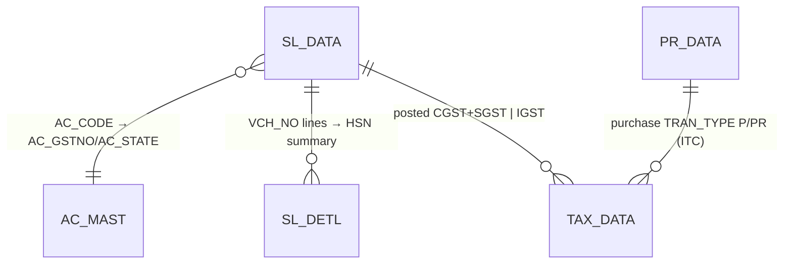

# RP_GST — GST Returns (GSTR-1 / GSTR-3B datasets)

```
Form: RP_GST  ·  Module: 9_GST_EInvoice  ·  Type: report / read-model (no posting)
Desktop source: unified/src/csharp/DataCareNext/RP_GST.cs (Crystal launcher) + Ac_Tax.cs (TAX_DATA posting)
Web target: apps/api/src/modules/gst/gst.ts (gstr1) · apps/api/src/modules/reports/{reports.ts gstr3b,
            reports3.ts gstr2Purchase, reports10.ts gstInputRegister}
Requirements: Req 18.1–18.6 (GST), Req 19 (reports)
Engine: 04_Cross_Cutting_Engines/gst-engine.md   ·   Parity: 06_Parity/gst.md
Status: 📋 SPEC · 🟩 BUILT (gstr1 + gstr3b live; HANDOFF: GSTR-1 datasets 11/11)
Evidence: RP_GST.cs (AxCrystalReport launcher, "Gstr 1/2/3" buttons), all_rpt_fields.txt (Gstr_1/Gstr_2 fields)
```

## 1. Purpose & business context

A jeweler files monthly GST returns. **GSTR-1** is the outward-supply statement: every sale invoice
classified into government buckets (**B2B**, **B2CL**, **B2CS**) plus an **HSN summary**. **GSTR-3B** is
the monthly self-assessed summary (total outward taxable value + tax by head). The desktop `RP_GST`
screen is a **Crystal Reports launcher** (`AxCrystalReport Cr`; buttons "Gstr 1", "Gstr 2", "Gstr 3"
and a CSV export `btnGstrCsv`) — the classification lives inside the bound `.rpt` templates over the
posted tax tables. `// src: RP_GST.cs#L10-L12` (`using AxCrystal; using Crystal;`), `#L1060-L1182`
(`Cr = new AxCrystalReport()`, `BtnGstr1.Text = "Gstr 1"`).

The web rebuild replaces the Crystal report with **scoped SQL read-models** that reproduce the same
record set: `gstr1()` (B2B/B2CL/B2CS/HSN) and `gstr3b()` (summary), with purchase-side `gstr2Purchase()`
and `gstInputRegister()` for ITC. No posting happens here — tax is already on `TAX_DATA`/`SL_DETL` from
the sale save (`Ac_Tax.Sales_GST`).

## 2. UI / UX specification

### Layout (desktop launcher → web report page)
```
┌─ RP_GST ─ GST Returns ───────────────────────────────────────────────────────┐
│ Period:  From [01/MM/YYYY]  To [31/MM/YYYY]   Company/Year scope (CO_YEAR)     │
│ [ Gstr 1 ]  [ Gstr 2 ]  [ Gstr 3 ]                         [ CSV export ]      │
│ ┌ GSTR-1 preview (tabs) ─────────────────────────────────────────────────────┐│
│ │ B2B │ B2CL │ B2CS │ HSN                                                      ││
│ │ GSTIN │ Invoice │ Date │ Taxable │ Rate% │ CGST │ SGST │ IGST │ Inv.Value   ││
│ └─────────────────────────────────────────────────────────────────────────────┘│
└────────────────────────────────────────────────────────────────────────────────┘
```

### Field / parameter table
| Label | Source | Type | Req | Default | Notes |
|---|---|---|---|---|---|
| Period (from/to) | filter on `SL_DATA.VCH_DATE` | date range | ✓ | current month | desktop binds the `.rpt` to the period |
| Scope | `CO_CODE`(+`LC_CODE`,`CO_YEAR`) | session | ✓ | session | web `readScope(req)` |
| B2CL threshold | `B2CL_THRESHOLD` | money | — | ₹2,50,000 | overridable via `?threshold=` |
| Bucket tabs | derived | — | — | B2B | classification result |
| CSV export | dataset → CSV | action | — | — | desktop `btnGstrCsv`; web report engine CSV |

### Grid columns — GSTR-1 B2B / B2CL (per invoice)
| Col | Field (`InvoiceRow`) | Source column | Notes |
|---|---|---|---|
| GSTIN | `gstin` | `AC_MAST.AC_GSTNO` | present ⇒ B2B |
| Invoice no | `vchNo` | `SL_DATA.VCH_NO` | (`BILL_NO` for display) |
| Place of supply | `stateCode` | `AC_MAST.AC_STATE` | state code |
| Taxable | `taxable` | `SL_DATA.NET_AMT − DISC_AMT` | net after discount |
| Rate % | `ratePct` | `SL_DATA.TAX_PRC` | |
| CGST/SGST/IGST | `cgst`/`sgst`/`igst` | `SL_DATA.CGST_TAX`/`SGST_TAX`/`IGST_TAX` | |
| Invoice value | `invoiceValue` | `SL_DATA.TOT_AMT` | drives B2CL threshold test |

### Grid columns — B2CS (summary) / HSN (summary)
| B2CS col | Field | | HSN col | Field | Source |
|---|---|---|---|---|---|
| State | `stateCode` | | HSN | `hsn` | `ITEM_MAST.HSN_CODE` (proxy `SL_DETL.IT_CODE`) |
| Rate% | `ratePct` | | Qty/UQC | `qty` | `Σ SL_DETL.ITM_PCS` |
| Taxable | `taxable` | | Taxable | `taxable` | `Σ SL_DETL.NET_AMT` |
| CGST/SGST/IGST | `cgst/sgst/igst` | | CGST/SGST/IGST | `cgst/sgst/igst` | `Σ SL_DETL.ITM_CGST/SGST/IGST_AMT` |

### Modes
View / Print / CSV export only. **No New/Edit/Delete** (read-only). Print requires `USER_PRINT`.

## 3. Data model touched

**Reads only — no writes.**

- **Header source:** `SL_DATA` (`VCH_NO`,`AC_CODE`,`NET_AMT`,`DISC_AMT`,`TAX_PRC`,`CGST_TAX`,`SGST_TAX`,
  `IGST_TAX`,`TOT_AMT`,`CO_BOOK`,`VCH_DATE`).
- **Buyer join:** `AC_MAST` (`AC_GSTNO` → GSTIN, `AC_STATE` → place of supply, `AC_GST_TYPE` → intra/inter).
- **Line/HSN source:** `SL_DETL` (`IT_CODE`,`ITM_PCS`,`NET_AMT`,`ITM_CGST_AMT`,`ITM_SGST_AMT`,`ITM_IGST_AMT`).
- **Posted tax register (3B / ITC cross-check):** `TAX_DATA`, plus purchase `PR_DATA` for GSTR-2.



Table refs: [SL_DATA](../../02_Data_Model/tables/SL_DATA.md) · [SL_DETL](../../02_Data_Model/tables/SL_DETL.md) · [TAX_DATA](../../02_Data_Model/tables/TAX_DATA.md) · [TAX_MAST](../../02_Data_Model/tables/TAX_MAST.md)

## 4. Business logic & calculations (with code)

### 4.1 Upstream tax posting (desktop evidence — how the numbers got there)
`Ac_Tax.Sales_GST` posts `TAX_DATA` from `SL_DATA` differently by supply type. **Intra-state**
(`AC_MAST.AC_GST_TYPE <> 'I'`) writes **two** rows of `TAX_AMT/2` (CGST then SGST, keyed by
`TAX_MAST.SR_NO=1` / `SR_NO=2`); **inter-state** (`AC_GST_TYPE = 'I'`) writes **one** row of the full
`TAX_AMT` (`SR_NO=3` = IGST):
```sql
-- src: Ac_Tax.cs (Sales_GST, India branch) — CGST leg (SR_NO=1) and SGST leg (SR_NO=2)
INSERT INTO TAX_DATA(...,SR_NO,...,TAX_TYPE,TAX_PRC,NET_AMT,TAX_AMT,...,TAX_SIGN,...)
SELECT ...,1,...,C.TAX_GROUP,C.TAX_PRC,A.NET_AMT,A.TAX_AMT/2,...,'+',...
FROM SL_DATA A ... LEFT JOIN TAX_MAST C ... LEFT JOIN AC_MAST D ...
WHERE B.MAIN_BOOK='SALES' AND A.NET_AMT<>0 AND C.SR_NO=1 AND D.AC_GST_TYPE<>'I';
-- (SR_NO=2 identical with C.SR_NO=2) ; inter-state: one row TAX_AMT, C.SR_NO=3, D.AC_GST_TYPE='I'
```
So a posted invoice already carries `CGST_TAX+SGST_TAX` (intra) **or** `IGST_TAX` (inter). The web `gstSplit`
reproduces this with the penny kept on SGST (`gst-engine.md §2`).

### 4.2 Invoice classification (web — `gst.ts`, pure & unit-tested)
```ts
// src(web): modules/gst/gst.ts#L43-L47
export const B2CL_THRESHOLD = 250000;                 // ₹2,50,000 (configurable)
export function classifyInvoice(inv, threshold = B2CL_THRESHOLD): 'B2B'|'B2CL'|'B2CS' {
  if (hasGstin(inv.gstin)) return 'B2B';              // buyer registered ⇒ B2B
  if (inv.interState && inv.invoiceValue > threshold) return 'B2CL'; // unregistered, inter-state, large
  return 'B2CS';                                       // everything else (summarized)
}
```
`interState` is read back from the posted tax (`IGST_TAX > 0`), so classification never disagrees with
posting. `taxable = NET_AMT − DISC_AMT` (net after discount, Req 18.1).

### 4.3 Bucket assembly + summaries (web)
```ts
// src(web): modules/gst/gst.ts#L98-L107 (buildGstr1)
const b2b   = invoices.filter(i => classifyInvoice(i, t) === 'B2B');   // full invoice rows
const b2cl  = invoices.filter(i => classifyInvoice(i, t) === 'B2CL');  // full invoice rows
const b2cs  = summarizeB2CS(invoices.filter(i => classifyInvoice(i,t)==='B2CS')); // by (state,rate)
const hsn   = summarizeHsn(detail, opts.hsnMap);       // by HSN (IT_CODE proxy → hsnMap)
return { b2b, b2cl, b2cs, hsn };
```
`summarizeB2CS` aggregates by `state|ratePct`; `summarizeHsn` aggregates `Σ qty/taxable/CGST/SGST/IGST`
by HSN. All sums use `round2` (HALF-UP, 2 dp).

### 4.4 Live dataset query (web — `gstr1()`)
```ts
// src(web): modules/gst/gst.ts#L133-L176 (trimmed)
// invoices: SL_DATA ⋈ AC_MAST (buyer GSTIN/state); interState ⇐ IGST_TAX>0
SELECT S."VCH_NO", S."AC_CODE", M."AC_GSTNO" AS gstin, M."AC_STATE" AS state,
       S."IGST_TAX" igst, S."CGST_TAX" cgst, S."SGST_TAX" sgst,
       S."TOT_AMT" tot, S."NET_AMT"-S."DISC_AMT" AS taxable, S."TAX_PRC" rate
FROM "SL_DATA" S LEFT JOIN "AC_MAST" M ON M."CO_CODE"=S."CO_CODE" AND M."AC_CODE"=S."AC_CODE"
WHERE <scope>;
// detail (HSN): SL_DETL grouped by IT_CODE → Σ ITM_PCS, NET_AMT, ITM_CGST/SGST/IGST_AMT
```

### 4.5 GSTR-3B summary (web — `reports.gstr3b`)
```ts
// src(web): modules/reports/reports.ts#L233-L249
SELECT sum("NET_AMT"-"DISC_AMT") taxable, sum("TAX_AMT") tax,
       sum("CGST_TAX") cgst, sum("SGST_TAX") sgst, sum("IGST_TAX") igst
FROM "SL_DATA" WHERE "CO_CODE"=$1 [AND "CO_YEAR"=$2] AND "CO_BOOK"<>'SRT';  // exclude returns
// → { outwardTaxable, outwardTax, outwardCGST, outwardSGST, outwardIGST }  (all round2)
```

### 4.6 Purchase side (ITC) — `gstr2Purchase` / `gstInputRegister`
```ts
// src(web): reports3.ts#L109 — PR_DATA aggregate { taxable, tax, cgst, sgst, igst }
// src(web): reports10.ts#L113 — TAX_DATA WHERE TRAN_TYPE IN ('P','PR') grouped by month → monthly inputGst
```
`TAX_DATA.TRAN_TYPE` is `'S'` for sales (output) and `'P'/'PR'` for purchase (input) — see
`Ac_Tax.Purc_GST` (`'P'`, `TAX_SIGN='-'`).

## 5. Save sequence (create / edit)

**N/A — read-only.** No `SRNO_MAST` allocation, no header/detail/ledger writes. The data these reports
read is produced by the **sales save** (`createSale` → `Ac_Tax.Sales_GST`), documented in
`03_Modules/2_Sales/TR_SALE.md §5` and `gst-engine.md §3`. A "refresh" is just a re-query for the period.

## 6. Delete / reverse sequence

**N/A — read-only.** Tax rows are reversed when the underlying sale is deleted (`reverseVoucherTx`
includes `TAX_DATA`; see `TR_SALE.md §6`). GSTR datasets simply stop returning the reversed invoice.

## 7. API contract

```ts
// GET /gst/gstr1?threshold=250000        (right: print)   // web: routes/txn.ts#L604
interface Gstr1 { b2b: InvoiceRow[]; b2cl: InvoiceRow[]; b2cs: B2csRow[]; hsn: HsnDetailRow[]; }
interface InvoiceRow { vchNo; acCode; gstin: string|null; interState: boolean;
  invoiceValue; taxable; cgst; sgst; igst; stateCode: string|null; ratePct; }

// GET /reports/gstr3b                     (right: print)   // web: routes/txn.ts#L605
// → { outwardTaxable, outwardTax, outwardCGST, outwardSGST, outwardIGST }

// GET /reports/gstr2                      (right: print)   // PR_DATA summary
// GET /reports/gst-input-register         (right: print)   // monthly ITC from TAX_DATA
```
Scope comes from the session (`readScope(req)` → `CO_CODE`/`LC_CODE`/`CO_YEAR`). Errors: `ForbiddenError`→403
(no `USER_PRINT`); empty scope → empty buckets (Req 19.5). CSV/PDF via the report engine (`reporting-and-integrations.md §A`).

## 8. Validation rules

| Rule | Condition | Desktop behavior | HTTP | req |
|---|---|---|---|---|
| Print right | caller lacks `USER_PRINT` | menu/print blocked | 403 | 6.x |
| Period scope | no rows in range | empty report ("no records") | 200 (empty) | 19.5 |
| Classification integrity | `gstin` present ⇒ B2B regardless of value | desktop `.rpt` B2B section | — | 18.6 |
| B2CL threshold | B2C **inter-state** invoice value > ₹2.5L | B2CL section else B2CS | — | 18.6 |
| Intra/inter source | derive from posted `IGST_TAX>0` (not re-derived) | matches `AC_GST_TYPE` posting | — | 18.2/18.3 |
| Tax tie-out | `Σ TAX_DATA` tax == `Σ` invoice CGST+SGST+IGST | Crystal sums | (parity) | 18.6 |

## 9. Parity criteria (Definition of Done)

1. For a given period, **B2B / B2CL / B2CS / HSN** record sets equal the desktop `Gstr_1.rpt` dataset
   (same invoices in the same buckets, same taxable/CGST/SGST/IGST to the paisa).
2. **GSTR-3B** `outwardTaxable/Tax/CGST/SGST/IGST` equal the desktop GSTR-3B summary for the period
   (returns book `'SRT'` excluded, matching desktop scope).
3. `Σ TAX_DATA` output tax (`TRAN_TYPE='S'`) == `Σ AC_DATA` output-tax legs == `Σ` GSTR-1 tax columns.
4. B2CL boundary: an invoice exactly at ₹2,50,000 stays **B2CS** (strict `>` threshold), matching desktop.
5. CSV export columns match the desktop `btnGstrCsv` output; PDF carries the same fields as `Gstr_1.rpt`.
   Fixtures/scripts tracked in `06_Parity/gst.md` (HANDOFF: GSTR-1 live 11/11).

## 10. Variants & edge cases

| Variant | Delta |
|---|---|
| **GSTR-2 / input register** | purchase side — `PR_DATA` summary + `TAX_DATA` `TRAN_TYPE IN ('P','PR')` monthly ITC. |
| **E-invoice books** (`E INVOICE`/`E CRNT`) | tax posted line-level from `SL_DETL` (`Ac_Tax.EInvoice_GST`, `TAX_SIGN` `+`/`-` by book) — still flows into GSTR-1 via `SL_DATA`. |
| **Hallmarking (HM) tax** | extra `TAX_DATA` rows `SR_NO 10/20/30` on `HM_AMT`/`HM_TAX_AMT`; HSN `9997` → `IsServc='Y'`. |
| **Sales return** (`SALES RETURNE`/book `SRT`) | `Ac_Tax.Sales_Rtn_GST` posts with `TAX_SIGN='-'`; excluded from GSTR-3B outward, reduces net in GSTR-1 (credit notes). |
| **Tax-free / zero-rated** | `TAX_FREE_AMT` / `ZERO_RATED_AMT` columns on `TAX_DATA` carry exempt/zero-rated value. |
| **UAE VAT** | `Ac_Tax` UAE branch posts single-rate VAT (`TAX_TYPE='I'`, `SR_NO=0`); not part of Indian GSTR. |

## 11. Open questions / risks

- **HSN master.** GSTR-1 HSN summary uses `IT_CODE` as an HSN proxy unless an `hsnMap` is supplied; the
  desktop reads `ITEM_MAST.HSN_CODE` (defaults `7113` gold/silver, `9997` hallmark). Wire `ITEM_MAST.HSN_CODE`
  into `summarizeHsn` for true parity (`gst.ts` flags this as Task 30). **Flag.**
- **B2CL threshold drift.** ₹2,50,000 is the current statutory value; it has changed historically. Keep it
  config-driven (already `?threshold=`), and confirm the value the desktop `.rpt` used per filing period.
- **Place-of-supply for B2CS.** Web groups by `AC_MAST.AC_STATE`; confirm the desktop `.rpt` uses the same
  state field (vs. a derived POS) — needs a Docker golden-master pass against `Gstr_1.rpt`.
- **Document-series / nil-rated / credit-note sections.** The full GSTR-1 has more sections (CDNR, docs
  issued, nil-rated) than B2B/B2CL/B2CS/HSN; only the four core buckets are modeled today. **Flag** for
  completeness if those sections are filed.
- **Exact desktop period filter.** Confirm whether the `.rpt` filters on `VCH_DATE` vs. `CO_YEAR` only;
  the web `gstr1()` currently scopes by company/year, not an explicit from/to range.
