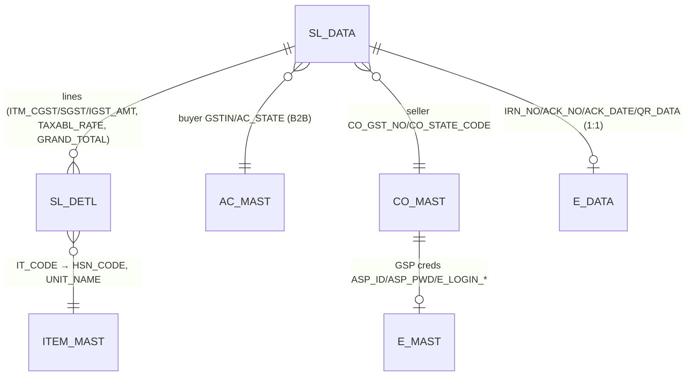
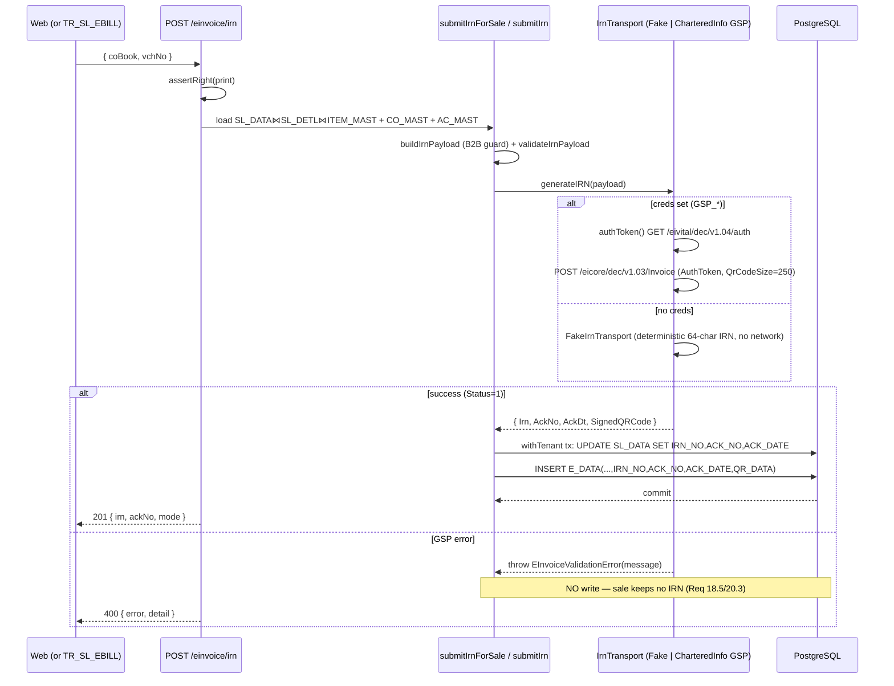

# TR_SL_EBILL — E-Invoice / IRN generation

```
Form: TR_SL_EBILL (+ UT_E_INVOICE bulk)  ·  Module: 9_GST_EInvoice  ·  Type: outbound integration (writes IRN/ACK)
Desktop source: unified/src/csharp/DataCareNext/TR_SL_EBILL.cs (IRN form, GSP REST) + UT_E_INVOICE.cs (bulk),
                IRNClass.cs / IRNData.cs (GSP response DTOs), GenIRN.txt (NIC payload template)
Web target: apps/api/src/modules/einvoice/einvoice.ts  ·  routes: POST /einvoice/irn, /einvoice/:vchNo
Requirements: Req 18.4 (IRN payload + submit), Req 18.5 (error → no IRN), Req 20.3 (non-blocking)
Engine: 04_Cross_Cutting_Engines/reporting-and-integrations.md §B   ·   Parity: 06_Parity/gst.md
Status: 📋 SPEC · 🟦 BUILT (payload+persist live; FakeIrnTransport until GSP creds — EXTERNAL BLOCKER)
Evidence: TR_SL_EBILL.cs#L9420-L9700 (build/submit/store), #L9725-L9765 (auth); GSP host charteredinfo.com
```

## 1. Purpose & business context

Indian B2B invoices above the turnover threshold must be registered on the government **IRP** (Invoice
Registration Portal) to receive an **IRN** (a 64-char hash), an **AckNo/AckDt**, and a **signed QR code**
that must be printed on the tax invoice. DataCareNext does this through a **GSP** (GST Suvidha Provider —
**Chartered Info**, `charteredinfo.com`). The desktop `TR_SL_EBILL` form loads a saved sale, builds the
**NIC e-invoice schema v1.1** JSON, authenticates to the GSP, POSTs the invoice, and on success stamps
`SL_DATA.IRN_NO/ACK_NO/ACK_DATE` and inserts an `E_DATA` row (IRN/ACK/QR blob). `UT_E_INVOICE` is the
**bulk** variant (a grid over a date range). E-invoice is **B2B only** — a recipient GSTIN is mandatory.

Critically (Req 18.5 / 20.3): if the GSP rejects the invoice, the desktop **records the error and leaves
the sale without an IRN** — it never rolls back the posted sale. The web reproduces this exactly.

## 2. UI / UX specification

### Layout (desktop `TR_SL_EBILL`)
```
┌─ TR_SL_EBILL ─ e-Invoice ──────────────────────────────────────────────────────────┐
│ Book[__] Vch No[____] Date[__/__/____]  Party[AC_CODE][AC_NAME ...][type L/I]         │
│ Auth Token: [........................]                 [ Gen Token ]                  │
│ IRN No:     [tIrnNo ................................]  Ack No:[tAckNo] Ack Dt[mAckDt] │
│ Response:   [tBoxResponce (raw GSP JSON) .........]    Error:[TxtBoxError ..........] │
│ [ Gen IRN ]   [ e-Data import ]                        QR: [ PicEQr image ]          │
└──────────────────────────────────────────────────────────────────────────────────────┘
```

### Field table
| Label | Column / field | Type | Req | Source / behavior |
|---|---|---|---|---|
| Book / Vch No | `CO_BOOK` / `VCH_NO` | lookup | ✓ | selects the saved sale |
| Party / type | `AC_CODE`/`AC_NAME`/`AC_GST_TYPE` | from `AC_MAST` | ✓ | `type='L'` local, `'I'` inter-state |
| Auth Token | `tTokan` → `AuthToken` | string | ✓ (cached) | from `GetAuthToken()`; expires → regen |
| IRN No | `tIrnNo` ⇒ `SL_DATA.IRN_NO` | string(100) | out | 64-char NIC IRN |
| Ack No / Ack Dt | `tAckNo`/`mAckDt` ⇒ `ACK_NO`/`ACK_DATE` | str(25)/date | out | from GSP response |
| Response / Error | `tBoxResponce`/`TxtBoxError` | text | out | raw GSP JSON / error message |
| QR | `PicEQr` ⇒ `E_DATA.QR_DATA` | image(blob) | out | `SignedQRCode` → QR bitmap |

### Action bar / modes
- **Gen Token** → `GetAuthToken()` (GSP auth, caches `AuthToken`). `// src: TR_SL_EBILL.cs#L9719`
- **Gen IRN** → `BtnIrnGen_Click()` (build → submit → store). Guarded: if `IRN_NO` already present or
  an `E_DATA` row exists, refuses ("No Need to Generate eInvoice its Already Exist"). `// src: #L9512-L9560`
- **e-Data import** → `edataImport()` validates mandatory seller/buyer fields, defaults HSN, flags
  intra/inter mismatch. `// src: #L9788-L9860`
- Web has no screen yet — exposed as `POST /einvoice/irn` (single) and a planned bulk loop for `UT_E_INVOICE`.

## 3. Data model touched

**Reads:** `SL_DATA` (header/tax/totals), `SL_DETL ⋈ ITEM_MAST` (lines + `HSN_CODE`,`UNIT_NAME`),
`CO_MAST` (seller), `AC_MAST` (buyer GSTIN/state), `E_MAST` (GSP credentials).

**Writes (on success only):**
- `SL_DATA` → `IRN_NO` (VARCHAR 100), `ACK_NO` (VARCHAR 25), `ACK_DATE` (DATE).
- `E_DATA` → `(CO_CODE,LC_CODE,CO_YEAR,CO_BOOK,VCH_NO, IRN_NO, ACK_NO, ACK_DATE, QR_DATA)` (QR blob).

**On error:** writes **nothing** to `SL_DATA`/`E_DATA` (records error in UI / log only).



Table refs: [SL_DATA](../../02_Data_Model/tables/SL_DATA.md) (`IRN_NO`#2,`ACK_NO`#82,`ACK_DATE`#83,`AC_GST_TYPE`#47) · [SL_DETL](../../02_Data_Model/tables/SL_DETL.md) (`ITM_CGST_AMT`#84,`ITM_SGST_AMT`#85,`ITM_IGST_AMT`#83,`TAXABL_RATE`#82,`GRAND_TOTAL`#86)

> `E_MAST` columns (GSP creds master): `CO_CODE, ASP_ID, ASP_PWD, E_LOGIN_GST_NO, E_LOGIN_USER,
> E_LOGIN_PWD, CO_LEGAL_NAME`. `// src: TR_SL_EBILL.cs#L9545-L9552` (`DC_Main.Tbl.Rows[0]["ASP_ID"]` …).
> `E_DATA` columns: `CO_CODE,LC_CODE,CO_YEAR,CO_BOOK,VCH_NO,IRN_NO,ACK_NO,ACK_DATE,QR_DATA`.

## 4. Business logic & calculations (with code)

### 4.1 Desktop payload build (`dcClass` → NIC v1.1 JSON)
The desktop assembles a `dcClass` with party blocks and an item list, then serializes it via Newtonsoft
(`JsonConvert.SerializeObject(dcClass, Formatting.Indented)` → `DcJson.Json`, against the `GenIRN.txt`
template). Buyer/seller come from `AC_MAST`/`CO_MAST`; the item list is a `SL_DETL ⋈ ITEM_MAST` query:
```csharp
// src: TR_SL_EBILL.cs#L9420-L9460 (item list) — fields mapped onto ClsItemList
SlNo      = SR_NO,                  PrdDesc = IT_NAME,
IsServc   = "Y" if HSN_CODE in (9997,9972,9968,998892,997212) else "N",  // hallmark/service HSNs
HsnCd     = HSN_CODE,               Qty     = ITM_NWT (else ITM_PCS),     Unit = UNIT_NAME,
UnitPrice = TAXABL_RATE,            TotAmt/PreTaxVal/AssAmt = NET_AMT,
GstRt     = TAX_PRC,                IgstAmt = ITM_IGST_AMT, CgstAmt = ITM_CGST_AMT, SgstAmt = ITM_SGST_AMT,
TotItemVal= GRAND_TOTAL
// src: TR_SL_EBILL.cs#L9475-L9484 (ValDtls from SL_DATA)
AssVal=NET_AMT, CgstVal=CGST_TAX, SgstVal=SGST_TAX, IgstVal=IGST_TAX,
Discount=DISC_AMT, OthChrg=TCS_AMT, TotInvVal=TOT_AMT
```

### 4.2 Web payload build (`buildIrnPayload`, pure & unit-tested)
```ts
// src(web): modules/einvoice/einvoice.ts#L74-L122 (trimmed)
export function buildIrnPayload({ seller, buyer, sale, items }): IrnPayload {
  if (!seller?.gstin) throw new EInvoiceValidationError('seller GSTIN is required');
  if (!buyer?.gstin)  throw new EInvoiceValidationError('recipient GSTIN is required (e-invoice is B2B only)');
  if (!items?.length) throw new EInvoiceValidationError('at least one item is required');
  const itemList = items.map((it, i) => ({
    SlNo: String(i+1), PrdDesc: it.desc, IsServc: 'N', HsnCd: it.hsn,
    Qty: it.qty, FreeQty: 0, Unit: it.unit ?? 'GMS', UnitPrice: round2(it.unitPrice),
    TotAmt: round2(it.assAmt), Discount: 0, PreTaxVal: round2(it.assAmt), AssAmt: round2(it.assAmt),
    GstRt: it.gstRt, IgstAmt: round2(it.igst??0), CgstAmt: round2(it.cgst??0), SgstAmt: round2(it.sgst??0),
    OthChrg: 0, TotItemVal: round2(assAmt+igst+cgst+sgst),
  }));
  return {
    Version: '1.1',
    TranDtls: { TaxSch:'GST', SupTyp:'B2B', RegRev:'N', IgstOnIntra:'N' },
    DocDtls:  { Typ:'INV', No: sale.billNo, Dt: fmtIrnDate(sale.vchDate) },   // dd/MM/yyyy
    SellerDtls: partyDtls(seller),
    BuyerDtls:  { ...partyDtls(buyer), Pos: buyer.stcd },                     // place of supply
    ItemList: itemList,
    ValDtls: { AssVal:Σ AssAmt, CgstVal:Σ Cgst, SgstVal:Σ Sgst, IgstVal:Σ Igst,
               Discount:0, OthChrg:0, RndOffAmt: round2(sale.roundOff??0), TotInvVal: Σ TotItemVal + rnd },
  };
}
```
`partyDtls` = `{ Gstin, LglNm, TrdNm, Addr1, Loc, Pin, Stcd }` — matching desktop `SellerDtls`/`BuyerDtls`.
Money is HALF-UP to 2 dp (`round2`); dates are `dd/MM/yyyy` (NIC format, `fmtIrnDate`).

### 4.3 Loading a stored sale into a payload (`submitIrnForSale`)
```ts
// src(web): modules/einvoice/einvoice.ts#L260-L300 (trimmed)
const interState = String(hdr.AC_GST_TYPE) === 'I' || N(hdr.IGST_TAX) > 0;          // desktop AC_GST_TYPE
const seller = { gstin: co.CO_GST_NO, lglNm: co.CO_NAME, addr1: co.CO_ADD1,
                 loc: co.CO_CITY, pin: N(co.CO_PIN), stcd: String(co.CO_STATE_CODE||'24') };
const buyer  = { gstin: party.AC_GSTNO || 'URP', lglNm: hdr.AC_NAME, loc: party.AC_CITY,
                 stcd: String(party.AC_STATE || co.CO_STATE_CODE) };
const items  = detl.map(d => ({ desc:d.IT_DESC, hsn: itemMap[d.IT_CODE]?.HSN_CODE || '7113',  // default jewellery
                 unit: itemMap[d.IT_CODE]?.UNIT_NAME || 'GMS', qty: N(d.ITM_NWT)||1, unitPrice: N(d.ITM_RATE),
                 assAmt: N(d.NET_AMT), gstRt: N(d.TAX_PRC), cgst:N(d.ITM_CGST_AMT), sgst:N(d.ITM_SGST_AMT), igst:N(d.ITM_IGST_AMT) }));
```
HSN default `7113` (gold/silver) / `9997` (hallmark) mirrors the desktop `edataImport()`:
```sql
-- src: TR_SL_EBILL.cs#L9854-L9856
UPDATE ITEM_MAST SET HSN_CODE='7113' WHERE IT_TYPE IN ('G','S') AND (HSN_CODE='' OR HSN_CODE IS NULL);
UPDATE ITEM_MAST SET HSN_CODE='9997' WHERE IT_CODE='HM'        AND (HSN_CODE='' OR HSN_CODE IS NULL);
```

### 4.4 Required-field validation
```ts
// src(web): einvoice.ts#L179-L188 (validateIrnPayload) — returns missing-field list; empty ⇒ valid
SellerDtls.Gstin, BuyerDtls.Gstin, DocDtls.No, DocDtls.Dt, ItemList(≥1), ValDtls.TotInvVal>0
```
Desktop `edataImport` enforces the equivalent mandatory seller fields (Address1, City, Pincode, GST No,
State Code) and buyer fields, and warns on intra/inter mismatch (party GSTIN state ≠ company state but
`type='L'`). `// src: TR_SL_EBILL.cs#L9810-L9845`

## 5. Save sequence (generate IRN)

Desktop `BtnIrnGen_Click`: guard duplicate → load `E_MAST` creds → build JSON → POST to GSP → parse
response → on success `UPDATE SL_DATA` + `INSERT E_DATA`. The web `submitIrn` wraps the persist in **one
tenant transaction** after the transport returns.



### Persist (web — `submitIrn`)
```ts
// src(web): einvoice.ts#L195-L218 (one withTenant tx)
UPDATE "SL_DATA" SET "IRN_NO"=$1,"ACK_NO"=$2,"ACK_DATE"=$3 WHERE "CO_CODE"=$4 AND "VCH_NO"=$5;
INSERT INTO "E_DATA"(tenant_id,CO_CODE,LC_CODE,CO_YEAR,CO_BOOK,VCH_NO,IRN_NO,ACK_NO,ACK_DATE,QR_DATA)
VALUES (...);   // QR_DATA = Buffer(SignedQRCode)
```
Desktop equivalent (one update + adapter insert): `UPDATE SL_DATA SET IRN_NO,ACK_NO=Mid(resp,11,15),
ACK_DATE` then `INSERT INTO E_DATA(... QR_DATA = QR bitmap bytes)`. `// src: TR_SL_EBILL.cs#L9665-L9700`

### GSP transport (web — mirrors desktop hosts exactly)
```ts
// src(web): einvoice.ts#L222-L246 (CharteredInfoIrnTransport)
base = sandbox===false ? 'https://einvapi.charteredinfo.com' : 'https://gstsandbox.charteredinfo.com';
authToken(): GET  `${base}/eivital/dec/v1.04/auth?aspid&password&Gstin&User_name&eInvPwd` → Data.AuthToken
generateIRN: POST `${base}/eicore/dec/v1.03/Invoice?aspid&password&Gstin&User_Name&AuthToken&QrCodeSize=250`
```
```csharp
// src: TR_SL_EBILL.cs#L9565 (IRN submit) / #L9750 (auth) — identical hosts/paths/params
"https://einvapi.charteredinfo.com/eicore/dec/v1.03/Invoice?&aspid="+ASPID+"&password="+ASPPwd+"&Gstin="+GSTIN+"&User_Name="+eInvUserId+"&AuthToken="+AuthToken+"&QrCodeSize=250"
"https://einvapi.charteredinfo.com/eivital/dec/v1.04/auth?aspid="+ASPID+"&password="+ASPPwd+"&Gstin="+GSTIN+"&User_name="+eInvUserId+"&eInvPwd="+eInvPwd
```
`irnTransportFromEnv()` returns the **real** transport iff `GSP_ASPID/GSP_PASSWORD/GSP_GSTIN/GSP_USER/
GSP_EINV_PWD` are set, else `FakeIrnTransport` (deterministic IRN, no network). `// src(web): einvoice.ts#L249-L257`

## 6. Cancel / reverse sequence

- **IRN cancellation** is time-boxed by the IRP (24 h) and is a *separate* GSP call (cancel API). The
  desktop deletes the `E_DATA` row before re-inserting on regenerate; a true cancel-IRN flow is **not**
  implemented in the web yet. `// src: TR_SL_EBILL.cs#L9678` (`DELETE FROM E_DATA …` before insert).
- **Sale delete** (`reverseVoucherTx` in `TR_SALE.md §6`) removes the underlying `SL_DATA`; the `E_DATA`
  row should be cleaned up alongside it (add `E_DATA` to the sale's reverse table set when IRN is present).
  **Flag** — currently `E_DATA` is not in the documented reverse set.
- Requires `USER_DELETE` (cancel) / `USER_PRINT` (generate).

## 7. API contract

```ts
// POST /einvoice/irn          (right: print)   // web: routes/txn.ts#L618-L624
interface IrnForSaleBody { coBook?: string; vchNo: number|string; }   // coBook default 'SAL'
// → 201 { irn:string, ackNo:string, mode:'fake'|'chartered-info-sandbox'|'chartered-info-prod' }

// POST /einvoice/:vchNo       (right: print)   // explicit payload   // web: routes/txn.ts#L608-L616
interface IrnExplicitBody { seller: IrnParty; buyer: IrnParty; sale: SaleForIrn; items: IrnItemInput[]; }
// → 201 { irn, ackNo, mode }

interface IrnParty { gstin; lglNm; trdNm?; addr1?; loc?; pin?; stcd; }   // stcd = state code
interface IrnResult { Irn; AckNo; AckDt; SignedQRCode; Status; }
```
Errors → HTTP: `EInvoiceValidationError` → **400** (missing GSTIN, no items, invalid payload, sale not
found, GSP rejection); `ForbiddenError` → **403** (no `USER_PRINT`). `// src(web): routes/txn.ts#L99`
(EInvoiceValidationError auto-mapped to 400). Status: `GET /integrations/status` reports
`einvoice.provider='Chartered Info GSP'` + `fake`/`live` mode. `// src(web): routes/txn.ts#L408`

## 8. Validation rules

| Rule | Condition | Desktop message | HTTP | req |
|---|---|---|---|---|
| Recipient GSTIN required | buyer has no GSTIN | (B2B only) | 400 | 18.4 |
| Seller GSTIN required | company has no GST no | "Please Insert eid and epwd…" | 400 | 18.4 |
| ≥1 item | empty item list | — | 400 | 18.4 |
| Total > 0 | `ValDtls.TotInvVal ≤ 0` | — | 400 | 18.4 |
| Seller mandatory fields | missing Address1/City/Pincode/GSTNo/StateCode | "Please Insert Salers Mandatary Field…" | 400 | 18.4 |
| Buyer mandatory fields | missing Address1/City/Pincode/GSTNo/State | "Please Insert Buyers Mandatary Field…" | 400 | 18.4 |
| Duplicate IRN | sale already has `IRN_NO`/`E_DATA` row | "No Need to Generate eInvoice its Already Exist" | 400/skip | 18.4 |
| Intra/inter mismatch | buyer GSTIN state ≠ company state but `type='L'` | "This Party Is Inter State… change GST Type" | warn | 18.2 |
| GSP rejection | `Status≠1` / `status_cd=0` | error shown, GenIRN.txt saved | 400, **no IRN** | 18.5 |
| Print right | no `USER_PRINT` | blocked | 403 | 6.x |

GSP error specifics (desktop): `error.error_cd='GSP752'` (auth/token), `ErrorDetails[0].ErrorCode=2150`
(duplicate — extract existing `Irn` from `InfoDtls[0].Desc`), `5002` (validation). `// src: TR_SL_EBILL.cs#L9590-L9640`

## 9. Parity criteria (Definition of Done)

1. `buildIrnPayload` from a stored B2B sale produces a JSON that **validates against the NIC v1.1 schema**
   and is field-for-field equivalent to the desktop `DcJson.Json` (`Version,TranDtls,DocDtls,SellerDtls,
   BuyerDtls,ItemList,ValDtls`), including HSN defaults (`7113`/`9997`), `Unit='GMS'`, `dd/MM/yyyy` date.
2. `ValDtls.TotInvVal == SL_DATA.TOT_AMT`; `Σ ItemList.AssAmt == NET_AMT`; per-item CGST/SGST/IGST ==
   `SL_DETL.ITM_*_AMT` to the paisa.
3. On a **successful** submit, `SL_DATA.IRN_NO/ACK_NO/ACK_DATE` are stamped and an `E_DATA` row
   (IRN/ACK/QR) exists — identical keys to the desktop write.
4. On a **GSP error**, **no** `IRN_NO`/`E_DATA` is written and the posted sale is untouched (Req 18.5/20.3).
5. With `GSP_*` unset, `mode='fake'` and a deterministic IRN round-trips; with creds set, the real
   Chartered Info hosts/paths are used. Tracked in `06_Parity/gst.md`.

## 10. Variants & edge cases

| Variant | Delta |
|---|---|
| **UT_E_INVOICE (bulk)** | grid over a date range; loop `submitIrnForSale` per uncredited B2B sale; per-row error isolation (one failure doesn't stop the batch). Web: planned loop, same engine. |
| **E CRNT (e-credit-note)** | credit-note book; `Ac_Tax.EInvoice_GST` posts with `TAX_SIGN='-'`; IRN doc type would be `CRN` (not `INV`) — **flag** (web hardcodes `Typ:'INV'`). |
| **Hallmark line (HSN 9997…)** | `IsServc='Y'` in the desktop item loop (`9997/9972/9968/998892/997212`); web hardcodes `IsServc:'N'` — **flag** for service-line parity. |
| **Qty source** | desktop uses `ITM_NWT` (else `ITM_PCS`); web `submitIrnForSale` uses `ITM_NWT||1`. |
| **UnitPrice source** | desktop uses `TAXABL_RATE`; web `submitIrnForSale` uses `ITM_RATE` — **flag** (minor; both feed `AssAmt=NET_AMT`). |
| **AuthToken caching** | desktop caches token in `AuthToken.txt`, regenerates on `GSP752`; web fetches a fresh token per submit (`authToken()` each call). |
| **QR storage** | desktop stores the QR **bitmap** in `E_DATA.QR_DATA`; web stores the **`SignedQRCode` string** as bytes — render to image at print time. **Flag** (representation differs). |

## 11. Open questions / risks

- **GSP credentials = EXTERNAL BLOCKER.** No live IRN until `GSP_ASPID/GSP_PASSWORD/GSP_GSTIN/GSP_USER/
  GSP_EINV_PWD` are provided (desktop `E_MAST.ASP_ID/ASP_PWD/E_LOGIN_GST_NO/E_LOGIN_USER/E_LOGIN_PWD`).
  Until then `FakeIrnTransport` is used (no network, no secrets). Verified via `GET /integrations/status`.
- **`Typ:'INV'` hardcoded.** Credit notes (`E CRNT`) need `Typ:'CRN'`; debit notes `'DBN'`. Map from book.
- **`IsServc` always `'N'`.** Desktop flips to `'Y'` for service/hallmark HSNs — port the HSN check.
- **`UnitPrice` field.** Desktop uses `TAXABL_RATE`, web uses `ITM_RATE`; reconcile against `Gstr_1`/IRP echo.
- **`E_DATA` not in sale reverse set.** When a sale with an IRN is deleted, `E_DATA` should be cleaned up;
  add it to `reverseVoucherTx` tables (today only `SL_DATA` IRN columns would dangle). **Flag.**
- **IRN cancel API** (24-h window) and **e-way bill** generation are not implemented. The desktop form has
  no e-way-bill block in this evidence; `UT_E_INVOICE` exposes an `IgstOnIntra` grid column
  (`// src: UT_E_INVOICE.cs#L100,#L1187`) but no e-way payload was found — **confirm via golden master**.
- **ACK number parse.** Desktop derives `ACK_NO = Mid(response, 11, 15)` from the raw response string in
  one path; the structured `IRNData.AckNo`/`IRNClass.Desc.AckNo` is the robust source — prefer the parsed DTO.
