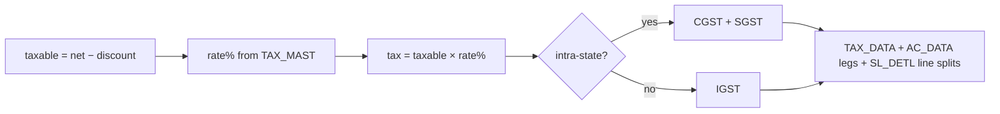

# GST Engine

Computes Indian GST on transactions, posts the tax legs, and produces the GST return datasets.
The split math lives in the calc engine (`gstSplit`); this doc covers **rate resolution**, **tax
posting**, and the **GSTR-1/3B datasets**. (E-invoice/IRN is its own module — see `03_Modules/gst-einvoice/`.)

Source: `packages/core` `gstSplit`, `modules/gst`. Desktop: inline + `Ac_Tax.cs`, `TAX_MAST`, `TAX_DATA`.
Requirements: Req 10.4/10.5, 18.1–18.6.

## 1. Rate resolution

- The item's GST rate comes from `TAX_MAST` (by tax code on the item / item group). Taxable base is
  the **line/bill net after discount** (Req 18.1).
- The supply is **intra-state** when the customer's state == the company's state, else **inter-state**.
  The desktop derives this from the customer's GST registration / state code on `AC_MAST`.

## 2. Split (intra vs inter) — Req 18.2/18.3

```ts
gstSplit(tax, interState)
//  intra → { cgst: tax/2, sgst: tax − cgst, igst: 0 }
//  inter → { cgst: 0, sgst: 0, igst: tax }
```
`SGST = tax − CGST` keeps `CGST+SGST === tax` exactly (penny-safe). See `calc-engine.md §5`.

## 3. Tax posting → `TAX_DATA` + `AC_DATA`

On save, the tax is recorded two ways (both must agree):
- **`TAX_DATA`** — the tax register row(s): `TAX_CODE`, `TAX_PRC`, taxable, `CGST_AMT`/`SGST_AMT`/`IGST_AMT`.
- **`AC_DATA`** — ledger legs crediting the output-tax accounts (sales) or debiting input-tax (purchase).
- Line-level splits are stamped on `SL_DETL.ITM_CGST_AMT/ITM_SGST_AMT/ITM_IGST_AMT`; header carries `SL_DATA.TAX_AMT`.



## 4. GST return datasets — Req 18.6

Built as read-models over posted sales (`SL_DATA ⋈ AC_MAST ⋈ SL_DETL`) for a period:

| Dataset | Classification rule | Key fields |
|---|---|---|
| **B2B** | customer has a GSTIN | GSTIN, invoice no/date, taxable, CGST/SGST/IGST, rate |
| **B2CL** | B2C, inter-state, invoice value > threshold | state code, invoice, taxable, IGST |
| **B2CS** | B2C small (intra or below threshold) | state, rate, taxable, tax (summary) |
| **HSN** | per-item HSN summary | HSN, qty/uqc, taxable, CGST/SGST/IGST |

`classifyInvoice()` assigns each invoice to a bucket; `buildGstr1()` aggregates. **GSTR-3B** is the
summary roll-up (outward taxable + tax by type). HANDOFF cites GSTR-1 datasets live 11/11.

## 5. Cash-limit → PAN rule (related, Req 17.2)

Not GST per se, but enforced on cash receipts: if a cash transaction exceeds the configured cash
limit, the customer's PAN is required before save (shared finance rule; documented in the Finance module).

## 6. Parity criteria (DoD)

- For each invoice, CGST/SGST/IGST match the desktop `SL_DETL`/`TAX_DATA` to the paisa.
- GSTR-1 B2B/B2CL/B2CS/HSN record sets equal the desktop `Gstr_1.rpt` dataset for the same period.
- Σ tax in `TAX_DATA` == Σ output-tax legs in `AC_DATA` for the period.
