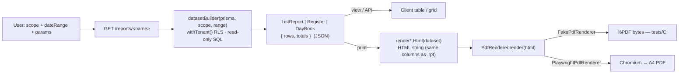

# 05 — Reports: catalog + per-report field specs

```
Section: 05_Reports  ·  Module: 12_Reports  ·  Type: read-only reporting surface
Desktop source: 255 Crystal .rpt in unified/reports/ + 45 RP_*.cs report forms (project-memory/catalogs/forms/RP_*.md)
Web target: apps/api/src/modules/reports/* (dataset builders) + render.ts (HTML→PDF) · routes apps/api/src/routes/txn.ts (GET /reports/*)
Engine: 04_Cross_Cutting_Engines/reporting-and-integrations.md
Requirements: Req 19 (reports), 20 (integrations/print)
Status: 📋 SPEC  ·  Build: 🟦 PARTIAL (≈46 dataset builders live; per-voucher bill/print layouts pending)
```

This is **the report catalog**: the report-engine architecture, an exhaustive domain-grouped table of
all **255 `.rpt`** (report → `.rpt` file → domain → web status → web builder/route), and the parity
rule. Per-report field specs for the 12 key reports live as sibling files in this folder.

> Evidence is cited as `// src <file>#Lxxxx`, `data <table>`, or `field all_rpt_fields.txt#Lxxx`.
> Anything not recoverable from the decompiled source / live schema is **flagged**, not invented.

---

## 1. Report-engine architecture (web)

The desktop prints through **Crystal Reports** (`.rpt`) bound to a dataset the form first materialises
into a scratch table (e.g. `RP_DHRN_OS.cs` `INSERT INTO REPORT_DATA` // `RP_LEDR.cs` `LEDR_AC_DATA`/
`FINE_DATA`, `RP_ROJMEL.cs` `ROJMEL_BAL`/`LEDR_AC_DATA`). The web replaces **both** halves:

- **No Crystal, no .NET, no Windows.** A report is a **dataset builder + HTML template + PDF renderer**
  (`04_Cross_Cutting_Engines/reporting-and-integrations.md §A.1`).
- **No scratch table.** The desktop's "delete REPORT_DATA → re-insert → Crystal reads it" pattern is
  replaced by an **on-the-fly read-only SQL builder** that returns the same rows/fields directly.



### 1.1 Dataset builder contract
Every builder is a pure read model in `apps/api/src/modules/reports/reports*.ts`. House rules verified
across all builders (`// src reports.ts`, `reports2-10.ts`, `voucherRegister.ts`):

```ts
export interface ReportScope { tenantId: string; coCode: string; lcCode?: string; coYear?: string }
export interface DateRange  { fromDate?: Date | string; toDate?: Date | string }
export interface ListReport { rows: Record<string, any>[]; totals?: Record<string, number> }
export interface Register   { rows: RegisterRow[]; totals: { netAmt; taxAmt; cgst; sgst; igst; totAmt; osAmt } }

// withTenant() sets the RLS tenant GUC for every query (multi-tenant isolation).
// NN(c) coalesces the desktop's TEXT-typed money columns to numeric:
const NN = (c: string) => `coalesce(NULLIF(${c}::text,'')::numeric,0)`;   // // src reports.ts
const round2 = (x:number)=>Math.round((x+Number.EPSILON)*100)/100;        // money: 2 dp
const round3 = (x:number)=>Math.round((x+Number.EPSILON)*1000)/1000;      // weight/fine: 3 dp
```

- **Scope:** always `WHERE "CO_CODE"=$1`, plus optional `CO_YEAR`, `LC_CODE`, and a `VCH_DATE` range
  (`whereScopeDate()` // src `reports.ts`). Reports are company+year scoped; `LC_CODE` filters **only**
  when a location is explicitly selected — it is never defaulted to the company code (`readScope()`
  // src `txn.ts#L67-72`), so multi-location data is not hidden.
- **Totals** are footed in JS (`shapeRegister`, per-builder `reduce`) — money to 2 dp, weight/fine to 3 dp.
- **Read-only:** no builder mutates. Edits/deletes happen in the transaction modules, not here.

### 1.2 Renderer contract (`render.ts`)
```ts
export interface PdfRenderer { render(html: string): Promise<Buffer>; }
export class FakePdfRenderer       implements PdfRenderer  // emits real %PDF bytes, no browser (tests/CI)
export class PlaywrightPdfRenderer implements PdfRenderer  // headless Chromium → A4 PDF (guarded dynamic import)
export function renderRegisterHtml(title, register, { showGst })   // register grid → HTML (escaped)
export function renderInvoiceHtml(invoiceView)                     // tax invoice (+ IRN/QR) → HTML
```
The PDF route falls back Playwright → Fake so the API never 500s when Chromium is absent
(`// src txn.ts#L172, L418-419`):
```ts
try { pdf = await renderToPdf(html, new PlaywrightPdfRenderer()); }
catch { pdf = await renderToPdf(html, new FakePdfRenderer()); }
```

### 1.3 USER_PRINT gate
The **dataset GETs** (`GET /reports/*`, `// src txn.ts#L431-477`) are `auth`-guarded only — viewing
data on screen is not gated. **Printing/exporting to PDF** is gated by the `print` right
(`guard(req, reply, 'print')` → `assertRight(rights,'print')`, desktop `USER_PRINT`):

| Endpoint | Right | Evidence |
|---|---|---|
| `GET /reports/*` (dataset JSON) | `auth` | `// src txn.ts#L431-477` |
| `POST /render/pdf` (any dataset HTML → PDF) | `print` | `// src txn.ts#L398, L414-421` |
| `GET /txn/sales/invoice` (tax-invoice PDF) | `print` | `// src txn.ts#L609, L619` |

> **Parity gap (flagged):** the desktop gates the **report screen open** on `USER_PRINT`; the web gates
> the **PDF/print step**. To match desktop exactly, also assert `print` on the dataset GETs (or document
> the relaxation in `06_Parity/reports.md`).

### 1.4 Empty-scope handling — Req 19.5
A scope with no rows returns an **empty dataset** (`rows: []`, zeroed `totals`), and the HTML template
renders the literal **"No records for the selected period."** (`// src render.ts renderRegisterHtml`,
empty-`rows` branch). No error, no blank page.

### 1.5 CSV export — ⚠️ FLAGGED (claimed, not in code)
`HANDOFF.md` and the engine doc say "16 reports live with **CSV**+PDF", but a repo-wide search found
**no CSV emitter** (`grep -rniE 'toCsv|text/csv|csvExport' web/` → 0 hits). Today the builders return
**JSON** (consumed by the client grid) and **PDF** (via `/render/pdf`). **CSV is unbuilt** — add a
`toCsv(ListReport)` shaping the same `rows/totals` and a `format=csv` switch on the report routes, then
tick this box. Treat CSV as 📋 SPEC, not 🟩 BUILT.

---

## 2. The catalog — all 255 `.rpt` by domain

Counts (verified by `ls unified/reports | wc -l` = **255**, classified programmatically):

| Domain | `.rpt` count | Web coverage |
|---|---:|---|
| Accounting / Ledger | 45 | 🟩 analytics built (TB, ledger, balances, P&L/BS, group, cash-book, contra); ⬜ cheque/Form8-12/JmUd/interest prints |
| Stock / Tag | 39 | 🟩 valuation, item-ledger, group-stock, by-location; ⬜ tag/bar/QR/HUID label prints, grid/detail variants |
| Manufacturing / Karigar | 34 | 🟩 karigar balance/statement; ⬜ MfgLedger, Mfg/Kr/Labour/Jadtar/repairing vouchers |
| Sales | 32 | 🟩 register, by-party/item/group, returns, daily, employee, old-gold; 🟨 A4 invoice (invoice.ts); ⬜ bill-layout variants |
| Purchase | 16 | 🟩 register, by-party/item, monthly, returns, input-GST; ⬜ bill-layout prints |
| Dhrn (pledge) | 15 | 🟩 outstanding list; ⬜ khata-vahi, issue/receipt vouchers, interest, register/stock |
| Membership / Scheme | 14 | 🟨 scheme-adjustments; ⬜ Memb*/Schm* registers + passbook/QR |
| Order | 13 | ⬜ (order list via `GET /sales-orders`; no dedicated report datasets) |
| Tour / Bullion / VP | 11 | ⬜ |
| Wholesale | 11 | 🟨 folded into sales/purchase registers; ⬜ Wh* bill/summary/HUID prints |
| Other / Master / HR | 11 | 🟩 rate-list; reminders via `/reminders/*`; ⬜ salary slip, user-detail, approval, temp/phone |
| GST | 7 | 🟩 GSTR-1/2/3B, input-register, GST-monthly; ⬜ Gstr_3 form, UAE tax summary, e-invoice print |
| Rojmel / Day-book | 7 | 🟩 day-book + cash-day-summary; 🟨 RojMelCash; ⬜ Cr/Dr, estimate, group, item, jma-udhar pivots |

**Web-status legend:** 🟩 BUILT (live dataset builder + route) · 🟨 PARTIAL (covered by a sibling
builder / variant, not field-complete) · ⬜ TODO (no web equivalent yet — chiefly per-voucher bill &
label *layouts*, which are presentation, not new datasets).

> The **data** is the contract (§3). Most ⬜ rows are *print layouts* over data the BUILT datasets
> already expose (a sale's data exists via `salesRegister`/`invoice.ts` even though `SalesBillVr.rpt`'s
> exact layout is unbuilt). Bill/voucher **layouts** are an HTML-template task, not a dataset task.

### 2.1 Sales (32)
| Report (.rpt) | Purpose | Web status | Web builder / route |
|---|---|---|---|
| `SaleReport.rpt` | Sales register (period) | 🟩 | `salesRegister` · `GET /reports/sales-register` |
| `SalesSumm.rpt` | Sales summary | 🟩 | `salesRegister` / `dailySalesSummary` |
| `SalesItem.rpt` | Item-wise sales | 🟩 | `salesByItem` / `topItems` |
| `SalesGroupWise.rpt` | Group-wise sales | 🟩 | `salesByGroup` · `GET /reports/sales-by-group` |
| `EmpSaleReport.rpt` | Salesperson-wise sales | 🟩 | `employeeSales` · `GET /reports/employee-sales` |
| `SaleRtnReport.rpt` | Sales-return register | 🟩 | `salesReturnRegister` |
| `SalesRtnSumm.rpt` | Sales-return summary | 🟩 | `salesReturnRegister` |
| `SalesRtnItem.rpt` | Item-wise sales return | 🟨 | `salesReturnRegister` (aggregate) |
| `OutTax_SaleRpt.rpt` | Output-tax (sales GST) | 🟩 | `salesGstMonthly` / `gstr3b` |
| `SlTaxRpt.rpt` | Sales tax register | 🟨 | `salesGstMonthly` |
| `OldItmSaleVch.rpt` | Old-gold/exchange against sale | 🟨 | `oldGoldRegister` |
| `SalesBillA4.rpt` / `SalesBillA4Gst.rpt` / `SalesBillA4_WithImage.rpt` | A4 tax-invoice print | 🟨 | `invoice.ts` `renderInvoiceHtml` (main A4) |
| `SalesBillHz.rpt` / `SalesBillHzGst.rpt` | Horizontal bill print | ⬜ | layout pending |
| `SalesBillOrgDup.rpt` | Original/Duplicate copies | ⬜ | layout pending |
| `SalesBillOs.rpt` | Bill with outstanding | ⬜ | layout pending |
| `SalesBillVr.rpt` | Voucher-style bill | ⬜ | layout pending |
| `SlBillWapp.rpt` | WhatsApp bill image | ⬜ | layout + integration |
| `B2BSaleBillA4Tax.rpt` / `B2BSaleImgVch.rpt` | B2B invoice / image voucher | ⬜ | layout pending |
| `FineSalesGstBill.rpt` | Fine-metal GST bill | ⬜ | layout pending |
| `CounterSale.rpt` / `CounterTrfr.rpt` | Counter sale / transfer | ⬜ | layout pending |
| `RateCutBill.rpt` / `RateCutItmBill.rpt` | Rate-cut (unfixed) bill | ⬜ | layout pending |
| `SaleOrnaIsu.rpt` | Ornament issue note | ⬜ | layout pending |
| `SalesRtnA4.rpt` / `SalesRtnA4Gst.rpt` / `SalesRtnBillUae.rpt` | Return bill prints | ⬜ | layout pending |
| `SalesToPurcFixingVch.rpt` | Sale→purchase fixing voucher | ⬜ | layout pending |

### 2.2 Purchase (16)
| Report (.rpt) | Purpose | Web status | Web builder / route |
|---|---|---|---|
| `PurcReport.rpt` | Purchase register (period) | 🟩 | `purchaseRegister` · `GET /reports/purchase-register` |
| `PurcSumm.rpt` | Purchase summary | 🟩 | `purchaseRegister` / `monthlyPurchase` |
| `PurcItem.rpt` | Item-wise purchase | 🟩 | `purchaseByItem` · `GET /reports/purchase-by-item` |
| `PurcGroupWise.rpt` | Group/party-wise purchase | 🟩 | `purchaseByParty` |
| `AcPurcRpt.rpt` / `AcPurcSummRpt.rpt` | Account purchase report/summary | 🟩 | `purchaseByParty` |
| `InTax_PurcRpt.rpt` | Input-tax (purchase GST) | 🟩 | `gstInputRegister` · `GET /reports/gst-input-register` |
| `PrTaxRpt.rpt` | Purchase tax register | 🟨 | `gstInputRegister` |
| `PrRtnBill.rpt` / `PrRtnBillGst.rpt` | Purchase-return register/print | 🟩/⬜ | `purchaseReturnRegister` (data); print layout pending |
| `PurcBillA4.rpt` / `PurcBillA4Gst.rpt` / `PurcBillHalfGst.rpt` | Purchase bill prints | ⬜ | layout pending |
| `B2BPurcBillA4Tax.rpt` / `B2BPurcImgVch.rpt` | B2B purchase / image voucher | ⬜ | layout pending |
| `PurcToSalesFixingVch.rpt` | Purchase→sale fixing voucher | ⬜ | layout pending |

### 2.3 Accounting / Ledger (45)
| Report (.rpt) | Purpose | Web status | Web builder / route |
|---|---|---|---|
| `AcLedger.rpt` / `AcLedgerSelected.rpt` | Account ledger / statement | 🟩 | `accountLedger` · `GET /reports/account-ledger/:acCode` |
| `TRialBalHz.rpt` | Trial balance (horizontal) | 🟩 | `trialBalance` / `trialBalanceFull` |
| `BalanceHz.rpt` | Balance sheet (horizontal) | 🟩 | `balanceSheet` · `GET /reports/balance-sheet` |
| `ProfitLossHz.rpt` | Profit & loss (horizontal) | 🟨 | derived from `balanceSheet`/`groupSummary` (P&L split pending) |
| `AcGroupRpt.rpt` | Group-wise trial balance | 🟩 | `groupSummary` · `GET /reports/group-summary` |
| `AcSumm.rpt` / `AcSummLdr.rpt` | Account balances summary | 🟩 | `accountBalances` |
| `AcOsWithAdd.rpt` | Outstanding with address | 🟩 | `outstandingReport` / `billOutstanding` |
| `AcOsArea.rpt` | Area-wise outstanding | 🟩 | `areaOutstanding` · `GET /reports/area-outstanding` |
| `AcCrList.rpt` / `AcDrList.rpt` | Creditors / debtors list | 🟩 | `outstandingReport` (Receivable/Payable split) |
| `AcLastVisit.rpt` | Customer last-visit (CRM) | 🟩 | `customerCrm` · `GET /reports/customer-crm` |
| `CashBankBill.rpt` / `CashBankBillAc.rpt` | Cash/bank book | 🟩 | `cashBook` / `cashDaySummary` |
| `ContraBill.rpt` | Contra (transfer) register | 🟩 | `contraRegister` · `GET /reports/contra-register` |
| `AcWithWt.rpt` / `AcWithWtGold.rpt` / `AcWithWtSumm.rpt` | Ledger with metal weight | 🟨 | `accountLedger` (+ fine cols pending) |
| `AcFineGold.rpt` / `AcFineSilver.rpt` | Fine-metal ledger (Au/Ag) | 🟨 | `karigarStatement`/metal-ledger (per-metal split pending) |
| `PartyInterest.rpt` / `PartyIntSumm.rpt` | Interest on party balances | ⬜ | interest calc pending |
| `GoldInterest.rpt` | Gold-loan interest | ⬜ | interest calc pending |
| `LedrInOut.rpt` | Ledger in/out movement | 🟨 | `partyStatement` |
| `LedrAdjVch.rpt` | Ledger-adjustment voucher | ⬜ | layout pending |
| `BillRecVch.rpt` / `PaymentVch.rpt` | Receipt / payment voucher | ⬜ | layout pending |
| `JmUdAmt.rpt` / `JmUdFine.rpt` / `JmUdFineHz.rpt` / `JmUdFineHzSumm.rpt` / `JmUdFineHzSummVch.rpt` / `JmUdFineSl.rpt` / `JmUdFineSlHz.rpt` / `JmUdFineSlSum.rpt` | Jama-Udhar (Dr/Cr) fine-metal balances | ⬜ | fine-ledger datasets pending (8 reports) |
| `ChqPrint010.rpt` / `ChqPrint011.rpt` / `ChqPrint012.rpt` / `ChqPrint013.rpt` / `ChqPrint014.rpt` / `ChqPrint135.rpt` (6) | Cheque printing (bank layouts) | ⬜ | layout pending |
| `Form8.rpt` / `Form12.rpt` | Statutory forms | ⬜ | layout pending |
| `Company.rpt` | Company master print | ⬜ | layout pending |

### 2.4 Stock / Tag (39)
| Report (.rpt) | Purpose | Web status | Web builder / route |
|---|---|---|---|
| `ItmStkBalance.rpt` | Item stock balance (on-hand) | 🟩 | `stockValuation` / `onHand` |
| `ItemStkRpt.rpt` | Item stock report | 🟩 | `stockValuation` |
| `ItmStkWithGrid.rpt` / `ItmStkWithOthWt.rpt` | Stock w/ grid / other-weight | 🟨 | `stockValuation` (extra cols pending) |
| `GroupStkRpt.rpt` | Item-group stock | 🟩 | `itemGroupStock` · `GET /reports/item-group-stock` |
| `ProdStkRpt.rpt` | Product-wise stock | 🟨 | `itemGroupStock` |
| `ItemLedger.rpt` | Item stock ledger (in/out) | 🟩 | `itemStockLedger` |
| `ItemInOut.rpt` / `ItemInOutSumm.rpt` | Item in/out movement | 🟩 | `itemStockLedger` |
| `ItemInword.rpt` / `ItemOutword.rpt` | Inward / outward register | 🟨 | `itemStockLedger` |
| `TagStkRpt.rpt` | Tag-wise stock | 🟩 | `stockValuation` / `listTags` |
| `TagStkSummRpt.rpt` / `TagStkItemSumRpt.rpt` / `TagStkRptDmSum.rpt` / `TagStkIdtlRpt.rpt` | Tag-stock summary/detail variants | 🟨 | `stockValuation` / `itemGroupStock` |
| `TagItmSumm.rpt` | Tag item summary | 🟨 | `itemGroupStock` |
| `CntrTagStkRpt.rpt` / `CntrTagSumRpt.rpt` | Counter tag stock/summary | 🟨 | `stockByLocation` |
| `SafeStkSumm.rpt` | Safe (vault) stock summary | 🟨 | `stockByLocation` |
| `StkInOutVch.rpt` | Stock in/out voucher | ⬜ | layout pending |
| `TableStkGwtRpt.rpt` | Table (counter) gross-wt stock | 🟨 | `stockByLocation` |
| `TagCanBill.rpt` / `TagReNumberVch.rpt` / `TagSplitVch.rpt` / `TagWtChangeVch.rpt` / `TagWtChangSplit.rpt` | Tag cancel / renumber / split / wt-change vouchers | ⬜ | layout pending (data in stock module) |
| `TagHuIdRpt.rpt` / `RtlHuidPrint.rpt` / `WhHuidPrint.rpt` | HUID (hallmark) reports/labels | ⬜ | layout pending |
| `BarPrint10.rpt` / `BarPrint13.rpt` / `QrPrint10.rpt` | Barcode / QR tag labels | 🟨 | `/integrations/barcode`,`/integrations/qr` (Code39/QR SVG) |
| `ItmLotPrint.rpt` | Lot label print | ⬜ | layout pending |
| `DiamondSf.rpt` | Diamond stock file | ⬜ | layout pending |
| `OthItmLoose.rpt` / `OthItmStud.rpt` | Loose / studded other-item stock | ⬜ | layout pending |
| `ItemPurcVch.rpt` / `ItemSalesVch.rpt` / `ItemSalesVchWithQr.rpt` | Item purchase/sale vouchers | ⬜ | layout pending |

### 2.5 Manufacturing / Karigar / Job-work (34)
| Report (.rpt) | Purpose | Web status | Web builder / route |
|---|---|---|---|
| `MfgLedger.rpt` | Manufacturing / karigar ledger | 🟩 | `karigarBalances` / `karigarStatement` |
| `LbrWorkRpt.rpt` | Labour-work report | 🟨 | `karigarStatement` (labour cols pending) |
| `MfgVch.rpt` / `MfgGhatIsu.rpt` / `MfgGhatRec.rpt` / `MfgMinoIsuRec.rpt` | Mfg issue/receive/ghat/mino vouchers | ⬜ | layout pending (mfg module has data) |
| `KrIsuBill.rpt` / `KrIsuBillGst.rpt` / `KrRecVch.rpt` / `KrRecVchGst.rpt` | Karigar issue/receive bills | ⬜ | layout pending |
| `KrDesignIsuImg.rpt` / `KrDesignIsuVch.rpt` / `KrDmIsuRec.rpt` / `KrDmWtInOut.rpt` / `KrRepRec.rpt` | Karigar design/diamond/repair vouchers | ⬜ | layout pending |
| `LabourBill.rpt` / `LabourBillGst.rpt` / `LabourWorkVch.rpt` | Labour bills / work voucher | ⬜ | layout pending |
| `JadtarInOut.rpt` / `JadtarIssue.rpt` / `JadtarRec.rpt` / `JdtProcessRec.rpt` | Jadtar (setting) in/out/process | ⬜ | layout pending |
| `MtlIsu.rpt` | Material issue | ⬜ | layout pending |
| `GhatDesignIsu.rpt` / `GhatTagPrnt.rpt` | Ghat design issue / tag print | ⬜ | layout pending |
| `StngIsuRec.rpt` | Stone setting issue/receive | ⬜ | layout pending |
| `ReparingCustIsu.rpt` / `ReparingKrRec.rpt` / `ReparingRec.rpt` / `CustRepIsu.rpt` / `CustRepRec.rpt` / `CustRepRecBill.rpt` | Repairing (customer/karigar) | ⬜ | layout pending |
| `EmpIsuRecVch.rpt` | Employee issue/receive voucher | ⬜ | layout pending |
| `HedgingFixVch.rpt` | Hedging fixing voucher | ⬜ | layout pending |

### 2.6 Dhrn / Pledge-loan (15)
| Report (.rpt) | Purpose | Web status | Web builder / route |
|---|---|---|---|
| `DhrnOsLetter.rpt` | Pledge outstanding (letter) | 🟩 | `dhrnOutstandingList` · `GET /reports/dhrn-outstanding` |
| `DharnDue.rpt` | Dues / overdue pledges | 🟨 | `dhrnOutstandingList` (+ aging pending) |
| `DhrnReceivedSumm.rpt` | Receipts summary | 🟨 | `dhrnOutstandingList` |
| `DhiranReg.rpt` | Pledge register | ⬜ | register dataset pending |
| `DhiranStock.rpt` | Pledged-item stock | ⬜ | dataset pending |
| `DhiranitemRpt.rpt` | Pledged-item report | ⬜ | dataset pending |
| `DhiranIssuRec.rpt` / `DhrnIssue.rpt` / `DhrnIssueImg.rpt` | Issue / receipt vouchers | ⬜ | layout pending |
| `DhrnIntRec.rpt` | Interest receipt | ⬜ | interest calc pending |
| `DhrnKhataVahi.rpt` / `DhrnKhataVahiSumm.rpt` | Khata-vahi (passbook) | ⬜ | dataset pending |
| `AngdiyaIsuRpt.rpt` | Angadia (courier) issue | ⬜ | dataset pending |
| `LoanStock.rpt` / `LoanWisePacket.rpt` | Loan stock / packet-wise | ⬜ | dataset pending |

### 2.7 GST (7)
| Report (.rpt) | Purpose | Web status | Web builder / route |
|---|---|---|---|
| `Gstr_1.rpt` | GSTR-1 (outward: B2B/B2CL/B2CS/HSN) | 🟩 | `gstr1` · `GET /reports/gstr1`-equiv (gst module) |
| `Gstr_2.rpt` | GSTR-2 (inward ITC summary) | 🟩 | `gstr2Purchase` · `GET /reports/gstr2` |
| `Gstr_3.rpt` | GSTR-3 / 3B (net liability) | 🟨 | `gstr3b` (3B summary; full GSTR-3 form pending) |
| `TaxInOutRpt.rpt` | Tax in/out (input vs output) | 🟩 | `gstInputRegister` + `salesGstMonthly` |
| `TaxSummUae.rpt` | UAE VAT summary | ⬜ | UAE variant pending |
| `EInvoice.rpt` | E-invoice (IRN/QR) print | 🟨 | `einvoice` module (IRN payload built; print layout pending) |
| `EInvOthIncom.rpt` | E-invoice other income | ⬜ | layout pending |

### 2.8 Rojmel / Day-book (7)
| Report (.rpt) | Purpose | Web status | Web builder / route |
|---|---|---|---|
| `RojMel.rpt` | Day-book (all ledger movement) | 🟩 | `dayBook` · `GET /reports/day-book` |
| `RojMelCash.rpt` | Cash day-book / cash-book | 🟩 | `cashBook` / `cashDaySummary` |
| `RojMelCrDr.rpt` | Day-book Dr/Cr split | 🟨 | `dayBook` (Dr/Cr footed) |
| `RojMelGr.rpt` | Day-book group-wise | 🟨 | `groupSummary` |
| `RojMelItem.rpt` | Day-book item-wise | 🟨 | `salesByItem`/`itemStockLedger` |
| `RojMelEstmat.rpt` | Estimate day-book | ⬜ | dataset pending |
| `RojMelJmaUdhar.rpt` | Jama-Udhar day-book | ⬜ | dataset pending |

### 2.9 Membership / Scheme (14)
| Report (.rpt) | Purpose | Web status | Web builder / route |
|---|---|---|---|
| `SchmAdj.rpt` | Scheme adjustments register | 🟨 | `schemeAdjustments` · `GET /reports/scheme-adjustments` |
| `MembRpt.rpt` / `MembRptAdd.rpt` / `MembSumm.rpt` | Member report / w/ address / summary | ⬜ | dataset pending |
| `MembBonus.rpt` / `MembGoldRpt.rpt` | Bonus / gold-scheme | ⬜ | dataset pending |
| `MembCommRpt.rpt` | Commission report | ⬜ | dataset pending |
| `MembDailyRecRpt.rpt` / `SchmRecVch.rpt` | Daily receipt / scheme receipt | ⬜ | layout pending |
| `MembOpenNew.rpt` / `MembVch.rpt` / `MembQr.rpt` | New-member / voucher / QR | ⬜ | layout pending |
| `SchmMonthRpt.rpt` / `SchmPassBook.rpt` | Monthly / passbook | ⬜ | dataset pending |

### 2.10 Order (13)
| Report (.rpt) | Purpose | Web status | Web builder / route |
|---|---|---|---|
| `OrderVch.rpt` / `OrdVchImg.rpt` / `OrderBill.rpt` | Order voucher / image / bill | ⬜ | data via `GET /sales-orders`; layout pending |
| `OrderCancelVch.rpt` | Order cancellation | ⬜ | layout pending |
| `OrdDetlRpt.rpt` / `OrdDetlPanding.rpt` / `OrdDesignSumm.rpt` | Order detail / pending / design summary | ⬜ | dataset pending |
| `OrdAdvRpt.rpt` / `OrdAdvAdj.rpt` / `OrdAdjBillWise.rpt` / `BillWiseOrderAdjust.rpt` | Order advance / adjustment | ⬜ | dataset pending |
| `SalesWithOrder.rpt` | Sales fulfilled from order | 🟨 | `salesRegister` |
| `SalesQuotation.rpt` | Quotation | ⬜ | layout pending |

### 2.11 Tour / Bullion / VP (11)
| Report (.rpt) | Purpose | Web status | Web builder / route |
|---|---|---|---|
| `BullBookBill.rpt` / `BulCustBooking.rpt` / `BulCustAdjust.rpt` | Bullion booking / customer adjust | ⬜ | dataset pending |
| `TourOrdVch.rpt` / `TourOrdImg.rpt` | Tour order voucher / image | ⬜ | dataset pending |
| `VpIsuRpt.rpt` / `VpAdjustBill.rpt` | VP (value-protection) issue / adjust | ⬜ | dataset pending |
| `ConsiBill.rpt` | Consignment bill | ⬜ | dataset pending |
| `FineJvBill.rpt` | Fine journal voucher | ⬜ | layout pending |
| `OthCommVch.rpt` / `OthExpUae.rpt` | Other commission / UAE expense | ⬜ | dataset pending |

### 2.12 Wholesale (11)
| Report (.rpt) | Purpose | Web status | Web builder / route |
|---|---|---|---|
| `WhSalesBill.rpt` / `WhSalesBillSumm.rpt` / `WhSalesSumm.rpt` | Wholesale sales bill / summary | 🟨 | `salesRegister` (book-scoped) |
| `WhSalesEmp.rpt` | Wholesale by employee | 🟨 | `employeeSales` |
| `WhSalesImage.rpt` / `WhSalesIsuRec.rpt` / `WhSalesRtnBill.rpt` | WH image / issue-receive / return | ⬜ | layout pending |
| `WhHuidPrint.rpt` | Wholesale HUID labels | ⬜ | layout pending |
| `AcSaleWhRpt.rpt` / `AcPurcWhRpt.rpt` | WH account sale/purchase | 🟨 | `salesByParty`/`purchaseByParty` |
| `LedrInOutWh.rpt` | WH ledger in/out | 🟨 | `partyStatement` |

### 2.13 Other / Master / HR (11)
| Report (.rpt) | Purpose | Web status | Web builder / route |
|---|---|---|---|
| `RateRpt.rpt` | Metal rate list | 🟩 | `rateList` · `GET /reports/rate-list` |
| `ReminderAll.rpt` | Reminders (birthday/anniversary/overdue) | 🟨 | `/reminders/overdue`, `/reminders/birthdays` |
| `SalarySlip.rpt` | Employee salary slip | ⬜ | dataset pending |
| `UserDtlRpt.rpt` | User detail / rights | ⬜ | data via `/admin/users`; layout pending |
| `AprBill.rpt` / `AprInOut.rpt` / `AprPan.rpt` / `AprPartyWise.rpt` | Approval (consignment) reports | ⬜ | dataset pending |
| `TempAdd2.rpt` / `TempAdd3.rpt` / `TempPhone.rpt` | Address/phone label templates | ⬜ | layout pending |

---

## 3. The parity rule (Definition of Done)

Parity is on **data, not pixels** (Req 19.1/19.3, engine doc §A.3):

1. **Field parity.** For a given scope, the web dataset returns the **same columns** as the `.rpt`'s
   field set. The `.rpt` field tokens are harvested in `extraction_output/all_rpt_fields.txt` — a
   **single sorted dictionary of 724 unique tokens across all 255 `.rpt`** (e.g. `SL_DATA`#L580,
   `NET_AMT`#L428, `TOT_AMT`#L665, `CGST_TAX`#L103). Each per-report spec lists its subset.
2. **Record parity.** Same rows for the same scope: identical filters (`CO_CODE`/`CO_YEAR`/`LC_CODE`/
   date), identical inclusion rules (e.g. sales register **excludes** the returns book `CO_BOOK='SRT'`
   // src `reports.ts salesRegister`).
3. **Total parity.** Footer totals match to **money 2 dp / weight·fine 3 dp**.
4. **Empty scope** → "no records", never an error (Req 19.5).
5. **Print** is gated by `USER_PRINT`; PDF carries the same fields as the `.rpt`.

> **Closing-stock caveat (accounting reports).** A jeweller holds closing stock **outside** the ledger,
> so `AC_DATA` alone does not tie Σdr=Σcr; the residual is the off-ledger stock/trading figure
> (`// src reports.ts balanceSheet`, `reports8.ts trialBalanceFull`). Parity for `TRialBalHz`/`BalanceHz`
> is therefore "matches desktop **presentation**", not "Σdr=Σcr". Documented per report.

Parity fixtures/scripts: per-report `06_Parity/reports.md` (to be added); live sanity checks are
embedded as docstrings in each builder (e.g. `voucherRegister` CO_CODE='01': 1567 vouchers / 5150 legs).

---

## 4. Per-report field specs (this folder)

The 12 key reports each have a sibling deep-dive file:

| Spec file | `.rpt` | Domain | Web builder |
|---|---|---|---|
| [SaleReport.md](./SaleReport.md) | `SaleReport.rpt` | Sales | `salesRegister` |
| [PurcReport.md](./PurcReport.md) | `PurcReport.rpt` | Purchase | `purchaseRegister` |
| [AcLedger.md](./AcLedger.md) | `AcLedger.rpt` | Accounting | `accountLedger` |
| [TRialBalHz.md](./TRialBalHz.md) | `TRialBalHz.rpt` | Accounting | `trialBalance`/`trialBalanceFull` |
| [Gstr_1.md](./Gstr_1.md) | `Gstr_1.rpt` | GST | `gstr1` |
| [Gstr_2.md](./Gstr_2.md) | `Gstr_2.rpt` | GST | `gstr2Purchase` |
| [RojMelCash.md](./RojMelCash.md) | `RojMelCash.rpt` | Rojmel/Day-book | `cashBook`/`cashDaySummary` |
| [TagStkRpt.md](./TagStkRpt.md) | `TagStkRpt.rpt` | Stock/Tag | `stockValuation` |
| [ItmStkBalance.md](./ItmStkBalance.md) | `ItmStkBalance.rpt` | Stock/Tag | `stockValuation`/`onHand` |
| [RP_DHRN_OS.md](./RP_DHRN_OS.md) | `DhrnOsLetter.rpt` (form `RP_DHRN_OS`) | Dhrn | `dhrnOutstandingList` |
| [MfgLedger.md](./MfgLedger.md) | `MfgLedger.rpt` | Manufacturing | `karigarBalances`/`karigarStatement` |
| [LbrWorkRpt.md](./LbrWorkRpt.md) | `LbrWorkRpt.rpt` | Manufacturing | `karigarStatement` |

## 5. Build checklist

1. Keep every report a **read-only dataset builder** returning `{ rows, totals }`; scope by
   `CO_CODE`(+`CO_YEAR`/`LC_CODE`/date); foot in JS (2 dp money / 3 dp weight).
2. **CSV export (§1.5):** add `toCsv(ListReport)` + `?format=csv|html|pdf|json` on the report routes.
3. **USER_PRINT (§1.3):** gate PDF/CSV on `print`; decide whether dataset GETs should also gate
   (parity vs desktop screen-open) and record it in `06_Parity/reports.md`.
4. Build the remaining **datasets** first (JmUd fine-ledger, Dhrn register/khata-vahi, Memb/Schm,
   interest, order) — they unlock many ⬜ rows; **bill/label layouts** are HTML templates over data
   the BUILT datasets already expose.
5. Parity-gate each report against its `.rpt` field set in `all_rpt_fields.txt` + a live-scope fixture.
