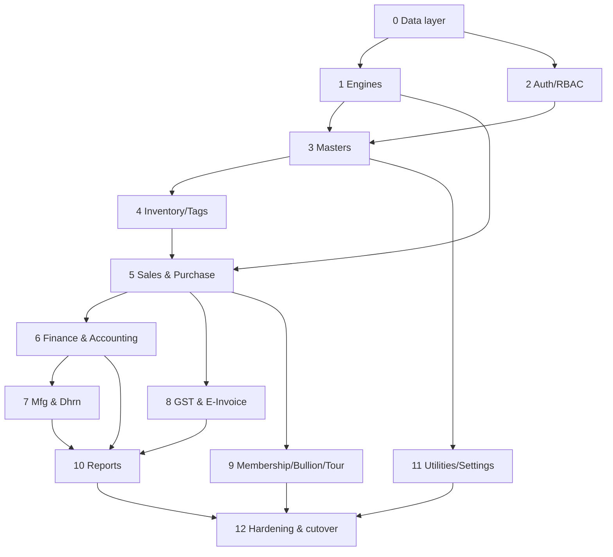

# Master Build Plan — phased implementation order

The dependency-ordered sequence an AI agent executes to build (or, given the existing `web/` build,
**verify-and-complete-to-parity**) the whole app. Each phase has an **entry** (what must exist first)
and an **acceptance gate** (the parity bar to pass before moving on). Gates reference `06_Parity/`.

> **Context:** a partial web build already exists (`web/` monorepo: ~50 screens, 16 reports, core
> backend, certified on real data per `project-memory/HANDOFF.md`). So for most phases the work is
> **close the parity gaps in `06_Parity/§6`**, not greenfield. Treat any module marked 🟩 BUILT as
> "audit against its spec + fix the listed risks", and ⬛/🟦 as "build/finish".

## How to execute one work item (the loop)

```
1. Read the module deep-dive in 03_Modules/<module>/ (+ the tables it touches in 02_Data_Model/tables/).
2. Read/justify against the decompiled C# (golden master) cited in the doc.
3. Implement/fix in web/apps/api/src/modules/<module> (+ UI in apps/web), reusing the engines.
4. Tier-1 unit tests (golden vectors) → Tier-2 live (e2e tenant) → Tier-3 e2e (trial balance ties).
5. Tier-4 golden-master diff (xdb_diff / compute_parity) where a dataset exists.
6. Tick the module's Parity DoD checklist; update project-memory/parity/latest.json.
7. Only then move on.
```

## Phase 0 — Foundation: data layer
**Entry:** none. **Build:** Prisma schema for all 162 tables (preserve names); `tenant_id` + RLS
(`packages/db/rls.sql`); `withTenant`/`atomic`; `buildScopeWhere`; ETL from SQL Server backups stamping `CO_YEAR`.
**Gate:** all 162 models migrate; RLS tenant-isolation proven; ETL loads a real year; row counts match source (Tier-4 `xdb_diff` table matrix).
**Docs:** `01_Architecture/*`, `02_Data_Model/*`.

## Phase 1 — Cross-cutting engines
**Entry:** Phase 0. **Build:** `packages/core` (money/round, fineWeight, labourCharge, metalAmount, lineNet, gstSplit, billTotals); `modules/vouchers/numbering`; `modules/posting` (postVoucherTx/reverseVoucherTx, assertBalanced, enrich, period-lock).
**Gate:** Tier-1 golden vectors green for every calc branch; numbering unique under concurrency (N parallel → {1..N}); posting rejects unbalanced; `compute_parity` matches sample invoices to the paisa.
**Docs:** `04_Cross_Cutting_Engines/*`.

## Phase 2 — Auth, Company/Year, RBAC
**Entry:** Phase 0. **Build:** login vs `LOGIN_MAST` (Argon2 + forced reset), JWT httpOnly cookies, `/context/*` company-year select, `assertRight` + `filterNav`, audit hook.
**Gate:** real users authenticate; the 3 rights block the right actions (403); nav filtered; invalid year → 409.
**Docs:** `04_Cross_Cutting_Engines/auth-and-rbac.md`, Module 0 in `01_MASTER_INDEX.md`.

## Phase 3 — Masters
**Entry:** Phases 0–2. **Build:** config-driven generic CRUD (`MASTERS` registry) for all 33 masters; **add the missing update path (R8)**; `AC_MAST`/`AC_GROUP` chart of accounts, `ITEM_MAST`, `RATE_MAST`, `TAX_MAST`, `MS_BOOK`; `MS_COMPANY`/`MS_YEAR` setup-seeding services.
**Gate:** create/update/delete/list/import with required/duplicate/referenced guards; year-seed creates the expected table set; masters match desktop rows.
**Docs:** `03_Modules/1_Masters/*`.

## Phase 4 — Inventory / Tags / Stock
**Entry:** Phases 1–3. **Build:** `TAG_STOCK` lifecycle (create/issue/restore/onHand with double-issue guard), `MAIN_STOCK` movements, lots, opening balances, tag split/cancel/wt-diff, physical stock. **Fix R1 (onHand fine/full net) + R2 (stamp bugs).**
**Gate:** on-hand qty/gwt/nwt/**fine** = signed net per CO/LC; tag states correct; split conserves weight; Tier-4 stock matrix matches.
**Docs:** `03_Modules/4_Inventory_Tags/*`.

## Phase 5 — Sales & Purchase (the revenue core)
**Entry:** Phases 1–4 (needs stock + masters + engines). **Build:** `createSale`/`deleteSale` + variants (LBR/HM/ORD/RTN/WH); `createPurchase`/`deletePurchase` + variants. **Fix R5 (rojmel), R6 (purchase stock-in/lots), satellite rows.**
**Gate:** persisted row-set + ledger + tax + stock + totals match desktop; tags issued/restored; GSTR feed correct; invoice PDF fields match `SaleReport.rpt`; trial balance ties. (This is the biggest parity surface — `compute_parity` 190/190.)
**Docs:** `03_Modules/2_Sales/*`, `03_Modules/3_Purchase/*`.

## Phase 6 — Finance & Accounting
**Entry:** Phases 1–5. **Build:** receipts/payments/contra/card/UPI (**resolve R7 cash-limit→PAN**, add `ROJ_MEL_DATA`); account ledger, trial balance, `Ac_Final` (balance sheet/P&L incl. **R14 off-ledger closing stock**), opening balances, journal vouchers, metal (fine) ledgers.
**Gate:** balanced postings; account ledger opening/period/closing correct; trial balance Dr=Cr; **fine ledgers balance independently**; final accounts reconcile.
**Docs:** `03_Modules/7_Finance_CashBank/*`, `03_Modules/8_Accounting/*`.

## Phase 7 — Manufacturing & Dhrn
**Entry:** Phases 1–6. **Build:** karigar issue/receive, wastage→fine, melting, MFG orders/lots, karigar metal balance; dhrn issue/receipt/interest (**fix R3 rounding, R4 borrower account, UNCHAK netting**).
**Gate:** karigar balance = Σissued−Σreceived fine; mfg receipt adds stock atomically; dhrn outstanding = issue−Σreceipts; interest matches desktop day-count to precision.
**Docs:** `03_Modules/5_Manufacturing/*`, `03_Modules/6_Dhrn_Loans/*`.

## Phase 8 — GST & E-Invoice
**Entry:** Phase 5 (needs posted sales). **Build:** GSTR-1 (B2B/B2CL/B2CS/HSN) + GSTR-3B datasets; IRN payload (NIC v1.1) + GSP submit (FakeIrnTransport until **R10 creds**); e-bill.
**Gate:** GSTR datasets equal `Gstr_1.rpt`; Σtax in `TAX_DATA` = Σoutput-tax legs; IRN payload validates; stored IRN/ack round-trips.
**Docs:** `03_Modules/9_GST_EInvoice/*`.

## Phase 9 — Membership, Bullion, Tour, VP
**Entry:** Phase 5. **Build:** loyalty points earn/redeem + member schemes; fine sale-purchase + rate-cut; tour sales/orders (fix book-name); bullion; **confirm R11 VP/GOLD_BOOK from decompile before building**.
**Gate:** points/schemes post + adjust correctly; fine trade prices on fine weight; tour approval drawdown correct.
**Docs:** `03_Modules/10_Membership/*`, `03_Modules/11_Bullion_Tour_VP/*`.

## Phase 10 — Reports
**Entry:** the modules feeding each report. **Build:** dataset builders + HTML templates + PDF/CSV for the catalog in `05_Reports/`, prioritized: registers, ledger, trial balance, GSTR, stock valuation, dhrn OS, karigar, rojmel.
**Gate:** each report's dataset = its `.rpt` dataset (records + fields) for the scope; print gated by `USER_PRINT`; empty scope → "no records".
**Docs:** `05_Reports/*`.

## Phase 11 — Utilities, Settings, Integrations
**Entry:** core modules. **Build:** `CO_SET` settings (incl. `LOCK_DATE`, cash-limit), backup/restore, import/export, WhatsApp/SMS (never-throws), live rates, barcode/QR, reminders, audit, voucher renumber. Note device-bound items (web-cam/HDD/OLocker) need a different web approach.
**Gate:** period-lock enforced by posting; a forced integration failure logs but doesn't roll back; backup round-trips.
**Docs:** `03_Modules/13_Utilities_Settings_Integrations/*`.

## Phase 12 — Hardening & cutover
**Entry:** all phases. **Do:** security audit (injection, RLS re-assert), perf indexes, observability, the **full golden-master parity sweep** across all modules, migration/cutover runbook.
**Gate:** all per-module Tier-4 matrices match; global trial balance ties; the `06_Parity/§6` risk register is fully resolved (or each residual item has an accepted ADR).

## Dependency graph (summary)



## Parallelization note for the agent

Within a phase, independent modules can be built by parallel sub-agents (Sales ∥ Purchase; the
masters; the reports), then integrated. Cross-phase order must respect the graph (e.g. never build
Sales before stock + engines exist). Re-assert the global trial balance after each merge.
